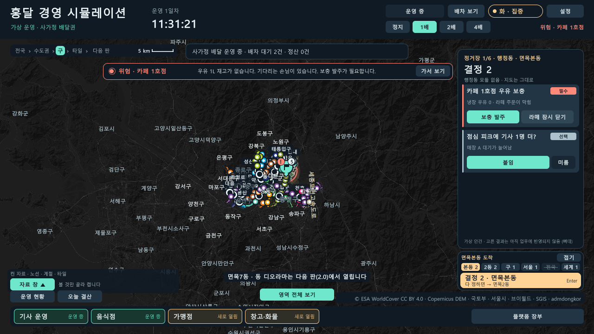
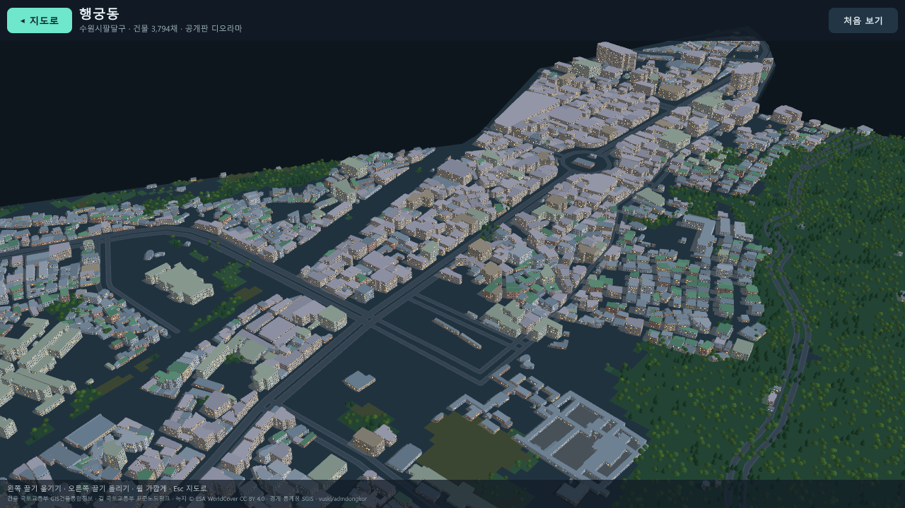
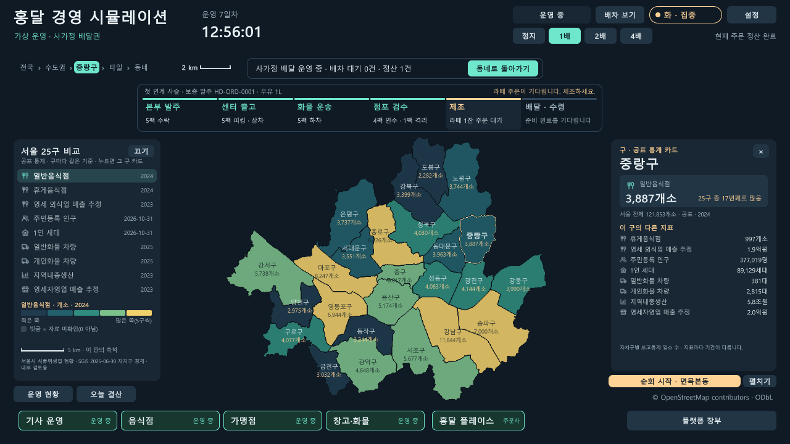
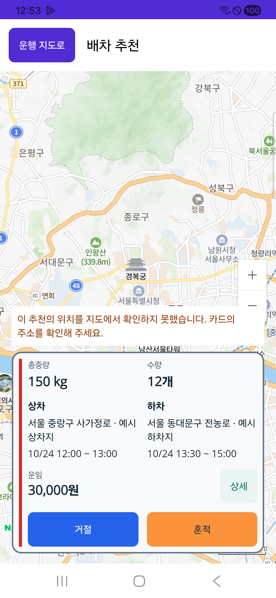
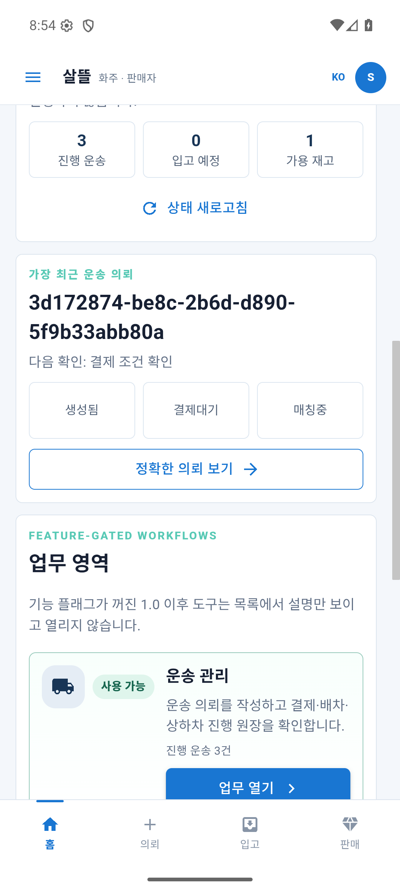

# Mirror (거울)

**배달 기사 · 음식점 · 주문자 · 화주 · 창고 · 운영자처럼 배달과 물류에 얽힌 사람들의 일을 앱과 게임으로 만드는 프로젝트**입니다. 지금도 기획과 개발을 고쳐 가며 진행 중입니다.

> **이 프로젝트는 AI로 만들었습니다.** 코드 · 기획 문서 · 자료 수집과 가공 · 지도와 그림 · 이 README까지 모두 AI(Anthropic Claude, OpenAI Codex)가 만들었고, 사람은 방향을 정하고 결과를 확인합니다.

이 저장소에는 크게 두 가지가 있습니다.

1. **역할 앱** — 역할마다 쓰는 휴대폰 · 웹 앱과 그 뒤의 서버(.NET)
2. **홍달 경영 시뮬레이션** — 실제 지도 위에서 가게와 배달을 운영하는 게임의 기획 · 자료 · 문서. 게임 코드 자체는 [Unity 저장소](https://github.com/cheolwo/unity)에 있습니다.

## 홍달 경영 시뮬레이션

| 수도권 지도 | 동 디오라마(공개판) | 서울 25구 비교 |
| --- | --- | --- |
|  |  |  |

- 플레이어는 동네 가게(카페 · 음식점)와 배달 기사, 물류를 맡아 하루하루 운영합니다.
- 지도는 **전국 → 수도권 → 구 → 타일(300 m 육각형 칸) → 동(입체 디오라마)** 순서로 가까워집니다.
- 건물 · 길 · 지하철 승하차 · 날씨 · 생활 시설 · 구별 통계 같은 **실제 공개 자료**를 지도에 보여 주고, 가게 · 기사 · 주문 · 돈은 **가상**입니다.
- **휴대폰에서 바로 해 보기**: [안드로이드 시험판 내려받기 (최신판 APK)](https://github.com/cheolwo/unity/releases/latest/download/hongdal-android.apk) · [설치 방법](https://github.com/cheolwo/unity/releases/latest)
- 자세한 진행은 [Windows판 구현 현황](docs/AI/Handoffs/Unity-Windows-구현현황.md)과 [인계 · 반환 문서](docs/AI/Handoffs/)에 있습니다.

## 역할 앱 한눈에 보기

| 역할 | 앱에서 하는 일 |
| --- | --- |
| 주문자 | 음식을 주문하고, 주문이 어디쯤인지 봅니다 |
| 음식점 | 주문을 받고, 메뉴 가격 · 판매 상태와 조리 · 픽업 준비를 관리합니다 |
| 음식 기사 | 음식점 도착부터 픽업 · 배달 완료까지 진행합니다 |
| 화주 | 화물 운송을 맡기고(의뢰), 진행 상황과 비용을 확인합니다 |
| 화물 기사 | 추천된 운송을 보고 수락 · 거절하고, 상 · 하차 증빙을 남깁니다 |
| 판매자 · 창고 | 출고할 주문을 찾고, 입고 검수 · 보관 · 출고 인계를 처리합니다 |
| 운영자 | 주문 · 배차 · 사건 처리 이력을 살펴봅니다 |

역할마다 실제 화면과 「무엇을 보고 · 무엇을 누르는지」는 **[역할별 화면 둘러보기](docs/ProjectOverview/역할별-화면-둘러보기.md)**에 모아 두었습니다. 화면의 「살뜰」은 예전 앱 이름입니다.

## 처음 보는 분을 위한 낱말

| 낱말 | 뜻 |
| --- | --- |
| 화주 | 화물을 보내는 사람(운송을 맡기는 쪽) |
| 배차 | 주문이나 화물에 기사를 정해 보내는 일 |
| 디오라마 | 동네 하나를 건물 · 길까지 입체로 만든 작은 모형 화면 |
| 동(행정동) | 주민센터 단위의 동네. 홍달 지도의 가장 작은 지역 단위 |
| Simulation | 실제 서비스와 떨어진, 게임 · 검증용 계산. 게임 상태와 실제 운영 상태는 섞지 않습니다 |
| Ssalddel(살뜰) | 이 프로젝트의 예전 이름. 코드 · 저장 형식과의 호환을 위해 이름이 남아 있습니다 |

## 폴더 안내

| 위치 | 들어 있는 것 |
| --- | --- |
| `Ssalddel/` | 서버(ASP.NET Core) — 주문 · 배차 · 인력 · 운송 API |
| `Ssalddel.Contracts/` · `Ssalddel.Domain/` · `Ssalddel.Infrastructure/` | 서버와 앱이 함께 쓰는 약속(계약) · 업무 규칙 · 저장 |
| `DriverApp/` · `FDriverApp/` · `OrdererApp/` · `RestaurantDeskApp/` · `SellerApp/` · `WarehouseManagerApp/` · `SsalddelApp/` | 역할별 휴대폰 · 데스크톱 앱(.NET MAUI) |
| `Ssalddel.WebApp/` · `Ssalddel.Ui.Common/` | 웹 앱(Blazor)과 공통 화면 부품 |
| `Ssalddel.Simulation.*` | 게임 · 검증용 시뮬레이션 서버 |
| `Ssalddel.Tests/` | 자동 테스트 |
| `docs/` | 문서. 처음이면 [문서 안내](docs/README.md)부터 |
| `docs/AI/` | 홍달 게임 기획(`Planning/`), 인계 · 반환(`Handoffs/`), 자료 조사(`DataCollection/`) |
| `eng/` · `tools/` | 검증 도구 · 미리보기 · 배치 감시기 |

## 직접 실행해 보기

1. **.NET SDK 10**(`global.json` 기준 10.0.301 이상)을 설치합니다. 휴대폰 앱까지 빌드하려면 .NET MAUI 워크로드도 필요합니다.
2. 저장소를 받습니다: `git clone https://github.com/cheolwo/mirror.git`
3. 데이터베이스(MySQL · MongoDB)는 Docker로 띄웁니다. `docker-compose.env.example`을 `.env`로 복사해 비밀번호와 키를 채운 뒤 `docker compose up -d mysql mongo`. 자세한 순서와 주의할 점은 [Docker Compose 실행 준비](docs/Deployment/DockerCompose.md)에 있습니다.
4. 서버: `dotnet run --project Ssalddel` · 웹 앱: `dotnet run --project Ssalddel.WebApp`
5. 테스트: `dotnet test Ssalddel.Tests`

> 비밀값(`.env`, `appsettings.Local.json`, `secrets/`)은 저장소에 없습니다. 각자 만들어 넣어야 서버가 뜹니다.

## 문서 더 보기

- [문서 안내](docs/README.md) · [화면 카탈로그](docs/ProjectOverview/app-page-catalog.md) · [변경 기록](docs/Changes/README.md)
- [개발 통합 상태판](docs/AI/개발통합상태판.md) · [현재 작업](docs/AI/CURRENT_WORK.md) · [개발 지침](AGENTS.md)
- [AI 협업 방식](docs/AI/ai-collaboration/README.md) · [운영 · Simulation · Unity 책임 구분](docs/Architecture/OperationsSimulationUnity작업흐름분리.md)

기획과 구조 문서 목록 펼치기

### 기획과 구조 문서

- [관찰 중심 개인 세계 · 리팩토링 단계](docs/AI/Planning/시스템/PLAN-SYSTEM-OBSERVER-WORLD/README.md)
- [이야기와 플레이 기획](docs/AI/PLANNING.md)
  - [게임의 상위 목적](docs/AI/게임상위목적-오행순환과광복기-기획-2026-09-02.md)
  - [64괘·384효 기획 트리](docs/AI/generated/hexagram-story-tree.md)
    - [수뢰둔 — 한스 농장](docs/AI/generated/hexagram-story-tree.md#hex-03-zhun)
    - [산수몽 — 이데아 맵과 학습](docs/AI/Planning/스토리/PLAN-STORY-IDEA-MAP-LEARNING-001/README.md)
    - [효사별 기획·WI·H 연결](docs/AI/generated/hexagram-line-planning-requirements.md)
    - [효사 기획의 H 공간 참조](docs/AI/generated/hexagram-h-reference-index.md)
  - [괘·효는 진행 규칙이 아닌 영감 자료](docs/Architecture/스토리영감과플레이진행분리.md)
- [주체와 상호작용(WI)](docs/Architecture/주체상호작용중심개발체계.md)
- 세계와 공간
  - [H1 행동 공간 → H2 블록 → H3 경관 → H4 지역 → H5 세계 배치](docs/Architecture/H1-H5공간포함계층조사.md)
  - [관계 지도(Graph Map)와 배치 맵](docs/Architecture/GraphMap기획인계순환체계.md)
- 실행과 표현
  - [웹·MAUI에서 Unity로 — 코드 연결과 음식점 예제](docs/Architecture/UnityClientLayeredArchitecture.md)
  - [Simulation·Unity 코드 지도](docs/AI/generated/simulation-unity-code-map.md)
  - [Unity 프로젝트](https://github.com/cheolwo/unity)
- 개발과 검증
  - [E1~E7 기능 검증 / E8~E10 반복 안정·영역 조화·제한 운영](docs/Architecture/E1-E7수직폐루프와E8-E10수평증거체계.md)
  - [논리와 표현의 검증 구분](docs/Architecture/플레이폐루프논리시각이중순환체계.md)
- 현실 자료와 기존 업무 기반
  - [커뮤니티·운영 서버·웹 도구](docs/ProjectOverview/README.md)
  - [운영 업무에서 Unity로의 이관](docs/AI/Planning/시스템/PLAN-ARCH-OPERATIONS-UNITY-TRANSFER-001/README.md)
  - [현실 자료의 수집·검토·저장](docs/AI/현실자료-서버MySQL축적-기획과개발인계-2026-08-31.md)

## 배달 영상과 촬영·편집 안내

[MYBOX 배달 영상·공유자료 폴더](https://naver.me/GP2n94w4)에서 날짜별 배달 영상과 다른 배달기사도 참고할 수 있는 촬영·쇼츠 편집 자료를 내려받을 수 있습니다.

- **촬영·편집 안내서(PDF)**: DJI Osmo Nano·Osmo Action 6 촬영 목적, 촬영 중 기록할 말, Premiere Pro 편집 순서와 개인정보 가림 기준을 설명합니다.
- **공유자료 ZIP**: 안내서, 배달 기록 빈양식, 공통 편집 설정, UXP 연결 확인용 예제 패널을 포함합니다. 예제 패널은 연결 확인용이며 자동 편집 기능은 아닙니다.

폴더에서 `배달기사_촬영과_쇼츠_편집_안내서_v1.pdf`와 `배달기사_쇼츠_촬영편집_공유자료_v1.zip`을 찾으세요. 위 링크는 읽기 전용 공유 링크입니다.

## 지금 상태

개발 중입니다. 화면 캡처는 날짜 · 판본이 서로 다르고, 많은 화면이 가상 자료로 찍혔습니다. 실제 결제 · 배차와 연결된 운영 서비스가 아닙니다. 공개 저장소이므로 이용 조건을 확인하지 못한 지도 원본 · 가공 자료는 올리지 않습니다.
