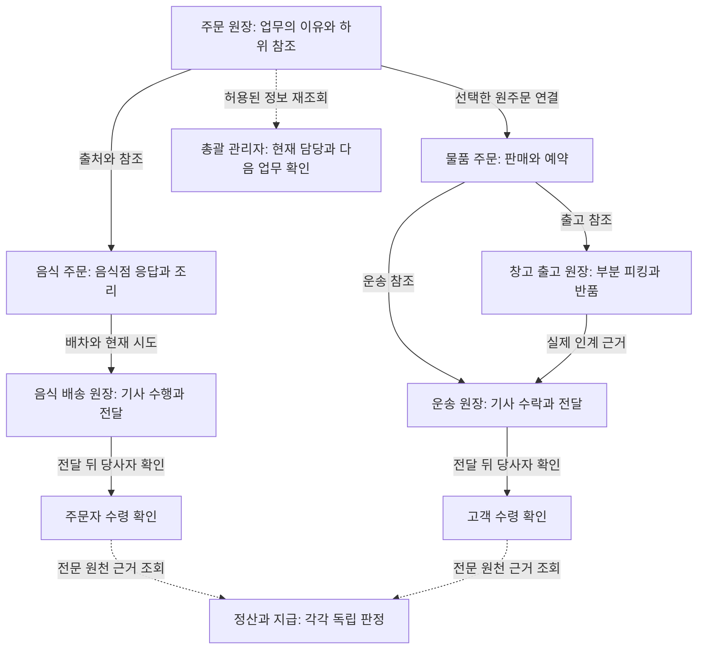

# [기획 · 주문 원장·총괄 관리자 · PLAN-OPERATIONS-ORDER-CENTERED-WORK-NETWORK · r7]

- 판본: `order-ledger-admin-refactor.r7` (2026-10-09)
- 상태: `ApprovedScope / Implemented / LocalValidated / AdminSpecificationPrepared / RealDbAndDeviceValidationPending`
- 승인: 사용자가 주문 원장 중심 구조 보완과 총괄 관리자 기획 계획에 `Implement the proposed plan.`을 요청했다.
- 선행: [r6 업무망 기획](README.md#r6-기획-기준선), [주문 원장 구조](../../../../Architecture/OrderRootLedger.md), [원주문 선택·관계 동시 보호 r35](../PLAN-OPERATIONS-NEIGHBORHOOD-MICRO-HUB/root-order-selection-concurrency.implementation.r35.md).
- 관련 작업: [운영 알림 r45](../PLAN-OPERATIONS-NEIGHBORHOOD-MICRO-HUB/operator-alerts.implementation.r45.md), [회원 생활 배송 수령 r46](../PLAN-OPERATIONS-NEIGHBORHOOD-MICRO-HUB/member-delivery-completion.implementation.r46.md). 두 작업은 이번 변경 전에 존재하던 별도 변경이며 이 문서로 완료를 선언하지 않는다.
- 주 상태 소유자: 운영 서버. Unity·Simulation·Graph Map 영향은 `NoImpact`.

## 확정한 범위와 결과의 의미

음식 배송과 물품·창고 배송을 각각 접수, 이행 준비, 배정·수락, 수행, 전달, 수령, 정산, 지급까지 같은 깊이로 대조한다. 원주문은 업무가 발생한 이유와 하위 원장의 참조를 보존하고, 각 업무의 상태 변경 권위는 기존 UseCase·Command·원장에 남긴다. 단계는 단일 전역 순서가 아니며, 조리와 배차 준비 같은 병행 관계를 함께 표시한다.

이번 개발 범위는 음식 배송 원장 연결, 음식 주문 읽기 표시의 일관성, 관계 편집 응답의 상세 보호, 기사 화면의 조회 실패·응답 유실 복구와 관리자 명세다. 총괄 관리자 모바일 화면 구현, 지사별 권한 신설, 일괄 데이터 이주, 운영 기능 활성화와 실지급 연결은 포함하지 않는다. 기존 route, 저장 ID, 상태 code를 보존한다.

| 독립 결과 | 음식 배송의 근거 | 물품·창고 배송의 근거 | 관리자 판독 |
| --- | --- | --- | --- |
| 전달 | 최종 유효 배달시도의 전달 완료와 음식 주문의 `전달완료` | 예약별 `DeliveredQuantity`, 분산 주문 `Delivered`와 운송 결과 | 수행자가 전달을 기록했음 |
| 수령 | 주문자의 별도 `receipt-confirmation`, `수령확인` | 고객의 별도 `acknowledgements`, `CustomerAcknowledged` | 당사자가 수령을 확인했음 |
| 정산 | `음식주문기사정산`의 최종 시도·기사·동결 대금·정산 `Revision`; 생활 정산은 별도 동의·항목 확정 | 기존 운송 정산 및 생활 정산의 보관·피킹·판매·운송 실제 업무 근거 | 비용 산정 또는 당사자 확정이며 지급과 별개 |
| 지급 | 기사 정산의 지급 상태와 모의 지급 검증; `Simulation` 모의 성공은 실송금 아님 | 지급 신고와 상대방 수령 확인, 기존 운송 지급 근거 | 신고·확인·모의 결과·실제 외부 이체 증거를 구별 |

전체 조회의 완료 문구, 알림 확인, 문제 처리 종결만으로 다른 행의 결과를 확정하지 않는다. 직접 수령·직접 전달 거래의 기사 배송 원장 0건은 정상이며 임의로 배송 원장을 만들지 않는다.

## 두 흐름의 원장·역할 인계 대조

아래 표는 2026-10-09 작업 중 읽은 route·contract·UseCase 기준이다. 실제 한 건의 HTTP·DB·화면 실행 결과는 뒤의 통합 검증 반환에 별도로 기록한다. 표의 존재는 실행 성공 증거가 아니다.

화살표는 출처·참조·역할 인계이며 하나의 전역 상태 전이를 뜻하지 않는다. 조리·배차 준비의 선행 조건, 창고·운송의 부분 이행과 병행은 아래 절차 표와 전문 UseCase가 판정한다. 수령 이후의 점선도 자동 정산·지급 실행을 뜻하지 않는다.

### 음식 주문 1건

기본 경로는 `api/v1/food-orders`다. 주문자·음식점·기사·관리자는 같은 주문번호를 각자 허용된 조회로 다시 읽는다.

| 절차 | ID·출처 판본·권위 | 입력과 선행 조건 | 다음 앱·행동과 반환 결과 | 실패·복구 |
| --- | --- | --- | --- | --- |
| 접수 | SQL `음식주문.Id`·`주문번호`·`클라이언트요청Id`; DTO `Revision`은 상태 이력 수 기반. Mongo 루트는 `food-order:{주문번호}`이며 별도 `Revision` | 주문자 앱 → `POST` → `음식주문접수UseCase`; 인증, 메뉴·가격·수령 정보 검증 | 주문자 상세·음식점 `restaurant/inbox` 재조회; 접수 결과와 음식점 응답 대기 | 제출 응답 유실은 `GET client-requests/{requestId}`로 동일 접수 결과 확인. SQL 성공 후 Mongo 지연은 Outbox 상태로 확인 |
| 음식점 응답·준비 | 음식 주문 상태·이력, 음식점 접근권; `음식점수락Async`·`음식점진행변경Async` | 음식점 앱 → `restaurant-acceptance`·`restaurant-progress`; 같은 주문·음식점·현재 판본·배정 조건 검사 | 주문자 상세·기사 업무·관리자 추적 재조회. 조리 상태와 배차 상태를 함께 읽고 조리 시작의 배정 조건 유지 | 상태 충돌은 같은 주문 재조회. 음식점 거절·취소와 이행 완료를 구별 |
| 배차·제안·수락 | `배차대기Id` → SQL `운송원장.Id`; `원본의뢰유형=음식점주문`·`원본의뢰Id=주문번호`; 제안 ID와 배달시도 ID·순번 | 기사 앱 → `api/v1/driver/food-deliveries/offers/{offerId}/accept`; 현재 제안·기사·만료·동시 수락 조건 검사 | 기사 `workspace`, 음식점·주문자 상세 재조회. 제안 중 기사와 확정 기사를 구별 | 만료·거절·경합 뒤 최신 제안·시도 조회. 이전 시도 기사에게 현재 수행 권한을 부여하지 않음 |
| 루트·배송 연결 | SQL 출처를 대조한 `운송원장.커뮤니티원장Id` 또는 기존 ID 생성 규칙의 Mongo `food-delivery`; 음식 루트에 `배송` 참조 | `음식마트원장Mongo동기화Service`가 기존 자녀의 템플릿·출처·공동체와 개인정보 파기 표지를 검사 | 역할별 주문 원장 조회에서 같은 자녀 ID·최신 `Revision`을 조합. 기존 관계 역할·필수 여부·순서 보존 | 자녀 누락·출처 불일치 때 동기화 성공으로 표시하지 않음. Outbox 재처리, 루트 CAS 경합 시 최신 관계 합침. 조회만으로 이전 주문을 쓰지 않음 |
| 픽업·배송 | 최종 유효 배달시도·기사·운송 연결; `FoodDeliveryDriverWorkspaceUseCase`와 기사 수행 서비스 | 기사 앱의 `restaurant-arrival`·`pickup-complete`·`delivery-complete`; 현재 수행·조리·도착·상태 조건 | 음식점 인계 결과 → 주문자 전달 상태 → 수령 주 행동; 관리자 `operations-trace`에서 현재 시도 확인 | `interruption`으로 중단 기록. 관리자 `delivery-attempts/{attemptId}/interruption-review`가 현재 시도·경합을 재검증하고 후속 배차 판단 |
| 수령·결과 반환 | 주문자 수령 확인 Command·Event, 음식 상태 `수령확인`, 정산 최종 시도 연결 | 주문자 앱 → `POST {orderNo}/receipt-confirmation`; 본인 주문·현재 판본·전달 근거 검사 | 주문·역할 원장·기사 정산 재조회. 음식 수령 확인을 완료 결과로 반환 | 전달됐으나 미수령이면 수령 버튼을 대신 확정하지 않고 문제 처리. 취소·낮은 판본·중복 요청은 기존 정책 |
| 정산 | `음식주문기사정산.Revision`, 수락 때 동결 대금과 최종 유효 기사·시도. 선택적 생활 정산의 SourceRevision·동의 | 기사 당일 정산·완료 상세, 관리자 `DriverSettlement`와 비용 근거 조회 | 수령과 정산·공제·수령액·지급 상태를 분리해 확인 | 대금·공제 근거 미정은 미확정. 재배차의 이전 기사 또는 모의 외부 수행에 지급 생성 금지 |
| 지급 | `음식주문기사정산UseCase`, 모의 지급 멱등 키·`ExpectedSettlementRevision`; 생활 정산 지급 신고·영수 확인은 별도 | 관리자 `simulate-driver-payout`은 서버관리자·`Simulation`·수령·최종 기사·정산 판본·명시적 공제 근거 검사 | 동일 주문의 정산 재조회; 모의 성공/실패와 실제 이체 미연결 표시 | 같은 멱등 키의 다른 입력·중복 성공·낮은 판본 거부. 실제 이체 완료를 화면·시험으로 추정하지 않음 |

소스: [음식 주문 API](../../../../../Ssalddel/Controllers/Food/음식주문Controller.cs), [기사 업무 API](../../../../../Ssalddel/Controllers/Driver/Food/음식배달기사업무Controller.cs), [관리자 운영 추적 API](../../../../../Ssalddel/Controllers/Admin/Food/음식주문운영추적Controller.cs), [음식·마트 Mongo 동기화](../../../../../Ssalddel/Services/Community/FoodMartLedgerMongoSyncService.cs).

### 물품·창고 주문 1건

기본 경로는 `api/v1/distributed-fulfillment`다. 분산 이행의 판매자·공간/창고 담당자·기사·주문자는 같은 `WaveId`와 `OrderId`를 역할별로 조회한다. 기존 화물 의뢰와 원주문 연결은 각각의 ID로 유지한다.

| 절차 | ID·출처 판본·권위 | 입력과 선행 조건 | 다음 앱·행동과 반환 결과 | 실패·복구 |
| --- | --- | --- | --- | --- |
| 접수 | 기존 `CargoRequestId`, 분산 `WaveId`·`OrderId`·각 `Revision`; `OrderReference`는 표시명. 원주문 선택 시 `RootOrderLedgerId`·기대 판본·업무 digest | 화주 의뢰 후 판매자 앱 → `waves/{id}/orders`; 판매자·고객·화물 조건·보관 동의·Lot·가용 수량 검사 | 공간/창고 예약·출고 조회 및 원주문 연결 상태 확인. 원주문 미선택 작성 유지 | `receipts/{requestId}`로 기존 Command 확인. 루트 미연결은 `Pending`과 구별하며 자동 주문·예약 생성하지 않음 |
| 입고·예약·출고 준비 | `SiteId`·`PlanId`·`LotId`·보관 합의 ID/판본, `ReservationId`·`OutboundPlanId`; 예약 당시 합의는 `RouteEvidenceJson` | 창고 앱 `inbound-plans/{id}/receipts` 또는 배치; 수량·소유자·위치·사진·합의 검사. 주문 예약은 SQL 조건부 재고 변경 | 기존 입고·출고 원장과 분산 역할 화면 재조회; 물품 확보·미입고·부분 입고를 구별 | 부분 수량을 전체 완료로 표시하지 않음. 예약 당시 합의와 입고 당시 Lot 합의를 각각 보존 |
| 순회 계획·기사 수락 | `WaveId.Revision`, 경로·Stop ID, `DriverId`, 현재 화물 `확정기사Id`; 화물 근거 digest | 계획 담당 `close`·`plan`, 기사 `accept`; 시간·적재량·경로·현재 화물 조건과 경고 확인 | 기사 순회와 판매자/창고 업무 재조회. `Planned`·`AcceptancePending`·`Accepted` 구별 | 일부 화물 수락 실패를 전체 수락으로 표시하지 않음. 픽업 뒤 보관 책임 기사 변경은 기존 잠금 정책 |
| 루트·하위 연결 | 선택한 Mongo `order`/`ssalddel-mart`, 기존 출고 원장 ID들·운송 원장 ID; 별도 루트 `Revision` | `waves/{id}/orders/{orderId}/ledger` → `분산주문원장연결Adapter`; 현재 당사자·업무 digest·정확한 출고 참조 검사 | `Connected`·`Pending`·`Blocked` 반환, 연결된 출고·운송 최신 판본 읽기. 조회는 연결을 쓰지 않음 | SQL 성공 후 Mongo 연결을 같은 요청으로 재개. 이전 표시 참조의 모호성·원주문 교체를 거부하고 기존 ID 일괄 수정 금지 |
| 피킹·전달 | 예약별 `Quantity`·`PickedQuantity`·`DeliveredQuantity`·`ReleasedQuantity`·`ReturnedQuantity`와 `Revision`; 실제 사진·Command receipt | 기사 `picks`·`pick-batches` → 현재 Pickup Stop, `deliveries`·배치 → 현재 Delivery Stop; 배정·출처·기한·사진·수량 검사 | 창고 출고 결과 → 운송 결과 → 주문자 수령 화면. 운송 수행과 고객 수령을 분리 | 부분 피킹은 완료 아님. 취소는 미피킹 예약 해제와 픽업 물품 `ReturnRequired`를 분리하고 반환 사진·수량으로 회복 |
| 수령·결과 반환 | 분산 주문 `Delivered`와 별도 `CustomerAcknowledged`; 기존 화주 인수·검수는 화주 업무 권위 | 주문자 `waves/{id}/acknowledgements`는 실제 고객·전달 기록·현재 Wave 판본 검사 | 주문자·화주·창고·기사 재조회. 화주 업무망은 실제 인계의 `SourceRevision`·`SourceRevisionBasis`와 반환 참조 보존 | 미전달 수령 확인·다른 고객·낮은 판본 거부. 원본에 개별 수령 시각이 없으면 현재 조회 시각으로 채우지 않음 |
| 정산 | 생활 정산 `DistributedLot`·`DistributedOrder`·`CargoRequest` 원천, 실제 재고 이력·영수증·사진·운송과 SourceRevision | 기존 `NeighborhoodSettlementUseCase`의 조건·당사자 동의·실제 업무 항목·확정·분쟁 처리 | 보관·피킹·판매·운송의 실제 근거를 연결. Lot와 Order 조회가 같은 피킹을 중복 청구하지 않음 | 자유 표시명·현재 상품 가격을 과거 대금으로 사용하지 않음. 부분 전달·반품·실제 보관 기간·기존 기사 지급 중복 여부 검증 |
| 지급 | 기존 운송 지급 결과, 생활 정산 지급 신고·수령 확인·멱등 `RequestId`; 실이체는 외부 근거 | `neighborhood-settlements/{id}/payment-reports`·`payment-receipts`와 기존 화주 정산 권위 | 같은 정산 조회로 신고·상대 확인·잔여액을 표시. 주문 수령과 별개 | 부분 지급·환급·분쟁·중복 신고를 기존 원장으로 처리. 신고만으로 실송금 또는 전체 정산 완료를 선언하지 않음 |

소스: [분산 이행 API](../../../../../Ssalddel/Controllers/Common/DistributedFulfillmentController.cs), [원주문 연결 Adapter](../../../../../Ssalddel/Application/Warehouse/분산주문원장연결Adapter.cs), [화주 업무망 조회](../../../../../Ssalddel/Application/Shipper/Request/화주운송업무망조회UseCase.cs), [생활 정산 원천 조회](../../../../../Ssalddel/Application/Settlement/NeighborhoodSettlementSourceResolver.cs).

### 공통 판본과 조회 보호

- Mongo 루트/하위원장의 `Revision`, 분산 업무의 `Revision`, 음식 SQL의 상태 이력 수 기반 판본, OS 인계의 `SourceRevisionBasis`를 각각 보존한다. 서로 다른 출처 판본을 비교해 하나의 전역 최신값으로 만들지 않는다.
- 원주문 연결의 분리·역할 변경·필수 해제는 r35/r41의 Mongo 다문서 트랜잭션과 하위 관계 편집 판본 검사를 따른다. 미지원 환경은 파괴적인 관계 변경을 거부하고 비파괴 저장은 보존한다.
- 음식 루트의 읽기 단계는 같은 판본의 `food-order` 블록으로 판독한다. `수령확인`은 완료, `취소/거절`은 닫힘, 다른 음식 단계는 진행 중이다. 상태 표시·검색·건수와 상세가 일치해야 하며 읽기로 저장 상태를 바꾸지 않는다.
- 저장소의 200건 제한은 내부 페이지 크기로 유지하되 `Skip`으로 순회한 뒤 단계 판독·상태 검색·건수를 계산한다. 기존 저장소 조회 조건의 `Skip` 기본값은 0이며 공개 HTTP 계약은 바꾸지 않는다. 여러 페이지가 하나의 원자 snapshot이라는 보장은 없으므로 목록 이후 전문 처리는 현재 원장의 판본을 다시 검사한다.
- 이전 음식 주문의 읽기 참조 보완은 개인정보 파기 Marker가 있는 루트에서 후보 탐색을 생략하고, 파기된 배송 원장을 신규 후보에서 제외한다. 이미 저장된 명시적 관계의 업무 이력은 보존하며 조회로 새 관계를 저장하지 않는다.
- 연결/분리 성공 뒤 현재 주문자 조회를 다시 수행하고 `주문원장변경응답Projector`가 기존 통합 DTO 형식에 보호된 결과만 담는다. 관계 편집 권한이 상세 공개 권한을 뜻하지 않는다. ID·템플릿·역할 참조는 유지하고 허용되지 않은 원장·서명 상태와 그 완료 집계는 반환하지 않으며 필수 판정에 `공개요청필요`를 사용한다.
- 최신 조회 실패 시 이전 자료임을 표시하고 상태 변경을 차단한다. 불명확한 제출은 기존 요청 결과 확인 → 같은 원장 정본 재조회 → 현재 단계 복귀로 회복한다. 조회 실패를 빈 목록·완료·새 요청으로 숨기지 않는다.

## 총괄 관리자 모바일 업무 명세

[전체 로드맵 페이지 원칙](../../../../Architecture/WholeRoadmapPagePrinciple.md)의 책임 카드를 적용한다. 아래 네 업무는 후속 구현 명세이며 신규 `PageKey`·route·Controller·DTO를 이번에 만들지 않는다. 관리자가 배송 참여를 겸해도 관리 조회와 본인의 수행 권한·수령 확인을 구별한다.

### 주문 진행 확인

| 항목 | 기록 |
| --- | --- |
| 주 사용자·페이지/소스 | 총괄 서버관리자. 기존 음식 운영 추적·주문 역할 조회·분산 역할 조회를 재사용할 후속 모바일 업무 |
| 대상·진입 문맥 | 주문번호 또는 원주문 ID, 주문 유형, 날짜·진행/문제 필터와 선택 문맥 |
| 한 문장 목적 | 관리자가 선택 주문의 현재 담당자와 다음 일이 기다리는 이유를 확인한다 |
| 완료 결과·상태별 주 행동 | 정상: 다음 담당 업무 열기. 문제: 해당 문제 처리 열기. 조회 실패: 새로고침. 확인한 자료의 시각·출처 판본과 주문 문맥 유지 |
| 기본 정보 | 주문 식별·하위 연결 요약·현재 단계·실제 배정 기사·다음 담당·대기 이유·마지막 확인 시각. 제안/수락/수행과 전달/수령을 구별 |
| 보조 정보 | 하위 원장 ID·판본·배달 시도·인계·Outbox 이력은 원인 확인할 때 펼침 |
| 독립 업무·제외 정보 | 문제 조치·정산/지급은 각각의 업무로 이동. 주소·연락처·원시 위치·사진·예외 원문을 목록에 노출하지 않음 |
| 진입·실패·복귀 | loading/empty/error/retry/disabled를 분리. 전문 화면에서 돌아올 때 필터·선택 ID 보존 후 정본 재조회. 권한 철회·계정 변경 시 이전 상세 제거 |
| 코드·API·DB | 기존 `admin/food-orders/operations`, `operations-trace`, `community/order-ledgers/{id}/views/*`, 분산 `workspace`/`waves/{id}`; 각 SQL/Mongo 읽기 권위 유지 |
| 책임 판정·검증 | 기획상 같은 목적의 구성. 음식 목록/추적은 기존 구현, 두 유형 통합 관리자 모바일 조립·별도 관리자 조회 계약은 추가 개발. 실제 모바일 화면 미구현·미검증 |

### 기사별 업무 확인

| 항목 | 기록 |
| --- | --- |
| 주 사용자·페이지/소스 | 총괄 서버관리자. 기존 음식 배달시도와 화물/분산 기사 배정 근거를 소비할 후속 업무 |
| 대상·진입 문맥 | 관리 조회에서 선택한 기사, 현재 업무/날짜 필터. 관리자가 기사 전용 API를 타인으로 가장하지 않음 |
| 한 문장 목적 | 관리자가 한 기사의 진행 업무와 중단·재배차 이력을 확인하고 원주문으로 이동한다 |
| 완료 결과·상태별 주 행동 | 현재 업무 존재: 선택 원주문 열기. 현재 업무 없음: 날짜/종료 업무 조회. 미확인: 다시 조회 |
| 기본 정보 | 업무별 주문 ID·유형·현재 단계·수락/픽업/전달·대기 시간. 기사 확정 근거가 없는 제안은 수행 업무와 분리 |
| 보조 정보 | 중단 이유 code·시도 순번·재배차 이전/현재 담당·종료 업무 이력. 판단에 필요한 허용된 정보만 표시 |
| 독립 업무·제외 정보 | 기사 계정·정산·개인 설정은 다른 업무. 현재 위치만으로 도착·인계·완료를 추정하지 않음 |
| 진입·실패·복귀 | 새로고침 실패는 마지막 성공 시각과 미확인 표시. 주문 상세 복귀 시 기사·필터 유지하고 현재 배정 재조회 |
| 코드·API·DB | 음식 관리자 `배달시도목록`, 분산 Wave의 `DriverId`와 운송의 `확정기사Id`를 재사용. 기사 `workspace`는 본인 권한이며 관리자 집계 API로 대체 호출하지 않음 |
| 책임 판정·검증 | 기획상 같은 목적의 구성. 기사 본인 업무·음식 관리자 시도 확인은 기존 구현; 음식/화물 통합 기사별 관리자 조회와 모바일 화면은 추가 개발·미검증 |

### 문제 처리

| 항목 | 기록 |
| --- | --- |
| 주 사용자·페이지/소스 | 총괄 서버관리자. 기존 음식 중단 검토·운송 비정상 처리·운영 알림·지원 사건 업무 |
| 대상·진입 문맥 | 주문/시도/운송/알림/사건 ID와 발생 회차, 출처 상태·판본 |
| 한 문장 목적 | 관리자가 문제의 권위 업무로 이동하여 허용된 회복 조치를 진행하고 원주문 결과를 다시 확인한다 |
| 완료 결과·상태별 주 행동 | 지연: 현 담당 확인. 연결/조회 실패: 정본 확인·복구. 중단/미수령: 전문 검토 열기. 이후 원주문 재조회 |
| 기본 정보 | 업무 지연·자동 회복·연결 이상·조회 불명확·전달 후 미수령을 구별; 다음 확인 담당·대기 이유·정본 확인 시각 |
| 보조 정보 | 허용된 시도/인계/Outbox·증빙·감사 이력. 개인정보 사고·분쟁은 기존 보호된 사건 화면에서 조회 |
| 독립 업무·제외 정보 | 알림 확인은 재알림 제어. 사건 종결은 사건의 결과이며 주문 수령·배차·지급을 대신 확정하지 않음 |
| 진입·실패·복귀 | 만료·409·권한 변경은 최신 대상 재조회. 응답 유실은 기존 요청 확인. 전문 처리 뒤 선택 주문으로 복귀하며 취소/반환/새 배차 결과를 각각 표시 |
| 코드·API·DB | 기존 음식 `interruption-review`, 화물 문제/비정상 업무 API, r45 알림과 기존 지원 사건. `OperationsAlerts.Enabled`·외부 발송 기본 OFF를 유지 |
| 책임 판정·검증 | 전문 처리 경로는 기존 구현, 주문별 연결 조립은 추가 개발. r45 dirty 작업과 r46 수령 작업의 완료 여부는 각각의 검증 기록에서 판정 |

### 정산·지급 확인

| 항목 | 기록 |
| --- | --- |
| 주 사용자·페이지/소스 | 총괄 서버관리자. 기존 음식 기사 정산·운송 정산·생활 정산을 연결할 후속 조회 업무 |
| 대상·진입 문맥 | 원주문 ID와 정산 ID, 원천 업무·당사자·동결 조건 판본 |
| 한 문장 목적 | 관리자가 주문의 비용 근거와 정산·지급의 각 확인 상태를 판독하고 해당 담당 업무로 인계한다 |
| 완료 결과·상태별 주 행동 | 미확정/분쟁: 정산 근거 열기. 지급 대기: 지급 담당 업무 열기. 확인 완료: 기록 확인. 미확인: 재조회 |
| 기본 정보 | 상품대금·배송/운송비·보관/피킹비·공제·잔여액, 정산 확정/보류·지급 신고/수령 확인·모의 결과·실지급 근거의 구별 |
| 보조 정보 | 동결 조건·실제 작업 수량/기간·부분 지급/환급·중복 청구 방지·영수증과 감사 이력 |
| 독립 업무·제외 정보 | 지급 실행·모의 지급 검증·정책 편집은 독립 업무. 계좌·결제 증빙의 원문을 일반 주문/기사 목록에 노출하지 않음 |
| 진입·실패·복귀 | 금액/근거 누락은 미확정이며 0으로 대체하지 않음. 정산 담당 화면 복귀 뒤 같은 정산/주문 재조회. 오래된 판본에서는 변경 금지 |
| 코드·API·DB | 음식 관리자 `DriverSettlement`, 기사 당일/완료 정산, `NeighborhoodSettlementUseCase`와 기존 화주 `settlement/*`; 기존 권한·기능 관문과 정본 유지 |
| 책임 판정·검증 | 정산/모의 지급/지급 신고·확인은 기존 구현. 주문별 관리자 정산 모바일 조립 및 실제 외부 이체 연결은 추가 개발이며 이번에 구현하지 않음 |

### 권한과 추가 개발 경계

총괄 관리자 진입·관리자 집계 조회는 기존 `서버관리자전용` 정책을 사용한다. 새 지사/중간관리자 권한을 만들거나 관리자라는 이유로 일반 원장의 상세 공개 조건을 우회하지 않는다. 기존 Common 역할 조회를 재사용할 때는 그 조회의 소유·직접 참여·승인 공개 범위를 그대로 적용한다. 후속 관리자 조회 계약이 필요한 부분은 최소 항목·대상 범위를 서버에서 정해 기존 보호 조회와 결합한다.

관리자는 조회·판단·전문 화면 진입을 소유하며, 배차 확정·현재 운송 변경·수령·정산·지급은 해당 전문 API/UseCase가 현재 사용자·역할·상태·판본·멱등 키를 다시 검사한다. 버튼 표시와 `업무안내`는 실행 권한이 아니다. 주소·연락처·사진·계좌는 해당 처리를 위해 필요한 권한 범위에서만 열고 목록·푸시·메일·로그에 복제하지 않는다. 기능 플래그·`SsalddelExecution:Mode`와 운영/법률 관문은 기존 기준을 유지한다.

## 통합 검증 반환

최종 변경 소스에서 아래 검증을 실행했다. 이전 r35/r41/r45/r46의 시험 수치를 재사용하지 않았으며, 집중 시험과 전체 시험의 중복을 합산하지 않는다. 명령·로그·미실행 범위의 정본은 [이번 변경 기록](../../../../Changes/2026-10-09-order-ledger-admin-refactor-r7.md)이다.

| 항목 | 이번 판정·근거 |
| --- | --- |
| 소스와 문서 대조 | 기준 `dev/mirror-integration`의 HEAD `d1bab3eec08dc0a49c9a87f882590d394205c9a4`와 미커밋 변경. 수정·신규 C# 21개는 최종 검증 전후 SHA-256 일치. 다른 작업의 변경을 보존 |
| 음식·물품 각각 한 건의 단계/다음 역할 | [음식 정상 생명주기](../../../../../Ssalddel.Tests/Application/Food/음식배달정상수직생명주기Tests.cs)의 접수→배차→조리→전달→수령, [분산 이행](../../../../../Ssalddel.Tests/Application/Warehouse/DistributedFulfillmentUseCaseTests.cs)의 두 거점·두 판매자·두 고객 수락→부분 피킹→전달→수령·동일 영수증 재조회가 통과. SQLite 업무 저장·UseCase와 원장 대체 저장소 시험이며 HTTP·실제 Mongo·역할 앱 완주 증거는 아님 |
| 집중 회귀 | 최종 Fast 886개 통과·실패 0·Mongo 환경 의존 12개 건너뜀. 출처/파기 보호·관계 보존·목록 200건 이후 검색/건수·변경 응답 공개 보호·기사 최신 조회 실패/응답 유실 복구와 기존 부분 피킹·취소/재배차 검증 포함 |
| 영향 앱 build·Fast·Task | `Ssalddel.v3.5.slnx` build 및 Task 전체 9,462개 통과·실패 0·환경 의존 Mongo 15개 건너뜀. `FDriverApp`의 `net10.0-android` Debug build 성공(오류 0, 경고 37). 최초 프레임워크 일괄 지정의 복원 실패를 명령 수정으로 해결 |
| 로컬 HTTP·실DB·브라우저/앱 | 이번 범위에서 미실행. 격리 Mongo 시험 연결이 없어 관련 시험을 건너뛰었으며 운영 저장 실패를 sample fallback으로 대신하지 않음. Android 지도 SDK ID 미설정 및 기존 API 수준 경고는 build 로그에 남음 |
| APK·단말·운영·실지급 | Debug APK 파일 생성까지 확인. APK 설치·실제 단말 UI·지도/알림 작동·운영 활성화·실지급·배포·commit/push는 수행하지 않음. 관리자 모바일 화면은 명세만 완료 |

미정은 후속 통합 관리자 조회 계약과 모바일 구현의 실제 배치·검증, 실이체 연결이다. r6의 원천 공동주문·비용 귀속·생성 전 위임 등 장기 확장은 이 판본의 구현 범위로 승격하지 않는다. 다음 질문은 이번 승인 범위 안에서는 없으며, 후속 화면 구현 요청 시 이 네 책임 카드를 기준으로 기존 화면과 계약을 재검증한다.
