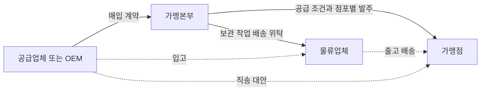

# 프랜차이즈 식자재 공급 계약과 가맹점 물류 통합

[기획 · 가맹본부 공급과 물류 · PLAN-SYSTEM-FRANCHISE-OPERATIONS · r67]

- 조사 기준일: 2026-11-09, 대한민국.
- 상태: `ResearchCompleted / IntegrationDesignProposed / ProductImplementationPending`.
- 사용자 방향: 공급업체와 공급 계약을 맺고 가맹점에 식자재를 공급·배송하는 구조를 조사하여 기존 프로젝트에 연결한다.
- 관계: [본부의 공급망 총괄 r35](franchise-supply-to-sales-coordination.plan.r35.md), [재료·조달 규격 r39](menu-ingredient-supply-analysis.plan.r39.md), [참고 레시피 관계 r40](ingredient-reference-unity-exploration.plan.r40.md)의 후속이다. 메뉴 원가 조사와 공급 계약·물류 이행을 연결한다. r66의 음식 배달비·예비금 가정은 변경하지 않는다.

## 조사 결론

본부는 공급업체에서 매입해 가맹점에 재판매하고, 보관·피킹·배송은 외부 물류업체에 맡길 수 있다. 공급업체가 매장으로 직접 보내는 방식도 비교할 수 있다. **상품을 누구에게 사고파는지와 실제로 어디에 보관하고 누가 배송하는지를 별도로 기록해야 한다.** 아래 거래 구조는 통합 설계안이며 개별 업체가 사용자에게 제시한 계약 조건은 아니다.

기존 프로젝트에는 운영 공급중개와 프랜차이즈 공급망 Simulation이 각각 있다. 운영 중개에서는 공급자가 판매자이고 점포가 매수인이다. 프랜차이즈 Simulation에서는 본부가 조달 계약과 매장 공급안을 따로 관리한다. 운영 중개 원장의 이름만 바꾸어 본부 재판매를 처리하면 거래 당사자·가격·채권채무가 달라진다.

## 거래 구조와 물류 경로

| 비교 구조 | 매매 관계 | 보관과 이동 | 본부가 확인할 비용과 책임 |
| --- | --- | --- | --- |
| 본부 매입과 자체 이행 | 공급자 → 본부, 본부 → 가맹점의 두 거래 | 본부 보관·작업·차량 또는 계약한 개별 운송 | 재고 자금, 시설·인력·차량, 폐기, 검수·회수 |
| 본부 매입과 3PL 위탁 | 위와 같은 두 거래 | 제3자 물류업체가 보관·피킹·배송 | 매입대금과 별개인 위탁료, 최소 월비용, 재고 소유와 보관 책임 |
| 본부 재판매와 공급자 직송 | 공급자 → 본부 → 가맹점의 상업 거래를 유지 가능 | 물품은 공급자 → 가맹점으로 이동 | 직송 확인, 점포별 운임, 매입·매출 증빙과 검수 결과의 연결 |
| 점포 직접 매입과 본부 조율 | 공급자 → 가맹점, 본부는 공통 조건·품질·발주를 조율 | 공급자 직송 또는 별도 물류 위탁 | 조율 수수료 유무, 점포의 구매 동의, 별도 서비스 책임 |

OEM과 중앙주방은 제조 방식이다. 위 구조와 함께 사용할 수 있다. 예를 들어 전용 소스는 위탁 제조하고 냉동 패티는 범용 상품으로 매입한 뒤, 동일한 위탁 물류센터에서 점포별로 합배송할 수 있다. 공급자의 제조 기능, 상품의 매도인, 재고 소유자, 보관자, 실운송자를 각각 연결한다. 소유권과 멸실 위험의 이전 시점도 계약별로 정한다.



실선은 계약 관계, 점선은 물품 이동의 대안이다. 실제 인수 확정과 대금 지급은 각각 별도 기록한다. 본부·가맹점 공급 관계와 가맹 관계, 물류 서비스 조건은 논리적으로 구분하며 반드시 별도 종이 계약서 세 장이어야 한다는 뜻은 아니다.

## 공식 업체 자료로 확인한 서비스

| 공식 출처 | 공개된 기능 | 견적에서 확인할 내용 |
| --- | --- | --- |
| [CJ대한통운 더 풀필](https://cjlogistics.com/ko/business/fulfillment) | 외식 프랜차이즈 상품 보관·운송, 온도대별 작업·배송과 배송 모니터링 | 취급 품목, 배송권·요일, 센터별 온도대, 월 최소요금과 책임 범위 |
| [삼성웰스토리 식자재 유통](https://m.welstory.com/solution/distribution.do) | 통합 구매, PB 상품, 도래미 발주와 콜드체인 | 사용자 물량의 납품단가, 전용품 조건, 최소주문과 공급 지역 |
| [CJ프레시웨이 식자재 유통](https://www.cjfreshway.com/solution/business/distribution.jsp) | 레시피·교육 지원, 전용 소스 상품화, 중앙주방 반조리·완조리 공급 | 개발비, 최소 생산량, 배합·상표 권리, 유통기한과 품질 승인 |
| [CJ프레시웨이 물류](https://www.cjfreshway.com/solution/infra/logistics.jsp) | 입고 검수, 창고관리, 온도대별 상차와 배송 관리 | 상품별 온도 기준, 인계 기록, 사고·반품·회수 처리 |
| [외식UP 식자재 유통](https://hq.oesikup.com/intro/food) | 브랜드 전용몰, 전용상품 소싱·제조·유통, 점포 발주·결제·배송 관리 | 충전금·여신 조건, 배송 마감과 예외, CS와 청구 주체 |

위 자료는 서비스 존재와 범위를 설명한다. 사용자에게 적용되는 납품단가·MOQ·월 최소 물류비·신용 조건은 공개자료로 확정하지 않았다. 전국 배송이나 익일 배송이라는 소개를 특정 점포의 계약상 보장으로 저장하지 않는다. 개별 업체 추천 순위와 계약 성립도 부여하지 않는다.

## 계약별로 확보할 정보

| 관계 | 필요한 항목 |
| --- | --- |
| 공급업체와 본부 | 매도인·매수인, SKU와 규격, 법정 식품유형, 가격·세금·유효기간, MOQ·포장단위, 발주 마감·납기·부분 납품, 소유권·위험 이전, 품질·잔여 소비기한·하자·회수 부담 |
| OEM 제조사와 본부 | 배합 판본·샘플 승인, 개발비·초도량·리드타임, 배합·상표·포장 권리, 원료 대체·공장 변경·단종, 검사와 회수 역할 |
| 본부와 가맹점 | 실제 판매자·청구자, 필수·자율 구매 구분, 공급가격 산식·물류비 포함 여부, 주문·취소 마감, 대체품 동의, 최소주문·여신, 인수·부족·반품·환급 |
| 위탁자와 3PL | 재고 소유자·보관자, 온도대·시설·실운송자·재위탁, 입고·보관·피킹·포장·배송·역물류 요금, 최소요금, 사고 증거·배상 범위·보험·회수 협력 |

가맹점이 부담하는 물류비를 본부가 계약·청구할 수도 있고 물류업체와 점포가 직접 계약할 수도 있다. 위탁자·수익자·지급의무자를 계약별로 명시한다. 본부가 공급업체와 계약했다는 사실만으로 가맹점의 구매·가격변경·대체품 동의가 성립하지 않는다.

## 국내 법규와 품목별 확인 범위

- 지정거래를 강제하는 품목은 종류와 공급가격 산정방식이 가맹계약서 기재 대상이다. 모든 식자재를 자동으로 필수품목으로 분류하지 않는다. [가맹사업법 제11조 제2항 제12호](https://www.law.go.kr/LSW/lsSideInfoP.do?docCls=jo&joBrNo=00&joNo=0011&lsiSeq=288583&urlMode=lsScJoRltInfoR), 2026-10-02 시행본.
- 구입강제품목의 거래조건을 가맹점에 불리하게 바꾸는 경우 적용되는 협의 절차를 확인한다. 변경안·근거·사전 안내·의견·협의 결과·실제 적용을 분리한다. 가격 관측값이 오르면 공급가격을 자동 인상하는 구조로 연결하지 않는다. 협의와 일률적인 전원 동의를 같은 상태로 표시하지 않는다. [거래조건 변경 협의 고시](https://www.law.go.kr/LSW/admRulInfoP.do?admRulSeq=2100000249984), 2024-12-05 시행본.
- 단순 매입판매·소분·자기 상표 OEM 유통·냉동냉장 보존·전문 운반은 실제 수행 업무에 따라 적용 업종이 달라진다. 식품운반업의 정의와 제외 조건도 확인한다. 공급자·센터·실운송자의 업종·시설·신고 범위를 저장하되 프로그램이 신고 필요 여부를 자동 확정하지 않는다. [식품위생법 시행령 제21·25조](https://www.law.go.kr/LSW/lsInfoP.do?lsiSeq=288767), 2026-08-18 시행본.
- 위해 식품의 회수 등 조치와 공식 식품이력추적 등록의 적용 범위를 구분한다. 운영상 로트 추적을 설계하더라도 모든 SKU가 법정 이력추적 의무대상이라고 표시하지 않는다. 3PL 위탁만으로 판매 영업자의 회수 의무가 없어지지 않는다. [식품위생법 제45·49조](https://www.law.go.kr/LSW/lsInfoP.do?lsiSeq=285339), 2026-10-08 시행본.
- 원육·패티 등은 제조사가 표시한 식품유형을 확인하여 축산물 관련 업종·보관·운반·회수 기준의 적용 여부를 별도 검토한다. 품명만으로 분류하지 않는다. [축산물 위생관리법](https://www.law.go.kr/LSW/lsInfoP.do?lsiSeq=285351), 2026-10-08 시행본. 실제 유상 운송·주선과 창고 운영의 허가·등록 적용 범위는 수행 주체·시설이 정해진 뒤 별도 확인한다.

조사 이후 계약·운영에 적용할 때는 그때의 시행 법령과 관할 해석을 다시 확인한다. 위 항목은 시스템이 기록할 검토 정보이며 법률이 모든 필드 저장을 직접 요구한다는 의미는 아니다.

## 현재 프로젝트와 통합할 위치

| 현재 근거 | 확인된 범위 | 이번 통합 설계의 연결점 |
| --- | --- | --- |
| [운영 공급중개](../../../../Architecture/PlatformSupplyBrokerage.md) | 공급조건 계약·조직 이용등록·개별 발주·공급자 수락/부분수락/거절. 플랫폼은 판매자가 아님 | 점포 직접 매입 구조에서 재사용. 본부 재판매와 거래 당사자를 합치지 않음 |
| [프랜차이즈 공급망 Simulation](../../../../Architecture/프랜차이즈공급망SimulationProjection.md) | 본부 조달계약·매장 공급안·발주 Preview/Confirm, 세션 저장과 관계형 사본 | 본부 매입가와 점포 공급가, 계약 판본과 포장단위 사본을 연결하는 기반 |
| [출고 배치](../../../../Architecture/OutboundBatchEngine.md) | 재고·배송권·거리·운송비·분할 출고를 다루는 계획 구조 | 계약상 출고 가능·소유자·온도대·잔여 소비기한을 확인한 후보만 인계 |
| 기존 창고·운송 업무 | 입고·검수·작업·출고·운송 인계 기능이 별도 존재 | 프랜차이즈 발주와 자동 연계된 것으로 간주하지 않고 명시적 원장 참조와 권한을 대조 |
| 메뉴·가격·BEP 조사 | 참고 레시피 110개, 구매 후보 33개, 시제품 6종의 오프라인 계산 자료 | 연구 ID에서 검토한 조달 SKU로 연결. 가격 관측과 실제 납품계약 가격을 별도 보존 |

현재 Simulation의 첫 이행 기준인 `HeadquartersResale + HeadquartersFleet`는 유지한다. 3PL·공급자 직송·점포 직접 매입은 이번 비교 대상이며 새 실행 모드나 승인된 구현으로 추가하지 않는다. 기존 운영 중개 API가 재판매를 지원한다고 표현하지 않는다.

코드 대조에서 확인한 재사용 범위는 다음과 같다. 코드·기존 문서 확인이며 이번에 해당 API나 DB를 실행 검증한 결과는 아니다.

| 코드 근거 | 확인한 의미와 남은 연결 |
| --- | --- |
| [Simulation Controller](../../../../../Ssalddel.Simulation.Hosting/Controllers/프랜차이즈공급망SimulationController.cs), [공급망 계약](../../../../../Ssalddel.Simulation.Contracts/UnityPackage/Runtime/프랜차이즈공급망SimulationContracts.cs) | 초기화·조달계약·공급안·발주 Preview/Confirm. 수락 상태 상수의 존재를 수락·배송 실행 API 완료로 세지 않음 |
| [공급중개 DTO](../../../../../Ssalddel.Contracts/Common/ContractManagement/플랫폼공급중개Dtos.cs), [개별 발주 UseCase](../../../../../Ssalddel/Application/ContractManagement/조직개별공급발주UseCase.cs) | 운영 Guid와 Simulation stable ID를 구분. 발주 제출이 결제·재고예약·입고를 자동 실행하지 않음 |
| [입고 계약](../../../../../Ssalddel.Contracts/Common/Inbound/InboundContractDtos.cs), [재고 DTO](../../../../../Ssalddel.Contracts/Common/Inventory/InventoryDtos.cs), [창고 작업](../../../../../Ssalddel/Services/LogisticsProcessing/Warehouse/WarehouseOperationService.cs) | 보관대행·위탁판매와 소유자·판매자 분리, 입고 완료·검수·가용/예약/불량 수량의 재사용 후보 |
| [재위탁 출고](../../../../../Ssalddel/Application/Warehouse/창고재위탁출고UseCase.cs), [출고 운송 인계](../../../../../Ssalddel/Application/Warehouse/출고운송인계완료UseCase.cs) | 출고예정·입고상품·운송의뢰와 할당 수량 연결, 기사·차량·인계 조건 검증. 프랜차이즈 발주에서 자동 연결된 흐름은 아님 |
| [입고상품](../../../../../Ssalddel.Domain/창고/입고상품.cs), [창고 서비스 비용](../../../../../Ssalddel.Contracts/Common/WarehouseBilling/WarehouseServiceBilling.cs) | 검토한 품목·재고 모델에서 식품 로트·소비기한·실측 온도 이력의 완결된 연결을 확인하지 못함. 반품·폐기 비용 항목도 공급대금 반품 크레딧·실제 지급의 증거와 구별 |

가격 조사 원본은 로컬 비공개 `배달/edit-kit/private/ingredient-price-bep/20261108-r1/research-data.json`이다. `P01` 같은 연구 상품 ID와 참고 레시피 ID는 정식 상품 ID나 공급업체 계약 SKU가 아니다. 검토된 매핑에 규격·단위·출처·판본을 연결하기 전에는 합치지 않는다. 개별 점포의 실제 조리법·매입처·판매량을 배달 영상과 참고 레시피로 추정 확정하지 않는다.

## 연결할 데이터와 업무 상태 제안

기존 원장과 고유 식별자를 먼저 재사용한다. 다음은 필요한 업무 정보이며 새 테이블·DTO·API 명칭 확정은 아니다.

| 정보 묶음 | 연결할 내용 |
| --- | --- |
| 주체·계약 | 본부·공급자·매장·제조자·보관자·실운송자, 계약 종류·판본·유효일·동의·접근 범위 |
| 상품·가격 | 공통 상품 후보와 계약별 SKU 매핑, 포장 내용량·발주단위·변환 판본, 순중량/조리 후 중량 구분, 매입가·공급가·통화·세금·가격 효력일 |
| 조달·판매 | 본부 조달 발주와 매장 발주의 별도 ID, 계약 품목 참조, 수락 수량·분할 납품, 적용 조건의 과거 사본 |
| 재고·품질 | 재고 소유자와 보관 위치, 로트·소비기한·온도 기준의 출처, 검수·격리·유효 재고·예약 재고, 대체품 동의 |
| 이행·인수 | 입고·피킹·출고·운송·도착·점포 검수 ID, 수량·단위·시각·담당자·증빙, 온도이탈·분실·파손·거절 수량 |
| 정산·예외 | 매입/매출/물류 서비스의 별도 청구·조정·입금, 미수·미지급·여신, 반품·환급·회수·폐기·비용 분담 |

점포의 발주 완료, 공급자 수락, 배송 도착, 검수 인수, 청구, 실제 입금은 서로 다른 상태다. 제안 흐름은 다음과 같다.

1. 유효 계약·점포 권한·현재 가격 판본을 확인하고 발주를 명시적으로 제출한다.
2. 수락·부분수락·거절을 기록한다. 수락 수량을 초과해 재고나 출고를 예약하지 않는다.
3. 본부 매입 구조에서는 필요한 조달과 보유 재고를 구분하여 부족분을 확인한다. 발주만으로 입고·재고 증가를 만들지 않는다.
4. 입고 검수와 로트·기한·소유자·보관 조건을 확인하고, 출고 가능한 수량만 피킹·운송에 인계한다.
5. 도착 뒤 점포가 인수·부분 인수·거절을 기록한다. 요청 10박스, 출고 10박스, 도착 10박스, 인수 8박스라면 거절 2박스와 사유·처분을 보존한다.
6. 계약 기준에 따라 청구·조정을 계산하고 실제 입금과 대조한다. 반품·환급·회수는 원 발주행·로트·인수 증빙을 참조한다.

거래 확정은 서버 원장의 권한·현재 revision·중복 요청 검증을 통과해야 한다. 계약 변경이 과거 발주 가격을 덮어쓰거나 다른 점포·본부·세션의 재고를 가져오면 안 된다. 모의와 운영은 기존 `SsalddelExecution:Mode` 경계를 따른다. Unity가 보여 주는 차량 도착은 실제 인수·계약·지급 확정이 아니다.

## 메뉴 원가와 본사 손익 연결

가맹점은 **본부 공급가격과 점포가 별도로 부담하는 물류비**를 기준으로 메뉴 사용분 비용을 계산한다. 본부의 매입가격만으로 점포 원가를 낮춰 보이지 않는다. 필요한 포장 수량을 올림한 최초 구매지출, 실제 사용분 비용, 잔량과 폐기는 구분한다.

본부의 관리 손익은 다음과 같이 비교한다. 공급 매출에 로열티·물류비가 포함됐는지 먼저 확인한다.

```text
본부 상품 공급이익 = 가맹점 공급매출 − 대응 상품 매입원가
본부 물류 손익 = 별도 청구한 물류 서비스 수익 − 대응 위탁·자체 물류비
본부 운영 결과 = 상품 공급이익 + 물류 손익 + 별도 계약 수익
                 − 품질·교육·지원·폐기·회수·금융 비용 − 본부 고정비
점포 소요비용 = 계약 공급가에 따른 사용분 재료비
               + 점포 별도 부담 물류비 배부 + 포장·폐기 등 기존 비용
필요 운전자금 = 결제 시차별 누적 실제 지급 − 누적 실제 수금의 최대 부족액
```

물류 포함 공급가에 배송비를 다시 더하거나, 본부 위탁료와 점포가 직접 부담한 같은 배송비를 양쪽 비용으로 중복 계상하지 않는다. 로열티·공급 이익·물류 수익은 서로 다른 근거로 관리한다. 세금·면세/과세·세금계산서와 상품권리 이전에 따른 회계 인식은 품목·계약 확인 후 적용한다.

견적 비교 입력은 SKU별 구매단가·MOQ·납기·잔여 소비기한, 월 물량과 발주 횟수, 점포 수·권역·배송요일·시간창, 온도대별 보관량, 입출고·피킹 단위, 점포 배송료·최소 월요금·반품료, 결제 기한과 여신이다. 미확인값은 결손으로 표시하고 총비용은 부분합계로 제한한다. 쿠팡 소매가격과 기존 입고운임 5% 가정은 실제 납품·3PL 견적을 대신하지 않는다.

## 첫 검증 범위 제안

첫 비교 자료는 기존 6개 시제품의 구매 후보를 **규격·온도대·발주단위·공통 사용 메뉴**로 묶고, 범용품과 전용 제조 후보를 구분한다. 이 자료로 동일 조건의 자체 이행·3PL·직송 견적 항목을 준비한다. 외부 견적 문의나 계약 체결은 이번 조사에 포함하지 않는다.

제품 개발의 다음 작은 범위는 기존 모의 기준을 유지한 본부 1곳·공급자 1곳·점포 2곳·SKU 1종의 발주 수락부터 부분 인수까지다. 승인할 수량·상태·책임을 기획과 작업 명세에 먼저 결속한다. 정상 수령, 10박스 중 8박스 인수, 품절·대체품 미동의, 온도이탈 격리, 계약 판본 변경, 중복 재시도, 다른 점포 접근 차단을 같은 범위에서 대조하도록 제안한다.

확정된 것은 공급·물류 조사와 프로젝트 연결 방향이다. 실제 거래 구조 선택, 본부가 부담할 재고, 3PL 계약·요율, 필수품목, 온도 수치와 배상·반품 정책은 미정이다. 이 문서는 새 게임 WI·개발 Goal·운영 발주를 활성화하지 않는다. 이번 결과는 조사와 설계의 통합이며 제품 API·DB·화면·실물 이행 구현 완료가 아니다.
