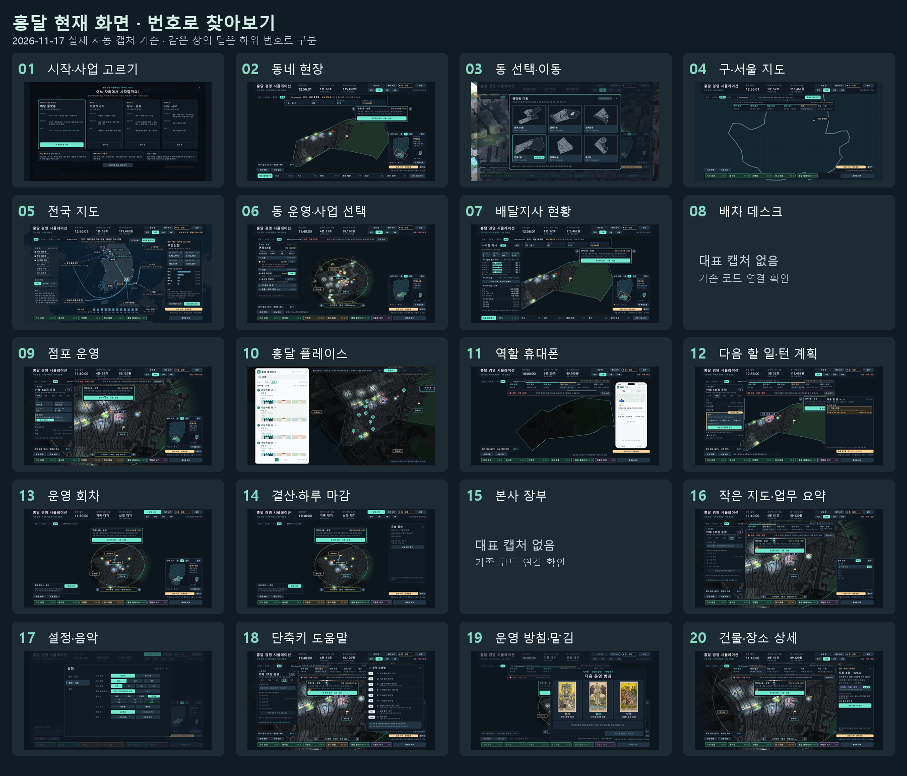

# [기획 · 현재 화면 번호 정리 · PLAN-SYSTEM-REGIONAL-OPERATOR-SIMULATION · r258]

[위에서 아래로 읽는 구조와 화면 연결은 r259](top-down-screen-hierarchy.design.r259.md)에 정리했다. 이 문서의01~20과 하위 번호는 그대로 참조한다.

[후속 오행 총괄판 r260](five-element-root-management-board.design.r260.md)은 새 루트00의 기획이다. 아래 기존 화면 번호/캡처를 바꾸지 않으며00은 현재 실행 화면으로 촬영·검증된 항목이 아니다.

- 기준일: 2026-11-17 KST. 사용자가 현재 만들어진 화면을 번호로 지목하며 검토할 수 있도록 요청했다.
- 상태: `CurrentScreenNumberingRequested / ExistingScreensCataloged / DocumentationReferencesAssigned / RuntimeLayoutUnchanged / ProductUnchanged`.
- 관계: [배달지사 성장 r257](delivery-branch-growth-play-loop.design.r257.md)을 논의할 화면 참조다. 기존 기획·구현 범위를 대체하지 않는다.
- 번호는 대화·기획·Claude 인계용이다. 기존 코드 고유 식별자·단축키·지도 단계·저장 값과 연결하지 않는다. 게임에 번호 표시를 추가하지 않았다.

## 1. 번호를 쓰는 방법

큰 화면은 `01`~`20`, 같은 창 안의 탭/상태는 `09-2`처럼 쓴다. 예: **「07번 지사 현황의 모집 부분」**, **「09-4번 직원 탭」**, **「11-1번 기사 휴대폰」**. 앞으로 화면이 추가돼도 기존 번호는 유지하고 새 번호를 붙인다. 없어진 화면은 번호를 재사용하지 않고 이력으로 남긴다.

## 2. 전체 화면 한눈에

## 3. 주요 화면 01~20

| 번호 | 화면 | 주로 보는 것·현재 한계 | 대표 캡처 |
| --- | --- | --- | --- |
| **01** | 시작·사업 고르기 | 배달 플랫폼 선택. 다른 패키지는 준비 중. | [보기](../../../../assets/changes/2026-11-17-hongdal-screen-catalog/screen-01.jpg) |
| **02** | 동네 현장 | 건물·기사의 빛·배달 이동을 보는 기본 화면. | [보기](../../../../assets/changes/2026-11-17-hongdal-screen-catalog/screen-02.jpg) |
| **03** | 동 선택·이동 | 다른 행정동을 찾아 이동하는 창. | [보기](../../../../assets/changes/2026-11-17-hongdal-screen-catalog/screen-03.jpg) |
| **04** | 구·서울 지도 | 구 지도를 연속 축소해 서울 전역을 보는 같은 지도 단계. | [보기](../../../../assets/changes/2026-11-17-hongdal-screen-catalog/screen-04.jpg) |
| **05** | 전국 지도 | 대한민국 권역·물류 시설을 보는 상위 지도. | [보기](../../../../assets/changes/2026-11-17-hongdal-screen-catalog/screen-05.jpg) |
| **06** | 동 운영·사업 선택 | 고른 동의 사업·고용·제휴 등 기존 운영 진입. | [보기](../../../../assets/changes/2026-11-17-hongdal-screen-catalog/screen-06.jpg) |
| **07** | 배달지사 현황 | 현재는 열린 동을 묶은 조회. 독립 1·2호지사 개설은 후속. | [보기](../../../../assets/changes/2026-11-17-hongdal-screen-catalog/screen-07.jpg) |
| **08** | 배차 데스크 | 현재 코드의 기존 배차 창 연결 확인. 이번 대표 캡처는 없음. | 미촬영 · 코드 확인 |
| **09** | 점포 운영 | 요약·재료·이력은 연결. 설비·직원은 탭/안내 단계. | [보기](../../../../assets/changes/2026-11-17-hongdal-screen-catalog/screen-09.jpg) |
| **10** | 홍달 플레이스 | 검색 결과·페이지·장소 상세·메뉴 보기. | [보기](../../../../assets/changes/2026-11-17-hongdal-screen-catalog/screen-10.jpg) |
| **11** | 역할 휴대폰 | 배달·음식점·화물·센터·점포 검수의 업무 상태 보기. | [보기](../../../../assets/changes/2026-11-17-hongdal-screen-catalog/screen-11.jpg) |
| **12** | 다음 할 일·턴 계획 | 안건·계획·턴 이후 결과로 이어지는 작업 창. | [보기](../../../../assets/changes/2026-11-17-hongdal-screen-catalog/screen-12.jpg) |
| **13** | 운영 회차 | 준비→실행·관찰→결과→다음 준비의 반복. | [보기](../../../../assets/changes/2026-11-17-hongdal-screen-catalog/screen-13.jpg) |
| **14** | 결산·하루 마감 | 오늘 결산·지난 결산·하루 마감의 결과 보기. | [보기](../../../../assets/changes/2026-11-17-hongdal-screen-catalog/screen-14.jpg) |
| **15** | 본사 장부 | 본사 장부로 가는 기존 연결 확인. 이번 대표 캡처는 없음. | 미촬영 · 코드 확인 |
| **16** | 작은 지도·업무 요약 | 오른쪽 아래의 보조 정보. 작은 지도 자동 검사 미통과. | [보기](../../../../assets/changes/2026-11-17-hongdal-screen-catalog/screen-16.jpg) |
| **17** | 설정·음악 | 화면·시간·음악 반응 등의 설정. | [보기](../../../../assets/changes/2026-11-17-hongdal-screen-catalog/screen-17.jpg) |
| **18** | 단축키 도움말 | 현재 배정된 화면 조작과 단축키 확인. | [보기](../../../../assets/changes/2026-11-17-hongdal-screen-catalog/screen-18.jpg) |
| **19** | 운영 방침·맡김 | 운영 방침 카드와 맡김 설정·자동 수행 상태 확인. | [보기](../../../../assets/changes/2026-11-17-hongdal-screen-catalog/screen-19.jpg) |
| **20** | 건물·장소 상세 | 건물/빛을 골랐을 때 여는 해당 장소의 카드. | [보기](../../../../assets/changes/2026-11-17-hongdal-screen-catalog/screen-20.jpg) |

## 4. 같은 화면의 탭·하위 보기

| 번호 | 화면/상태 | 캡처 |
| --- | --- | --- |
| **04-1** | 구 가까이 | [보기](../../../../assets/changes/2026-11-17-hongdal-screen-catalog/screen-04-1.jpg) |
| **04-2** | 서울 전체 축소 | [보기](../../../../assets/changes/2026-11-17-hongdal-screen-catalog/screen-04-2.jpg) |
| **06-1** | 이 동의 장소 | [보기](../../../../assets/changes/2026-11-17-hongdal-screen-catalog/screen-06-1.jpg) |
| **09-1** | 요약 | [보기](../../../../assets/changes/2026-11-17-hongdal-screen-catalog/screen-09-1.jpg) |
| **09-2** | 재료·발주 | [보기](../../../../assets/changes/2026-11-17-hongdal-screen-catalog/screen-09-2.jpg) |
| **09-3** | 설비 · 업무 미연결 | [보기](../../../../assets/changes/2026-11-17-hongdal-screen-catalog/screen-09-3.jpg) |
| **09-4** | 직원 · 업무 미연결 | [보기](../../../../assets/changes/2026-11-17-hongdal-screen-catalog/screen-09-4.jpg) |
| **09-5** | 이력 | [보기](../../../../assets/changes/2026-11-17-hongdal-screen-catalog/screen-09-5.jpg) |
| **10-1** | 검색 결과 | [보기](../../../../assets/changes/2026-11-17-hongdal-screen-catalog/screen-10-1.jpg) |
| **10-2** | 검색 2페이지 | [보기](../../../../assets/changes/2026-11-17-hongdal-screen-catalog/screen-10-2.jpg) |
| **10-3** | 매장 상세 | [보기](../../../../assets/changes/2026-11-17-hongdal-screen-catalog/screen-10-3.jpg) |
| **10-4** | 메뉴 | [보기](../../../../assets/changes/2026-11-17-hongdal-screen-catalog/screen-10-4.jpg) |
| **11-1** | 배달기사 | [보기](../../../../assets/changes/2026-11-17-hongdal-screen-catalog/screen-11-1.jpg) |
| **11-2** | 음식점 주문 · 조리 단계 조작 미연결 | [보기](../../../../assets/changes/2026-11-17-hongdal-screen-catalog/screen-11-2.jpg) |
| **11-3** | 화물기사 | [보기](../../../../assets/changes/2026-11-17-hongdal-screen-catalog/screen-11-3.jpg) |
| **11-4** | 물류센터 출고 | [보기](../../../../assets/changes/2026-11-17-hongdal-screen-catalog/screen-11-4.jpg) |
| **11-5** | 점포 검수 · 코드 확인/대표 캡처 없음 | 미촬영 · 코드 확인 |
| **12-1** | 하단 작업 대기열 | [보기](../../../../assets/changes/2026-11-17-hongdal-screen-catalog/screen-12-1.jpg) |
| **12-2** | 안건 창 | [보기](../../../../assets/changes/2026-11-17-hongdal-screen-catalog/screen-12-2.jpg) |
| **12-3** | 이번 턴 계획 | [보기](../../../../assets/changes/2026-11-17-hongdal-screen-catalog/screen-12-3.jpg) |
| **12-4** | 수행 결과 | [보기](../../../../assets/changes/2026-11-17-hongdal-screen-catalog/screen-12-4.jpg) |
| **13-1** | 준비 | [보기](../../../../assets/changes/2026-11-17-hongdal-screen-catalog/screen-13-1.jpg) |
| **13-2** | 진행 | [보기](../../../../assets/changes/2026-11-17-hongdal-screen-catalog/screen-13-2.jpg) |
| **13-3** | 결과 | [보기](../../../../assets/changes/2026-11-17-hongdal-screen-catalog/screen-13-3.jpg) |
| **14-1** | 오늘 결산 | [보기](../../../../assets/changes/2026-11-17-hongdal-screen-catalog/screen-14-1.jpg) |
| **14-2** | 지난 결산 | [보기](../../../../assets/changes/2026-11-17-hongdal-screen-catalog/screen-14-2.jpg) |
| **14-3** | 하루 마감 | [보기](../../../../assets/changes/2026-11-17-hongdal-screen-catalog/screen-14-3.jpg) |
| **16-1** | 작은 지도 · 자동 검사 미통과 | [보기](../../../../assets/changes/2026-11-17-hongdal-screen-catalog/screen-16-1.jpg) |
| **16-2** | 업무 요약 | [보기](../../../../assets/changes/2026-11-17-hongdal-screen-catalog/screen-16-2.jpg) |
| **17-1** | 일반 설정 | [보기](../../../../assets/changes/2026-11-17-hongdal-screen-catalog/screen-17-1.jpg) |
| **17-2** | 음악·빛 설정 | [보기](../../../../assets/changes/2026-11-17-hongdal-screen-catalog/screen-17-2.jpg) |
| **19-1** | 맡김 설정 | [보기](../../../../assets/changes/2026-11-17-hongdal-screen-catalog/screen-19-1.jpg) |
| **20-1** | 건물 정보 | [보기](../../../../assets/changes/2026-11-17-hongdal-screen-catalog/screen-20-1.jpg) |
| **20-2** | 장소·빛 카드 | [보기](../../../../assets/changes/2026-11-17-hongdal-screen-catalog/screen-20-2.jpg) |

## 5. 현재 구현과 검증 수준

최신 Unity Windows 작업본, Claude 배달플랫폼 뼈대 반환과 실제 자동 촬영을 읽기 전용으로 대조했다. 확인한 빌드는 `2026-11-17T00:43:38.4070569Z`의 성공 기록(오류 0·경고 0)이다. 이번 작업에서 새로 빌드하거나 게임을 조작해 촬영하지 않았다.

이번에 읽은 자동 촬영의 전체 판정은 **미통과**다. 요약 지도(작은 지도)의 표시·위치·입력·복귀 관련 복합 검사에서 실패를 보고했고 정확한 실패 항목/원인은 이 목록 작업에서 확정하지 않았다. 16번 계열에 이를 표시했다. 화면이 캡처되었다는 사실을 모든 기능의 정상 동작이나 실제 사용자 입력 통과로 올리지 않는다.

07번은 현재 열린 동을 한 지사로 묶은 조회다. 09-3/09-4는 설비/직원 탭이 있어도 구매·고용이 연결됐다는 뜻이 아니다. 11-2의 음식점 수락·조리 시작·준비 완료 조작도 후속이다. 04번의 서울 전체는 구 지도의 연속 축소 보기이며 새 지도 단계를 추가하지 않았다. 08/15는 기존 연결을 코드에서 확인했고 대표 캡처는 미준비로 남겼다.

[캡처별 원본/축소본 지문·코드·빌드 근거](../../../../../artifacts/local/screen-catalog-20261117-r258/screen-catalog.json)를 보존한다. 대표 이미지는 실제 캡처의 축소본이며 시안 이미지를 섞지 않았다. 목록의 정렬은 대화/문서의 읽는 순서다. 게임 UI 배치 변경·미연결 기능 구현·제품 코드·Goal/WI/E 승격·commit/push는 수행하지 않았다.

## 6. 확정 / 미정 / 다음 검토

**확정:** 현재 화면을 번호로 지목할 수 있도록 문서 목록을 만든다. 위 번호를 이번 검토의 참조로 배정했다.

**미정:** 화면 통합/삭제·실제 배치 변경·게임 안 번호 표시·미연결 기능 구현. 이 정리로 변경을 승인한 것으로 해석하지 않는다.

**다음 질문:** 이번에는 새 선택을 묻지 않는다. 사용자가 번호로 화면을 지목하면 그 화면의 역할·내용·배치를 검토한다.
