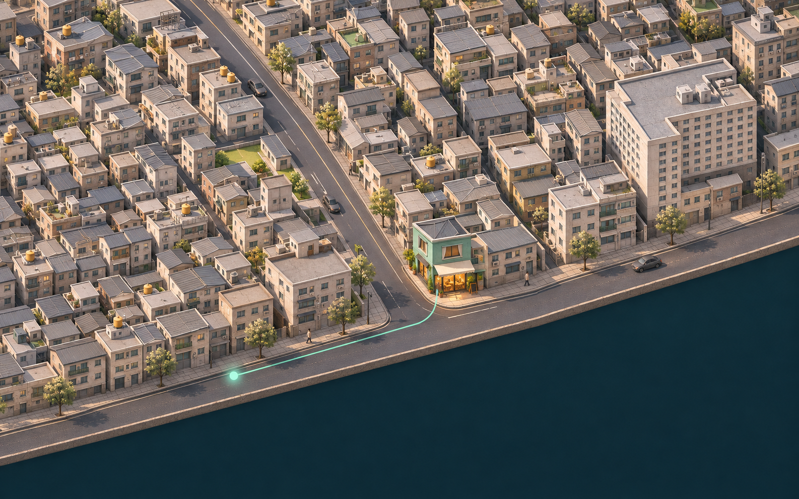
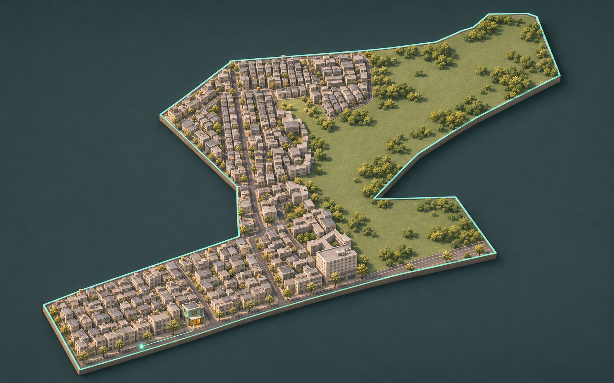
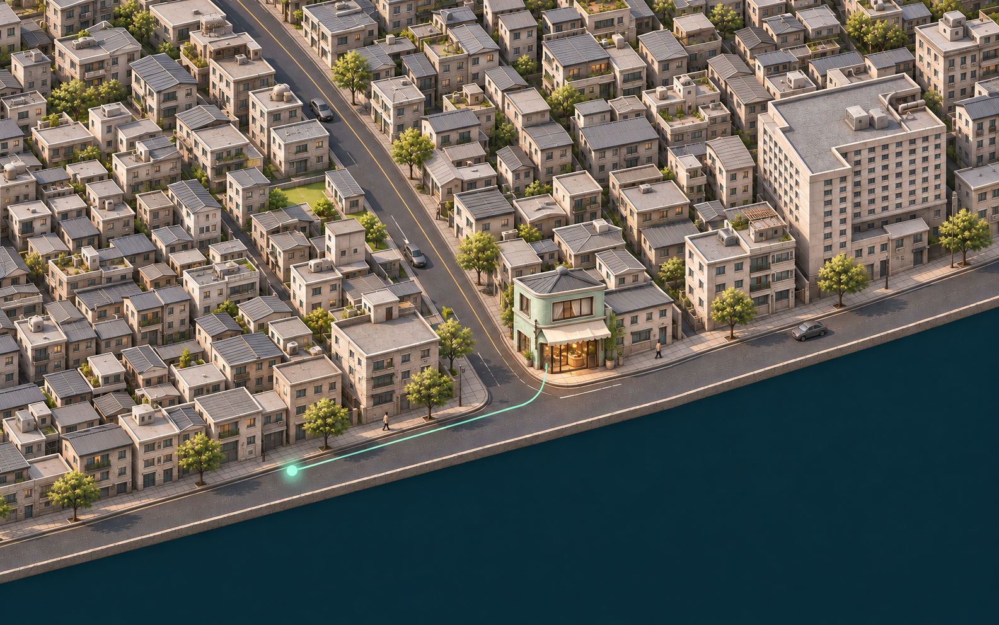

# [기획 · 행정동 디오라마 미술 · PLAN-SYSTEM-REGIONAL-OPERATOR-SIMULATION · r228]

- 상태: `Proposed / ArtDirectionPreview / NotReadyToDispatch`
- 검토 기준일은 2026-11-15 KST다. 현실 자료로 만든 동네에 게임다운 색·빛·재질을 더하는 미술 방향을 제안한다. 첫 장면은 낮의 면목제3·8동이다.

## 첫 장면

오른쪽 아래에 민트색 2층 카페가 있다. 크림색 차양 아래로 호박색 창빛이 보인다. 왼쪽 아래 골목의 민트빛 한 점은 기사다. 두 곳 사이를 가는 선이 잇는다. 카페는 제자리에 있고 기사 빛은 길을 따라 움직여, 색이 비슷해도 누를 대상을 고를 수 있다. **첫 시선은 내 가게에, 두 번째 시선은 기사와 길에 간다.**

동 전체로 물러나면 같은 카페는 지붕의 작은 민트 표식으로 찾는다. 이 축척에서는 건물 하나의 창문보다 동의 윤곽, 큰길이 이어지는 방향과 내 가게가 있는 쪽이 먼저 읽혀야 한다.

전체 시안에서는 민트색 동 경계가 작은 카페와 기사 경로보다 눈에 먼저 들어온다. 첫 시험에서는 경계를 저채도의 가는 선으로 두고 경계를 선택했을 때만 민트를 써서, 평소에는 카페·기사에 시선이 머무는지 확인한다.

지도의 미술에 집중할 수 있도록 조작 창을 생략한 시안이다. 낮빛 아래 건물 덩어리가 읽히는지, 운영 점포와 기사 빛을 찾기 쉬운지 본다. 건물 외장·차양·창문과 수목의 세부 묘사는 미술 표현 예시다. 옥상의 노란 물탱크가 반복돼 눈에 띈다. 실제 첫 시험에서는 몇 채에만 채도를 낮춰 배치하고 원본 건물 외곽과 골목 폭을 보존한다. 개별 건물의 모양과 위치를 확인할 때는 [현재 Windows 검토판의 실제 화면](../../../../assets/changes/2026-11-15-hongdal-dong-r4/four-districts.png)을 쓴다.

## 가까이서 보는 카페의 재질

사용자는 **로우폴리 외형을 필수 조건으로 두지 않는다**고 밝혔다. 앞의 두 장에서 거리 배치와 색을 고른 뒤, 같은 카페를 **낮의 반실사 건축 모형**으로 표현하는 안을 제안한다. 화면 가까이에 둔 점포에는 둥근 차양 끝과 가느다란 창틀을 쓰고, 도장 금속에는 좁은 빛띠를, 미장 벽에는 거친 무광 표면을, 창유리에는 안쪽 불빛이 남을 만큼 절제한 반사를 준다. 벽돌 줄눈과 모서리의 작은 그림자는 가까이 다가가야 보일 정도로 둔다.

이 세 번째 그림은 재질을 비교하는 용도다. 낮빛이 닿은 회벽·벽돌, 곡면 민트 외벽과 천 차양, 유리에 비친 거리와 호박색 실내를 본다. 카메라 거리와 세부 도형에 차이가 있어 실건물의 형상·크기·점포 위치를 증명하는 자료로는 사용할 수 없다.

카메라가 물러나면 거리별 세부 단계(LOD)를 바꾼다. 먼저 줄눈과 유리 반사를 줄이고, 더 멀어지면 차양의 곡면을 단순화해 점포의 색과 형태가 남게 한다. 세부 외장은 건물 ID와 지도 원점을 그대로 쓰는 시각 요소다. 누르기·충돌 판정에는 같은 건물 외곽과 상호작용 좌표를 써서 근경과 전체 보기에서 고른 건물이 바뀌지 않게 한다. 채택할 재질과 세부 단계를 바꾸는 거리·성능 목표는 실제 Windows 화면에서 검토한다.

## 현재 구현과 이번 차이

| 확인 범위 | 현재 근거와 이번 제안 |
| --- | --- |
| 그대로 쓸 것 | r4에서 면목제3·8동을 포함한 여섯 동의 경계·건물·지표 도보선·공원 계획면과 건물 선택이 실제 Windows 화면에 연결됐다. 65동은 기준동과 같은 생성 설정으로 자료와 메시를 대조했고, 별도 Windows 표본에서 상계2동의 건물 1,331조각과 지번 선택도 확인했다. [상계2동 화면 검증](../../../../../artifacts/local/admin-dong-reference-review-20261115/unity-sample/검증.md) 지도 모양, 건물 ID, 누르는 영역과 지번을 새 미술에도 이어 쓴다. [실행·자료 검증](../../../Handoffs/2026-11-15-Codex-기사빛-행정동-디오라마-r4.md) |
| 보완할 것 | 현재 WindowsGame의 `DrawCourier`는 `DrawCourierGlow`를 호출하며 기사 A는 민트, B는 연보라다. 기사와 점포의 색이 가까울 때 점포의 고정된 면과 기사의 둥근 중심점을 구분한다. 현재 배차 지도에서 픽업 선은 금색이고 전달 선은 기사색이다. 두 구간의 색을 기사와 맞추는 r212는 후속 제안이다. [기사 빛 실제 확대](../../../../assets/changes/2026-11-15-hongdal-dong-r4/rider-light.png) · [경로선 r212](soft-road-following-delivery-lines.design.r212.md) |
| 새로 제안하는 것 | 따뜻한 낮빛, 무광 건물 외장, 지붕 모서리의 가는 빛, 짧고 부드러운 그림자를 한 동의 공통 재질로 조합한다. 이 판본의 산출물은 미술 시안이다. 해당 재질을 적용한 Windows 실행 검증은 후속이다. |
| 아직 확인할 것 | 바닥은 평면 표현이다. 공원 계획면은 자료의 계획 시점이 있고, 나무의 자리와 산의 높이도 별도 근거가 필요하다. 현장 위치가 확인되지 않은 식생의 배치나 점포의 실제 간판·입구·영업 상태를 사실로 표시하지 않는다. [계절 경관과 지형 r221](seasonal-scenery-trees-and-terrain.design.r221.md) |

## 같은 미술을 다른 동에 쓰는 법

| 대상 | 가까운 거리에서 | 한 동을 펼쳐 보거나 더 멀어지면 |
| --- | --- | --- |
| 건물·길 | 지붕은 은회색, 벽은 한 톤 어둡게 두어 건물 높이와 골목 틈을 읽는다. 차도와 보행로는 평면의 밝기와 너비로 구별한다. | 창문과 작은 그림자는 차례로 생략한다. 동 외곽·도로의 연결과 건물 덩어리가 먼저 읽혀야 한다. |
| 내 점포 | 운영 관계가 확인된 건물의 차양·처마 등 고정된 한 면에 민트를 쓴다. 건물 전체를 켜서 이웃 매장의 경계를 지우지 않는다. | 지붕의 작은 표식 하나를 남긴다. 구 지도에서는 기존 거점 표시에 연결한다. |
| 기사·경로 | 민트·연보라 중심점과 짧은 번짐으로 표시한다. 선택한 기사에만 이동 경로를 강조한다. 빛의 중심과 눌리는 자리가 일치해야 한다. | 기사 빛이 가까워져도 중심점을 읽을 수 있게 한다. 민트 점포와 기사가 맞닿으면 선택 테두리와 이름으로 구분한다. |
| 계절·시간 | 낮 장면은 같은 빛 방향으로 그린다. 기존에 확인된 녹지의 색, 주변광과 그림자에 계절·시간 변화를 입히는 방식을 제안한다. | 일몰의 따뜻한 색, 계절의 잎 색은 배경에 남긴다. 기사와 점포의 식별색을 유지하며, 동의 전체 보기는 정적인 화면에서도 판독되어야 한다. |

명덕이 쌓인 정도는 기존 기획대로 빛의 기본 크기에 연결한다. 하루 중 시각·계절은 주변 조명에, 박동은 선택형 움직임에 쓴다. 소유·성장·현재 선택을 같은 밝기 하나로 전부 설명하지 않는다. [회색 동네와 내 매장 r143](gray-neighborhood-managed-stores-and-walkers.design.r143.md) · [효과 선택 r157](optional-map-visual-effects.design.r157.md) · [명덕과 빛 r205](mingde-contribution-light-growth.confirmed.r205.md) · [밀집한 빛 r209](dense-light-readability-and-meaning.proposal.r209.md)

## 시안 검토와 다음 결정

면목제3·8동과 화양동에서 같은 낮빛·시점·축척을 놓고 **동 전체 한 장과 가로 300m 근경 한 장**을 비교한다. 기준동의 매장 장면은 같은 건물·도로를 대상으로 실제 화면과 대조한다. 화양동에서 경영 관계가 연결되지 않았다면 건물·거리의 표현만 비교한다. 검토자가 내 점포와 기사를 각각 찾고, 두 건물 사이로 길이 이어지는지 읽고, 효과를 끈 뒤에도 같은 대상을 고를 수 있는지가 수용 기준이다. 다른 동의 건물 수나 수목 밀도를 면목제3·8동과 같게 만들 필요는 없다.

- **확정된 방향**은 실제 공간 자료를 바탕으로 한 동에 집중하고, 운영 매장을 구별하며, 배차 기사를 빛으로 표현하는 것이다. 모델은 여러 방식으로 제작할 수 있다. [한 동 집중 r182](single-dong-crowd-focus.confirmed.r182.md)
- **미정**은 낮 미술과 반실사 재질의 채택, 점포의 민트 면적·반사와 그림자의 세기, 실제 PC에서 쓸 세부 단계다. 시안 수용과 제품 구현은 별도로 기록한다.
- **다음 질문 하나**는 “면목제3·8동의 첫 재질 시험은 무광 미장 벽·도장 금속·은은한 유리 반사를 쓰는 낮의 반실사 건축 모형 톤으로 할까요?”다.
