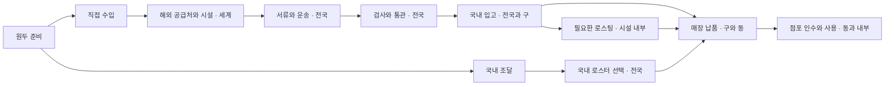

# [기획 · 국내 로스터 자료와 절차 노드별 지도 이동 · PLAN-SYSTEM-REGIONAL-OPERATOR-SIMULATION · r197]

- 기준일: 2026-11-14 · Unity Windows 경영 게임.
- 상태: `ProcessNodeMapNavigationDirectionConfirmed / DomesticRoasterSourcesReviewed / MapResponsibilitiesProposed / NationwideRoasterCountUncollected / NotReadyToDispatch / ProductUnchanged`.
- 사용자 방향: 국내 로스터 수/공급처를 확인할 데이터가 있는지 조사한다. 공급처·서류/운송·검사/통관·국내 입고 등 각 과정을 그래프로 표현하고, 노드를 누르면 적합한 동·구·대한민국·세계 지도에 이동해 관련 정보를 읽도록 한다.
- 관계: [r190 개업 준비 그래프](cafe-opening-supply-chains-and-map-linked-process.proposal.r190.md)와 [r196 원두 수입 절차](coffee-import-food-safety-and-learning-flow.research.r196.md)의 지도 책임/자료를 구체화한다. [r184 지도 경로](district-seoul-continuous-zoom-and-nation-transition.design.r184.md)·[r195 홍달 플레이스](hongdal-place-registration-and-store-profile.design.r195.md)를 유지한다. 독립 서울 단계를 다시 만들지 않는다.
- 범위: 공식 자료의 제공 항목/집계 가능성 조사와 기획이다. 국내 로스터 업체 본문의 신규 수집/전국 집계·실제 공급 계약/좌표 결속·제품/Unity 구현은 수행하지 않았다.
- WI·Goal·Graph Map: 미등록/미변경. 아래 도식의 노드명은 기획 설명이며 공식 고유 식별자/Graph Map/기존 절차 색인을 발급·수정한 것이 아니다.

## 1. 국내 로스터 데이터는 있는가

**공급처 후보를 찾을 공개 자료는 있다. 다만 이번 조사에서 전국 로스터의 정확한 총수를 확보한 것은 아니다.** 기업·사업장·등록공장·로스터리 카페·제품 신고 건수는 다른 단위다. ‘커피숍 수’나 이름에 커피가 들어간 업체 수를 국내 로스터 수로 표시하지 않는다.

| 자료 | 찾을 수 있는 것 | 확인 상한/집계 주의 |
| --- | --- | --- |
| [전국등록공장15105482](https://www.data.go.kr/data/15105482/fileData.do) | 회사명·생산품·공장주소 등 등록공장 정보 | 현재 보유 카탈로그명 기준2025-12-31, 수정2026-09-23. 업체 본문 미취득. 등록공장 모집단이 소형 로스터리까지 전수 포괄함을 보장하지 않음 |
| [시도·업종 공장통계15085508](https://www.data.go.kr/data/15085508/fileData.do) | 지역·업종별 공장 통계의 수집 후보 | 현재 보유 메타데이터는 KSIC10차 기준이라고 설명. 수치 본문 미취득이며 최신 분류와 혼합하지 않음 |
| [고양시 공장등록3080741](https://www.data.go.kr/data/3080741/fileData.do) | 업종코드·생산품·주소·좌표 등 지역별 보충 자료 | 공식 설명은 KSIC11차를 명시. 지역 표본이지 전국 전수 자료가 아님 |
| [식품안전나라 I1250](https://www.foodsafetykorea.go.kr/api/openApiInfo.do?svc_no=I1250) | 품목유형·제품명·생산종료여부·업소명·인허가번호·품목제조번호 | 볶은커피 품목 근거를 찾을 수 있는 후보. 제품 행수를 업체 수로 세지 않으며 영업상태/주소 자료와 추가 연결 필요 |
| 지역 식품제조가공업 자료 | 예: [인천15120683](https://www.data.go.kr/data/15120683/fileData.do)는 업체·주소·식품유형 공개 | 생산품/영업상태의 세부성·기준일은 출처마다 다름. 특정 지역 현황으로 전국 수를 대신하지 않음 |

산업분류 판본도 보존한다. 커피 가공업의 **10차10791 / 11차10891**을 같은 원문 코드처럼 덮어쓰지 않는다. [공식 산업분류 해설](https://law.go.kr/LSW/flDownload.do?flSeq=136717847)의 해당 업종은 볶은 커피 외 다른 가공형태도 포함하므로 코드 일치만으로 원두 로스터라고 확정하지 않는다. 세부 해설은 공식 검색 추출로 확인했고 원문 재열람 일부가 점검 화면을 반환한 한계가 있다.

전국등록공장 설명의 월말 추출 기준과 포털 메타데이터의 연간 갱신 주기는 별도로 기록한다. 카탈로그 수정일을 개별 공장 관측일로 사용하지 않는다.

## 2. 집계/지도 후보를 준비하는 방식

후속 자료 작업은 다음 흐름을 제안한다. 이번에 실행한 수집/DB 작업은 아니다.

1. 원천별 판본·범위·식별자·상태·주소·산업분류/생산품을 보존해 취득한다.
2. 분류 판본에 맞는 커피 가공 공장 후보와 ‘볶은커피’ 제품 근거를 가진 제조사업장 후보를 따로 만든다.
3. 제품의 인허가번호 등 근거로 사업장 상태/주소를 연결한다. 회사명이나 ‘로스터’라는 상호 문자열만으로 동일 업체/직접 제조를 확정하지 않는다.
4. 공장·사업장·제품·카페가 같은 장소인지 검토하고 중복/불확실 관계를 남긴다. 한 기업의 여러 공장을 하나의 시설로 합치지 않는다.
5. 주소·좌표계·실제 건물 결속까지 확인된 후보만 지도에서 시설 핀으로 보여 준다.

화면에 필요한 수치는 **커피 가공 등록공장 수 / 볶은커피 제품 근거가 연결된 제조사업장 후보 수 / 소형 로스터리 추가 확인 후보 수 / 지도 표시 가능한 후보 수**로 나눈다. 서로 겹치는 모집단을 합산해 ‘대한민국 전체 로스터’라고 표시하지 않는다. 이번의 전국 로스터 수와 후보별 집계값은 `미집계/null`이며 0개가 아니다.

등록 사실·제품 보고가 있어도 현재 도매 거래 가능·재고·생산능력·가격·납기·가맹점 공급 관계가 확인된 것은 아니다. 현실 자료는 읽기용 공급처 후보, 게임 계약/운영은 명시한 가상 파트너로 구분한다. 실제 업체에 가상 납품 이력이나 부정행위를 자동 부여하지 않는다.

기존 로컬 자료는 [r190 수집 기록](../../../DataCollection/Research/2026-11-14-cafe-opening-supply-chain-intake.md)에 따라 공장 카탈로그만 보유한다. 커피숍1743관측은4구 인허가로 로스터 수가 아니다. 기존 `geography/facilities-business-certification`의 `blocked`와 인증/범위·DB 분리 검토를 유지하며 이번에는 API 수치 호출·수집기/예약을 바꾸지 않았다.

## 3. 과정마다 주로 보는 지도

**사용자는 절차를 고르고, 지도는 그 절차를 이해하기에 적합한 범위로 바뀐다.** 세계는 해외 조달, 대한민국 전국은 수입·간선 운송, 구는 공급망 배분, 동은 매장/마지막 배송, 시설 내부는 실제 현장 작업을 주로 읽는 책임 배정안이다.

| 절차 노드 | 기본 지도 | 상세로 볼 대상/초점 |
| --- | --- | --- |
| 국내 로스터/공급처 선택 | 대한민국 전국 | 후보 목록/지역 분포 → 선택 로스터 소재 구·동/건물. 확인된 실제 공급처 후보와 가상 계약 대상을 구분 |
| 해외 공급처·제조/포장시설 확인 | 세계 | 상대국·실제 또는 명시된 가상 공급처/시설. 국가만 확인됐으면 국가 관계로 표시 |
| 수입자 준비·서류 확인 | 대한민국 전국 | 담당 수입자·수입 건·예정 국내 도착 거점과 서류 카드. 해외시설 확인은 세계 노드와 연결 |
| 선적·국내 도착 운송 | 대한민국 전국 | 선택 화물의 국내 도착항/공항·보세 거점, 해외 출발국 방향. 전체 해외 구간은 세계 상세로 이동 |
| 식품검사·검역·통관 | 대한민국 전국 | 그 화물의 실제 검사/보관·도착 거점과 세 상태 카드. 기관 본청 소재지로 대신 이동하지 않음 |
| 국내 반출·입고 거점 | 대한민국 전국 → 해당 구 | 선택 창고/로스터로 가는 국내 운송·입고 대상. 인수/검수 작업은 그 시설 내부 |
| 필요한 로스팅·포장 | 해당 구/동의 로스터 건물 → 내부 | 로스팅·포장·보관 작업과 같은 원두/화물. 볶은 원두를 샀으면 불필요한 로스팅 생략 |
| 매장 납품·마지막 배송 | 구 → 동 | 해당 배송권/차량·다음 정차·점포 도착. 거리만으로 공급 계약을 생성하지 않음 |
| 매장 인수·사용 | 동 → 매장 내부 | 검수/보관·가용 원두·커피 제조. 점포의 홍달 플레이스는 같은 매장 정보로 연결 |

표의 화살표는 필요할 때 더 자세히 보는 관계다. 노드를 한 번 눌렀다고 여러 지도/내부 화면을 연속으로 자동 순회하지 않는다. 기본 지도로 이동해 대상을 읽고, 상세/내부는 사용자가 선택한다. 서류 노드는 정부기관 방문 미니게임이 아니라 해당 수입 건을 이해하는 전국 지도+문서 패널로 제안한다.

검사·통관의 하위에는 r196의 **식품 / 필요한 식물검역 / 세관** 상태를 유지한다. 이들을 같은 지도에 보여 준다는 이유로 동일 기관/동일 완료 상태로 합치거나 모든 검사를 직렬로 강제하지 않는다.

## 4. 그래프와 지도 왕복

도식은 큰 과정을 읽는 기획 예시다. 직접 수입의 검사/통관은 품목별 세부 경로를 펼치는 부모 노드이며 고정 법정 직렬 순서를 뜻하지 않는다.

로스팅 여부에 따른 H→I→J와 H→J는 선택한 제품 프로필에 따른 분기이며 동시에 두 번 납품하는 경로가 아니다. 국내 로스터 구매는 수입 절차를 플레이어에게 다시 수행시키지 않고 D→J로 이어진다.

**노드 선택 → 관련 지도 이동 → 대상 강조 → 상태/자료·다음 선택 확인 → 같은 그래프/계획으로 귀환**을 공통 상호작용으로 둔다. 지도와 함께 절차 패널을 유지해 어디를 보고 있는지 잃지 않게 한다. 기존 작업 대기열을 대체하는 화면 배치나 패널 위치는 시안 전 미정이다.

예를 들어 ‘국내 입고’를 누르면 전국 지도에서 선택 창고를 강조한다. `[주변 보기]`는 해당 구, `[내부 보기]`는 그 창고의 인수/검수 공간으로 들어간다. `[원두 계획으로 돌아가기]`를 누르면 같은 카페·원두 계획·선택 노드와 이전 지도 문맥으로 돌아온다. 실제 창고/공간이 준비됐을 때의 동작 제안이지 새 내부 모델을 만든 결과는 아니다.

## 5. 공통 전환 규칙

- **문맥 보존:** 대상 점포·원두/화물·선택 노드·그래프 펼침·필터/초안·이전 지도/확대/선택을 보존한다. 다른 카페의 수입 건으로 바뀌지 않는다.
- **대상 우선:** 노드가 연결한 장소/화물/시설을 강조한다. 지도 확대 때문에 다른 공급처를 임의 선택하지 않는다.
- **원자료/가상 구분:** 실제 자료 후보·검증된 위치·가상 계약/경로를 구별한다. 통계 국가나 등록시설 사이에 실제 거래 간선을 자동 생성하지 않는다.
- **미확인:** 위치 결속이 없으면 이유와 목록/자료를 보여 준다. 지역 집계는 집계 영역으로 표시하고 공장 핀으로 꾸미지 않는다. 아무 항만·서울 중심을 대신 찍지 않는다.
- **지도 미준비:** 세계/상세/내부 화면이 준비되지 않았으면 이를 알리고, r190처럼 현재 지도와 상대국/거점 패널을 유지한다. 빈 공간을 다른 지역 자료로 채우지 않는다.
- **권한/시간 유지:** 관찰을 위해 지도 범위를 바꿔도 사업 해금·담당 역할·수입 권한·현실 날짜/회차·발주/검사/입고 상태를 변경하지 않는다.
- **카메라 통제:** 물류 상태 갱신은 노드 표시를 바꾸고, 지도 자동 이동은 사용자의 노드/상세 선택에 따른다. 관찰 중 다른 단계로 강제 이동하지 않는다.
- **한 번에 한 초점:** 한 지도에서 선택 절차·대상 하나를 우선 보여 준다. 노드별 지도 여러 장을 동시에 열거나 모든 동/시설을 펼치지 않는다.

정확 카메라 이동 시간·효과·클러스터/목록 밀도·노드 모양/색은 제안/시안 검토 사항이다. 관리 매장의 민트색과 공급처 선택 강조를 혼동하지 않는다. 노드를 누르는 조회 행동이나 곡선 도착 연출이 법적 등록·계약·비용·입고 완료를 만들지 않는다.

## 6. Claude가 준비할 첫 범위와 검증 후보

첫 후보는 기존 카페의 같은 원두 계획에서 **공급처 노드→준비된 전국 지도/대상→설명→같은 계획 귀환**이다. 실제 공급처 원자료·좌표가 아직 없으면 ‘위치 확인 필요’의 정확한 상태부터 읽을 수 있어야 한다. 수입·운송·검사·창고·로스팅을 한 번에 새 구현으로 묶지 않는다.

후속 노드를 같은 전환 규칙에 연결하되, 해당 지도/실제 대상/가상 시나리오·상태 소유자를 확인한다. 기존 r190의13노드/16연결 `mapTargets=[]`를 위치 결속 완료로 승격하지 않는다. 건물 내부·Graph Map·Scene·공유 계약은 담당별 별도 수용/연구/검증이 필요하다.

검증 후보는 국내/해외 분기와 생략 경로, 지도별 대상 동일성, 선택/뒤로가기의 문맥 보존, 미확인·지도 미준비 표시, 검색/자료와 게임 운영 상태 분리, 관찰 중 강제 카메라 이동 없음, 노드 조회의 날짜·원장 불변이다. 상세 기획/hash·WI 하나·E1~E7 명세·정확 쓰기 경로·개발 수용은 별도다.

## 7. 확정 / 미정 / 다음 질문 하나

- **확정 방향:** 과정을 그래프로 표현하고 노드를 누르면 그 과정에 맞는 지도/대상으로 이동한다. 국내 공급처 데이터 가능성을 조사한다.
- **조사 결과:** 등록공장·품목제조보고·지역 제조업 자료는 후보 근거로 이용 가능하다. 전국 로스터 총수·실제 거래 가능 공급처·지도 좌표 결속은 아직 확보하지 않았다.
- **이번 배정안:** 해외 공급처=세계, 국내 공급처/서류·운송/검사·통관=대한민국 전국, 입고·가공/납품=구·동·시설 내부.
- **미정:** 전국 업체 본문 수집/중복 검토·집계, 실제 공급처/좌표·지도/내부 준비, 노드별 대상/상태 계약·시안·개발 수용.
- **다음 질문 하나:** 없음. 이번에는 자료 가능성과 지도 배정/전환 규칙을 준비한다.

기획·탐색 문서만 변경했다. 원자료/수치 API 취득·계정/비밀키 탐색·DB/수집기/예약·제품/Unity·Graph Map 원본·Goal/WI·전역 D·commit/push는 수행하지 않았다.
