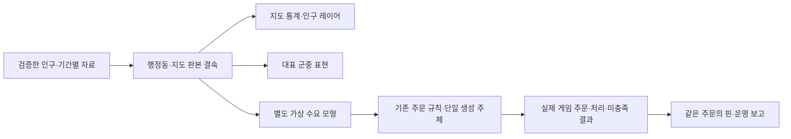

# [기획 · 행정동 인구의 지도 연결과 주문 수요 · PLAN-SYSTEM-REGIONAL-OPERATOR-SIMULATION · r200]

- 기준일: 2026-11-14 · 분야: 행정동 인구·지도 통계·자료 기반 게임 환경/주문 수요.
- 상태: `AdministrativeDongPopulationMappingRequested / PopulationTypesAndCurrentProxyReviewed / DemandInfluenceDirectionConfirmed / BindingAndOrderModelProposed / NotReadyToDispatch / ProductUnchanged`.
- 사용자 방향: 시안 이미지는 Claude가 맡고 Codex는 기획을 작성한다. 행정동별 인구를 지도에 연결하고, 인구 환경에 따라 주문이 더 생길 수도 덜 생길 수도 있는 경영을 준비한다.
- 상위: [공통 r162](integrated-map-management-baseline.r162.md). 관련: [군중 r180](population-driven-map-crowds.design.r180.md), [세 시간대 r181](myeonmok-three-period-crowd-comparison.confirmed.r181.md), [한 동 집중 r182](single-dong-crowd-focus.confirmed.r182.md), [판본 r54](session-pinned-public-data-revision.r54.md), [날짜 r174](live-calendar-daily-management.baseline.r174.md), [회차 r187](operating-round-first-play.prototype.r187.md), [사업 진입 r198](business-tabs-and-dong-scoped-expansion.design.r198.md).
- 확장 범위: r180의 자료→표현과 별도로 자료→게임 수요의 연결을 구체화한다. 군중 수/표시 설정이 주문을 만든다는 규칙으로 바꾸지 않는다. 기존 원문/수집/업무 권위를 대체하지 않는다.
- WI·PlayableLoop·Graph Map: 이번에 신규 등록/활성화하지 않음. 검증된 인구 사본→행정동 결속→지도 조회/군중과 수요 모형의 독립 투영→주문 결과→같은 동의 다음 경영 선택 관계가 영향 후보다.
- 인계 상태: Claude가 이어 읽을 기획이다. 코드/팩 교체·실제 지도 결속·개별 주문 생성·시안·개발 수용은 수행하지 않았다.

## 1. 먼저 제공할 경험

**한 행정동을 선택하면 그 동의 인구 환경을 읽고, 어느 시간에 어떤 사업/인력이 필요한지 판단한다.** 인구가 많은 것은 주문 기회가 커질 수 있는 근거다. 모든 사람이 주문하거나 인구가 두 배면 주문/매출도 반드시 두 배가 되는 규칙은 채택하지 않는다.

- 지금: 선택한 동에서 다음 운영 회차의 영업/인력을 검토하는 때.
- 여기: 행정동 한 곳의 지도, 인구/활동 요약과 기존 사업 운영 창.
- 나: 매장·기사·영업 시간/업종과 준비된 운영 방침을 고르는 플레이어.
- 너: 검증된 지역 인구/시간대 자료, 영업 가능한 점포·고객 선택/대기·운영 여력.
- 이렇게: 같은 동의 자료 기준과 시간대별 경향을 확인→음식점/기사 운영에서 준비→실행/관찰→발생·처리·미충족 결과를 비교→개선하거나 확장을 미룬다.
- 대가/회복: 추가 인력/영업의 비용과 유휴 시간, 부족한 조리·배송 여력/대기. 결과가 낮으면 조건을 다시 확인하고 기존 업무에서 개선한다.
- 상위 목적 정렬: 공공자료를 경영의 환경으로 읽는 보조 층. 자료 조회/시각 효과를 성과·소득·사람 성장으로 지급하지 않는다.

첫 검토는 r182의 **한 행정동**을 유지한다. 이웃 동을 전부 펼치거나 여러 동의 주문을 한꺼번에 소개하지 않는다. 특정 첫 동의 선택은 기존 미정을 보존하고, 현재 선택 동을 예시로 쓸 경우 예시임을 밝힌다.

## 2. 현재 가진 자료와 실행 자료의 차이

읽기 전용 자료/소스 점검으로 다음 범위를 확인했다. 기존 DB 영수증은 보존하되 이번에 실DB 연결을 새로 열어 재조회한 것은 아니다.

| 항목 | 확인한 내용 | 이번 연결에 쓸 의미/남은 준비 |
| --- | --- | --- |
| OA-22178 행정동 추정 유동인구 | 원본 9,350행·22분기(2021Q1~2026Q2), 최신425개 통계 행정동 | 원래 기간/코드·단위의 활동 규모. 주민등록 인구·고유 방문자·현재 거리의 사람 수가 아님 |
| OA-15568 상권 추정 유동인구 | 별도 원본36,281행 | 상권 지표. 행정동 값과 합치거나 통째로 각 동에 복제하지 않음 |
| 시간대/요일 | 면목6동 최신6행/이력132행의 원문 프로필, 시간대6구간·요일7열 | 숫자/결측/음수·기간키 문제0이지만 합계 의미 검토 필요. 시간대×요일 결합분포·시간당 보정·지도 할당 미수행 |
| 기존 공공자료 DB 반입 | 행정동 총계9,350행의 기존 정규화/검증 근거. 품질은 `PendingHumanReview` | 총계의 저장/계보와 지리 결속 승인은 다름. 시간대/요일은 원본/프로필에 있으며 총계 DB행에 이미 들어 있다고 하지 않음 |
| 주민등록 인구 | 공식 행정동별 월말 통계 제공 경로 확인. 이번 좁은 보유 점검에서는 해당 본문을 확인하지 못함 | 거주 규모 보충 후보. 실제 취득·범위/단위/코드 검증 뒤 별도 지표로 연결 |
| 현재 Unity 동 수요 팩 | `basis.population.kind=residentialFloorArea`, 시간대/요일 임시, 소득 `none` | `population` 필드가 지금은 **주거 연면적㎡ 대리값**. 사람 수로 표시/해석 금지 |

원본 보유는 [수집 안내](../../../DataCollection/SeoulPopulationRoadContext.md), 시간대 값은 [면목 프로필](../../../../../artifacts/local/management-research-data-20261114/common/myeonmok-time-profiles.json), 검증 한계는 [전열 감사](../../../../../artifacts/local/management-research-data-20261114/common/population-column-audit.json)를 따른다. 감사의 시간대 합계 차이6,551행·요일 합계 차이6,777행은 원인 미확인이다. 이를 몰래 재정규화해 ‘검증된 시간대 주문 확률’로 만들지 않는다.

‘실제 인구 연결 구조가 전혀 없다’거나 ‘이미 실제 인구로 주문을 발생시킨다’고 일괄 설명하지 않는다. **입력 가능한 구조/집계는 있고, 현 실행 팩은 면적 대리값이며 실제 인구 자료 연결이 남아 있다.**

## 3. 행정동에 매핑하는 단위와 규칙

기본 연결은 **출처별 행정동 코드/관측기간 → 검토한 코드 대응 → 같은 행정동 모듈/판본 → 조회 결과**다. 동 이름만으로 묶지 않는다.

| 보존할 의미 | 내용 |
| --- | --- |
| 자료 식별 | 출처/자료군·원본 위치/SHA·측정 지표·값/단위·기준 월/분기·취득시각 |
| 지역 식별 | 원문 코드/코드체계·명칭·유효기간·관할/경계 판본 |
| 지도 결속 | 기존 `administrativeAreaStableId` 등 실제 계약과 모듈 ID/경계 판본, 대응 근거·미해결 상태 |
| 모형 해석 | 어떤 지표/열을 어떤 환경 지수로 썼는지, 비교 집합/기준기간·변환/정책 판본 |
| 사용 준비 | 원본 검증·코드 후보·지리 결속·모형 사용 가능을 구분. 결측/미결속은0이 아님 |

위 표는 의미의 체크 항목이며 새 API/JSON 필드·ID를 확정하지 않는다. 기존 출처/지역/판본 계약을 재사용한다.

- 서울 인구 원문의 8자리 코드와 Unity 모듈의 10자리 코드는 원문 그대로 보존한다. 현재 면목6동에 보이는 `원문+00` 외형 대응만으로 확정하지 않는다. 행정동 10자리 모양을 법정동 코드로 오인하지 않는다.
- 현재 지도는 **2023 역사 경계 후보**다. 2026 통계와 유효 지역/경계가 같은지 확인하고, 시점이 맞지 않으면 미해결/역사 경계라는 제한을 남긴다. 현재 경계라고 바꾸지 않는다.
- 최신 통계의4구는64행정동(중랑16·광진15·동대문14·노원19)이며 최신 MOIS65개와 다르다. 누락/신설/분동/통폐합 원인을 검토하며 이름/코드 자릿수로 강제 결합하지 않는다.
- 원문 `면목3?8동`처럼 문자가 어색한 명칭은 원문과 검토한 표시명을 함께 보존한다. 표시명 정정이 지역 동일성의 근거가 되지 않는다.
- 1:1 대응이 검증된 동부터 연결한다. 분동/합동은 유효기간/공식 대응과 배분 근거 없이는 합계·비율 배분을 하지 않는다.
- 대표좌표/면적은 경계 폴리곤이 아니다. 행정동 합계를 골목·도로·각 건물의 관측 인구로 나누지 않고, 도로 인구의 blocked를 해제한 것으로 보지 않는다.

서울425동 원본이 있다는 것과 모든 동의 현재 모듈·업무가 준비됐다는 것은 다르다. 서울 밖/전국 주민등록 자료도 같은 규격의 준비를 거쳐 확장하며 서울 추정치를 전국 동의 실제 인구로 대신 쓰지 않는다.

## 4. 같은 자료에서 표현과 수요로 따로 간다

대표 보행자 한 명은 실제 주민/고객 한 명이 아니다. 군중 수·애니메이션/효과·인구 레이어 숨김·카메라·줌은 수요 산식에 들어가지 않는다. 인구가 더 큰 환경과 군중 표시량의 변화는 같은 출처에서 갈라진 결과이지 군중이 주문을 발생시키는 연결이 아니다.

## 5. 인구가 주문 기회에 미치는 방식

**인구/활동 규모는 잠재수요의 한 입력이고, 업종·시간·고객 선택과 영업 조건이 실제 게임 주문을 가른다.** 다음은 모형 설계 제안이며 실측 주문 예측식이 아니다.

1. **지역 환경:** 확인한 주민등록 거주 규모 또는 추정 유동/활동 규모를 원래 의미로 읽는다. 두 지표의 중복 모집단을 합산해 총 사람 수를 만들지 않는다. 입력별 독립 기여/가중 결합을 명시하고 자료가 없는 항목의 효과를 자동으로 만들어 넣지 않는다.
2. **시간/업종의 기회:** 길이가 다른 원문 시간구간의 비교/합계 정의를 검토하고, 별도로 선언한 가상 기본 수요·업종/메뉴·요일/계절 프로필을 적용한다. 낮 커피/저녁 식사 등의 반응도 검토할 게임 가설이며 특정 동의 실제 습관으로 단정하지 않는다.
3. **매장 선택/주문 요청:** 영업 중인지·메뉴/서비스·접근/배달권·가격/품질 등 준비된 게임 규칙으로 선택한다. 다른 매장 선택과 주문하지 않는 선택도 남긴다. 표시된 인구가 많아도 내 매장이 선택된다고 보장하지 않는다.
4. **수락/처리/미충족:** 조리·재고·기사/작업 여력과 기존 주문 상태로 수락/대기·처리·실패를 구분한다. 인력이 부족하다는 이유로 지역의 잠재수요 자체를 지우지 않는다.

정확한 수요 기준량·가중치/탄력성·분포·상한은 미정이다. 이번 요청으로 기존 임시 소득 계수나 새로운 연령/국적별 효과를 승인하지 않는다.

### 비교 기준과 확률의 제안

- 같은 업종/시간/운영 조건에서 인구 환경이 커지면 평균적인 기회가 늘어날 수 있게 하되 인구의 선형 배수·매출 보장을 채택하지 않는다. 지역 지수의 비교 집합/기준기간과 가상 기준 수요를 고정한다.
- 현재 builder는 팩 전체의 고정 가상 총량을 동별 가중치로 배분한다. 이 기존 상대 배분과 ‘지역 자체의 수요 성장’은 다른 해석이다. 후속은 **동결한 기준 대비 지역별 강도**를 제안하며 정확 전환/밸런스는 검토한다. 보고 있는 동만 분모로 다시 계산하거나 지역팩을 추가 설치했다고 기존 동의 수요가 갑자기 줄어들게 하지 않는다.
- 실제 정수 주문의 발생을 확률적으로 만들 경우, 같은 seed·자료/정책 판본·대상 동/업종·이미 처리한 시간구간에서 재현되게 한다. 같은 평균 환경에서도 짧은 구간에는 주문0건 또는 여러 건이 가능하다. 현재 집계 방식이 이미 이런 확률 주문이라는 뜻은 아니다.
- 조회/오전·점심·저녁 비교/저장 복원·다음 회차에서 동일 구간을 재발행하지 않는다. 비교용 시간 선택은 진행 시각/주문/돈을 바꾸지 않는다.
- 자료가 미확보/미결속이면 `자료 미확인`이다. 별도 가상 기본 시나리오를 유지할 수는 있으나 `인구 기반`으로 표시하지 않는다. 면적 대리값은㎡로 표시하고 임의 명수 환산을 하지 않는다.

### 경영 결과를 나누어 읽는다

지도/창에는 **잠재수요(모형) / 생성된 게임 주문 / 수락·처리 / 미충족/실패**를 구분한다. 현재 모듈의 미처리 소수 집계가 실제 대기 주문 ID/재고 예약을 가진다는 뜻은 아니다. 처리 여력을 늘리는 것은 기회를 받아낼 가능성을 바꾸며 원본 인구를 늘리지 않는다.

개별 주문을 연결할 때는 기존 Core의 주문 생성 권위를 하나로 유지하고 그 결과를 동 보고에 반영하는 방향으로 준비한다. 기존 동 합계와 같은 개별 주문을 각각 매출/보상으로 더하지 않는다. 원인/단위가 다른 시제품 집계와 개별 주문은 연결 계약이 마련되기 전까지 별도 지표다. 동별 통계에서 특정 집/고객의 실제 주문 위치를 추정하지 않고 게임이 준비한 가상 대상만 쓴다.

## 6. 지도와 사업 창의 표시

기본 화면에는 선택 동과 함께 **인구/활동 지표 종류·기준기간을 짧게 한 줄**로 제안한다. 예: `추정 유동 규모 · 2026년 2분기`는 현재 보유 판본의 기간 설명이며 오늘 실시간 인구라는 뜻이 아니다. 실제 수치는 원문/단위 검증 후 표시한다.

`인구 보기`를 열면 주민등록 인구/활동 규모를 구분하고 원래 값·기간/단위·출처·자료/모형 준비 상태를 펼친다. 주민등록 지표가 없으면 준비 상태를 보여 주며 유동인구를 그 칸에 대신 채우지 않는다. 모형의 예상 수요는 실제 인구 옆에 같은 단위의 확정값으로 붙이지 않는다.

- **동 확대:** r180~r182의 대표 군중과 선택 동의 시간대/자료 보기. 같은 카메라에서 오전/점심/저녁을 비교한다. 점심이 무조건 최대가 되게 정하지 않는다.
- **구 축소:** 같은 지표/기간/척도의 동별 음영/요약과 범례. 결측/미결속은 별도 표시하고 낮은 인구색으로 채우지 않는다. 서울 전체 보기는 r184의 구 안 연속 축소를 유지한다.
- **사업 창:** r198의 `기사 운영`/`음식점`에서 현재 수요 기회·받아낸 결과/부족 이유를 읽고 고용/운영을 검토한다. 인구 카드에 사업별 직접 고용/입점 버튼을 다시 복제하지 않는다.
- **주문 핀:** r154의 기존 규칙과 같은 주문 ID/상태를 읽는다. 인구 수치가 바뀌거나 레이어를 열었다는 이유로 주문 핀을 만들어 내지 않는다.

관리 매장 민트색과 통계 음영을 구분하고 기본 지도/사람/주문을 덮을 정도의 진한 열지도는 피한다. 레이어/표현 밀도는 Claude 시안에서 검토하며 이번에 이미지를 새로 만들지 않는다.

## 7. 자료 갱신·검증과 기존 구현의 재사용

주민등록 인구의 공식 후보는 [행정안전부 행정동별 인구·세대현황](https://jumin.mois.go.kr/statGrapA.do)이다. 월말 기준과 등록구분/포함 범위를 보존하며 모든 현재 체류인원의 전수라고 표시하지 않는다. 추정 유동인구는 [OA-22178](https://data.seoul.go.kr/dataList/OA-22178/S/1/datasetView.do)와 [서울 상권분석 출처 안내](https://golmok.seoul.go.kr/source.do)를 함께 읽는다. 출처별 정의/집계·개정일과 실제 취득 원문의 기간은 별개다.

기존 수집/DB 담당과 예약·최소간격/blocked를 유지한다. 이번은 주민등록 자료 취득·예약 추가/변경 요청이 아니다. 후속은 기존 보유를 먼저 재확인하고 필요한 누락만 별도 수집 범위로 준비한다.

환경 통계는 r174의 안전한 새 작업 시작에 검증 판본을 적용하고 진행 작업의 입력/결과를 유지한다. 도로/건물/경계는 r54의 세션 고정/명시 Migration을 따른다. 회차를 닫거나 지도를 바꿀 때마다 재다운로드/집계 초기화를 하지 않는다. 최신 검증 분기가 과거여도 수집일을 관측일로 고쳐 표시하지 않는다.

현재 읽기 근거는 외부 Unity 작업본 `C:/Users/user/ssalddel/Assets/Ssalddel/WindowsGame/`의 다음 파일이다. 실제 실행/소스 수정은 하지 않았다.

- `Resources/hongdal-dong-demand.json:6–13`: 현 바탕이 주거 연면적이며 시간대/요일 임시임을 명시.
- `Tools~/make_dong_demand.py:115–146,186–189`: 인구 파일 입력 경로와 팩 전체 가중 배분. 존재가 현 실행 팩의 인구 반영 증거는 아님.
- `Kernel/DongDemandModule.cs:143–164,294–320`: 가상 하루 수요/시간대/요일을 경과 시간의 소수 집계로 적용. 개별 음식 주문 생성과 별도.
- `Runtime/SagajeongDispatchDongBusiness.cs:247–250`: 유동인구/주거 연면적/임시 바탕을 구분하는 기존 표시. 새 통계/수요 창을 별도로 중복 생성하기보다 관련 조회/명령을 재사용할 후보.

## 8. Claude가 이어받을 작은 단계와 완료 조건

1. **자료 결속부터:** 행정동 한 곳의 원문 총계·단위/기간과 지도 코드/판본 대응을 확인한다. 미결속이면 이유/원문 조회까지만 보여 주고 실제 인구 팩 활성화를 멈춘다.
2. **같은 동 통계/표현:** 기존 임시 면적과 실제 추정 유동을 구분해 표시한다. 시간대 열/합계 해석이 검증된 범위만 r181의 세 시간대 비교에 사용한다. 군중 설정을 바꿔도 수요는 동일해야 한다.
3. **기존 수요 모형 입력 검토:** 비교 집합/판본과 가상 기본량을 동결해 기존 집계에 자료를 쓰는 범위를 확인한다. 예상/처리/미충족과 수치 단위를 분명히 한다. 기존 집계를 실제 주문으로 이름만 바꾸지 않는다.
4. **개별 주문 연결 준비:** 필요 명세/수용 후 기존 단일 주문 생성 경로가 자료 프로필을 소비하도록 한다. 생성된 주문 ID/핀/배차·처리·보고와 중복 없는 귀환을 별도로 검증한다.

확인할 조건은 결측≠0·면적≠사람 수, 1:1/미해결 코드 대응·판본 표시, 줌/레이어/동 선택에 무관한 같은 수요, 다중 회차/재진입의 주문 중복 방지, 잘못된 자료 시 이전 검증 판본 보존, 예상과 실제 게임 결과/DB 관측의 구분이다. 첫 구현/시안은 승인 기획·관련 명세·경로 소유와 결속한 뒤 진행하며 이 문서만으로 코드/연구/E 상태를 승격하지 않는다.

## 확정 / 미정 / 다음 질문 하나

**확정:** 행정동별 인구/활동 자료를 지도에 연결하고 게임의 주문 기회에 영향을 주는 방향. 시안은 Claude가 맡고 한 동 집중·자료/표현/업무 결과 구분을 유지한다.

**미정:** 첫 행정동과 검토 완료 코드 대응, 주민등록 원본 취득 범위, 시간대 합계 해석, 수요/확률·업종 반응/상한/비용·개별 주문 계약과 시안/개발 수용. 본문의 표시/단계·모형은 제안이다.

**다음 질문 하나:** 지금 답변이 필요한 질문 없음. 우선 한 동의 자료/코드 결속 근거를 마련하고 Claude가 표시/수요 입력의 구현 범위를 검토한다.
