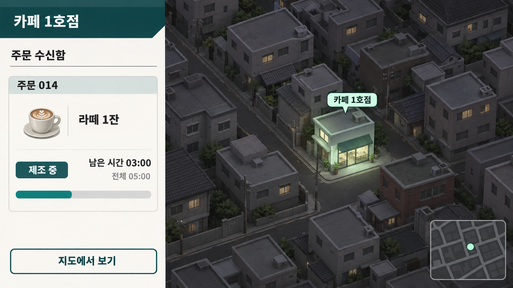

# [기획 · 라떼 한 잔의 주문·제조·배달·일일 결산 개발 계획 · PLAN-SYSTEM-REGIONAL-OPERATOR-SIMULATION · r240]

2026-11-15 · 설계실 개발 순서 제안 · `DevelopmentPlanProposed / ExistingRulesReused / SharedOrderContractPending / NotReadyToDispatch`

첫 목표는 **면목제7동 카페 1호점의 라떼 한 잔을 주문자, 점주, 기사가 같은 주문번호로 이어받고, 플레이어가 그날 결산에서 어디까지 처리됐는지 설명할 수 있게 하는 것**이다. 매장을 선택하면 제조 대기와 남은 시간이 보인다. 준비되면 어떤 기사가 픽업했는지 지도로 따라가고, 전달 후에는 이 주문에서 발생한 매출과 기사 수행대금을 각각 확인한다. 이 순서는 첫 구현을 위한 제안이며 다른 업종으로 시작하는 선택은 유지한다.

## 1. 출발점과 재사용할 것

11월 15일 홍달 `dev/mirror-integration@7c83c18cf`와 별도 Unity 작업본 `unity/workstream-transition@605e87e`의 미커밋 소스 및 일반판을 대조했다. **기준선은 19:34:01 KST 빌드**로 오류·경고 0, 기존 검사 394개 통과다. 자동 촬영 98번은 선택한 기사의 기존 주문, 99번은 시험 입력으로 수락 장면을 재연했다. 원래 창으로 복귀하고 재연 중 시간·원장·주문 단계가 유지되는 검사도 통과했다. 19:20 현황의 기사 앱 ‘제안’은 이 범위에서 구현됐다. 사람이 1배속으로 플레이스의 새 라떼 주문을 완주하는 것은 이번 개발 목표다. [기획 대비 현황](../../../Handoffs/2026-11-15-Codex-기획대비구현상태-재점검.md) · [플레이스 첫 화면 반환](../../../Handoffs/2026-11-15-Claude-홍달플레이스-주문자뷰-첫조각-반환.md)

| 있는 것 | 이번에 연결할 부분 |
| --- | --- |
| 면목제7동 플레이스 검색, 내 카페 상세와 메뉴, 건물 핀, 이전 지도 복귀 | 가상 고객 주문 한 건을 확정할 때만 매장 수신함에 한 줄을 만든다. 구경·검색·메뉴 열람은 계속 자유롭다. |
| 카페 1호점의 레시피, 우유 검수 및 가용 재고, 기존 제조/가상판매 명령 | 현재 `StoreOperationsModule.Produce`는 같은 시각에 재고 사용·판매·준비 완료를 기록한다. 연결 주문에 대기·착수·경과·준비를 도입한다. |
| 제조 번호로 보내는 `FoodReadyForPickup`, 기존 배달 Core의 배차·픽업·전달 | `FoodDeliveryModule.Accept`는 현재 인계를 보관한다. 외부 제조 주문 한 건을 Core의 배달 한 건에 대응시켜야 한다. |
| 기사 빛, 기사 휴대폰의 상태 재연, 하루 마감 알림·결산 보기 | 선택한 주문번호의 실제 상태와 거래 참조를 표시한다. 휴대폰 연출이나 결산을 다시 여는 행위는 조회로 처리한다. |

**확정한 기준**은 커피 약 5분·음식 10~15분, 일일 결산, 점포별 왼쪽 운영 창, 발주·예외·정산 결정은 플레이어가 맡는 경계다. 첫 검토에는 기존 가상 레시피의 라떼 4,500게임원·우유 170mL를 쓴다. **추천 시험 조건**은 한 잔씩, 포장 포함, 작업자 한 명·제조 자리 한 곳, 도착 순 대기다. 수령 시 매출 인식과 화면 배치는 이번 제안이다. [준비시간 r202](coffee-food-preparation-time-defaults.confirmed.r202.md) · [시험 기본안 r203](priority-defaults-and-first-validation.proposal.r203.md) · [한 잔의 원가·공정 r214](coffee-one-cup-chain-and-multiscale-balance.design.r214.md) · [점포 창 r215](store-specific-left-management-panel.design.r215.md) · [위임 범위 r225](field-work-delegation-and-player-decisions.confirmed.r225.md)

## 2. Claude가 한 번에 확인할 개발 단위

| 차례 | 플레이어가 볼 장면과 담당 | 개발을 마쳤다고 볼 조건 |
| --- | --- | --- |
| 0. 기존 첫날 | 기존 판에서 직접 배차와 맡김을 각각 1배속으로 진행한다. 하루 마감 칩으로 결산을 열고 다음 영업을 저장한다. | 일반 Windows판을 종료·재실행한 뒤 영업 회차, 주문 상태와 금액을 대조한다. 이 확인과 주문 계약 설계는 병행 가능하다. |
| **1. 주문과 매장 수신** | **첫 인계 단위.** 영업 중인 내 카페 상세에서 시험 손님이 라떼 1잔을 명시적으로 주문한다. 매장을 누르면 왼쪽 수신함에 그 번호·메뉴·수량·접수 상태가 보인다. | 같은 요청을 두 번 보내거나 저장 후 다시 열어도 주문·수신행이 각각 하나다. 영업 마감·판매 불가 메뉴는 이유를 표시한다. 검색·상세 재열람 전후 주문과 금액은 같다. |
| 2. 대기와 5분 제조 | 점주가 주문을 받아 제조를 시작한다. 왼쪽 창에 대기·제조 중·픽업 준비를 표시한다. 자리가 차면 다음 주문은 차례를 기다린다. | 게임 작업시각 12:00 착수 예에서 12:02에 남은 3분, 12:05에 준비 1건. 중간 저장·일시정지·다른 동 보기에도 순서와 재료가 보존된다. |
| 3. 기사에게 인계 | 카페의 준비 완료 한 건을 기존 배달에 연결한다. 기사 빛과 휴대폰에서 같은 주문을 따라가고, 담당 기사가 도착하면 픽업·전달한다. | 준비와 도착이 모두 충족돼야 픽업한다. 다른 기사 또는 중복 확인에는 새 픽업이 생기지 않는다. 기존 배달의 준비 타이머를 추가해 5분을 두 번 기다리게 하지 않는다. |
| 4. 오늘 결산과 복귀 | 고객 수령, 미정산/정산 상태, 상품 매출과 기사 금액을 조회한다. 결산에서 주문을 선택하면 매장이나 해당 기사의 건으로 돌아간다. | 같은 주문의 각 업무 기록이 한 번씩만 잡힌다. 합계에서 원래 주문까지 추적 가능하다. 자정에 걸친 미완료 주문은 같은 번호로 이어진다. |

**검토 방법.** 단계 1은 내부 시험 주문 하나를 명시적으로 발생시키는 독립 시나리오로 검증한다. 플레이어가 자기 매장을 반복 클릭해 주문을 무한히 만들 수 있는 일반판 기능으로 내보내지 않는다. 아직 주민 검색이 연결되지 않은 판에서는 고객 발생 부분을 ‘시험 손님’으로 표시한다. 일반 고객 경로에서는 정상 수요 중 플레이스로 배정된 몫에서 한 기회를 소비하고, 같은 몫이 동의 기존 집계매출과 개별매출에 함께 잡히지 않는 시점에 연다. 이 개발 순서로 기존 플10의 실제 고객 전환 조건을 생략하지 않는다. [가상 검색과 수요 귀속 r238](hongdal-place-population-keyword-search-and-ranking.proposal.r238.md) · [Claude의 플1~플10](../../../Handoffs/2026-11-15-Claude-개발계획-홍달플레이스-종합-정본하나뷰셋.md)

## 3. 주문·제조·배달이 공유할 계약 초안

1. **주문은 한 번만 만든다.** 주문을 접수한 게임 규칙이 한 주문번호를 소유한다. 매장·메뉴·수량·주문 당시 가격·주문 유입 경로·픽업 점포와 가상 수령 지점을 함께 보존한다. 매장 ID와 건물 위치는 기존 카페 결속을 쓴다. 제조는 별도 제조 번호, 배달은 기존 배달 번호를 쓰되 모두 원 주문을 가리킨다. UI에 보이는 ‘014’는 예시 표시 번호다.
2. **명령과 관찰을 구별한다.** 주문 확정·제조 착수·픽업·전달에 기존 미리보기/확정과 명령 번호·현재 판본 검사를 적용한다. 같은 명령 재수신은 처음 영수증을 돌려준다. 다른 명령 번호로 같은 업무 완료를 다시 청해도 주문·작업·전이의 처리 기록을 검사한다. 선택한 주문을 볼 때는 기사에게 가장 최근 배정된 다른 주문으로 바꿔 표시하지 않는다.
3. **재료와 시계.** 접수 시 가용한 우유를 예약하고 착수 때 한 번만 사용 처리하는 안이다. 170mL만 남았으면 먼저 수락한 한 잔만 예약할 수 있다. 부족한 두 번째 주문에는 ‘재고 부족’을 표시하고, 보충·검수 후 재시도한다. 예약 뒤 착수 전 취소는 예약 해제, 착수 뒤 실패는 이미 쓴 수량을 유지한다. 5분은 실행 중 게임 작업 시간이다. 메뉴나 결산을 열거나 앱이 꺼진 시간 때문에 제조가 끝나지 않는다.
4. **준비와 인수.** 제조가 끝나면 제조 번호·원 주문·점포를 담아 기존 준비 완료 인계를 한 번 보낸다. 배달 모듈은 같은 인계를 다시 받아도 동일 배달 번호를 돌려줄 수 있어야 한다. 미배정은 픽업 대기로 남고, 담당자 교체 후에는 현 담당자만 인수한다. 픽업동과 전달동은 각각 실제 게임 지점에서 읽어 나중에 깨어서 수행한 활동의 귀속 근거로 쓸 수 있게 한다. [동을 넘는 전달 r207](cross-dong-delivery-and-recipient-mingde.design.r207.md) · [픽업지 기여 r208](pickup-preparation-and-local-mingde.design.r208.md)
5. **매출·정산·현금.** 첫 배달 시험은 고객 수령이 확인된 때 가상 상품 매출을 한 번 기록하는 안을 권한다. 제조 완료는 재고 사용·준비 결과, 기사 수행대금은 배달 원장, 정산 확정과 지급은 각각의 업무 기록을 따른다. 기사 보수나 배송비를 상품 매출에 더하지 않는다. 라떼의 재료 사용량을 볼 수 있어도 매입 단가가 없으면 원가를 ‘미연결’로 표시한다. 기존 연습 배달의 자동 가상 정산은 현행대로 식별한다. 결산을 다시 조회해도 금액은 바뀌지 않는다. [현실 달력과 일일 결산 r174](live-calendar-daily-management.baseline.r174.md)
6. **저장과 복원.** 주문·예약·제조 진척·준비 인계의 소비 여부·배달 번호·금액 참조를 서로 맞는 판본으로 저장한다. 기존 배달 저장과 커널 저장 중 한쪽만 복원된 경우에는 일관된 이전 저장이나 명시적 복구 안내를 사용한다. 이전 세이브의 독립 제조·판매·기존 배달에는 새 주문을 소급 발행하지 않는다. 미완료 건은 영업 회차 교체 후에도 조회된다. KST 자정 양쪽에서 발생한 일은 각각 발생일에 보고한다.

## 4. 화면 검토

점주에게 먼저 답할 질문은 **“이 한 잔은 언제 기사에게 줄 수 있나?”**다. 한 번 누르면 내 카페, 왼쪽에는 해당 주문의 남은 시간, 오른쪽 아래에는 작은 지도를 둔다. 시안에서는 총 5분 중 2분이 지났다. 아직 기사에게 넘길 수 없는 순간이라 상태를 ‘제조 중’으로 보여 준다. 준비 완료 시에는 같은 줄의 상태와 다음 행동만 바꾼다. 지도에서 다른 곳을 보고 돌아와도 같은 작업을 이어 본다. 그림은 ImageGen으로 그린 화면 배치안이며 건물 모양·014번·시각은 예시다. 기사 표현은 기존 빛을 유지한다. [기존 카페 하루 시안](../../../Handoffs/2026-11-15-Claude-시안-카페하루운영.md) · [역할 앱과 같은 주문번호 시안](../../../Handoffs/2026-11-15-Claude-제안-역할앱을게임속으로.md) · [그림 생성 요청문](../../../../assets/concepts/hongdal-first-latte-r240/generation-prompt.txt)

## 5. 제작실 작업 경로와 검증 반환

| 읽거나 수정 후보를 좁힐 곳 | 확인할 책임 |
| --- | --- |
| Unity 작업본 `Assets/Ssalddel/WindowsGame/Runtime/SagajeongDispatchPlace.cs`, 기존 점포 선택·왼쪽 창, `SagajeongDispatchRiderPhone.cs` | 기존 장소/기사 선택과 복귀를 재사용한다. 화면에서 명령을 요청하고 커널 상태를 읽는다. |
| 같은 작업본 `Kernel/StoreOperationsModule.cs`, `FoodDeliveryModule.cs`, `GameKernel.cs`와 기존 게임용 저장 묶음 | 잔 수와 개별 주문의 대응, 예약·소모, 준비 완료 소비와 멱등 저장. 우유 공급망·독립 제조의 기존 동작과 구 저장을 회귀 검사한다. |
| 홍달 `Ssalddel.Sagajeong.Core/UnityPackage/Runtime/FoodManagementSession.cs`, `FoodManagementRound.cs`, `LocalCampaign.cs` 및 기존 Unity 결속 | 외부 주문 수용·현재 담당 기사와 도착·준비 검사, 회차 교체 전후의 미완료 건 보존을 대조한다. |

설계실은 위 공유 계약(D7)과 첫 일감의 상태/실패/회복 조건을 제안한다. 제작실은 단계 1을 받기 전에 실제 소유 작업본·기준 commit과 변경 파일 지문, 승인 판본, 정확한 쓰기 경로, 시험 명세를 합의한다. Claude가 작업 중인 기사 재연 파일은 별도 소유로 두고, 첫 수신함은 그 파일의 변경에 의존하지 않는다. 기존 Goal·WI의 재사용 여부와 Graph Map의 ‘주문자→점포→기사’ 관계는 승인 범위에서 확인한다. 현재는 설계 검토이며 개발 배정 전이다. [설계실·제작실 인계](../../../../Architecture/CodexPlayableLoopGoal운영체계.md#설계실제작실-인계) · [작업본 교대 기준](../../../Handoffs/Codex-Claude-혼용운영안-2026-11-12.md)

**반환에 필요한 예시**

- 정상 한 건에서 주문번호, 제조·준비·픽업·전달 시각, 사용 재고, 매출 참조, 정산 상태를 한 줄로 추적한다. 단계 1 반환은 ‘수신 1건’까지로 끝내고, 이 뒤의 값은 진행될 때 채운다.
- 경계 검사는 **재고 한 잔과 주문 두 건**, **준비 전 도착과 기사 두 명의 픽업 시도**, **제조 중·인계 직후·전달 직후 재시작**, **자정과 영업 회차 변경**, **옛 저장 불러오기**로 나눈다. 중복 주문·재차감·이중매출과 서로 다른 주문 표시가 각각 0이어야 한다.
- 같은 시험 자료에서 논리 검사, 일반 Windows 빌드 및 판본 지문, 지도·수신함·기사·결산의 실제 촬영, 사람의 직접 1배속/맡김 플레이 기록을 별도 반환한다. 미완료인 장면은 마지막으로 확인한 단계와 다시 시작할 지점을 적는다.

## 6. 이후의 개발 순서

| 다음 분야 | 시작할 근거 | 첫 반환 결과 |
| --- | --- | --- |
| 주민 검색·점주 운영 창 | 검색의 시간대 예산·세션·판본 설계는 주문 개발과 병행 가능하다. 실제 전환은 주문 1건 귀속 뒤 연결한다. | 같은 키워드의 검색→노출→의향→수락 건수를 구분해 본다. 구경·재실행으로 수요가 늘지 않는다. |
| 직원·명덕·2호점 | 어떤 점포의 누가 제조·픽업·전달했는지 남긴다. | 한 초보가 제조를 익혀 현장 일을 맡고, 깨어서 했던 활동이 사람·점포·해당 동에 귀속되는 한 사례를 본다. 고용과 맡김, 발주와 정산 권한을 구별한다. [초보 성장 r227](novice-first-cafe-franchise-growth.confirmed.r227.md) |
| 정식 광고·중개 인물 | 정상 노출·주문 전환을 비교할 수 있게 한다. 게임 고객에게 정식 광고가 노출되고 플레이어가 결과를 본 뒤 소개한다. | 비용·기간·잠정 점수와 정상 고객의 실제 주문을 분리해 계약 전후를 본다. 영구 인맥 보유·계약별 비용과 밸런스는 별도 미정이다. [소개 조건 r194](broker-introduction-after-ad-result.confirmed.r194.md) · [인물 카드 r239](traffic-broker-person-card-and-temporary-ranking.design.r239.md) |
| 지도·물류·공급 | 65동 자료의 표본 대조와 센터 내부 시안 준비는 병행한다. 주문에 쓰인 점포·인계 지점부터 일반판에 붙인다. | 다음 확장은 한 동의 실제 음식점 후보 조회, 또는 우유 한 차례의 입고→점포 검수처럼 한 번에 검증할 작업을 고른다. |

**미정**은 실제 고객 주문 전환을 여는 시점, 연결 주문의 매출 인식 사건, 시험용 제조 자리와 대기 정책, 화면 시안 선택이다. **다음 질문 하나**는 “배달 라떼의 매출은 손님이 받은 순간 한 번 잡을까요?”다. 추천은 고객 수령이다. 그러면 제조를 끝냈어도 전달 전인 한 잔이 ‘준비됐지만 아직 팔리지 않은 주문’으로 결산에서 보인다.
