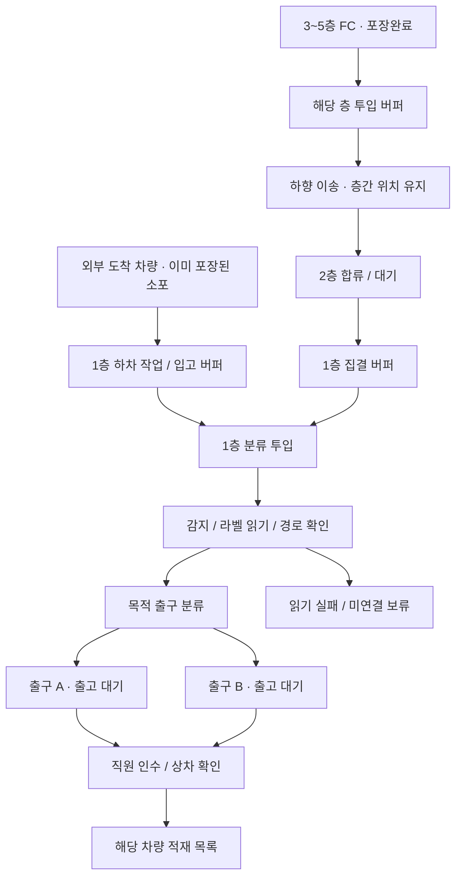

# [기획 · 다층 물류센터 내부 모형 · PLAN-SYSTEM-REGIONAL-OPERATOR-SIMULATION · r164]

- 기준일: 2026-11-13 (한국 시각)
- 기획 ID·분야: `PLAN-SYSTEM-REGIONAL-OPERATOR-SIMULATION` · 건물 내부 관찰·층 전환·물류 흐름 판독
- 상태: `UserDirectionConfirmed / MultifloorLayoutProposed / PreparedForClaudeVisualDesign / VisualReviewPending / ProductUnchanged`
- 사용자 근거: 센터 단지를 클릭하면 지붕 없는 모델하우스처럼 내부가 보이고, 1~5층을 살펴보며 연결 컨베이어를 따라 내려온 포장물이 1층에서 모여 분류되고 직원이 차량에 싣는 과정을 보고 싶다고 요청했다. **현재 요청은 기획서 작성이며 코드 대신 Claude의 후속 종합 시안을 준비한다.**
- 상위 공통 정본: [지도 경영 통합 r162](integrated-map-management-baseline.r162.md). 전문 선행은 [건물 내부·귀환 r144](scale-os-management-focus.design.r144.md)와 [센터 역할·분류 조사 r163](logistics-centers-sortation-skeleton.research.r163.md)이다. 해당 원문과 고정 인계 지문은 보존한다.
- 관련 하위 기획·WI·PlayableLoop: 새 등록 없음. 다층 모형은 시각 설계 대상이며 구현 작업지시서가 아니다. r163 연구를 `Accepted`로 승격하지 않는다.
- 관련 결정: 새 전역 결정 없음. 공통 시계·상태 권위·집중/이완·운영/Simulation 경계는 r162와 연결한 기존 기준을 따른다.
- Graph Map 영향: 지도 거점→단지/동/역할→내부 전체→선택 층·구역·설비→층간 이송→1층 분류/도크와 원래 지도 귀환. 관계·제약의 기획 입력만 남기며 원본/생성물은 수정하지 않는다.
- 다음 인계: [Claude 종합 시안 입력서](../../../Handoffs/2026-11-13-Codex-Claude-다층물류센터-시안입력-r164.md). 시안 제작 준비이며 제품 실행 권한·Goal/WI·공용 E는 바꾸지 않는다.

## 1. 먼저 만들고 싶은 경험

**지도에서 센터를 누르면 지붕을 걷어낸 작은 건축 모형이 열리고, 내가 고른 포장물 하나가 어느 층에서 내려와 어느 출구와 차량으로 이어지는지 이해한다.** 전체 건물은 층 사이 연결을 보여주고, 선택 층은 랙·통로·포장 작업대·분류 출구와 사람의 일을 보여준다. 숫자 대시보드가 중심이 되기보다 물건의 흐름과 막히는 장소가 먼저 눈에 들어오게 한다.

| 구분 | 현재 정한 범위 |
| --- | --- |
| 사용자 방향으로 확정 | 단지/건물 선택에서 내부 모형으로 진입, 지붕 없는 관찰, 층별 탐색, 층간 컨베이어 연결, 1층 집결·분류·직원 상차를 읽는 장면, 기획서 선행 |
| 이번 추천안 | 가상 FC·택배허브 복합센터 1동·5층, 비스듬한 전체 보기와 한 층 보기, 선택 소포 따라보기, 3~5층 재고/포장·2층 합류/완충·1층 분류/도크 |
| 시안에서 검토 | 층 간격·가림 처리·버튼 위치·표시 밀도·수직 이송 외형·작업자 동작의 자세한 형태 |
| 후속 설계 | 처리시간·벨트 속도/용량·인원·보상·설비 확장 경제·실제 도면과 대응·개별 구현 WI |

1~5층은 **설명용 가상 배치**다. r163이 조사한 실재 업체의 도면·층별 용도·컨베이어 구조를 복원한 것으로 표시하지 않는다. 실제 시설의 주소와 연결하더라도 내부는 `가상 내부 모형`이라고 밝힌다. 건물 주소/외곽만으로 창고 역할·권한·설비를 만들어 붙이지 않는다.

## 2. 플레이 상황과 정보의 초점

- **지금:** 가상 출고 회차를 준비 중이고, 상층 포장완료품과 외부 도착 소포가 1층 분류 투입을 기다린다. 구체 시각·물량은 시나리오 값이다.
- **여기:** 선택한 복합센터 한 동의 내부. 전국/구 지도에서 내려온 건물 상세이며 새 지도 높이가 아니다.
- **나:** 센터의 흐름을 관찰하는 경영자. 준비된 작업을 따로 선택했을 때만 현장 직무에 참여한다.
- **너:** 포장물·작업자·버퍼·컨베이어·분류 출구·도크와 차량. 확인된 상태 사본에 연결된 결과를 읽는다.
- **이렇게:** 전체에서 내려오는 길을 보고, 층/포장물을 골라 병목 위치와 다음 인계를 확인한다. 관찰 선택 자체는 물류 상태를 바꾸지 않는다. 준비된 재확인·소분·상차 작업은 별도 작업 선택으로 들어가며, 대기·오분류 위험·작업 부담을 함께 판단한다.
- **직접 결과와 다음 선택:** 첫 분류 결과는 올바른 출구 도착 또는 명시적 보류다. 이후 준비된 상차 작업까지 완료한 경우에만 차량의 인수 결과를 확인한다. 다음에는 다른 물건을 보거나 같은 직무의 `다음 작업`을 고르거나 지도로 돌아간다.

오행/괘 관계는 이번 공간 설계에서 새로 배정하지 않는다. 기존 업무 분류와의 결속은 미정이며 층 번호·설비 외형으로 의미를 추정하지 않는다. 상위 목적에서는 물건이 어디서 막혔는지 이해하고 현장 노동·대기·정확성을 함께 살피는 **경영 보조 층**이다. 내부 관찰만으로 직접 회복·소득·성장 보상을 부여하지 않는다.

## 3. 층별 가상 배치

한 건물 안에 FC의 보관·집품·포장과 허브의 분류·차량 인계를 함께 둔다. FC와 이미 포장된 소포를 중계하는 허브의 역할 구분은 r163을 따른다. 모든 센터가 이런 복합형이라는 뜻은 아니다.

| 층 | 주로 보여줄 것 | 내려보내는 흐름 | 플레이어가 읽을 질문 |
| --- | --- | --- | --- |
| 5층 | 재고/작업 구역 C: 랙·피킹 통로·작은 포장 구역 | 포장완료 투입부→공통 하향 이송 | 여기서 포장을 기다리는가, 내려가는 길을 기다리는가? |
| 4층 | 재고/작업 구역 B: 랙·작업대·투입 대기 | 이 층의 포장완료품도 같은 이송 계통에 합류 | 상층 통과 물량과 이 층 물량이 어디에서 만나는가? |
| 3층 | 재고/작업 구역 A: 대표 포장 장면을 자세히 표시 | 선택 소포의 포장완료→투입 확인→하향 이송 | 이 소포가 언제 어느 투입부로 넘어갔는가? |
| 2층 | 합류부·짧은 대기 버퍼·수동 확인 구역 | 상층 통과품을 받아 1층 투입 버퍼로 인계 | 1층이 막혀서 여기서 기다리는가? |
| 1층 | 외부 소포 하차·투입/읽기·분류·출구 A/B·보류·출고 대기·상차 도크 | 목적 출구→작업자 확인/대차·케이지→차량 | 맞는 곳으로 분류됐고, 실제로 차량이 인수했는가? |

3~5층은 같은 FC 작업 구역을 반복한 첫 배치안이다. 모든 주문이 5→4→3층의 피킹/포장을 차례로 거치는 구조가 아니다. 대표 소포는 **3층에서 이미 포장된 상태**로 출발할 수 있고, 다른 층에서 내려온 소포는 중간층 작업대에 들르지 않고 이송 계통을 통과한다. 상품 보충·포장 전 집품물의 층간 이동은 별도 업무이며 포장물 하향 벨트로 묵시적으로 처리하지 않는다.

### 층간 연결을 어떻게 보이게 할까

- 건물 한쪽에 층을 잇는 이송 영역을 모아 전체 보기에서 5→4→3→2→1층의 연결 방향이 읽히게 한다. 각 층의 투입부와 합류점을 따로 보인다.
- 시안의 우선 외형은 **완만하게 돌아 내려오는 경사 컨베이어**다. 정확 경사·길이·치수·지지구조는 미정이며 실제 설비 설계도로 쓰지 않는다. 작은 축척에서는 연결 경로를 단순화하되 수직 벽을 통과하거나 단절된 벨트 사이로 물건이 순간 이동하는 모습은 피한다.
- 공간이 부족한 시안은 나선형 경사 또는 승강 이송 외형을 대안으로 비교한다. 승강형을 택하면 입구 대기→이송 장치 점유→이동→출구 인계를 보여주며 모든 경로를 연속 벨트로 그리지 않는다. 시안 검토에서 주 외형 하나를 고른다.
- 층간 이동 중인 소포의 위치는 `3층→2층 이송 구간`처럼 읽는다. 위·아래 층 양쪽에 같은 소포가 별개로 생기지 않는다. 전 층이 보이는 전체 보기에도 경로는 하나다.
- 다음 구간이 가득 차면 앞 버퍼에서 대기한다. 우회 경로가 정의되지 않았으면 그림을 매끄럽게 만들기 위해 다른 출구로 보내지 않는다.

## 4. 하나의 분류 라인에 합류하는 두 출발점

사용자가 말한 1층의 ‘모이는 곳’은 여기서 **집결 버퍼/분류 투입부**로 부른다. 외부 고객에게서 물건을 받는 집하 업무와 구분한다. 외부 소포는 이미 포장돼 들어오므로 전부 다시 개봉·포장하거나 위층을 거치게 하지 않는다. 재포장이 필요한 예외는 별도 작업이 준비됐을 때만 연결한다.

위 도식은 **설명할 종합 흐름**이다. 한 장면에 보인다는 이유로 포장·하차·분류·상차·간선/최종 배송을 한 번의 명령이나 하나의 구현 WI로 합치지 않는다.

### 1층에서 눈으로 구별할 장면

| 구역 | 물건·사람의 모습 | 확인할 실제 게임 상태 |
| --- | --- | --- |
| 외부 입고 도크 | 도착 차량, 하차 직원, 입고 대기 | 도착/하차 인수와 신규 투입의 구분 |
| 상층 집결·합류 | 내려온 소포와 대기열 | 층간 이송 도착과 분류 투입 대기 |
| 읽기·분류 | 읽기 지점·방향 분기·출구 A/B | 감지 관측, 유효 물류단위 식별, 목적 출구, 확인된 도착 |
| 출구/보류 | 벨트 또는 완만한 슈트 출구, 케이지/대차, 재확인 작업대 | 정상 도착과 보류·재확인 필요를 분리 |
| 출고·상차 도크 | 직원이 대기품을 모아 대상 차량으로 옮김 | 담당 인수, 대상 차량/묶음 확인, 상차 결과 |

하차 도크와 상차 도크는 다른 구역으로 보이고, 사람 통로·차량 접근부·벨트 흐름도 구별한다. ‘벨트 끝에서 내려오는 모습’은 출구/슈트/버퍼로 읽히게 하되 모든 소포가 바닥으로 떨어지지는 않는다. 박스가 차량 옆에 도착하거나 적재 애니메이션이 끝난 것만으로 상차 완료·출발·배달 완료·정산을 만들지 않는다. 시안은 작업 관계를 설명하는 가상 모형이며 건축·설비·안전 교육 도면이 아니다.

## 5. 화면과 전환 규칙

### 지도 → 내부 전체

준비된 단일 센터 건물을 누르면 내부 전체 보기로 들어간다. 여러 동/역할이 묶인 단지는 먼저 해당 동·센터 역할을 선택한다. 진입 시 기존 지도 높이·카메라·OS·시설 선택·작성 중 입력을 복귀 정보로 보존한다. 모델이 없으면 기존 건물 카드에 `내부 표현 준비 중`을 표시한다.

첫 카메라는 비스듬히 내려다보는 건축 모형 시점이다. 지붕과 앞쪽 외벽을 걷어내고, 층 간격을 시각적으로 벌려 랙/작업대와 세로 이송을 함께 보인다. 이것은 **관찰용 층 펼치기**이며 설비 좌표·이송 거리·처리시간을 실제로 늘리는 조작이 아니다. 반대편 벽·기둥·바닥 일부로 한 건물이라는 느낌을 남긴다.

### 내부 전체 ↔ 선택 층

- 층 선택기는 `전체 · 5F · 4F · 3F · 2F · 1F`로 제안한다. 화면에서 층을 눌러도 같은 선택으로 연결하며 선택 층 이름과 주 업무를 항상 읽을 수 있게 한다.
- 한 층을 고르면 위층은 숨기고 필요한 벽은 잘라내 작업대를 가리지 않는다. 이송 연결은 가장자리의 간단한 건물 단면/연결 표식으로 남긴다. 아래층 작업을 여러 겹 겹쳐 그리지 않는다.
- 선택 층에서 확대·이동·전체 맞춤을 제공한다. `전체`는 내부 모형 전체로, `지도로 돌아가기`는 원래 지도로 돌아간다. 두 동작을 구별한다.
- 층을 바꿔도 현재 소포·작업 선택은 유지한다. 다른 층에 있는 경우 `선택 소포: 2층→1층 이송 중`과 위치로 이동하는 동작을 제공한다. 화면에서 사라졌다고 선택/업무를 취소하지 않는다.
- ‘층별 검색’의 첫 범위는 층 선택과 선택 대상 위치 찾기다. 운영 데이터가 준비되지 않은 상태에서 복잡한 텍스트 검색이나 가상 실재 재고 목록을 선행 구현하지 않는다.

### 소포 따라보기

소포를 누르면 현재 층·구역/구간·분류 목적·다음 인계·대기 이유를 간단히 보여준다. `따라보기`를 명시적으로 켜면 같은 물류단위가 층을 넘어갈 때 카메라/층 초점이 연결된다. 사용자가 다른 층을 고르거나 내부 모형 카메라를 직접 이동하면 자동 따라보기를 멈추고 현재 위치 표식만 유지한다. 설비 클릭은 해당 설비의 상태를 읽는 선택이며 수동 피킹/상차 명령이 아니다.

층간 이동 구간의 전부가 화면에 보이지 않아도 출발/도착 층과 대기/이송 중 상태를 읽을 수 있어야 한다. 미연결 구간은 `경로 미연결`로 표시하고 애니메이션만으로 이어 붙이지 않는다. 후속 상차가 확인되면 `차량 인수 완료`와 현재 인수 주체를 표시하고 센터 내부의 따라보기를 마친다. 센터 밖이나 다른 지도로 자동 추적 전환하지 않는다.

### 시간·참여·지도 귀환

내부 진입·층 선택·따라보기·전체 맞춤은 **현재 참여 방식과 공통 시계를 유지**한다. 이완 플레이에서 보지 않는 층의 준비된 작업도 같은 시계로 진행한다. 기존 일시정지 상태라면 그대로 유지하고, 자료만 보는 관찰에서는 모형 진입 때문에 가상 주문/시간을 시작하지 않는다. 모형을 보는 것과 집중 미니게임 진입은 다른 선택이다.

집중 직무는 준비된 작업 큐에서 한 건을 선택했을 때 시작한다. 진행 중이면 기존 중단/인계 규칙을 먼저 적용하며 층을 눌렀다는 이유로 작업을 완료하거나 보상을 얻지 않는다. [집중/이완 r146](focus-relax-shared-management.design.r146.md), [직무 r147](multi-role-minigames-and-realistic-recipes.design.r147.md), [다음 작업 r151](next-task-button-confirmed.design.r151.md)의 전문 규칙을 복제하지 않고 따른다. r148의 수동 바코드 타이밍 조작을 자동 벨트 센서의 매번 필요한 입력으로 넣지 않는다.

`지도로 돌아가기`는 진입 전 높이·카메라·OS·선택 센터·작성 입력을 복원한다. **업무 상태는 경과 후의 현재 상태**를 읽으며 진입 전 시점으로 되감지 않는다. 긴급한 다른 작업 알림은 선택 경로를 제공하되 자동 카메라 이동/직무 시작은 하지 않는다.

## 6. 상태 연결의 최소 의미

새 API/저장 스키마를 이 문서에서 확정하지 않는다. 후속 설계는 기존 ID·명령·Revision·상태 사본을 재사용하면서 아래 의미를 연결해야 한다.

| 읽을 의미 | 연결할 내용 |
| --- | --- |
| 공간 | 센터/동/역할→층→구역/설비→이송 구간. 펼쳐 그린 층 위치와 실제 시뮬레이션 위치를 구별 |
| 물류단위 | 소포 고유 ID, 내용물/SKU·수량 관계, 분류 목적, 한 시점의 현재 위치/담당 |
| 층간 이송 | 출발 층·도착 층·구간·진입 대기/이송 중/인계 확인. 두 층에 중복 소유하지 않음 |
| 업무 | 포장·하차·재확인·소분·상차의 준비/수행/보류/완료와 담당. 설비 이동 상태와 분리 |
| 관측·분류 | 감지/읽기 관측, 해석·경로 판본, 확인된 출구 도착. 중복 관측을 물건 추가로 세지 않음 |
| 차량 인계 | 소포/케이지와 목적 차량·적재 목록·확인 결과. 버퍼 도착과 차량 인수는 다름 |
| 화면 취향 | 선택 층·가림·따라보기·효과량. 재고·배송권·설비 가동·권한을 바꾸지 않음 |

저장/복원·층 전환·재스캔 뒤에도 같은 소포는 하나의 위치와 같은 업무 계보를 가진다. 대기/이송/보류/출고대기/차량 인수로 나누어 총수를 대조하고 포장 전 상품 수량·소포 수·케이지 수를 같은 단위로 더하지 않는다. 소포를 따라 보는 권한과 실제 업무 수행 권한도 구별한다.

## 7. 시안에서 비교할 정상·막힘·회복

| 장면 | 보이는 변화 | 결과·회복 경계 |
| --- | --- | --- |
| 정상 | 3층 포장완료 소포 P-001이 하향 이송→1층 읽기→출구 A에 도착 | 같은 P-001의 도착 상태를 읽고 후속 상차 작업을 따로 선택 |
| 1층 버퍼 가득 참 | 상층 합류부에 대기가 늘고 선택 소포에 이유 표시 | 앞 구간에서 대기. 버퍼 여유/허용된 재개 뒤 같은 ID로 이동 |
| 읽기 실패/출구 미연결 | 보류 구역과 재확인 필요 표시 | 성공으로 세지 않음. 재확인 작업 후 같은 소포를 재투입 |
| 잘못된 차량 시도 | 해당 상차 작업에 대상 불일치·미인수 표시 | 차량 적재 목록을 바꾸지 않고 올바른 작업/차량으로 재시도 |
| 다른 층 탐색/지도 복귀 | P-001은 현재 구간에서 계속 추적됨 | 카메라와 선택만 바뀌며 상태 되감기·복제·완료 보상 없음 |

P-001·출구 A/B·차량·작업자·물량과 시간은 시안용 가상 예시다. 물류 작업의 정확 분류·대기·회복을 읽기 위한 것이며 현재 실행판의 완료 기능으로 표시하지 않는다.

## 8. 표현 원칙과 Claude 시안의 입력

외부 지도는 일반 건물 회색·관리 관계가 확인된 내 사업 부분만 민트 강조라는 [r143](gray-neighborhood-managed-stores-and-walkers.design.r143.md)을 유지한다. 내부 전체를 민트로 채우기보다 벽·랙·바닥은 낮은 대비로 두고, 현재 선택 소포·활성 작업·관리 표식을 구별한다. 정상 목적지·선택·보류는 색 외에도 이름·아이콘/모양으로 읽는다.

기본 `간단히`에서는 정적 방향·짧은 상태 문구·제한된 물건/작업자 표현으로 흐름을 읽는다. 자동 층 비행·과한 빛·파동은 기본에 넣지 않는다. 따라보기와 추가 움직임은 선택할 수 있게 설계하며 효과를 줄여도 경로·막힘·출구와 작업 결과는 보존한다. 작업자 수·박스 밀도는 시각 예시이고 실제 처리량 추정값으로 쓰지 않는다.

Claude에게는 같은 가상 센터와 P-001을 유지하는 **대표 내부 전체 한 장을 먼저** 요청한다. 이후 같은 구성을 이용해 지도 진입, 3층 상세/층간 연결, 1층 분류·보류·상차의 보조 장면을 만든다. 정확 제작 입력·장면별 확인 기준은 [시안 입력서](../../../Handoffs/2026-11-13-Codex-Claude-다층물류센터-시안입력-r164.md)가 안내하고 기획 의미는 이 문서가 소유한다. 이번에 이미지·모델·Unity 화면을 만들지는 않았다.

## 9. 뼈대를 확장하는 순서

| 단계 | 좁게 닫을 범위 | 다음으로 남길 것 |
| --- | --- | --- |
| 지금 | 본 기획·기존 조사 연결·Claude 시안 입력 | 이미지·모델·코드·실행 검증 |
| 종합 시각 검토 | 5층 전체의 공간/흐름·한 층 선택·1층 사람/차량 인계 판독 | 설비 치수·처리시간·상태 연결·실제 입력 |
| 기존 r163의 첫 개발 후보 | 1층 포장완료 소포 1개→짧은 벨트/읽기→정상 A/B 출구 또는 보류 | 포장 조작·층간 이송·하차/상차 전체 |
| 다층 첫 확장 후보 | 2층 투입 버퍼의 포장완료 소포 1개→수직 이송 한 경로→준비된 1층 분류 | 3~5층 작업·복수 합류·전체 재고/인력 경제 |
| 사람의 인계 후보 | 확인된 출구의 준비 물건→직원 인수→대상 차량 상차 확인 | 간선 출발·다른 센터/캠프·기사 배송 |
| 다층/거점 확장 | 반복 가능한 층/작업 구역과 합류, 양쪽 준비 후 센터 간 인계 | 각 후속 WI별 승인·검증 |

5층 종합 시안의 완성도를 첫 WI 구현량으로 해석하지 않는다. 현재 Windows의 기존 Core·최소 센터/우유 사슬·동네/구/전국 지도는 별도 소비판 상태이며, 본 문서는 새 컨베이어·분류·다층·작업자 상차가 이미 연결됐다고 주장하지 않는다. 현행 구현/반환은 [Unity Windows 현황](../../../Handoffs/Unity-Windows-구현현황.md)을 따르며 해당 작업을 중단·인수하지 않는다.

첫 제품 변경은 기존 기획/연구 수용·준비된 주체/WI·작업 명세·정확 쓰기 경로·E1~E7를 별도로 결속한 뒤 진행한다. 이번은 제품 쓰기 범위가 없고 새 Scene·모델 자산·DB/수집/예약·공용 E·commit/push도 변경하지 않는다.

## 확정·미정·다음 검토 하나

**확정:** 사용자가 원한 지붕 없는 다층 내부, 층 탐색, 상층→1층의 연결과 분류/직원 상차를 같은 센터에서 읽는 방향을 기록했다. 코드보다 문서와 후속 시안이 먼저다.

**미정:** 제안한 층별 용도와 이송 외형·카메라/표시 밀도의 최종 채택, 작업 속도/용량·배치 치수·보상·현실 도면 대응·구현 WI. 1~5층 가상 배치에 대한 시각 검토와 전문 연구 수용은 아직 완료되지 않았다.

**다음 검토 하나:** 지붕을 걷어낸 전체 모형에서 **어느 층이 무슨 일을 하고, 선택 소포가 어떻게 1층과 차량으로 이어지는지 한눈에 읽히는가?** Claude의 대표 전체 시안으로 검토한다. 현재 사용자에게 추가 선택을 요구하지 않고 시안 입력 준비까지 마친다.
