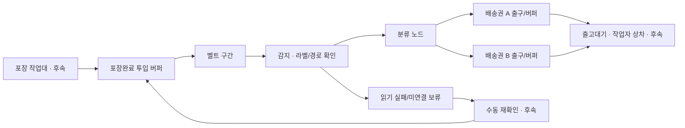

# [전문 조사 · 물류센터·자동 분류 뼈대 · PLAN-SYSTEM-REGIONAL-OPERATOR-SIMULATION · r163]

- 기준일: 2026-11-13 (한국 시각)
- 상태: `OfficialSourcesCollected / RegistryRawAcquired / CenterProcessSkeletonProposed / ResearchNotYetAccepted / ProductUnchanged`
- 사용자 요청: 대한민국 남한의 물류센터·배송센터와 포장→컨베이어→인식/분류→상하차→배송권 기사 인계를 조사하고, 규모를 고려해 작은 뼈대부터 제안한다.
- 상위 정본: [지도 경영 통합 r162](integrated-map-management-baseline.r162.md). 이 문서는 **센터 내부 물류와 거점 유형의 전문 조사**이며 r162 공통 규칙·기존 인계 hash·코드 실행 상태를 대체하지 않는다.
- 재사용 전문: [r144 건물 내부](scale-os-management-focus.design.r144.md), [r147 현장 작업](multi-role-minigames-and-realistic-recipes.design.r147.md), [r148 수동 스캔](barcode-scan-timing-minigame.design.r148.md), [r151 다음 작업](next-task-button-confirmed.design.r151.md), [r160 자료팩](data-packs-and-observation-layers.proposal.r160.md).
- 자료 대장: [공식 출처·시설 사례 JSON](../../../DataCollection/Research/2026-11-13-logistics-center-source-catalog.json). 공식 근거24항목·운영사3곳의 시설7사례·공표 화면8표본과 실제 취득 XLS1개를 구별한다.
- 범위: 공개 자료 조사·일회 원본 수집·구조 확인·제안 문서. DB 반입·정기 예약·게임/설비 코드·모델·새 Scene·Goal/WI·공용 E·commit/push는 변경하지 않는다. 전문 연구 `Accepted`나 실제 구현 승인을 자동 부여하지 않는다.

## 1. 결론 — 센터의 역할과 내부 흐름을 먼저 나눈다

**전국 거점은 실제 공개 자료로 찾고, 내부는 가상 센터 한 곳의 ‘포장물 한 개를 정확한 출구로 분류하기’부터 만든다.** 이후 포장 작업·사람의 상하차·센터 간 운송·배송권 기사 인계를 각각 붙인다.

물류창고, 풀필먼트센터(FC), 택배 허브, 지역 Sub/터미널, 배송캠프는 다른 역할이다. 한 건물에 여러 역할이 있을 수 있고 일부 단계를 생략하는 망도 있다. 회사 이름·주소·창고 등록이 같다는 이유로 실제 배송권이나 이동 경로를 생성하지 않는다.

## 2. 실제 수집한 것과 아직 없는 것

### 공공 시설 원본

[국토교통부 물류창고업등록정보](https://www.data.go.kr/data/15083282/fileData.do)의 연결 서비스인 [NLIC 물류창고업 현황](https://www.nlic.go.kr/nlic/WhsInfoWarehouseSch.action)에서 익명 XLS1개를 실제 취득했다.

- 로컬 원본: `artifacts/local/logistics-center-research-20261113/nlic-registered-warehouses-20261113.xls`
- 크기2,731,008바이트, SHA256 `7b8ba1bfcd29730c9fd594253f1a9c87dd33f40ceba8f0aff60ed94e492122eb`.
- `물류창고정보_0`의 헤더1행 + 자료6,011행, 9열 구조를 확인했다. 화면의6,011과 일치한다. 이는 **고유 택배 물류센터6,011곳이라는 뜻이 아니다.**
- 원본의 상호명·사업자번호·소재지 헤더는 UTF-16LE 바이트/코드포인트까지 대조했다. 원본은 수정/변환하지 않았다.
- 현재 파일의 별도 기준일은 미확인이다. 취득일과 포털 메타데이터 수정일을 자료 기준일로 채우지 않는다.
- 일반·항만·보세·화학·식품/축산/수산 관련 창고 공표 범위를 포함하며, 모든 자가창고·배송캠프·택배 영업소·실가동 거점 전수를 보장하지 않는다. 물류단지·터미널·내륙기지·우정 시설은 별도 자료원이다.

전체 행 정규화·동일 시설 중복 판단·사업자/브랜드 관계·좌표 변환·현재 실가동·기능 역할·DB 반입은 하지 않았다. 주소/면적은 센터 내부 도면·컨베이어 배치·센서·도크별 노선·처리능력·기사 배송권을 제공하지 않는다. 포털의 이용조건 표기는 수집 메타데이터에 보존했고 실제 프로그램 배포는 별도 검토한다.

### 운영사 공식 시설 사례

| 시설 사례 | 공식 자료에서 확인한 역할 | 자료 시점·확인 상한 |
| --- | --- | --- |
| 쿠팡 대구FC | 재고 진열·집품·포장, 운송장에 따른 배송지별 분류 | [2023-02-07 공정 공개](https://news.coupang.com/archives/26330/?print=print). 앞선1월 자료는 시험 가동. 실제 캠프 연결/현재 운영 미검증 |
| CLS 남양주2캠프 | 경기 지역 배송캠프 현장 사례 | [2026-06-16 발표](https://news.coupang.com/archives/63537/?print=print). 행사/현장 존재와 현재 노선·배송권은 구별 |
| 쿠팡 제주3캠프 | 지역 배송 출발 거점·차량 운영 사례 | [2022-10-17 소개](https://news.coupang.com/archives/20132/). 대륙→제주 중간 운송망은 이 자료로 확정 안 함 |
| CJ 곤지암 | FC와 택배허브가 같은 건물인 복합 거점 | [2024-11-29 소개](https://www.cjlogistics.com/ko/newsroom/latest/LT_00000391). 한 물리 시설에 복수 역할을 표현 |
| CJ 군포 e-FC | 상온 재고·포장/통합 출고, 곤지암 허브 직송 | [2021-06-20 가동 발표](https://www.cjlogistics.com/ko/newsroom/news/NR_00000851). 같은 군포 명칭의 다른 지점과 자동 병합 안 함 |
| CJ 용인 저온 FC | 냉장·냉동 보관/포장/출고, 허브→Sub→가정 | [2021-11-18 가동 발표](https://www.cjlogistics.com/ko/newsroom/news/NR_00000904). 특정 주문의 실제 운송편·Sub 미확인 |
| 한진 대전 Mega-Hub | 택배 중계·분류의 전국 거점 | [한진 공식 사업소개](https://www.hanjin.com/kor/CMS/Contents/Contents.do?mCode=MN125)에2024-01 개장 표기. 페이지 발행일·현행 실가동/처리량은 미검증 |

이는 발표/공표 근거를 가진 **사례 목록**이며 현시점의 가동 보장·모든 시설 목록·기밀 도면 수집이 아니다. 공표 화면8표본과 위7사례도 동일 모집단/고유 시설 수로 합산하지 않는다.

## 3. 회사별로 다른 망을 표현한다

| 유형 | 공식 자료로 읽을 수 있는 역할 흐름 | 모델에서 지킬 예외 |
| --- | --- | --- |
| 쿠팡의 FC·캠프 | FC 재고/집품/포장/출고 분류 → 시설 간 운송 → 캠프 소분/배송차 적재 → 고객 배송 | 여러 문헌을 합친 유형 설명. ‘대구FC→남양주2/제주3’ 같은 특정 edge는 미확인 |
| CJ 풀필먼트 연계 | FC 포장/출고 → 같은 건물 허브 또는 허브 직송 → 도착 Sub/지역 배송 → 고객 | 곤지암 동거형과 군포/용인 외부 FC형을 구별. 출발 측 집하/Sub 생략을 도착 Sub도 없다는 뜻으로 읽지 않음 |
| 한진 창고·택배 연계 | 창고 출하대기/상차검수/TML 인계 → 택배 권역분류/간선 → 도착 측 분류/기사 → 배송 | 공식 서비스 유형의 연결 해석이다. 특정 창고의 모든 물량이 대전 허브를 경유한다는 뜻 아님 |

쿠팡 공식 캠프 설명은 동네별로 분류한 상품을 롤테이너에 준비하고 배송 인력이 차량에 싣는 역할 분담과 오토소터를 소개한다. 이 일반 설명을 특정 캠프의 설비 설치 사실로 대입하지 않는다. [쿠팡 캠프/라스트마일 설명](https://news.coupang.com/archives/15709/), [간선 상하차 유형 설명](https://news.coupang.com/archives/2408/).

상품을 보관·집품·포장하는 FC와 **이미 포장된 소포를 받아 분류·중계하는 허브**를 구분한다. 모든 소포가 허브에서 다시 개봉/포장되지는 않는다. 입고 하차에서 컨베이어에 올리는 흐름과 포장 완료품을 출고 컨베이어에 올리는 흐름은 다른 시작점으로 같은 설비 그래프를 사용할 수 있다.

## 4. 컨베이어·센서·소터·작업자를 나누어 본다

| 구간 | 확인한 일반 원리 | 시뮬레이션 제안 |
| --- | --- | --- |
| 투입·간격 | 혼재 소포를 정렬하고 간격을 확보해 읽기/분류에 투입 | 짧은 버퍼·벨트 구간과 제한된 점유 수로 시작 |
| 감지·라벨 읽기 | 소포 감지·바코드 식별이 목적지 분기에 쓰임 | 감지 관측과 유효 포장물 확인을 별도 기록 |
| 분류 | 분류 계획에 따라 소포를 지정 출구로 보냄. 방식은 벨트/슬라이딩슈/로봇 등 다양 | 첫 모형은 단순 분기1개와 목적 출구2개. 실제 특정 센터 설비로 주장 안 함 |
| 출구·버퍼 | 슈트 외에도 벨트·백·팔레트·롤케이지 등으로 받음 | 사용자가 말한 ‘내려오는 곳’은 슈트/출구로 표현하되 모든 물건을 낙하시키지 않음 |
| 예외 | 라벨 부재·읽기 실패·출구 미배정은 수동 재작업으로 갈 수 있음 | 보류 구역과 재확인/재투입. 정상 도착·수량으로 세지 않음 |
| 출고·상차 | 분류 후 출고 구역에서 낱개 또는 케이지/팔레트 단위로 차량에 인계 | 작업자가 집어 옮기고 확인한 결과와 차량 적재 목록을 연결하는 후속 작업 |

위 일반 원리는 [Fives 소포 처리](https://www.fivesgroup.com/smart-automation-solutions/your-markets-our-solutions/parcel-postal/parcel-distribution), [Datalogic 식별/분류](https://www.datalogic.com/eng/industries-applications/transportation-logistics/postal/parcel-transport-and-sortation-systems-ia-55.html), [BEUMER 출고/슈트](https://www.beumergroup.com/industry/courier-express-parcel/outbound-logistics/)의 공식 설명을 대조했다. 이 공급사들이 위 국내 모든 시설에 설치됐다는 주장이 아니다. 대구FC의 소팅 로봇과 벨트 소터도 다른 설비 유형으로 유지한다.

센서가 물건을 감지한 사실, 라벨 읽기 성공, 경로 결정, 실제 출구 도달, 사람의 인수/상차 확인은 **서로 다른 결과**다. 센서 하나를 지나거나 그림이 슈트로 내려왔다고 배송 완료·정산·재고 차감을 실행하지 않는다.

## 5. 가상 센터 내부의 작은 뼈대

아래는 **실제 업체 내부 도면이 아닌 설명용 설비 흐름**이다. 첫 개발 후보는 가운데의 분류 한 건만 담당한다.

### 논리 뼈대 — 신규 계약 후보이며 아직 구현되지 않음

| 구성 | 갖는 의미 | 다른 것과 섞지 않을 것 |
| --- | --- | --- |
| 장소·역할 | 실제/가상 시설 ID, 운영사/근거, 같은 장소의 FC/허브/캠프 역할 | 건물 소유자·운영사·등록 상호·그룹 브랜드와 역할을 자동 동일시하지 않음 |
| 포장물 | 개별 물류단위 ID, 내용/SKU·수량 관계, 분류 목적, 현재 구간 | 상품 바코드·SKU·발주 한 줄이 실제 박스 한 개와 같지 않음 |
| 설비 그래프 | 버퍼·벨트·읽기/분기·출구·도크와 연결/점유 | 실제 전국망·재고 원장·3D Rigidbody가 상태 권위를 대신하지 않음 |
| 관측·해석 | 감지/읽기 관측 ID·시각, 라벨 해석, 중복 여부 | 같은 관측의 재수신을 새 포장물 생성으로 세지 않음 |
| 분류 계획 | 배송권/다음 거점·출구 대응과 판본 | 스캐너의 출력만으로 기사·운송 계약·현재 출구를 확정하지 않음 |
| 작업·인계 | 포장/재확인/소분/상하차 작업, 담당/완료/보류, 포장물/컨테이너 인수 | 시각 연출 종료가 작업 완료/운송 인수 증거는 아님 |

GS1은 운송/보관용 물류단위의 개별 식별에 SSCC를 설명한다. 여기서는 ‘내용이 같은 물품이라도 물류단위는 개별 추적한다’는 원리를 참고한다. 모든 국내 택배가 SSCC를 쓴다고 가정하거나 실사업자 송장 번호를 발급하지 않으며, 첫 Fixture는 가상 포장물 ID를 쓴다. [GS1 물류단위 설명](https://support.gs1.org/support/solutions/articles/43000734289-what-is-a-logistics-unit-and-how-is-it-identified-).

### 상태와 표현

센터의 업무/위치 상태를 공통 Simulation 규칙과 상태 사본으로 읽고, Unity는 벨트/박스/사람의 모습을 그린다. 첫 모형은 박스·선·간단한 작업대·출구로 시작할 수 있다. 정교한 실제 센터 모델과 로봇/사람 애니메이션은 흐름 검증 뒤 붙인다. 기존 공식 Scene을 새로 늘리거나 현재 최소 사슬을 대체하는 작업이 아니다.

모든 포장물은 한 시점에 하나의 위치/담당 상태를 가진다. 정상 출구·이송 중·보류·출고/상차를 합쳐 생성/인수한 포장물 수와 맞춰 본다. 재스캔·재투입·저장 복원으로 물건이 늘거나 사라지지 않는다. 포장 전 상품 수량과 출고 물류단위 수는 별도 보존식이다.

## 6. 기존 코드에서 재사용할 것

| 기존 자산 | 재사용 후보 | 현재 구현이라고 가정하면 안 되는 것 |
| --- | --- | --- |
| Windows `GameKernel`·인계·상태 사본·저장 | 같은 사건/명령·판본·모듈 인계의 계보 | 실센서·PLC/WCS 제어·컨베이어 위치 추적 |
| `LogisticsCenterModule`·우유 최소 사슬 | 예약/출고 할당·상위 수량·센터/화물 인계 맥락 | 현재 Reserved→Picked→Loaded 시간 자동 진행을 개별 피킹·포장·소터 완성으로 세지 않음 |
| [출고 배치](../../../../Architecture/OutboundBatchEngine.md)·피킹/적재 판단 | 재고 할당, 작업 묶음·담당, 차량 적합/적재 후보 | 센서 신호가 엔진을 통해 실설비를 자동 제어하는 시스템 |
| r147/r148·기존 작업 식별/묶음 바코드 | 포장·피킹·재확인 작업과 사람의 입력 | 작업Key·SKU·로트·묶음바코드를 개별 포장물 ID로 치환 |
| r144/r151·구/전국 지도 | 건물 내부 진입/귀환, 선택 직무와 다음 작업 | 실제 배송권 경계·모든 거점 간선·전체 물류/직무 구현 완료 |

현재 최소 사슬·소비판·사용자 저장을 보존한다. 상세 설비 slice는 독립 Fixture로 검증하고 필요한 부분만 Adapter/인계로 연결하는 안이다. 데이터의 존재만으로 규칙·작업·시설 역할을 자동 활성화하지 않는다.

## 7. 개발은 작은 직접 결과부터 나눈다

| 단계 | 만드는 범위 제안 | 완료를 읽는 기준 |
| --- | --- | --- |
| 준비 | 공개 시설/역할 근거, 가상 내부 그래프, 포장물/라벨/출구 관계와 권위 정의 | 실제·가상·미확인과 기존/신규 계약이 구별됨 |
| **첫 WI 후보** | **가상 센터1곳, 포장완료 Fixture1개, 벨트1구간, 읽기1, 분기1, 출구2+보류1** | **해당 포장물이 올바른 출구 버퍼 또는 이유 있는 보류로 한 번만 도달하고 같은 상태를 재조회** |
| 다음 작업 | 포장 완료→설비 투입 인계, 읽기 실패의 수동 재확인 | 각각의 작업/수량·물류단위·다음 소유가 일치 |
| 출고 작업 | 분류 버퍼→작업자 소분·케이지/대차·도크 상차 확인 | 올바른 출구·차량/묶음 인수, 중복/오상차 거절 |
| 시설 간/배송 | 간선·도착 측 하차·배송캠프 소분·기사 적재/배송권 인계 | 양쪽 독립 준비 뒤 실제 인계/운송/작업 기록을 연결 |

전체 포장→소터→상차→배송은 여러 WI를 잇는 후속 폐루프다. 첫 Goal 하나가 모든 설비·직무·운송을 소유하지 않는다. 첫 센터는 다른 센터·기사·생산/Farm·음식배달·우유 사슬을 필수 선행으로 요구하지 않는다. 외부 입·출력은 준비된 Stub/인계 경계로 둔다.

첫 검증 후보는 정상 A/B 분류, 라벨 읽기 실패, 목적 출구 미매핑, 출구 가득 참, 중복 감지/읽기, 보류 후 재확인, 같은 ID 저장/복원·멱등성이다. 출구가 막혔을 때 다른 배송권으로 임의 우회하거나 물건을 삭제하지 않는다. 이후 실제 상차는 별도 작업 결과로 확인한다. 세부 처리시간·속도·용량·인원은 가상 시나리오 값으로 정하며 실제 업체 수치로 임의 보정하지 않는다.

이 제안은 코드 착수 명세가 아니다. 직접 결과·Ready 주체/WI·정확 쓰기 소유·E1~E7·필수 공간/설비/동작 연구와 시각 검토를 기존 기준으로 결속한 뒤 구현한다. Logic·Presentation·통합 E를 승격하지 않는다.

## 8. 지도와 몰입에서 보이는 것

- **전국/서울:** 확인된 거점 역할과 가상 운송 관계를 읽고, 어느 센터/회차가 막혔는지 고른다. 실제 공개 시설과 가상 게임 노선을 다른 출처로 표시한다.
- **센터 내부:** 건물을 누르면 랙·포장·벨트·읽기·분류 출구·상차 구역이 보이는 가상 모형으로 들어간다. 선택한 포장물의 현재 구간과 다음 목적을 따라본다.
- **이완:** 준비된 설비/작업이 진행되는 모습을 관찰한다. 버퍼 증가·읽기 실패·출고 대기 같은 막힘이 결과와 연결돼야 한다.
- **집중:** 준비된 직무의 포장 확인·수동 재스캔·소분/상차 확인을 별도 작은 작업으로 수행한다. r148의 Space 타이밍은 사람의 게임 조작이며 자동 설비 센서의 실제 구조와 동일시하지 않는다.
- **구/동네:** 마지막 배송 거점의 준비·기사별 적재/약속을 보고, 준비된 배송 업무로 내려간다. 실제 사업자 배송권이 없으면 가상 A/B 권역을 쓰고 법정동을 회사의 실제 권역처럼 표시하지 않는다.

속도만 올리는 것을 유일한 성과로 두지 않는다. 대기·정확 분류·재작업·출고 약속과 작업자 부담을 함께 읽는다. 입력/표현/상태는 기존 공통 시계·집중/이완·다음 작업/귀환 규칙을 유지한다. 설비 고장/막힘의 처리 규칙은 시뮬레이션 정의이며 실제 설비 제어·작업 교육을 구현한 것이 아니다.

## 확정·미정·다음 검토 하나

**확정:** 공식 자료 조사와 실제 원본 수집을 완료했다. 사용자 방향은 센터·배송 거점·분류/상하차를 표현하되 뼈대부터 준비하는 것이다. 기존 r162 공통 계약과 우유/센터 최소 사슬의 소유를 보존한다.

**미정:** 최초 가상 시설/작업자·규칙/속도·박스/설비 외형·실제 배송권 대응·어느 범위까지 권위 결과로 닫을지와 구현 WI. 시설 원장 DB화·정기 수집·모델링·브랜드/자료 배포는 이번에 하지 않는다.

**다음 검토 하나:** 첫 내부 결과를 ‘포장완료 소포 한 개의 올바른 출구 분류 또는 보류’로 좁혀, 모형과 상태·회복 명세를 정밀화할지다. 업체 한 곳의 비공개 실제 공장을 그대로 복제하는 것을 선행조건으로 두지 않는다.

## 수집·검증 기록

로컬 `artifacts/local/logistics-center-research-20261113/`에 공공/운영사/OEM/식별 근거·다운로드 영수증·XLS 구조·재사용 감사를 보존했다. 익명 원본 취득은 최대6요청/12MiB 범위에서 완료했고 추가 요청·로그인/키 발급·연락처 조사·DB/예약/제품 변경은 하지 않았다. 정기 수집 성공이나 전국 실제 운영망/내부 설비 전수 확보로 보고하지 않는다.
