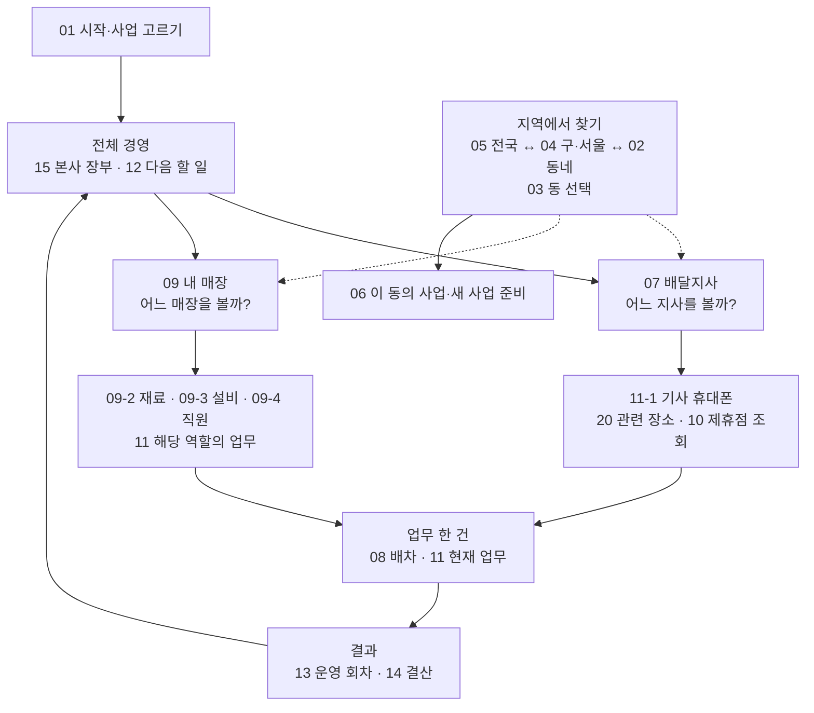

# [기획 · 화면의 탑다운 연결 · PLAN-SYSTEM-REGIONAL-OPERATOR-SIMULATION · r259]

[후속 r260](five-element-root-management-board.design.r260.md)에서 이 문서의 ‘전체 경영’ 자리를00음양오행 총괄판으로 구체화했다. 아래 사업·대상·업무·복귀 관계와01~20 번호는 유지하며 실제 구현 연결의 증거 수준도 바꾸지 않는다.

- 기준일: 2026-11-17 KST.
- 상태: `TopDownConnectedScreenOrganizationRequested / ExistingScreenNumbersPreserved / CurrentNavigationReviewed / HierarchyAndContextReturnProposed / NotReadyToDispatch / ProductUnchanged`.
- 사용자 방향: 만들어진 화면을 위에서 아래로 생각할 수 있도록, 서로 연결된 구조로 정렬한다.
- 관계: [화면 번호·캡처 r258](current-screen-numbering.catalog.r258.md)의 01~20을 그대로 사용하고 읽는 순서와 연결 관계를 보완한다. [배달지사 성장 r257](delivery-branch-growth-play-loop.design.r257.md)의 작은 1호지사 시작·2호 개설 목표와 미답변은 유지한다.
- 범위: 문서상 화면 구조와 연결 제안. 실제 메뉴/화면 재배치·새 대시보드·게임 코드·저장/권한·Graph Map·Goal/WI/E·수집/예약 변경은 하지 않는다. 구체 연결의 구현 승인은 별도다.

## 1. 현재 구현과 이번 차이

홍달 `dev/mirror-integration@81b6af97e`와 Unity 실제 작업본의 공통 메뉴·동/점포 창·역할 휴대폰·지도 이동을 읽기 전용으로 대조했다. 파일 지문과 확인 시각, 당시 빌드·자동 촬영 기록은 [확인 근거](../../../../../artifacts/local/screen-hierarchy-20261117-r259/review.json)에 고정한다. 이번에 새 빌드·실행·마우스 검증을 하지 않았다.

| 구분 | 현재 확인한 것 | 탑다운으로 정리할 때 필요한 것 |
| --- | --- | --- |
| 재사용 | 공통 하단 메뉴에서 07지사/15본사 장부, 06동 고용/제휴, 08배차, 14오늘 결산을 연다. | 기존 창을 새로 복제하지 않고 각 창의 상·하위 목적을 표시한다. |
| 보완 | 15본사 장부 본문은 조회이며 지사/기사로 내려가는 버튼이 없다. 07은 열린 동의 묶음이다. | ‘전체 경영’은 제안하는 읽기 구조다. 15가 이미 전체 지사를 선택·통제하는 화면이라고 설명하지 않는다. 특정 지사→기사/주문 필터는 후속이다. |
| 재사용 | 06동의 내 곳·20장소에서 09점포를 열고, 점포에서 해당 동의 내 곳으로 돌아가는 연결이 있다. | 같은 장소·동 관계를 재사용한다. 뒤로 가기를 모두 새로 만들 필요는 없다. |
| 재사용 | 11센터↔화물→검수의 상대 업무 연결이 있고 단일 관계가 없거나 모호하면 열지 않는다. | 같은 업무를 이어 보는 방식의 재사용 후보다. 모든 역할·주문에 결속됐다고 확대하지 않는다. |
| 보완 | 03동 선택→02현장, 02↔04/05 지도 이동이 있다. 일반 동네의 전체 보기에서는 동 초점을 해제하고, Solo·역 중심 보기에서는 해당 범위를 다시 맞춘다. | 확대 범위와 선택 대상의 복귀를 별도로 정리한다. 현재 선택이 모든 전환에서 보존된다고 단정하지 않는다. |
| 증거 갱신 | 이번에 읽은 더 뒤의 자동 촬영은 전체 `passed=true`, `miniShown/miniUnchanged/contStateSame=true`였다. | r258에 보존한 작은 지도 미통과는 당시 기록이다. 새 자동 기록은 실제 사용자 입력·모든 대상 선택 유지 검증을 대신하지 않는다. |

## 2. 위에서 아래로 읽을 경영 구조 — 제안

**전체 경영 → 사업·거점 → 사람·장소 → 업무 한 건 → 결과를 모아 다시 전체 경영**으로 읽는다. 지역 지도는 각 사업과 대상을 찾아 들어가는 길이다. 카메라가 높아지는 것과 누군가의 관리 책임이 커지는 것은 같은 규칙으로 취급하지 않는다.

아래는 권하는 정보 구조이며 모든 선이 이미 구현된 이동 버튼이라는 뜻은 아니다. 실제 연결 상태는 1절과 6절에서 구분한다.

카페·음식점·창고 등 직접 운영하는 거점은 지사와 나란한 사업이다. 음식 배달지사가 제휴한 음식점은 협업 상대이며 지사가 소유한 점포가 아니다. 같은 매장이 지도·플레이스·내 점포 창에 보이더라도 한 대상의 다른 보기로 연결한다.

01은 게임에 들어오는 입구다. 새 게임이 위 구조의 모든 창을 먼저 순회해야 한다는 뜻은 아니다. r257의 첫 장면은 준비된 작은 1호지사의 07/02에서 안내를 시작하는 안으로 이어 간다. 구체 첫 버튼·배치는 후속이다.

## 3. 지도 쪽의 탑다운 정렬

**05 전국 → 04 구·서울 → 03 동 선택/02 동네 → 20 건물·장소 → 09 매장 또는 11 사람 → 현재 업무** 순서로 범위를 좁혀 생각한다. 위로 돌아갈 때는 방금 고른 대상이 어느 지역에 있는지 다시 읽을 수 있도록 하는 안을 권한다.

| 보기 | 먼저 답할 질문 | 다음에 내려가 보는 것 |
| --- | --- | --- |
| 05 전국 | 사업/시설이 어떤 권역에 있는가? | 권역에 있는 구·사업 거점 후보. 첫 배달의 필수 경유 화면은 아니다. |
| 04 구·서울 | 어느 구·동·지사를 살펴볼까? | 같은 지점을 중심으로 02현장 또는 07지사. 서울 전체는 구 지도를 축소한 보기다. |
| 03 동 선택 | 지금 어느 동으로 이동할까? | 선택한 동의 02현장. 03은 별도 지도 높이가 아닌 선택 창이다. |
| 02 동네 | 지금 이곳에서 누가 무엇을 하는가? | 06사업, 20장소, 09내 매장, 11기사/역할. |
| 20 장소/건물 | 이 건물에 무엇이 있고 누구와 관련되는가? | 공개 정보/10플레이스, 관리 가능한 09점포, 연결된 역할의 11업무. 권한·연결 여부를 구분한다. |

한 지사가 여러 동을 맡거나 동 밖으로 배달해도 지사·기사·원 주문은 그대로다. 지역 선택은 새 지사 개설·주문 수요 생성·업무 완료를 만들지 않는다. 전국/구를 볼 수 있는 것과 그 단계의 경영 기능이 열린 것은 기존 기준대로 구분한다.

## 4. 기존 번호의 새 읽는 순서

번호 자체를 바꾸지 않고 다음 묶음으로 정렬한다. 같은 화면은 기본 위치를 한 곳에 두고, 다른 화면에서는 관련 대상의 지름길로 연결한다.

| 위계·묶음 | 화면 번호 | 책임 |
| --- | --- | --- |
| 입구 | 01 | 사업을 고르고 현재 운영으로 들어간다. |
| 전체 경영 | 15 · 12 | 전체 현황과 지금 결정할 일. 15의 지사 드릴다운 추가는 제안이다. |
| 지역 찾기 | 05 → 04 → 03/02 | 지도 범위를 좁히며 대상이 있는 곳을 찾는다. |
| 사업·거점 | 06 → 07 또는 09 | 06은 동의 사업 준비/진입. 07지사와 09직접 운영 점포는 나란한 선택이다. |
| 사람·장소 | 20 · 10 · 11 | 고른 대상의 정보·관계·현재 업무를 본다. 플레이스는 탐색 지름길로도 쓴다. |
| 업무와 반복 | 08 · 13 | 해당 업무를 선택·배차/관찰하고 회차 결과를 확인한다. 개별 발주/검수 등은 09/11의 같은 대상 보기로 연결한다. |
| 결과 모으기 | 14 | 오늘/지난 결산과 하루 마감. 지사·사업 귀속을 보존해 15전체 기록으로 모아 읽는 연결은 보완 제안이다. |
| 공통 보조 | 16 · 17 · 18 · 19 | 작은 지도/요약·설정/음악·단축키·방침/맡김. 현장 탐색의 필수 단계로 끼워 넣지 않는다. |

12다음 할 일은 전체 경영에서 ‘관련 현장 보기’로 내려가는 지름길, 16작은 지도는 현재 대상을 유지하며 위치를 찾는 보조 수단으로 제안한다. 19방침은 적용 범위를 전체/해당 사업/거점 중 어디까지로 정할지 후속이며, 현재 카드/맡김 창이 모든 범위별 방침을 구현했다고 읽지 않는다.

## 5. 연결할 때 유지할 것과 돌아오는 방법 — 제안

각 이동에서는 **어디에서 왔는지, 누구를 골랐는지, 어떤 일을 보던 중인지**가 이어져야 한다. 새 저장 계약을 정하는 단계는 아니며 기존 고유 식별자와 선택 상태를 먼저 재사용한다.

| 이동 예 | 내려갈 때 유지할 맥락 | 돌아올 때 |
| --- | --- | --- |
| 전체 → 1호지사 → 기사 → 주문 | 지사·기사·원 주문, 지역/시점. 독립 지사 식별/소속 결속은 r257 후속이다. | 같은 지사의 같은 기사/업무 선택으로 복귀. 다른 지사나 첫 동으로 초기화하지 않는 안을 권한다. |
| 동 → 매장 → 재료/발주 | 같은 매장·건물·지역·보고 있는 발주/기록 | ‘뒤로’는 진입한 동/목록의 보던 위치로, ‘이 매장 현장’은 소재 동 지도로 구별하는 안을 권한다. 기존 점포→동 복귀를 재사용한다. |
| 센터 → 화물 → 검수 | 연결된 출고·운행·검수의 실제 고유 식별자 | 기존 이전 관점을 재사용. 상대가 없거나 둘 이상이면 이유를 보여 주고 선택을 요구하며 임의 대상을 고르지 않는다. |
| 플레이스 → 매장/현장 | 같은 매장과 원래 검색어·페이지 | 검색으로 돌아오면 해당 결과 위치를 복원하는 안을 권한다. 외부 매장을 열었다고 운영 권한을 얻지 않는다. |
| 다음 할 일 → 관련 작업 | 해당 안건·거점·대상 업무와 확인된 상태 | 결과에서 원래 안건을 다시 읽는다. 취소/보류·결과 없음은 완료로 바꾸지 않는다. |

선택·확대·창 열기·뒤로 가기는 조회/관찰이다. 고용·발주·개설·배차 확정·정산 등의 실행은 기존 명시 행동으로 구분하고 [r225](field-work-delegation-and-player-decisions.confirmed.r225.md)의 플레이어 결정과 [현행 r251](next-todo-fire-to-center-observation.design.r245.md)의 턴 전 준비/턴 후 수행 경계를 유지한다.

위쪽 경로 표시는 **사업 관계**와 **현재 지도 위치**를 나누는 안을 권한다. 예: `내 사업 > 1호지사 > 기사 A > 배달 한 건`, 별도 위치 `중랑구 · 면목3·8동`. 지도에서 들어온 경우에는 지도 진입 경로도 복귀 위치로 보존한다. 카페를 지사의 자회사처럼 보이게 하거나, 기사님이 동을 넘었다고 소속 경로가 바뀌게 하지 않는다. 문구/배치 시안은 후속이다.

## 6. 구현 연결의 우선순위 — 제안이며 착수 아님

1. 기존 01~20 화면을 위 묶음으로 읽는 문서/참조를 먼저 사용한다. 이번 작업은 여기까지다.
2. 첫 배달지사에서는 **07지사 → 기사/08배차 → 같은 주문의 11휴대폰 → 결과 → 07** 한 경로만 먼저 정밀화하는 안을 권한다. 현재는 공통 메뉴와 동 선택을 재사용하며, 지사별 기사·주문 필터는 새 결속이 필요하다. 15전체 화면부터 전면 개편하지 않아도 이 경로를 검토할 수 있다.
3. 06/20→09점포→06은 기존 연결을 재사용하고, 같은 매장/검색 결과로 돌아오는 맥락을 필요한 만큼 보완한다. 모든 역할/물류를 함께 고치지 않는다.
4. 구체 구현은 관련 기획 승인·revision/hash·담당/정확 경로·WI 하나와 E1~E7 검증 명세를 결속한 뒤 별도 수용한다. 화면 전환 중 선택 보존·조회로 권위 불변·실패/보류/귀환은 실제 입력으로 검증해야 한다.

Graph Map 영향은 기존 화면/주체/업무 간 탐색·귀환 관계의 `ReviewRequired` 후보로 남긴다. 이 문서가 Graph Map 원본·생성물·승인 인계·Goal을 직접 바꾸지 않는다.

## 7. 확정 / 미정 / 다음 질문

**확정:** 화면을 탑다운으로 서로 이어 읽을 수 있게 정리한다. 01~20 참조 번호와 r258 캡처는 유지한다.

**미정:** 전체→지역/거점→대상→업무→결과의 구체 메뉴·필터·경로 표시/복귀 UI·시안·구현. 위 계층과 연결은 이번 요청에 맞춰 작성한 제안이며 기존 동작을 고친 결과가 아니다.

**다음 질문:** 이번에는 추가 선택을 묻지 않는다. 이 구조를 바탕으로 사용자가 지목한 화면/연결 한 곳을 좁혀 검토한다. r257 지사장 경로의 미답변도 그대로 둔다.
