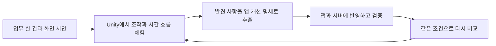

# Unity 업무 실험에서 앱 구체화로 돌아오는 제작 순환

[기획 · Unity·앱 개발 순환 · PLAN-SYSTEM-REGIONAL-OPERATOR-SIMULATION · r120]

- 사용자 의도: 2026-10-29. 웹·앱에서 수행할 업무를 Unity에서 먼저 구현·시뮬레이션하고, 체험 결과를 다시 앱 구체화에 반영하는 순환을 제안받는다.
- 상태: `UnityFirstProductFeedbackRequested / WorkflowCycleProposed / ExistingAuthorityPreserved / NoImplementationChange`.
- 선행: [개인용·사가정·한 주문부터 r119](sagajeong-solo-northeast-game-visual.proposal.r119.md), [지역 플랫폼 경영 r3](regional-platform-management-direction.r3.md).
- 관계: 기존 [플레이 경험 학습 환류 r1](gameplay-experience-learning.proposal.r1.md)의 경험 기록을 참고하되, 이번 제안은 앱/업무 설계의 환류다. 실제 모델 학습·운영 자동 변경을 시작하지 않는다.
- 현재 작업은 기획 제안이다. 제품/Unity 코드·Scene·운영 DB·새 API·Goal/WI·빌드/실행·공개·commit/push를 변경하지 않았다.

## 추천하는 순환

Unity를 **업무를 먼저 체험하는 실험실**로 두고, 앱의 최종 화면을 만들기 전에 사람·장소·시간·선택·결과를 직접 확인한다. 그 결과를 역할별 앱의 화면과 업무 계약에 반영한 뒤 같은 상황으로 돌아와 다시 비교한다.

| 순서 | 실제 작업 | 한 회차에서 남길 결과 |
| --- | --- | --- |
| 1. 작은 업무 정의 | 기존 기능이면 현재 route/상태/권한을 재사용하고, 새 기능이면 입력·가능한 행동·직접 결과의 최소 계약을 정한다. 시안으로 먼저 검토한다. | 상황·역할·선택·결과·실패/복구 카드1장 |
| 2. Unity 선행 체험 | 기존 디오라마에서 같은 업무를 가상 회차로 실행한다. 일시정지·시간 경과·선택 변경을 통해 실제로 읽고 판단할 수 있는지 본다. | 당시 입력·선택·결과를 다시 확인할 사례 |
| 3. 앱 환류 | 정보 부족·헷갈리는 선택·업무 순서·오류/복구 문제를 역할별 화면과 API/상태 변경 후보로 바꾼다. | 화면 수정표와 필요한 계약/검증 목록 |
| 4. 앱 구체화 | 필요한 기존 기능을 보완하고 서버·조회/저장·상태 전이와 실제 소비 앱/기기에서 확인한다. | 반영한 변화와 실제 검증 범위 |
| 5. 같은 상황 재검증 | 같은 시나리오 조건으로 Unity와 앱의 업무 의미·상태·선택 결과를 비교하고, 발견한 차이의 책임 위치로 돌아간다. | 해결된 문제/남은 문제·다음 작은 변경 |

전체 웹 기능이나 동북권 전체를 먼저 완성해야 하는 순서로 만들지 않는다. 시간·공간·여러 역할이 얽히는 업무 한 건부터 이 순환을 검증한다. 텍스트 수정처럼 체험 의미가 바뀌지 않는 작업까지 매번 새 디오라마·영상을 생성하는 절차로 만들지 않는다.

## 같이 쓸 것과 각자 소유할 것

- **공통 기준:** 업무 고유 ID와 상태 의미, Command/조회 계약, 허용 행동과 오류 의미, 재사용 가능한 순수 업무 규칙, 같은 상황의 검증 사례. 이미 있는 계약·규칙을 먼저 연결한다.
- **Unity:** 공간·관계·조작·카메라·표현. 화면을 위한 코드는 Prefab/MonoBehaviour에 두되 업무 확정 규칙을 여기에 중복 소유하지 않는다.
- **Simulation:** 가상 시간·회차·seed·결정 결과·Save/Replay. Solo는 LocalProcess, Hosted는 같은 Simulation Core를 쓰는 기존 방향을 유지한다.
- **운영 서버:** 실제 사용자 권한·원장·주문 확정·결제/정산과 영속 상태. 모의 회차와 운영 DB/entity를 공유하지 않는다.
- **앱/Web:** 역할별 입력·작은 화면 조작·목록·알림·상세·복구. Unity 체험의 발견을 각 기기의 업무 흐름에 맞게 표현한다.

Unity의 3D UI를 앱 화면으로 그대로 복사하거나, 두 환경에 같은 업무 규칙을 따로 구현하는 방식은 재사용의 기본 단위로 삼지 않는다. 공유할 순수 규칙과 서로 다른 Simulation/Operational 효과는 기존 Adapter·UseCase 경계에서 판단한다. 기존 `SsalddelExecution:Mode`의 경계를 유지하고 새 임의 실행 모드를 만들지 않는다.

## 사가정 첫 주문에 적용하는 예

r119에서 사용자가 고른 **주문 한 건의 문제 해결**을 첫 실험으로 추천한다. ‘매장 조리 지연’은 아직 사건 제안이며 이번 목적 설명으로 확정하지 않는다.

| Unity에서 드러날 수 있는 문제 | 앱에 반환할 확인/개선 후보 | 다시 비교할 내용 |
| --- | --- | --- |
| 언제 준비되는지 몰라 다음 행동을 고르기 어려움 | 기존 준비 예상시간·응답 기록·지연 이유의 존재/표시부터 확인. 필요한 역할별 입력과 조회만 보완 | 매장·기사·운영자가 같은 주문의 같은 의미를 읽는가 |
| 선택했는데 적용 여부를 알기 어려움 | 기존 접수/반영/실패 상태와 재조회·중복 방지를 확인 | 클릭/애니메이션과 확정 결과를 구분하는가 |
| 응답 없음·추가 지연 뒤 다음 행동이 막힘 | 현재 오류·대기·재시도·취소 가능 조건과 복귀 화면을 확인 | 실패 뒤 같은 주문에서 회복하고 전체 상황으로 돌아오는가 |

이는 현재 앱에 해당 기능이 없다는 감사 결과가 아니다. Unity에서 발견한 문제를 실제 route/contract/UI와 대조하는 반환 예시다. 가상 선택이 실제 기사 호출·연락·금전 이동을 일으키지 않게 모의 자료와 효과를 사용한다.

첫 실험의 앱 환류 산출물은 **①상황/선택/결과/복구 기록 ②역할별 화면 수정표 ③계약 변경과 서버/기기 검증 사례**로 제한한다. 매회 전체 문서를 다시 읽거나 새 전체 영상을 만드는 대신, 변경된 상태·화면·원문 판본만 연결한다. [r50 제작 방식 추출](../PLAN-SYSTEM-ADMIN-DONG-DIORAMA/sagajeong-construction-recipe.extract.r50.md)은 그래픽 쪽의 재사용 진입으로 유지한다.

## 재사용 기반과 이번 확인 범위

[프로젝트 컨텍스트](../../../../ProjectOverview/GptProjectContext.md)의 서버·Simulation·Unity 분리, [업무 흐름 분리](../../../../Architecture/OperationsSimulationUnity작업흐름분리.md), [서버 상태에서 Unity 표현으로의 설계](../../../../Architecture/UnityServerStateToWorldProjectionDesign.md)를 따른다. 기존 D-002/D-003과 양립하며 이번에 새 전역 D를 만들지 않는다.

기존 [판단/업무 계약](../../../../../Ssalddel.Simulation.Contracts/UnityPackage/Runtime/SimulationDecisionWorkContracts.cs), [Core 처리](../../../../../Ssalddel.Simulation.Domain/UnityPackage/Runtime/SimulationDecisionWork.cs), [Save/Replay 계약](../../../../../Ssalddel.Simulation.Contracts/UnityPackage/Runtime/SimulationSaveReplayContracts.cs), [경영 회차 API](../../../../../Ssalddel.Simulation.Hosting/Controllers/경영SimulationSessionsController.cs)의 파일 존재를 확인했다. 이번 제안에서 이 연결의 현재 통합 완주·Runtime·기기 동작을 새로 검증하지 않았다.

## 확정·미정·다음 질문

- 확정된 입력: 사가정역 중심·개인용·한 주문부터·시안 선행은 r119를 유지한다. 사용자가 이번에 제시한 목적은 Unity 체험과 앱 구체화의 순환이다.
- 제안: 위 5단계를 작은 업무 단위로 반복하고 공통 계약/규칙을 재사용한다. 첫 운영 앱의 수정 대상과 실제 시나리오가 아직 정해지지 않았으므로 구현 승인이 아니다.
- 미정: 첫 사건·대응/대가·시간·정확 상태, 공유 규칙과 Adapter의 실제 범위, 앱별 반환표·증거 결속/회귀 명세.
- 다음 질문 하나: r119의 ‘조리 지연을 첫 사건으로 삼을지’를 남겨 둔다. 같은 ‘한 주문부터’ 방향을 다시 묻지 않는다. 이 목적 제안에 대한 피드백 뒤 첫 사건의 한 선택만 이어간다.

이번은 기획/문서 변경이며 새 UI·게임 실행·앱 기능 반영 결과는 아니다. 새 디오라마 규칙 후보 없음.

문서 검증: 4개 경로의 Fast 검사와 `git diff --check`를 통과했다. 로그는 `artifacts/local/validation/20261029-183508/`에 남겼다. 본문의 상대 링크 11개가 존재하고 역세권 디오라마 증거 규칙 Validate도 통과했다. 문서 전용 변경으로 빌드·시험은 생략했으며 새 Runtime 검증은 없다.
