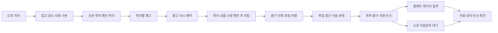

# [기획 · 위치표식과 물류센터 내부 작업 · PLAN-SYSTEM-REGIONAL-OPERATOR-SIMULATION · r199]

- 기준일: 2026-11-14 · 분야: 센터 내부 모형·위치 식별·현장 작업·지도 왕복.
- 상태: `DetailedWarehouseInteriorDirectionConfirmed / LocationAndGoodsIdentitySeparated / DoubleClickEntryDocumented / WorkflowsAndViewportProposed / VisualReviewPending / NotReadyToDispatch / ProductUnchanged`.
- 사용자 방향: 지붕 없는 내부에 랙/바닥의 위치 바코드와 구획, 실제 놓인 상품을 보인다. 직원이 입고·적치·피킹·포장하고, 포장물이 컨베이어/분류 출구로 이동한 뒤 팔레트 또는 차량으로 인계되는 과정을 자세히 읽는다. 지도 센터 더블클릭으로 내부 모형을 보고 그 공간에서 관찰/플레이하도록 한다.
- 상위: [공통 r162](integrated-map-management-baseline.r162.md). 전문: [위치/적치 r5](location-barcode-outbound-picking.proposal.r5.md), [센터 조사 r163](logistics-centers-sortation-skeleton.research.r163.md), [다층 모형 r164](logistics-center-multifloor-cutaway.design.r164.md), [작업 맵 r166](delivery-and-center-work-maps.proposal.r166.md), [스캔 r148](barcode-scan-timing-minigame.design.r148.md), [집중/이완 r146](focus-relax-shared-management.design.r146.md), [직무 r147](multi-role-minigames-and-realistic-recipes.design.r147.md), [다음 작업 r151](next-task-button-confirmed.design.r151.md), [사업 창/입점 r198](business-tabs-and-dong-scoped-expansion.design.r198.md).
- 부분 대체: r164/r166의 센터 선택 즉시 내부 진입을 **일반 클릭=카드, 더블클릭 또는 카드의 내부 보기=모형**으로 구체화한다. 층 선택/현재 시계/동일 물류단위/지도 귀환과 기존 업무 규칙은 유지한다.
- WI·PlayableLoop·Graph Map: 신규 등록/승격 없음. 지도 센터→내부/층/구역→위치/물품/작업자→작업/인계→같은 센터/지도 귀환의 관계와 제약을 기획 입력으로 남긴다.
- 인계 상태: 기획·시안 준비. 실제 모델 제작·Prefab/입력·상태 계약·제품 구현과 개발 수용은 미완료이며 자동 착수 권한이 아니다.

## 1. 핵심 경험과 권장 화면

**어느 칸의 무엇을 누가 꺼내 어디에 넘기는지, 공간을 보면서 이해하고 필요한 작업에 참여한다.** 센터 전체에서는 연결/병목을, 한 층에서는 구역/작업자를, 가까운 시점에서는 위치 라벨과 물품을 읽는다.

첫 안은 **화면의 주 영역에 조작 가능한 3D 내부 모형을 크게 두고 최소 UI를 얹는 방식**을 추천한다. 왼쪽은 층/구역, 오른쪽은 선택한 대상의 위치·물품·수량·다음 인계/대기 이유, 아래는 기존 직무 필터/작업 대기열을 재사용한다. 작은 팝업에 정지 이미지만 넣는 것으로 내부 플레이 요구를 완료 처리하지 않는다.

UI 안의 작은 모형 보기는 같은 모델/상태를 사용하는 대안 또는 후속 미리보기다. 첫 시안에서는 큰 모형 화면을 우선 비교하고, 창 크기/배치는 사용자 검토 전 제안으로 둔다. 독립 창고 세계·공식 Scene·시계·업무 권위를 새로 만들지 않는다.

### 지금·여기·나·너·이렇게

- 지금: 입고 재고가 보관되고 주문에 맞춰 출고할 작업이 준비된 운영 회차.
- 여기: 가상 센터의 선택 층, 랙/바닥 위치·통로·포장대·출고 출구/도크.
- 나: 현장/운영을 관찰하거나 준비된 직무 한 건에 직접 참여하는 플레이어.
- 너: 같은 ID로 추적되는 재고/용기/소포, 수행 가능한 직원과 현재 공간/설비 상태.
- 이렇게: 대상/작업을 선택해 출발 위치→현장 확인→실물 이동/작업→다음 인수 결과를 읽고 같은 현장으로 돌아온다.
- 대가/회복: 작업 시간·직원/장비 점유·재고/포장재와 대기·재확인. 잘못된 위치/품목·수량 부족은 보류하고 같은 작업의 올바른 대상을 다시 확인한다.
- 결과/다음 선택: 직접 작업의 확정 결과를 확인하고 `다음 작업`, 직원 인계 또는 관찰/지도 귀환을 선택한다.
- 상위 목적 정렬: 물건의 위치·인계·막힘과 사람의 노동을 이해하는 경영 보조 층. 모형/라벨을 구경한 횟수로 수익·경 시간·성장을 만들지 않는다.

## 2. 지도로부터 내부로 들어가는 규칙

| 입력/상황 | 제안 동작 |
| --- | --- |
| 일반 탐색에서 단일 센터 클릭 | 센터/건물 카드 선택. 내부 역할·준비 상태와 `내부 보기` 표시 |
| 준비된 단일 센터 더블클릭 | 같은 대상의 내부 전체 보기 진입. 중간 단일 클릭에는 파괴적/업무 확정 행동이 없음 |
| 카드의 `내부 보기` | 더블클릭과 같은 결과. 마우스 더블클릭이 어려워도 동일 진입 가능 |
| 단지/복수 건물·역할 | 먼저 대상 건물/센터 역할을 고른 뒤 내부 보기. 임의 시설로 들어가지 않음 |
| r198 입점 자리 선택 중 | 클릭/더블클릭은 기존 후보 검토 규칙을 유지. 자리 선택을 중단하고 내부로 강제 이동하지 않음 |
| 내부 자료/모델 미준비 | 카드에 준비 상태/이유 표시. 다른 센터 모형이나 임의 실제 내부를 대신 보여 주지 않음 |

진입할 때 지도 범위·카메라·센터/역할·사업 창/필터·초안과 참여/일시정지 문맥을 보존한다. `지도로 돌아가기`는 같은 위치/선택으로 돌아가되 **업무는 경과 후 현재 상태**를 읽는다. 더블클릭이 시간 진행·작업 수락·시설 소유/해금·자금 차감을 만들지 않는다. UI 버튼 클릭은 뒤의 지도에 전달하지 않는다.

## 3. 모델을 나눌 공간 단위

| 구역/물체 | 모형에서 읽을 것 | 선택 시 먼저 보여 줄 것 |
| --- | --- | --- |
| 입고 도크/검수 | 차량·하차품·인수 대기·검수대·보류 공간 | 입고 근거·품목/수량/상태·다음 보관 위치 |
| 바닥 위치 | 테이프로 구분한 사각 공간·위치 라벨·놓인 팔레트/상자 | 위치 이름·허용/점유 상태·현재 물류단위/수량 |
| 랙 | 구역/통로·랙·단·칸, 앞면 라벨, 칸별 상품/상자 | 해당 위치·SKU/로트·가용/예약/확인 필요 수량 |
| 보행 통로/집품 용기 | 랙 접근점·직원·토트/대차와 담긴 물건 | 담당 작업·다음 위치·현재 실물/용기의 소속 |
| 포장 작업대 | 주문 용기·상품·포장재·밀봉/라벨 구역 | 내용 대조·부족/오류·포장 완료/투입 대기 |
| 이송 투입/층간 연결 | 투입 버퍼·벨트 방향·합류·대기 | 같은 소포의 현재 구간·다음 출구·막힌 이유 |
| 읽기/분류 출구 | 센서·분기·완만한 슈트/받이·케이지/출구 버퍼 | 읽기 결과·분류 목적·확인된 도착/보류 |
| 출고 대기/도크 | 노선별 바닥 구획·팔레트/케이지·차량·인수 직원 | 포함 소포·목적 차량/회차·인수/적재 상태 |

첫 상세 모형은 **사람이 랙으로 이동하는 수동 피킹형**으로 제안한다. 사람이 직접 닿는 피킹 위치와 보충/장비 작업 위치를 구분하며 상단 칸의 상품을 맨손으로 순간이동시키지 않는다. 자동창고·상품이 작업자에게 오는 설비는 별도 프로필이며 이번 필수 범위가 아니다.

바닥 보관 슬롯, 임시 대기 구획, 보행 통로는 서로 다른 공간이다. 모든 바닥 네모를 재고를 놓을 수 있는 빈칸으로 만들지 않는다. 사람/운반장비 접근·집기/내려놓기 지점과 벨트 투입/인수 지점을 모델에 구별하되 실제 폭·하중·안전 기준/처리능력의 설계도로 표시하지 않는다.

## 4. 세 종류의 라벨을 구분한다

| 라벨 | 의미 | 화면 예시/주의 |
| --- | --- | --- |
| 위치 라벨 | 어디인가 | `3층 A구역 · 2번 랙 · 1단 · 3칸`, `1층 출고대기 B-02`. 랙 앞면/바닥/표지판에 읽기 쉬운 이름과 바코드 |
| 상품 라벨 | 어떤 품목인가 | SKU/상품 바코드·명칭. 같은 상품 여러 개의 낱개 고유 ID로 자동 해석하지 않음 |
| 용기/물류단위 라벨 | 어느 묶음인가 | 토트·포장 소포·팔레트/케이지의 게임 ID와 내용물/수량 연결. 운송장·SSCC·작업 ID를 자동 동일시하지 않음 |

예시 이름/코드는 표현용이며 기존 위치/재고/주문/물류단위의 안정 ID를 교체하지 않는다. 바닥 표식은 이동 중에도 식별할 수 있는 가상 배치를 쓰고 필요한 이름을 표지판/선택 카드에 함께 표시한다. 첫 게임 라벨은 내부 가상 위치코드로 충분하며 모든 랙 칸에 실제 GLN을 발급하거나 표준 인증 바코드처럼 표시하지 않는다.

가까이 보이는 바코드는 **작업/위치에 연결한 표식**과 단순 장식 텍스처를 구별한다. 무늬를 화면에 그렸다는 것과 실제 스캐너/카메라 디코딩이 되는 것은 다른 기능이다. 라벨이 바뀌거나 재스캔돼도 실물/재고가 새로 생기지 않는다.

## 5. 물건과 작업자가 이어지는 과정

아래는 상품 보관/출고형 FC의 대표 흐름이다. 각 상자는 별도 업무/결과 경계이며 하나의 명령이나 첫 구현 WI로 합치지 않는다.

| 작업 | 사람/물건의 구체 장면 | 확정할 결과와 실패/회복 |
| --- | --- | --- |
| 입고/검수 | 직원이 도착 단위와 입고 근거·품목/실수량/상태를 대조 | 인수/보류/거절 구분. 미검수·보류품을 가용 재고로 세지 않음 |
| 적치 | 적격 바닥/랙 위치까지 운반→위치 라벨/물품/수량 확인→놓기 | 같은 재고의 위치 이동/실적. 일부 적치 시 나머지는 대기. 스캔만으로 전량 적치 안 함 |
| 피킹 | 지시된 랙에 이동→위치/상품·로트/단위 확인→필요량을 토트에 담음 | 위치 재고→해당 작업 용기의 실제 수량. 부족/다른 상품이면 보류·다른 적격 후보 재검토 |
| 포장 | 작업 용기를 포장대에서 인수→내용 재대조→포장/밀봉→라벨 | 포장 소포와 내용물 관계·준비된 포장재 소모. 담긴 상품과 새 소포를 독립 재고로 중복 집계 안 함 |
| 이송/분류 | 소포 투입 확인→벨트/층간 구간→읽기/분기→출구 받이/버퍼 | 같은 소포의 위치/인계. 막히면 앞 버퍼에서 대기, 읽기 실패/미연결은 보류 후 같은 ID로 재확인 |
| 집약/상차 | 직원이 출구에서 인수해 노선 팔레트에 쌓거나 직접상차 대기로 옮김 | 팔레트/케이지 포함 관계 또는 개별 소포 인계. 대상 차량/허용 묶음·실수량 확인 뒤에만 적재 결과 |

선반의 상품, 토트 내용물, 포장 소포, 팔레트 포함 목록, 차량 적재 목록은 연속된 계보다. 상품 개수·상자 개수·팔레트 개수를 같은 수량으로 합산하지 않는다. 이동 중인 물건은 출발/도착 양쪽에 두 개가 생기지 않으며, 스캔/카메라 이동·애니메이션 종료가 권위 결과를 대신하지 않는다.

### 포장물이 내려오는 출구와 상차 두 갈래

사용자가 말한 ‘밑으로 떨어지는’ 장면은 r164처럼 **설비로 연결된 경사/슈트→받이·버퍼→직원 인수**로 읽히게 한다. 모든 상자를 허공에서 바닥으로 자유낙하시키지 않는다. 경로가 없는 층을 관통하거나 막힌 출구의 물건을 자동으로 다른 차량에 보내지 않는다.

- **팔레트/케이지 경로:** 출구에서 모으기→목적/내용물 대조→준비된 집약 완료→운반/해당 차량 인수. 소포와 팔레트가 각각 식별되고 포함 관계를 유지한다.
- **직접 상차 경로:** 출구/도크 버퍼→직원/준비된 운반 설비로 차량에 전달→해당 소포의 차량 인수. 팔레트를 반드시 만들지 않는다.

두 경로는 센터/출고 프로필에 따른 대안이다. 모든 물건을 두 번 상차하지 않는다. 출구 도착·직원 인수·팔레트 집약·차량 적재·차량 출발·최종 배달은 각각 다른 결과다.

택배허브로 들어온 **이미 포장된 외부 소포**는 r163/r164/r166처럼 1층 하차/투입에서 분류로 합류한다. 매번 랙 보관·주문 피킹·개봉/재포장을 강제하지 않는다. 보충 상품의 층간 이동도 포장물 하향 벨트와 구별한다.

## 6. 확대·층 선택과 작업 참여

- 전체: 지붕/앞 외벽을 걷어내고 층간 연결과 대표 구역·대기량을 읽는다. 펼친 층 간격은 관찰 표현이며 실제 이동 거리/시간을 바꾸지 않는다.
- 한 층: 다른 층의 가림을 줄이고 바닥 구획·랙 통로·포장대·작업자/용기 흐름을 보인다. 현재 구역/층과 선택 대상 위치를 유지한다.
- 가까이: 선택한 랙 칸/바닥 라벨·상품/용기와 실제 수량·다음 행동을 읽는다. 모든 라벨을 멀리서 동시에 띄우지 않는다.
- 선택 강조: 현재 작업의 출발 위치와 다음 인계 지점·이동 중 물류단위를 우선 표시한다. 같은 센터 전체의 선을 한꺼번에 켜지 않는다. 관리색과 후보/오류/선택 표식을 구별한다.
- 작업자: 목적 위치로 이동·확인·집기/놓기·대기·인계의 차이가 보이도록 한다. 실제 경로가 없으면 직선 최단 이동으로 꾸미지 않고 미연결/대기 이유를 남긴다.

이완에서는 준비된 직원이 같은 업무 규칙/시계로 움직이고 플레이어는 위치·작업·막힘을 관찰한다. 직접 참여는 대기열에서 준비된 직무 한 건을 선택했을 때 시작한다. 모형/랙을 눌렀다고 집중 작업을 자동 수락하지 않는다.

수동 스캔 직무는 r148의 **가로 레이저 상하 이동·중앙에서 Space**와 업무 대상/수량 검증을 재사용한다. 자동 벨트 센서에는 매번 이 미니게임을 요구하지 않는다. 같은 작업을 직원과 플레이어가 동시에 확정하지 않고, 이완 복귀는 기존 확인/인계 경계에서 담당·진행 수량을 보존한다. 완료 뒤 `다음 작업`은 버튼이며 자동 연속 시작하지 않는다.

층/카메라 변경·창 닫기·지도 귀환은 작업 취소나 완료 보상으로 세지 않는다. NPC가 계속 수행할지 일시정지할지는 기존 참여/공통 시계 규칙을 따른다. 보지 않는 층의 같은 소포를 삭제/복제하거나 완료 전 상태로 되감지 않는다.

## 7. 공식 근거와 게임 해석

다음 자료는 식별/설비 개념의 근거이며 국내 특정 업체의 실제 도면이나 모든 센터의 동일 공정 근거가 아니다. 2026-11-14 확인했다.

| 공식 1차 자료 | 확인한 개념/이 기획의 한계 |
| --- | --- |
| [GS1 위치 GLN 안내](https://support.gs1.org/support/solutions/articles/43000734241-how-do-i-use-a-global-location-number-to-identify-a-physical-location-) | 도크/보관 위치를 물리 바코드로 표시하는 사례와 위치 의미. 모든 내부 슬롯의 GLN 의무화로 해석하지 않음 |
| [GS1 Singapore 창고 관리](https://gs1.org.sg/transport-and-logistics/warehouse-management/) | 위치/상품/물류단위를 GLN·GTIN·SSCC 등으로 구분해 도착·보관/피킹·출고 정보 연결. 정보 대조가 실물 파손/수량 검수를 대체한다는 뜻이 아님 |
| [GS1 EPCIS/CBV 2.0 지침](https://ref.gs1.org/guidelines/epcis-cbv/2.0.0/) | 관측 위치·업무 단계·처리 상태의 구분. 이를 근거로 스캔 관측과 실물/업무 확정 결과를 분리하는 것은 이 게임의 설계 제안 |
| [Dematic Modular Sort System, 3쪽](https://www.dematic.com/content/dam/dematic/downloads/brochures/NA_BR_1112_ModularSortSystemSolution.pdf) | 분류 출구 뒤 수동 팔레트 집약/용기/트레일러 직접상차 등의 대안. 조사 담당이 원문 확인했고 통합 담당 재열람은 시간 초과. 특정 제조사의 설비 사례 |
| [Honeywell 이송/상하차 설명](https://automation.honeywell.com/au/en/support/warehouse-automation/resources/publications/journey-predictability/new-angles-optimize-dc-operations) | 높이 차/합류·슈트·차량 안으로 이어지는 컨베이어와 사람 상하차의 연결 사례. 실제 장비 치수/성능·안전/국내 보급 자료 아님 |

현재 취득한 [국내 시설 DB](../../../DataCollection/Research/2026-11-14-logistics-facilities-db-intake.md)는 시설 후보/출처 자료다. 랙 배치·내부 위치·실제 재고/작업자·가동률·팔레트/차량 관계를 제공하지 않는다. 등록시설에 이번 가상 내부를 붙이면 `가상 내부 모형`을 표시하고 실제 운영 복원으로 표현하지 않는다.

## 8. Claude 시안·모델 제작에 넘길 뼈대

[기존 시안 D](../../../../../artifacts/local/hongdal-unity-claude-20261112/mockups/기획적용-20261113/04-물류센터-내부모형.png)를 직접 확인했다. 다층 연결/분류·상차의 큰 구조는 재사용하고, 단순 랙 덩어리를 **위치 라벨/칸·물품·용기·바닥 구획이 읽히는 한 층**으로 구체화한다. 정적 시안은 실제 내부 실행/재고 연동의 증거가 아니다.

첫 시안은 같은 센터의 세 장면을 권한다: ① 전체/층 선택, ② 한 층의 적치·피킹/포장과 위치 라벨 상세, ③ 1층 분류 출구의 직원·팔레트/직접상차 대안. 수치/배치는 가상으로 밝히고 한 대표 작업/소포의 정상·보류·회복을 이어서 검토한다. [화면 시안 절차](../../../../Architecture/화면시안선행제작절차.md)를 따라 검토한 범위만 후속 구현 대상으로 준비한다.

모델 제작은 [Blender 왕복 r192](blender-authoring-and-unity-roundtrip.workflow.r192.md)를 따른다. 바닥/벽·랙 모듈/칸·라벨면·상품/상자·토트/대차·작업대·벨트 구간/투입/인수·도크·팔레트/차량은 역할과 연결 지점을 나눌 후보다. 라벨 값·재고 수량을 모델 메시 이름/장식에만 박아 넣지 않고 준비된 상태/위치와 결속한다. 크기·재질·피벗·콜라이더·상호작용 지점·높은 랙 접근·작업자 Clip은 제작/전문 연구에서 확인한다. 이번에는 모델을 제작하지 않았다.

**기존 첫 개발인 r163의 1층 한 소포 분류를 새 전체 공정으로 교체하지 않는다.** 상세 모델/공정의 목표를 준비하되 논리/표현이 확인된 작업 단위로 붙인다. 한 층과 1층 인계가 확인된 뒤 다른 층을 확장하며 처음부터 5층 모든 칸/직원을 같은 정밀도로 제작할 필요는 없다. 기존 Core·우유 사슬을 다시 구현하거나 외부 Farm/Hub/City 선행 상태를 요구하지 않는다.

### 후속 확인할 장면

- 단일 클릭/더블클릭/내부 보기·입점 선택 모드가 충돌하지 않고 같은 센터/지도로 돌아오는가.
- 위치/상품/물류단위 라벨을 구별하고 가까운 화면에서 실제 작업 대상과 연결되는가.
- 부분 적치/피킹·내용 불일치·잘못된 위치·읽기 실패/출구 적체에서 같은 작업이 보류/회복되는가.
- 랙→토트→포장물→출구→팔레트 또는 직접 차량의 수량/포함 관계와 다음 인수가 이어지는가.
- 층간 이송/재스캔/인계·저장/재진입에서도 물건·작업·보상·차감이 중복되지 않는가.
- 직원 관찰/직접 작업·중단/인계·다음 작업·지도 귀환과 공통 시계가 기존 규칙을 보존하는가.

## 확정 / 미정 / 다음 질문 하나

**확정:** 지붕 없는 센터 내부의 바닥/랙 위치표식과 물건을 구체화하고, 사람이 수행하는 입고·적치·피킹·포장·분류 출구 인수·팔레트/직접 차량 상차를 읽게 한다. 지도 센터 더블클릭에서 내부 모형으로 들어가는 방향을 기록했다.

**미정:** 큰 3D 모형 화면의 최종 채택/배치, 실제 모델·라벨 밀도/코드·동작/키·작업 시간/용량·경제/보상·상태/입력 계약·시안 승인·개발 수용. 본문의 상세 공간/전환 규칙은 제안이며 자동 확정하지 않는다.

**다음 질문 하나:** 지금 답변이 필요한 질문 없음. Claude의 같은 센터 전체/작업 층/분류·상차 시안에서 공간과 판독 밀도를 검토한다.
