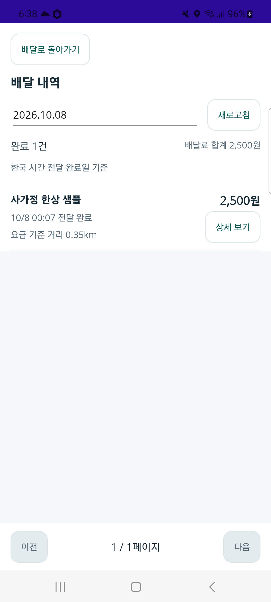

# 실제 휴대폰 지도·완료 내역·메뉴 저장·연결 복구 검증

휴대폰 잠금 해제 후 Samsung SM-N981N(Android 13/API 33)에서 기존 네 음식 역할 앱을 이어서 확인했다. 지도 중심 업무 화면과 [페이지 책임](../ProjectOverview/page-docs/food-mobile-four-role-r27.md), [역할 앱 시각 기준](../Architecture/RoleAppVisualDesignStandard.md)을 유지한다. 새 화면 설계를 추가한 작업이 아니라 설치된 앱의 조회·복귀·저장·연결과 위치 대기를 검증한 작업이다.

## 실제 휴대폰에서 확인한 범위

첫 확인 시 기사 `0.1.30/30`, 음식점 `0.1.28/28`, 주문자·운영자 `0.1.27/27`이 설치돼 있었다. USB를 다시 연결하면서 사라진 5363 역방향 연결을 복구했고, 기존 격리 서버 준비 상태는 HTTP 200이었다. 서버·DB는 초기화하지 않았다.

| 확인 대상 | 결과와 한계 |
| --- | --- |
| 네이버 지도 | 기사 r30에서 지도 타일이 표시되고 대로변의 주황·초록 교통정보 선은 숨겨졌다. 기본 지도에 남는 지하철 선과 별도 업무 경로는 교통정보와 구분한다. 현재 위치 수신 성공은 이 결과에 포함하지 않는다. |
| 기사 완료 내역 | 한국 시간 전달 완료일인 10/8의 1건·2,500원·요금 기준 거리 0.35km를 목록→상세→목록·새로고침으로 확인했다. |
| 기사 상세 | 배달료와 미확정 공제/수령액이 구분되고 주문·고객 정보와 3일 열람 만료 시각이 표시된다. 실제 3일 만료 이후 차단 시험은 아직 아니다. |
| 앱 복귀 | 기사 완료 상세에서 홈 화면으로 나갔다가 돌아와 동일 상세를 다시 조회했다. 이 결과는 위치 센서의 백그라운드 복귀 검증과 구별한다. |
| 음식점 메뉴 | 시험 메뉴 소개에 임시 문구를 넣어 저장·새로고침 후 유지됨을 확인하고, 원문으로 되돌려 다시 저장·새로고침했다. 이름·가격·공개/품절 상태도 독립 DB 조회로 대조했다. 수정 시각과 revision은 저장에 따라 변경된다. |
| 주문자·음식점·운영자 | 기존 완료 주문의 음식점 주문 완료, 주문자 수령 확인, 운영자 종료·다음 담당 없음과 지급 미확정을 조회했다. 새 휴대폰 주문을 만든 시험은 아니다. |
| 연결 끊김·복구 | USB 역방향 연결을 제거하고 기사 앱을 종료·재실행했을 때 서비스 연결 안내와 신규 업무 비활성화를 확인했다. 연결 복구·재실행 뒤 세션과 배차 대기가 돌아왔다. 앱 삭제·계정 자료 초기화는 하지 않았다. |

아래는 실제 기사 r30의 완료 목록이다. 시험 음식점과 금액만 보이며 실제 주소·고객 연락처·지도 현재 위치가 없는 캡처를 문서 자산으로 선택했다. 원시 단말 캡처는 Git 제외 영역에 둔다.

## 기존 자료 보존과 기록 구분

기존 `FOOD-20261007063023875`의 SQL 상태·연결·이력·운송·정산·outbox 및 Mongo 식별자·상태·revision·시각 비교 10항목이 이전 결과와 일치했다. 음식 원장 revision/projected revision은 9/9, 운송은 4/4다. 메뉴 원복 비교 7항목도 통과했다. 여러 읽기 조회의 대조이며 원자적 DB 스냅샷이라고 보고하지 않는다. 배달료 2,500원, 공제·수령액 미확정, 지급 `NotRequested`를 실제 입금 완료로 바꾸지 않았다.

초기 메뉴 저장 시도는 고정 하단 메뉴와 겹친 위치를 눌러 입력 중 이동 방지 안내가 나온 것이며 저장 성공이 아니다. 화면을 스크롤해 실제 저장 버튼을 확인한 후 성공했다. 첫 USB 연결 제거 시도 역시 기존 연결이 유지돼 화면이 같았으므로 실패 안내 검증으로 세지 않는다. 종료·재실행한 후속 시험을 실제 연결 실패·복구 근거로 사용한다.

`driver-map-and-location-ready`라는 초기 캡처 파일명은 실제 결과와 다르다. 그 화면도 위치 확인 중이므로 GPS 성공 근거로 쓰지 않는다. `capture-manifest.json`에 이 구분과 캡처 SHA-256을 기록했다. 메뉴 원문 복원과 독립 읽기 검증은 완료했으며 남은 원복 작업은 없다.

## 현재 위치 대기 진단

휴대폰 위치 기능과 앱 위치 권한이 허용된 상태에서도 현재 위치 버튼은 비활성화되고 위치 확인 안내가 지속됐다. 지도 표시·서버 통신 성공을 실제 GPS 수신으로 대신하지 않는다. 권한 설정이나 잠금 정책은 바꾸지 않았고 시험 좌표를 주입하지 않았다.

`FDriverApp/Services/FDriverLocationService.cs`에 Android Debug 전용 `Ssalddel.Location` 진단을 추가했다. 권한 조회·리스너 시작/수신·단발 조회·실패/중단의 단계, 경과 시간, 상태·세대 일치·취소·위치 존재/신선도 코드만 기록한다. 좌표·주소·계정·키·예외 원문·정확도 숫자를 기록하지 않는다. 기존 위치 취득·취소·재시도·시간 제한 동작은 변경하지 않았다. Release와 다른 플랫폼에서는 조건부 호출과 로그 본문을 제외한다. 이는 소스 조건과 독립 검토 결과이며 실제 Release 포장 시험은 수행하지 않았다.

관련 Fast **68/68 통과**, 기사 빌드 오류 0·기존 경고 12개다(`artifacts/local/validation/20261008-070040/`). Task는 전체 3.5 빌드와 **8,589개 통과·실패 0·Mongo 환경 조건 2개 건너뜀**이다(`artifacts/local/validation/20261008-070330/`). 지정한 위치 서비스 파일은 검증 전후 SHA-256이 일치한다. 원시 근거는 `artifacts/local/physical-usb-r31-runtime-20261008/`에 보관한다.

기존 r30 사본의 2,610개 소스 중 승인된 위치 진단 1파일만 바꾼 별도 사본에서 기사 `0.1.31/31`을 포장했다. 기존 Debug 서명·USB 5363·지도 ID, 양 ABI의 교통정보 기본값/XAML false와 진단 tag/호출을 대조했다. 단말에 덮어 설치한 `base.apk` SHA-256은 준비한 `0820a280681f854fccae1e53168ca12c7de10961887725ae4e56762454ec79ce`와 일치했다. 기존 소스/APK와 앱 자료는 보존했고 다른 작업트리 변경·서버 보완은 포장하지 않았다.

실제 단말의 07:11~07:15 관찰에서 단발 위치 조회 **7회가 신선도 Ready로 반환**됐고 현위치 버튼이 활성화된 시점도 확인했다. 초기 조회 12,043ms, 후속 조회 12,020ms, 구독 시작 7ms를 기록했다. 리스너 위치 이벤트는 0회였고 값이 30초 신선도 밖으로 나가면 Stale→단발 재조회→Ready가 반복됐다. 위치값 수신 성공과 연속 갱신 안정성은 다르다. 화면에서 다시 확인 중으로 바뀌는 구간이 있었으며 진단 추가가 수신 환경을 고쳤다고 보고하지 않는다. 실제 위치 공급자·위성 수신·정확도와 주행 중 갱신은 미확인이다.

앱을 벗어나면 구독 중단과 값 제거가 기록됐다. 진행 중 조회를 중단한 추가 시험에서는 약 2,231ms 뒤 `canceled=True`, `generationCurrent=False`, `Stopped`로 끝나고 위치값을 적용하지 않았다. 다시 앱으로 돌아온 뒤 새 조회의 Ready 반환과 구독 재시작을 확인했다. 휴대폰 권한 거절·위치 기능 끄기·센서 시작이 늦게 끝나는 모든 예외를 이 한 시험으로 검증했다고 보지 않는다. USB 역방향 연결은 최종 확인에서도 복구된 상태다.

## 남은 확인

새 주문의 휴대폰 작성·반복 제출 방지·수락 전 취소, 완료 정보의 실제 3일 만료 경계, 문제 접수·운영자 지원 처리, 실제 GPS 안정성·도로 경로는 아직 이번 완료 범위가 아니다. 현재 r27 서버에는 일반 음식 원장 읽기 보완을 배포하지 않았으므로 새 일반 원장 표시가 단말에 반영됐다고 보고하지 않는다. 애저·실운행·금융 지급·다른 네 역할 앱·커밋/푸시는 이번에 실행하지 않았다.
