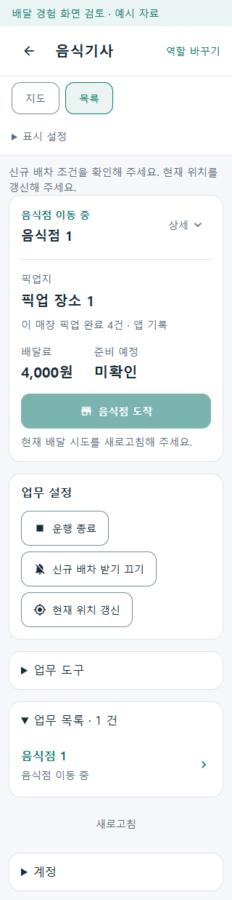
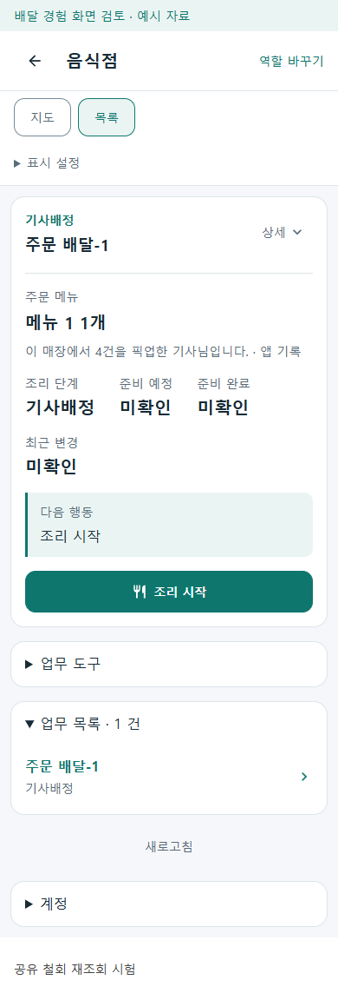
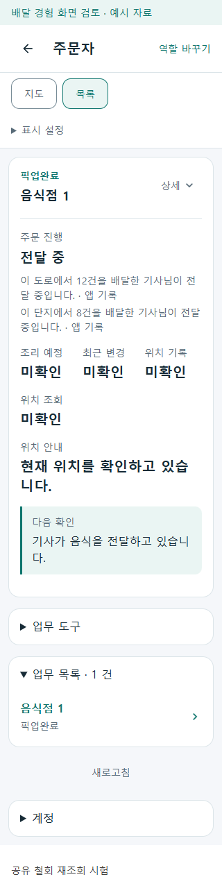

# 음식 배달 경험 공유 r47

- [승인 범위](../AI/Planning/공통/PLAN-OPERATIONS-NEIGHBORHOOD-MICRO-HUB/delivery-experience-sharing.implementation.r47.md) · [작업 지시](../AI/Planning/공통/PLAN-OPERATIONS-NEIGHBORHOOD-MICRO-HUB/delivery-experience-sharing.r47.work-order.json) · [페이지·코드·DB 책임](../ProjectOverview/page-docs/delivery-experience-sharing-r47.md).
- 음식 배달 기사·음식점·주문자가 현재 업무 안에서 확인된 앱 배달 기록을 알아볼 수 있도록 보완한다. 실제 방문 횟수, 신뢰 점수, 배차 우선순위나 추가 보수로 확대하지 않는다. 같은 장소에서 세 주문을 함께 처리하면 완료 기록은 세 **건**이다.
- 상태: **구현·로컬 검증 완료 / 운영 미활성**. 최종 Fast·전체 Task·공통 모바일 화면·EF migration SQL 생성을 확인했다. 실제 DB 적용·APK 패키지/서명·휴대폰 설치는 미검증이다. commit·push·배포·운영 활성화는 수행하지 않았다.

## 변경 축과 화면 결정

| 변경 축 | 코드·화면의 역할 | 최종 검증 상태 |
| --- | --- | --- |
| 완료 기록·공유 권한 | 원본 음식 주문·배달 시도의 완료 근거와 연결하고 매장·도로·단지별로 구분한다. 공유 기능과 기사 선택의 기본값은 모두 OFF다. | 구현·Fast/Task 완료, 실제 DB 적용 미실행 |
| 기사 현재 업무 | 픽업 전에는 해당 매장의 완료 건수를 한 줄로, 픽업 뒤에는 해당 도로·단지의 완료 건수를 최대 두 줄로 기존 카드 안에 표시한다. | 공통·전문 기사 구현, 집중 시험·공통 화면 완료 |
| 음식점·주문자 안내 | 현재 수행자와 업무 상태에 맞는 서버 요약만 기존 주문 진행 영역에 표시한다. 음식점의 도착 여부를 추정하지 않는 중립 문구를 사용한다. | 구현·집중 시험·최종 공통 화면 완료 |
| 수령지 공식 식별자 | 기존 주문 입력 안의 선택 주소 검색 결과를 요청에 전달한다. 일반 주소 입력과 기존 주문 제출도 유지한다. | 공통 입력 구현·집중 시험 완료, 실제 공공 API 대조 미실행 |
| 변경 기준 | 승인 r47. 이 작업의 새 commit hash는 아직 없다. 이전 작업의 실행 수치와 결과를 이번 완료로 재사용하지 않는다. | 미커밋 |

기사 지도·카드의 독립 배치와 기존 업무 버튼을 유지하며 새 경험 카드나 메뉴·목록 페이지를 늘리지 않는다. 전문 기사 앱의 기존 내 정보 안에서 공유 여부를 설정한다. 경험 공유 선택은 알림 수신 선택과 독립이다.

표시 문구는 같은 공통 formatter를 사용한다.

- 기사: `이 매장 픽업 완료 4건 · 앱 기록` 또는 `용마산로 배달 완료 12건 · 앱 기록`처럼 현재 도로·단지의 전달 완료 건수.
- 음식점: `이 매장에서 4건을 픽업한 기사님입니다. · 앱 기록`. 가게 도착 뒤에도 남을 수 있는 `오고 있습니다`를 사용하지 않는다.
- 주문자: `이 도로에서 12건을 배달한 기사님이 전달 중입니다. · 앱 기록`.

`Confirmed`의 확인된 0건과 모르는 값을 구별한다. `Unknown`·`Pending`, null 건수, 확인 시각 누락은 표시하지 않는다. 과거 일부 기록이 모호한 `Partial`은 확인된 양수만 `확인된 앱 기록`으로 표현하며 0건은 숨긴다. Simulation은 `모의 기록`으로 구별하고 실제 이력으로 승격하지 않는다.

## 권한과 상태에 따른 정리

서버가 현재 기사·주문자·음식점의 권한과 공유 선택을 확인한 요약만 응답한다. 다른 고객, 과거 전달 시각, 상세 주소·좌표·이동 경로를 경험 API에 추가하지 않는다. 내부 완료 fact는 기사 ID·지역명·Outbox ID에 연결된 비공개 집계 원장이며 완전 익명 데이터가 아니다. 기존 고객 상세 열람 3일 제한을 유지한다.

공유 OFF·철회·업무 종료·취소·재배정 뒤의 타인 요약은 서버 응답에서 배제하고 앱의 기존 재조회 때 제거한다. 오프라인 화면의 즉시 원격 삭제나 Firebase 철회 푸시는 구현하지 않는다. 앱의 조회 실패·갱신 중에는 이전 요약을 계속 보여 주지 않고, 계정 전환과 새 업무 조회에서도 이전 수행자의 정보를 재사용하지 않는다. 화면에서 주문 목록을 세거나 다른 고객 기록을 합쳐 누락 값을 계산하지 않는다.

음식점의 기존 상태 알림 뒤 정본 재조회와 주문자의 기존 진행 주문 재조회에서 안내를 갱신한다. 새로운 원격 푸시·알림음·인박스를 추가하지 않는다. 일반 OS 알림에 도로·단지·건수를 넣지 않고 인증된 업무 화면 안에서만 표시한다.

## 주소 선택과 주문 입력

공식 도로명주소 검색에서 선택한 건물관리번호·도로명 식별자를 현재 수령지 기본주소에 결속한다. 서버가 원천 결과와 다시 대조하며, 단지는 유일하게 확인된 공식 식별자가 있을 때만 연결한다. 도로만 확인되면 단지를 추정하지 않는다.

기본주소 수정·다른 주소 선택·계정 교체·입력 초기화 때 이전 식별자를 지운다. 상세 동·호수 수정은 같은 기본주소의 식별자를 유지하며 도로·단지 표시명과 검증 원천에 상세주소를 포함하지 않는다. 주소 검색 실패, 공공 키 미설정, 직접 입력한 주소도 기존 주문은 허용하고 경험 요약만 미확인으로 남긴다. 고객 프로필의 단지 코드를 현재 주소 대조 없이 사용하지 않는다.

## 검증 구분

| 단계 | 현재 기록 |
| --- | --- |
| 집중·Fast·Task 시험 | 새 공유·완료 근거·UI 문구·주소 식별자 및 실제 제품 명령의 원자성 집중 **최종 Fast 88/88** 통과, 실패·미실행 0개. 최종 `v3.5.slnx` **Task 실행 9,526/9,526 통과**, 실패 0개·환경 의존 Mongo 15개 미실행(전체 9,541개). 겹치는 시험 수를 합산하지 않는다. |
| 제품 모바일 화면 | 최종 중앙 preview build 오류·경고 0개. 실제 공통 Razor·역할 adapter에 모의 응답을 넣은 loopback preview에서 320/390px **38/38장면** 통과, 가로 넘침·브라우저 오류 0개, 소스/실행 바이너리 지문 변화 없음. 음식점 중립 문구와 공유 철회 재조회 제거를 최종 소스로 대조했다. |
| 서버·DB | EF tooling으로 실제 idempotent migration SQL **7,143바이트** 생성 성공. 모델·중복 완료·Outbox 원자성·권한은 로컬 시험으로 대조했다. 실제 MySQL/Mongo 접속·DB 적용·인증 HTTP 종단 검증은 수행하지 않았다. |
| Android APK | 중앙 Task solution build 성공. 기사·음식점·주문자 `bin/Debug/net10.0-android` APK 각 2개를 수집하고 Task 뒤 다시 SHA-256·길이를 대조했다. 주문자/음식점 4개는 처음과 동일하고 기사 2개는 최종 Task 빌드에서 교체되어 최신 값을 별도 보존했다. 패키지·서명·설치·로그인·실제 공유/지도/알림 작동은 미검증이다. |

최종 UI 실행 근거는 Git 제외 `artifacts/local/delivery-experience-r47/ui/verification.json`과 같은 폴더의 PNG다. 2026-10-09 **14:19:19 KST**에 역할별 정상·미확인·공유 철회·종료·모의 기록·부분 확인, 두 폭의 넘침 및 브라우저 오류, 철회 후 제거를 검사했다. 소유 preview PID 2092만 종료했고 별도 실행 서버를 종료하지 않았다. 선별 PNG 세 장의 사본 hash가 원본과 같음을 `selected-screenshot-hashes.json`에 남겼다.

최종 Fast TRX와 로그는 `artifacts/local/validation/20261009-142403/`이며 빌드 오류 0개·기존 경고 68개였다. 실제 제품의 수락→픽업·전달 완료와 Outbox 저장, commit 실패 시 함께 rollback하는 두 경우, null/timeout/호출자 취소, 과거 점검 재시도, 지점 식별자는 있으나 표시명이 빈 경우의 건수 보존을 포함한다. 이는 로컬 시험의 제품 명령 경로이며 실제 운영 DB·실배달 확인을 뜻하지 않는다. 최초 확장 Fast `20261009-142219`는 시험 fixture의 조리 시작 요청에 `ExpectedRevision`이 빠져 두 건이 실패했고, fixture를 수정한 최종 실행에서 88개를 통과했다. 실패 로그와 앞선 55개 통과 로그 `20261009-141313`은 보존하며 서로 합산하지 않는다.

최종 Task TRX·로그는 `artifacts/local/validation/20261009-142519/`이며 빌드 오류 0개·기존 경고 61개였다. Task 전후 소유 소스 **49개**의 SHA-256이 같음을 `artifacts/local/delivery-experience-r47/source-final-task-verification.json`에, UI 실행 근거의 소스·DLL **12개**가 Task 뒤에도 같음을 `ui-post-task-verification.json`에 기록했다. EF SQL은 `migration-idempotent.sql`이며 실제 DB에 접속하거나 적용하지 않았다.

preview 중앙 빌드는 `artifacts/local/delivery-experience-r47/preview-build.log`에 기록했다. 최초 preview의 `--urls` 인자가 현재 host의 `LifeFacilitationPreviewPort` 기본값 5392에 의해 덮여 5579 연결이 거절됐다. 실패 38개는 `ui/verification-first-wrong-port.json`에 보존했고 코드 변경·재빌드 없이 실제 listen 주소로 다시 실행했다. 이전 중립 문구 변경 전 PNG는 최종 근거에 포함하지 않는다.

세 앱 초기 bin APK 수집은 `existing-bin-apk-inventory.json`, Task 뒤 비교는 `apk-post-task-verification.json`, 최신 재수집은 `final-bin-apk-inventory.json`이다. 최초 목록을 덮어쓰거나 기사 파일의 변경을 동일 hash로 보고하지 않는다. 최신 기사 `kr.ssalddel.fdriver-Signed.apk`는 53,377,889바이트, SHA-256 `3F26C0EC78D8402A8329FA51343D70D81ADED4D9208735B7723E76779F6BEB31`이다. `Signed` 파일명과 빌드 성공은 별도의 패키지·서명 검사나 실제 단말 설치를 대신하지 않는다.

## 제품 샘플 화면

다음은 최종 소스의 **모의 자료를 넣은 실제 공통 제품 Razor 화면**이다. 픽업 전 한 줄과 전달 중 최대 두 줄이 기존 카드에 정렬되는지, 음식점 문구가 도착 여부를 추정하지 않는지 육안으로 확인했다. 실제 전문 기사 단말·음식점 상세 페이지·지도 타일·공공 주소 조회·DB·지급·배차 운영 증거가 아니다.

| 기사 픽업 전 · 320px | 음식점 기사 배정 · 390px | 주문자 전달 중 · 320px |
| --- | --- | --- |
|  |  |  |

## 남은 실행 경계

- 기능과 타인 공유 기본 OFF를 유지한다. 사용자의 실제 공유 동의를 임의로 만들어 켜지 않는다.
- 공공 주소 연동의 실제 키·API 호출, 운영 DB 적용·과거 실배달 이력 확인, 휴대폰·Azure·원격 발송·실운행·실지급은 별도 검증이다.
- 기능 OFF의 새 경험 테이블 접근 차단은 서비스·공유 API 범위다. 기존 음식 배달 시도의 nullable `experience_execution_mode_code`는 EF 조회에도 포함되므로 schema 변경 없이 앱만 배포해도 안전하다고 볼 수 없다. 운영 DB에는 아직 적용하지 않았으며 **배포 전에 준비한 additive migration을 적용**해야 한다.
- 영상 방문 원장의 자동 가져오기, 화물·생활 물품 경험 공유, 신뢰 점수·배차 우대·정산 변경, Unity·영상 편집은 이번 범위가 아니다.
- 별도 r45/r46 및 주문 원장 r7의 dirty 변경과 기존 승인·실행 기록을 보존한다. 배포·commit·push는 수행하지 않았다.
