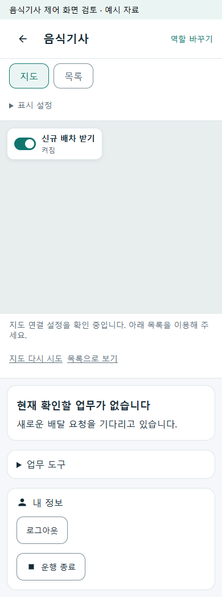
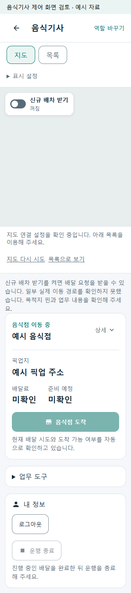

# 기사 운행 시작·자동 갱신 r49

음식 기사가 운행 시작 뒤 별도의 새로고침이나 신규 수신 켜기를 반복하지 않도록 한다. [페이지 책임 r13](../ProjectOverview/page-docs/driver-workspace-sections-r1.md#운행-시작과-자동-갱신-r13--사용자-후속-기준)에 따라 운행 시작과 기존 수신 ON 명령을 연결하고, GPS·업무 주기 조회·알림으로 지도와 현재 업무를 갱신한다. r48의 지도 왼쪽 위 토글·내 정보 하단 종료와 전체 지도·독립 하단 카드를 보존한다.

## 구현 범위

- 정상 음식 기사 화면의 새로고침 버튼과 당겨서 새로고침을 제거한다. 위치 권한·로그인·지도 설정 등 사용자 조치가 필요한 오류 복구는 유지한다. 다른 역할의 새로고침은 변경하지 않는다.
- 음식 기사 앱에서 운행 시작 한 번으로 운행과 신규 배차 수신 준비를 이어 처리한다. 두 서버 상태는 별도이며, 실패·응답 유실을 완료로 표시하지 않는다. 미확정 On 요청은 원 요청 ID로 확인하고 사용자의 명시적인 Off를 백그라운드 조회가 덮어쓰지 않는다.
- GPS 이벤트는 지도 위치를 갱신한다. 기존 전경 주기로 서버 위치/업무 상태를 확인하고, 매 GPS 이벤트마다 전체 화면과 API를 새로 만들지 않는다.
- 통신 회복 뒤 정본을 자동 재조회한다. 응답이 불명확하다고 운행 시작을 반복 전송하여 근무를 중복 생성하지 않는다.

운행 시작은 별도의 수신 조작 없이 이어지고, 종료는 내 정보의 기존 확인 절차를 유지한다. 아직 확인되지 않은 운행 상태를 종료 상태로 취급하지 않으며 시작·수신 변경을 잠시 막고 자동으로 확인한다. 위치 업로드의 일반 통신 장애는 업무 조회와 분리하되 인증·권한 오류는 기존 보호를 유지한다.

네이티브 앱은 기존 계정별 보호 저장소의 수신 요청에 선택적 `StartReceptionRequestId`를 결속하여 재시작 후에도 원 요청을 확인한다. 이전 JSON과 호환된다. 공통 역할 화면은 같은 계정의 일시 중단·재진입 및 일시 조회 실패 동안 메모리의 시작 요청을 보존한다. 계정·역할 변경, 로그아웃·폐기 시에는 제거하며 공통 화면의 프로세스 재시작까지 영속 복구한다고 표현하지 않는다.

운행 시작 API의 서버 멱등성 계약은 추가하지 않았다. 이번 보호는 클라이언트가 미확정 시작 POST를 자동 재전송하지 않고 정본부터 확인하는 범위다. 다른 기기나 서버 전체의 중복 운행 시작을 보장하는 변경은 아니다.

정상 수행의 단계·푸시 안내도 자동 확인으로 맞춘다. 다른 역할은 기존 안내를 유지하며, 완료 내역처럼 별도 조회 목적의 페이지는 이번 수행 화면 범위에 포함하지 않는다. 위치 신선도와 시험/프리뷰의 측정 시각은 같은 주입 시계를 사용한다. 실제 기본 시계와 30초 만료·5초 미래 허용 범위는 바꾸지 않는다.

## 배차 엔진의 현재 연결

기존 서버의 음식 큐 스캔·추천 만료·알림 작업이 배차 후보와 현재 위치·운행·수신 의사·수행 조건을 평가한다. `ServiceCollectionExtensions.BackgroundJobs.cs`, `SsalddelBackgroundJobActivationPolicy.cs`, `음식배달배차업무정책.cs`, `배차대기원장전환Service.Recommendation.cs`의 기존 경로를 재사용한다. 해당 작업의 Operational·FoodDeliveryWorkflow 게이트와 서버 일시정지·실효 제한은 변경하지 않는다.

이번 작업은 새 AI 모델·요금·수행량 정책·자동 수락의 도입이 아니다. 적합한 배차 제안·알림의 자동 준비와 기사 본인의 수락, 실제 운영 서버의 활성화·원격 발송을 구분한다.

## 검증 기록

구현·로컬 검증과 APK 생성을 완료했다. 최종 실행에 결속한 소스 22개의 해시는 Task 전후 동일하다. 기존 비소유 변경과 HEAD `d1bab3eec08dc0a49c9a87f882590d394205c9a4`를 보존했다.

| 확인 | 최종 결과 | 근거 |
| --- | --- | --- |
| 집중 Fast | 680/680 통과, 실패·미실행 0 | [최종 로그](../../artifacts/local/driver-automatic-work-r49/fast-final.log), `artifacts/local/validation/20261009-152333` |
| 전체 Task | 솔루션 빌드 성공. 실행 9,620/9,620 통과, 환경 의존 Mongo 시험 15개 미실행 | [최종 로그](../../artifacts/local/driver-automatic-work-r49/task-final.log), `artifacts/local/validation/20261009-152419` |
| 공통 역할 화면 | 320/390px의 9개 시나리오, 18/18 통과. 운행 시작 한 번·명시적 OFF·오류 후 자동 확인·종료 확인·지도 크기 유지·가로 넘침·JS 오류를 검사 | [화면 검사](../../artifacts/local/driver-automatic-work-r49/ui/verification.json). 모의 API와 로컬 제품 Razor이며 실제 지도 타일·네이티브 단말 화면이 아님 |
| 화면 검사 지문 | 소스와 실행 DLL 13개의 검사 전후 해시 동일 | [통합 검증 기록](../../artifacts/local/driver-automatic-work-r49/verification.json) |
| Android APK | ARM64 Debug 서명 APK 생성, 41,408,228 bytes. Manifest·리소스·`arm64-v8a` 포함 확인 | [APK 구조](../../artifacts/local/driver-automatic-work-r49/apk-structure.json), [지도 빌드 설정](../../artifacts/local/driver-automatic-work-r49/map-build-configuration.json) |

APK는 `FDriverApp/bin/Debug/net10.0-android/kr.ssalddel.fdriver-Signed.apk`이며 SHA-256은 `BDF7BE5F2D52E435D2BC267D7F9DF542F8A86E8AEB7D14F920B39453F30FE9A0`이다. 기존 로컬 네이버 SDK 설정을 빌드 프로세스에 전달했고 생성 설정과 일치함을 확인했다. 키 값은 문서·검증 원장에 기록하지 않았다. 실제 설치·SDK 인증·타일 표시·GPS 작동을 확인한 것은 아니다.

검사 중 발견한 주입 시계와 위치 시각 불일치, 시작 성공 안내 중복, 자동 확인으로 변경되기 전 문구를 기대하던 기존 시험을 수정했다. 최초 실패 로그는 `fast-initial.log`와 `task-initial.log`에 보존하고 최종 결과와 구분한다.

### 로컬 화면

모의 자료로 실제 공통 Razor를 렌더링한 화면이다. 네이티브 지도 SDK 화면이나 실운행 자료로 해석하지 않는다.

다음 USB 연결 때 실제 APK의 운행 시작→수신 ON, 명시적 OFF 유지, GPS·지도 갱신, 앱 복귀, 배차 알림과 내 정보의 운행 종료를 확인한다. 이번에는 휴대폰·에뮬레이터·원격 배차/알림·Azure·실운영·commit/push·Unity·영상 작업을 실행하지 않았다.
