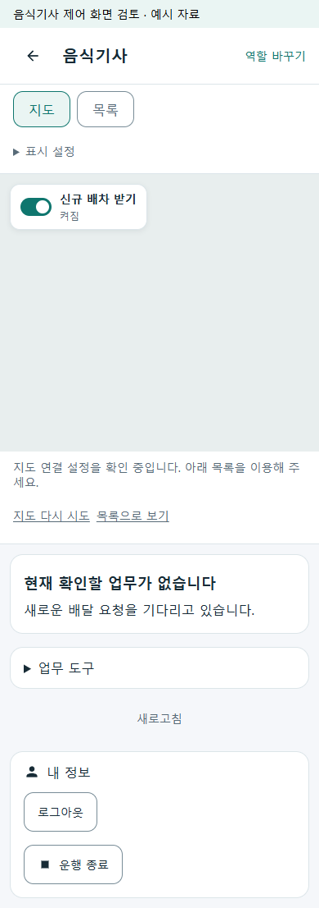
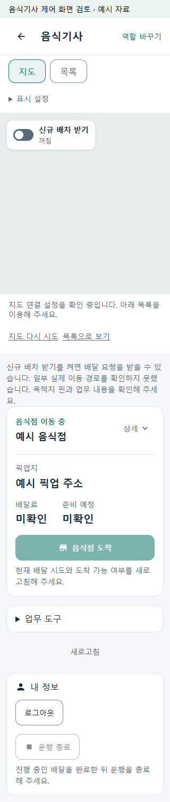

# 기사 지도 배차 토글·내 정보 운행 종료 r48

수행 화면의 운행·배차 설정 버튼을 정리한다. 신규 배차 받기는 지도 왼쪽 위의 토글로 표시하고 운행 종료는 내 정보 본문 맨 아래에 둔다. 기존 전체 화면 지도와 독립 하단 카드, 운행 시작·배차 수신의 별도 상태를 유지한다.

- 네이티브: 토글 조작은 기존 수신 의사 명령으로 보내고 서버 재조회 값으로 표시한다. 하단 중복 수신 버튼·업무 설정 묶음을 제거하고, 진행 중 배달이 있으면 종료를 막는다.
- 공통 역할 UI: 음식기사의 지도·목록 제어와 내 정보 종료를 같은 책임으로 맞춘다. 정상 수동 위치 갱신은 자동 갱신으로 대체하고 실패 복구는 남긴다.
- 위치: 지도 표시용 GPS와 서버 위치 전송을 구분한다. 배차 수신 OFF여도 진행 중 배달의 위치를 유지한다. 자동 반복은 권한 확인 후 읽는 경로를 사용하며 권한 요청·실패 복구는 명시적인 위치 확인 행동에 둔다.
- 통신 복구: 수신 변경 응답을 확인하지 못하면 이전 ON 값을 확정 표시하지 않고 `확인 필요`·비활성으로 둔다. 정본 조회 후 복구하며, 미적용 요청은 같은 요청 ID로 다시 확인한다.
- 서버: HTTP 위치 갱신이 DB의 종료된 운행을 다시 시작시키지 않도록 현재 운행 상태를 검사하고 위치 처리의 운행 상태 대입을 제거했다.

[페이지 책임 r12](../ProjectOverview/page-docs/driver-workspace-sections-r1.md#지도-배차-수신-토글내-정보-운행-종료-r12)에 따른다. 기존 배달 경험 공유 r47과 다른 변경은 보존한다. DB 스키마·배차 요금·지급 정책은 변경하지 않는다.

## 상태별 동작

| 상태 | 필요한 조작·정보 |
| --- | --- |
| 배차 수신 ON | 지도 왼쪽 위 토글 ON. 네이티브 운행 위치 전송은 기존 10초 간격, 공통 역할 화면은 기존 15초 전경 재조회에 결속한다. |
| 수신 OFF·진행 배달 있음 | 신규 요청 수신은 끄고 현재 배달의 위치·업무 카드를 유지한다. 배달 완료 전 운행 종료는 비활성이다. |
| 수신 변경 결과 미확인 | 토글에 `확인 필요`를 표시하고 새 명령을 막는다. 새로고침에서 실제 ON/OFF를 다시 확인한다. |
| 위치 권한·GPS 확인 실패 | 정상 수동 갱신 버튼 대신 `위치 확인`/`위치 다시 확인`으로 복구한다. 지도 내 위치로 이동하는 재중심 버튼은 유지한다. |
| 운행 종료 | 내 정보의 마지막 버튼으로 종료한다. 늦게 도착한 이전 위치 결과는 새 운행·계정의 상태를 변경하지 않는다. |

지도 크기와 카메라는 카드·토글 높이에 맞춰 바꾸지 않는다. 자동 위치는 전경 수명에 결속되며 백그라운드 서비스를 새로 구현한 것이 아니다.

## 이번 실행 기록

구현·로컬 검증·APK 빌드를 완료했다. 실제 휴대폰·지도 SDK 입력·백그라운드 위치·Azure·운영 데이터·실지급·commit/push는 이번 범위에 포함하지 않는다.

| 검증 | 이번 실행 결과·근거 |
| --- | --- |
| 최종 Fast | **577/577 통과**, 실패·건너뜀 0. `artifacts/local/validation/20261009-144846/`의 TRX·빌드·시험 로그. |
| 최종 Task | **9,564/9,564 실행 시험 통과**, 환경 의존 Mongo 시험 15개 미실행. `artifacts/local/validation/20261009-145147/`. 솔루션 빌드 오류 0개·경고 61개. |
| 공통 제품 Razor | 7상태 × 320/390px **14/14장면 통과**. ON/OFF 변경·종료 확인·위치 복구·변경 실패/응답 유실 후 정본 조회를 실제 클릭했다. 지도 크기 유지·가로 넘침 없음. `artifacts/local/driver-map-controls-r48/ui/verification.json`. |
| 브라우저 위치 모듈 | 실제 JS 모듈을 사용한 모의 Permissions/Geolocation 시험 **11/11 통과**. granted/denied/prompt/미지원/오류 등을 검사. `artifacts/local/driver-workspace-location-20261009/js-permissions-verification.json`. 실제 GPS·권한 대화상자 검증과 구분한다. |
| 소스 결속 | Task 전후 소유 소스 **29개** 및 UI 소스/실행 DLL **11개**의 SHA-256 일치. 기존 비소유 파일 변경 0개·HEAD 유지. `artifacts/local/driver-map-controls-r48/verification-final.json`, `source-before-task.json`, `unrelated-drift-final.json`. |
| 네이티브 | XAML 파싱·상태/수명 시험·Android 빌드 성공. 최신 `FDriverApp/bin/Debug/net10.0-android/kr.ssalddel.fdriver-Signed.apk` **53,377,889바이트**, SHA-256 `83621987D93E5EDE3580390104932D4FCD5F1F10AF3AC843F752FC0A04681B61`. 파일명·생성은 별도의 패키지/서명 검사·휴대폰 설치를 대신하지 않는다. |

서버 시험은 실제 SQLite 컨텍스트에서 운행 종료 후 늦은 위치, 정상 Food/Cargo, 앱 불일치, 저장 직전 종료 등 8개를 검증했다. 네이티브 자동 위치 시험은 수신 ON/OFF, 진행 배달 유지, 중복 전송, 종료·휴면·계정 변경 뒤 늦은 결과 등을 검증했다. 모의 HTTP/위치 결과와 실제 운영 통신을 구별한다.

초기 Fast `20261009-143815`의 신규 렌더 시험 3개는 HTML 엔터티 비교 문제로 실패하여 디코딩 비교를 수정했다. 그 다음 `20261009-144658`에서는 기존 `FDriverFoodPushTests.Receiver_CallbackTimeoutCannotPublishAfterDelayedLocalRestore` 한 건이 2초 대기 제한으로 실패했다. 해당 제품/시험 코드를 바꾸지 않고 같은 소스를 재실행한 최종 Fast와 Task에서는 통과했다. 각 실패 로그는 보존하며 최종 수와 합산하지 않는다. preview 최초 대기는 숨겨진 준비 요소를 visible로 기다린 도구 오류였고 attached로 수정했다. 제품 소스·DLL 변경 없이 최종 14장면을 다시 검증했다.

## 공통 제품 화면 검토

아래는 모의 업무 자료를 넣은 공통 제품 Razor 화면이다. 320/390px 두 폭에서 수신 ON/OFF, 진행 배달 중 OFF, 위치 권한 미확인, 변경 실패, 서버 적용 후 응답 유실, 운행 전의 14장면과 관련 클릭을 검증했다. 실제 네이티브 화면·지도 타일·GPS·운영 API 증거는 아니다. 네이티브의 전체 화면 지도는 기존 크기와 카메라를 보존하며 XAML·상태 시험·APK 빌드로 별도 검증한다.

| 수신 ON · 내 정보 하단 종료 · 390px | 진행 배달 중 수신 OFF · 종료 불가 · 320px |
| --- | --- |
|  |  |

## 남은 확인 경계

- 실제 휴대폰의 네이버 지도 표시·위치 권한·GPS·종료 후 전송 중단은 다음 USB 연결 때 확인한다. 이번 APK의 지도 SDK ID 미설정 경고는 설정 완료나 실지도 표시로 보고하지 않는다.
- 자동 읽기 전 권한 상태를 확인하고 명시적인 재확인 행동을 분리했지만, MAUI 내부 읽기 도중 OS가 권한을 철회하는 경합까지 실제 기기에서 확인한 것은 아니다.
- HTTP 위치 명령은 DB 운행 상태를 다시 시작하지 않게 했고 SQLite 시험으로 검증한다. 종료와 위치 갱신 사이의 OS 메모리·배달권 큐 전체 동시성, 별도 SignalR Hub의 운행 상태 쓰기는 후속 확인이다.
- 실제 운영 DB·Azure·원격 알림·실운행·지급·설치·배포·commit/push는 수행하지 않는다. 기존 dirty 변경은 보존한다.
