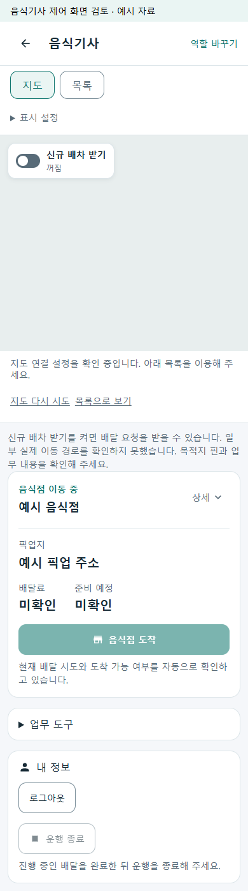
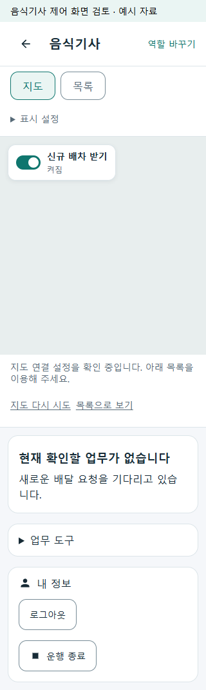

# 음식 기사 DB–API–화면 리팩토링 r50

[승인 명세](../AI/Planning/공통/PLAN-OPERATIONS-DRIVER-VERTICAL-REFACTOR/driver-vertical-refactor.r50.md)와 [페이지 책임 r14](../ProjectOverview/page-docs/driver-workspace-sections-r1.md#dbapi화면-책임-분리-r14)에 따라 기존 음식 기사 업무의 저장·후속 복구·현재 조회·화면 판단 책임을 분리한다. r49 운행 시작 한 번·GPS 자동 갱신·명시적 OFF·전체 지도·독립 카드와 기사 본인의 수락을 유지한다.

## 변경 범위

- 운행 시작 요청 ID와 입력 지문, 동시 시작 보호, SQL 근무와 후속 의도의 원자 저장.
- 수락·도착·픽업·전달의 원장 동기화·알림 후속 의도를 상태 변경 트랜잭션에서 예약하고 기존 worker로 재처리. 거절의 기존 두 단계 저장은 아래 남은 경계로 구분.
- 정산 없는 `workspace/current` 추가와 기존 workspace/정산 API 호환. 빈번한 지도 조회에서 정산 읽기 제거.
- 공통 셸의 구체 기사 어댑터 의존 제거와 두 화면의 공통 시작/수신 판단·거리/만료 해석. SDK·GPS·저장 수명은 호스트가 소유.
- 음식 기사 오류의 기존 구조화 복구 정보와 요청 ID 전달을 보존.

SQL 전문 상태·Mongo 원장 관계 권위와 전달/수령/정산/실지급의 구분을 유지한다. 서버 응답 확정, 후속 작업 예약, 실제 외부 발송을 같은 성공으로 처리하지 않는다. 새 AI·자동 수락·요금·수행량 정책은 추가하지 않는다.

## 복구 경계

- 같은 시작 요청·같은 입력은 기존 근무를 재사용한다. 확정 4xx 거절은 시작 및 연결된 수신 의도를 해제한다. 불확실한 응답은 시작 POST를 반복하지 않고 SQL 정본의 시작 요청 ID와 음식 실행유형부터 대조한다.
- 시작·종료·GPS·시작 인덱스 복구는 같은 기사 잠금과 SQL 행 잠금을 사용한다. 종료 또는 새 근무 뒤 오래된 시작 후속 작업은 인덱스를 복원하지 않는다. 같은 근무의 GPS는 시작 재처리로 초기화하지 않는다.
- 기사 수락·도착·중단·픽업·전달 후속은 기존 음식 원장 Outbox에 원장·운송 투영·음식점 알림·활동을 각각 예약한다. 고객 정보 사본 없이 식별값과 사건 정보만 저장하고 처리 시 최신 정본과 개인정보 파기 장벽을 확인한다.
- 현재 조회에는 정산 금액이 없고, 내 정보에서 정산을 별도로 읽는다. 정산 조회 실패는 503으로 구분하며 현재 업무를 보존한다. 미확인 거리와 확인된 0km도 다르게 표시한다.

## 적용 순서와 남은 운영 경계

추가형 migration `20261009160000_AddDriverWorkStartReliabilityR50`은 기존 근무의 값·종료 상태를 재작성하지 않는다. 기존 행의 새 열과 활성 슬롯은 null로 유지한다. 새 서버를 실행하기 전에 대상 DB 백업·migration 적용이 필요하며, 이번 작업에서는 공용 DB에 적용하지 않는다.

음식 운행 시작 후속은 30초 간격으로 최대 5회 재시도한 뒤 실패 상태를 보존한다. 이 실패의 운영자 재시도 화면은 추가하지 않았다. 화물 시작의 기존 즉시 후속, 종료 인덱스 정리 실패의 로그 처리, 음식 거절의 기존 두 단계 저장과 월 정산의 별도 후속 처리 경계는 유지한다. 외부 수신자의 중복 방지가 없는 경우 알림 응답 유실까지 정확히 한 번 전달을 보장하지 않는다.

## 검증

2026-10-09 최종 소스의 구현·로컬 검증을 완료했다. 원시 로그와 실행 증거는 `artifacts/local/driver-vertical-refactor-r50/verification.json` 및 같은 폴더에 보관한다. 이전 r49 시험 수를 이번 변경의 완료 근거로 사용하지 않는다.

| 검증 | 이번 결과 | 범위 |
| --- | --- | --- |
| 집중 Fast | 1,061/1,061 통과 | 동일/동시 시작, SQL 롤백·종료 경합, 후속 실패/재시도, 요청 소유권, 구조화 오류, 현재 조회·거리·화면 복구. `validation/20261009-213807` |
| 전체 Task | 실행 9,701/9,701 통과, Mongo 환경 시험 15개 미실행 | 전체 9,716개, 실패 0개. `validation/20261009-213949` |
| 공통 Razor 모바일 | 320/390 폭 18/18장면 통과 | 지도 토글·시작/종료·응답 유실 자동 복구·가로 넘침. 실제 제품 공통 Razor와 모의 API, 외부 접속 차단. 네이티브 화면·실제 지도 타일 시험과 구분 |
| DB 변경 준비 | SQLite 실제 추가형 migration·기존 행 보존 시험, MySQL SQL 생성, EF 모델 일치 | MySQL 서버 적용이나 실제 Mongo 통합 완료를 뜻하지 않음 |
| 기사 APK | Android Debug ARM64 생성, 패키지/서명 검증 | `kr.ssalddel.fdriver`, 0.1.0/1, 41,408,228바이트. 기존 로컬 지도 SDK ID 설정과 생성 리소스 일치. 실제 설치 미실행 |
| 검증 소스 결속 | 서버·계약·UI·시험·미리보기 소스 3,058개 전후 해시 일치 | 공통 화면 소스/실행 DLL 15개도 화면 시험 전후 일치 |

현재 조회 측정 fixture에서는 SQL 명령이 기존 3회에서 2회, JSON이 2,176바이트에서 1,992바이트로 줄었고 현재 조회의 월 정산 및 정산 테이블 조회는 0회였다. 이는 해당 모의 자료의 쿼리·응답 측정이며 실운영 응답 시간 보장은 아니다. 정산 읽기 실패는 별도 503 계약 시험으로 확인했다.

APK SHA-256: `A523099DDA177DEC7E7997438637D040569CD7BC57D6522DA23256F9BEFBF4EA`. 빌드 오류는 0개이며 기존 Android API 호환성·AndroidX 의존성 경고 35개는 남는다. Firebase 원격 수신과 실제 GPS는 시험하지 않았다.

첫 검증에서 내부 조회 어댑터와 시험 참조 누락, 구형 중단 조회 소비, 다른 명령의 오류를 지우는 복구 회귀, 시험의 배차 연결 누락 및 분할 전 파일만 읽던 구조 시험을 발견했다. 제품/fixture의 원인을 수정한 뒤 최종 Fast와 Task를 다시 통과했다. 처음 실패한 로그도 보존한다.

### 화면 확인

모의 자료의 공통 화면이다. 지도 연결 안내는 외부 지도 호출을 차단한 로컬 검증의 상태이며 지도 SDK 작동 증거가 아니다. 진행 업무 중 수신 OFF와 종료 차단, 시작 응답 유실 뒤 수신 ON 복구를 확인했다.

실제 단말·원격 알림/배차·Azure·공용 DB migration·실운영·실지급·Unity·영상·commit/push는 실행 범위에 포함하지 않는다. 기존 관련 없는 변경은 보존한다.
