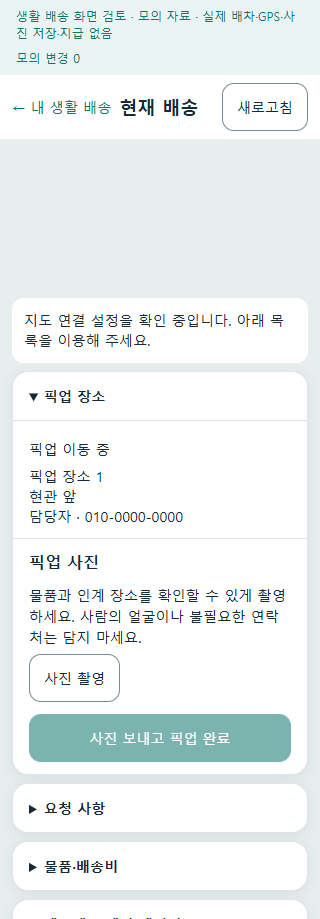
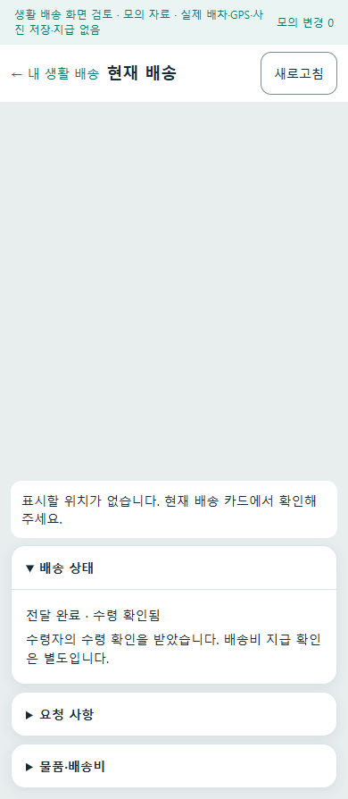

# 회원 생활 배송 한 건 완주 r46

- [승인 범위](../AI/Planning/공통/PLAN-OPERATIONS-NEIGHBORHOOD-MICRO-HUB/member-delivery-completion.implementation.r46.md) · [작업 지시](../AI/Planning/공통/PLAN-OPERATIONS-NEIGHBORHOOD-MICRO-HUB/member-delivery-completion.r46.work-order.json) · [화면 책임](../ProjectOverview/page-docs/neighborhood-member-completion-r46.md).
- 기존 r43의 회원 참여·요금·사진·기본 OFF를 유지하면서, r44 조사에서 드러난 최초 촬영·협업 접수·실제 수령 연결의 세 결손을 보완한다. 별도 운영 알림 r45와 그 기존 변경을 덮어쓰지 않는다.
- 상태: 제품 구현·최종 로컬 검증·APK 준비 완료 / 실제 MySQL·Mongo 종단·휴대폰·운영 보류. commit·push·배포·정책 활성화는 수행하지 않았다.

## 변경한 흐름

1. **사진과 완료 권한 분리**: 서버 `EvidenceStageCode`가 `Pickup` 또는 `Delivery`이면 첫 사진을 찍을 수 있다. `CanPickup/CanDeliver`는 사진을 실제 저장·검증한 뒤의 완료 권한이다. 업로드 뒤 같은 업무·단계·사진 ID·증가한 판본·서버 완료 권한을 재조회해야 완료 버튼이 열린다. 로그인 계정·단계가 달라지면 이전 사진을 다음 행동에 사용하지 않는다.
2. **협업 접수 일관성**: 회원 배송은 전문 기사 `DispatchMode=null`로 접수하며 협업 ID·조건 판본·원 글을 보존한다. Mongo 협업의 접수 intent와 SQL 원 의뢰가 일치하기 전 제안 등록·조회·수락을 열지 않는다. 같은 접수 요청 재시도는 새 의뢰가 아니라 기존 결과와 누락 제안을 복구한다. 전문 기사·외부 위탁 혼합은 허용하지 않는다.
3. **수령으로 협업 완료**: 기존 `confirm-completion` 명령을 재사용한다. 제공 글은 신청자, 필요 글은 글 작성자만 실제 수령을 확인한다. 배정 회원·제공자·운영자가 대신 확인하지 않는다. 같은 조건에 합의한 물품 협업, 실제 전달 상태, 원 의뢰·회원·사진·저장 바이트 hash를 대조한다.
4. **부분 저장·중복 복구**: Mongo의 수령 intent를 CAS로 고정해 다른 조건 변경·취소를 막고 SQL serializable 트랜잭션에서 수령 receipt·운송 사건·원 의뢰를 저장한다. 같은 키 재전송은 한 번의 수령 결과를 반환한다. 원장 투영 뒤 Mongo 협업을 완료한다. SQL 확정 뒤 투영/최종 Mongo 저장이 지연되면 503으로 원 요청 키를 유지한다. 동일 요청이 먼저 완료된 초기 검증/CAS 경쟁도 저장 결과를 다시 읽어 반환한다.

회원 업무는 `Delivered`를 유지하고 별도 `ReceiptConfirmedAtUtc`로 수령 확인을 표시한다. 원 의뢰의 `인수완료`, 협업 `Completed`, 회원의 전달 기록, 실제 지급은 서로 다른 결과다. 수령으로 결제·정산·송금 상태를 덮어쓰거나 전문 기사 ID를 만들지 않는다. 종료 후 주소·연락처 숨김, 배정 후 72시간 열람 제한은 유지한다.

## 검증 구분

| 단계 | 이 판본의 실제 증거 |
| --- | --- |
| 집중·Fast·Task 시험 | 회원/협업 집중 **198/198** 통과(접수 24·수령 16·UI/Render 48 포함). UI 담당의 최종 별도 **48/48**도 통과했다. 최종 **Fast 190/190**, **Task 실행 9,458/9,458** 통과·실패 0개; 환경 의존 Mongo 시험 15개는 미실행. 겹치는 시험 수는 합산하지 않는다. |
| 제품 모바일 화면 | 제품 Razor·공유 ViewModel의 모의 자료 호스트에서 16상태×320/390px **32화면**, 설정 저장→제안 수락→첫 픽업 사진/완료→첫 전달 사진/완료 **4단계×두 폭**을 실제 클릭했다. 캡처 40개, 가로 넘침·브라우저 오류 0개, 소스/실행 바이너리 21개 전후 지문 동일. 실제 단말·DB·GPS·지도 타일은 아니다. |
| 실제 DB·인증 HTTP | [전용 검증기](../../eng/NeighborhoodMemberCompletionVerification/README.md) 컴파일 오류 0·경고 0. Docker 응답 불가·서비스 권한 문제로 실행하지 못했다. `actualHttp/actualMySql/actualMongo=false`, DB 변경 없음. |
| APK | 일반 앱 **0.1.46 / versionCode 146**, Debug 서명·16KiB 정렬·패키지/버전·arm64-v8a/x86_64 내장 실행 파일·빌드 전후 소스 지문·복사본 hash를 확인했다. APK 생성은 설치·로그인·카메라·푸시·업무 완료를 증명하지 않는다. |

실제 DB 검증기는 GUID 전용 DB·임시 JWT 서명·제품 회원/협업 Controller·보호된 Mongo 원장·비공개 사진 바이트를 대조하도록 준비했다. **생활 배송 접수는 SQL 합성 표본으로 구성**하므로 이 검증기만으로 접수 API 전체를 통과했다고 표현하지 않는다. `EnsureCreated`와 운영 migration 적용도 구분한다.

최종 검증기 재컴파일은 오류·경고 0개, 3.15초이며 소유 소스 6개의 지문이 같았다. 잘못된 제공자의 수령 요청은 제품의 선행 `AllowedActions` 검사에서 409로 거절되므로 기대값을 수정했다. 독립 Mongo 운송 상태/snapshot과 보호 협업 원장↔SQL 연결 대조를 준비했지만 실행 결과는 없다. 이 호스트는 제품 기본 이벤트 발행 wrapper를 등록하지 않으므로 **Event/Outbox 종단 검증이 아니다**. 기존 Mongo 운송 투영은 회원 수행자·협업/조건 필드를 아직 발행하지 않으며, 그 연결은 보호 협업 Mongo와 SQL에서 별도로 대조한다. 해당 투영 필드 추가는 이번 승인 경로 밖의 후속이다.

Git 제외 근거: `artifacts/local/member-completion-r46-20261009/`, `artifacts/local/member-photo-r46-20261009/`, `artifacts/local/member-delivery-p0-registration-20261009/`, `artifacts/local/neighborhood-member-completion-r46-{build,readiness,sourcehashes}-20261009.*`. 초기 실패 로그는 보존한다. 별도 운영 알림 작업의 새 index로 실패했던 구형 migration 대조 시험은 해당 작업의 후속 migration 검사 변경과 분리한다.

집중 TRX: `member-completion-r46-20261009/tests/member-focused-final.trx`; 별도 UI TRX: `member-photo-r46-20261009/ui-final/member-ui-final.trx`. 화면 결과는 `neighborhood-member-delivery-r46-20261009/ui-final/verification.json`·`request-evidence.json`이며 2026-10-09 12:59:59~13:00:33 KST에 확인했다. 최종 Task는 `artifacts/local/validation/20261009-130646/`, Fast는 `20261009-130941/`이며 Task 빌드는 오류 0개·경고 83개였다. 소유 소스 27개는 최종 Task 시작부터 Fast 종료까지 SHA-256이 동일했다. 먼저 실행한 Fast 전체 빌드는 비소유 동시 변경의 미완성 기사 앱 helper와 음식 주문 시험 enum으로 두 번 실패했다. 해당 실패 로그 `20261009-125823/build-01.log`·`20261009-130045/build-01.log`를 보존하고 다른 작업의 반영 후 재검증했다. 초기 UI harness는 접힌 물품 제목을 기다려 timeout이 났으며 제품을 바꾸지 않고 준비 상태 선택자를 고쳐 다시 검증했다.

APK는 `artifacts/local/member-completion-r46-20261009/apk/handoff/ssalddel-member-local-0.1.46.apk`, 136,750,501바이트, SHA-256 `1C9018F6D1685C5E1D6E75B1BF0D3119A76FAA5D67F9BE456928B061A2DFDB74`다. 서버 주소는 `http://127.0.0.1:5363/`이며 설치 후에는 별도 로컬 서버 및 USB 역방향 연결/접근 가능한 주소가 필요하다. Firebase 설정·설치·실제 통신은 하지 않았다. 첫 publish는 최종 수령 확인 머리글 수정으로 소스 지문이 달라져 인계를 차단했고 로그/지문을 보존했다. 최종 소스에서 다시 publish하여 지문 일치 뒤 설치 파일만 준비했다. Windows PowerShell의 인자 인용 오류 뒤 PowerShell 7을 사용했으며 최초 실패를 성공으로 덮어쓰지 않는다.

## 제품 샘플 화면

다음은 실제 제품 Razor에 **모의 자료를 넣은 샘플**이다. 확정 디자인이나 실제 카메라·지도·DB·지급 증거가 아니다. 첫 사진 촬영과 완료 버튼의 분리, 전달 후 개인정보 숨김, 수령 대기/확인 차이를 직접 눈으로 대조했다.

| 첫 픽업 사진 | 첫 전달 사진 |
| --- | --- |
|  |  |

| 전달 후 수령 확인 대기 | 실제 수령 확인됨 |
| --- | --- |
|  |  |

## 남은 경계

- 실제 MySQL/Mongo/인증 HTTP·운영 migration·휴대폰·Azure·원격 FCM·실운행·실지급은 미검증이다. 기능과 Operational 기본 OFF를 유지한다.
- 잠긴 수령 intent 뒤 동의 철회·72시간 경과 등으로 검증이 불가능해지면 자동 완료·자동 취소하지 않고 같은 요청의 보류로 남긴다. 해당 보류의 운영자 판단/해제 화면은 이번 한 건 최소판에 추가하지 않았다.
- 독립 의뢰의 제3자 수령 위임·정산 UI·별도 앱·Unity·영상·commit/push는 이번 범위가 아니다.
- 이후 우선순위는 Docker 복구 후 격리 DB·HTTP 대조와 실제 Android 한 건 반복 검증이다. 코드와 로컬 시험만으로 영업 가능한 완료를 선언하지 않는다.
