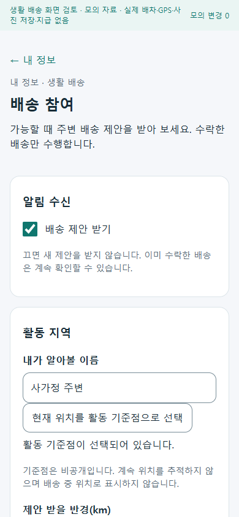
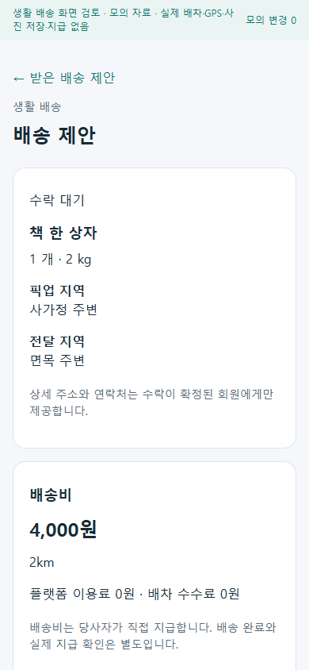
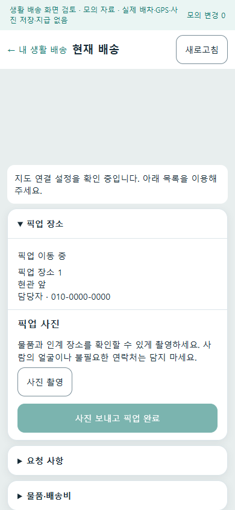
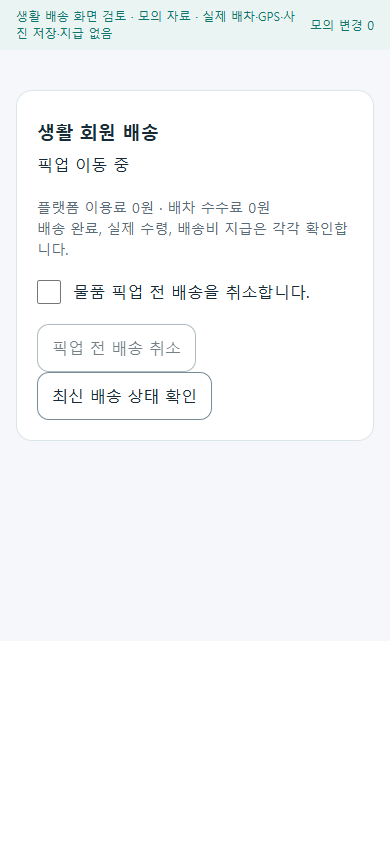

# 일반 회원 생활 배송 참여 r43

- 상태: 구현·최종 로컬 검증·APK 빌드 완료. 사용자 선택에 따라 실제 단말·운영 검증은 보류.
- [승인 범위](../AI/Planning/공통/PLAN-OPERATIONS-NEIGHBORHOOD-MICRO-HUB/member-delivery.implementation.r39.md) · [페이지 책임](../ProjectOverview/page-docs/neighborhood-member-delivery-r43.md).
- 일반 회원의 선택 참여, 비공개 활동 기준점과 주변 제안, 건별 수행 권한, 원자적 수락, 사진 업로드·완료, 일반 앱 FCM과 제안 목록 복구를 연결한다.
- 기존 배송 원장과 확정 요금, 플랫폼/배차 수수료 0원, 기존 음식/화물/미성년 OFF·운영 관문을 유지한다.

## 동작과 원장

일반 회원은 내 정보에서 배송 참여를 선택하고 비공개 활동 기준점·반경·이동 수단·운반 한도를 저장한다. 주변의 적격 회원 여러 명에게 최대 5분 동안 같은 요청을 제안하되, 서버가 최신 위치·실제 경로·시간창·동의·현재 업무를 확인한 뒤 한 명만 확정한다. 진행 중인 음식·화물 업무와 겹쳐 수락하지 않으며 첫 판본은 한 회원당 배송 한 건이다.

기존 SQL 의뢰·운송원장에 별도 회원 수행자를 기록하며 기사 역할이나 가짜 기사 ID를 만들지 않는다. 약정 배송비는 원 견적의 확정 금액이고 플랫폼 이용료·배차 수수료는 0원이다. 픽업·전달은 서버가 실제 이미지로 정규화하고 비공개 저장 객체를 다시 읽어 검증한 증빙이 있어야 완료된다. 전달 완료·수령 확인·배송비 지급은 독립 상태를 유지한다.

계정·요청 키·판본에 결속한 명령 복구와 사진 전송 영수증 재조회로 응답 손실을 처리한다. 원본 사진은 모바일 보호 저장소에 넣지 않는다. 픽업 전 취소는 원 의뢰 상태와 회원 슬롯을 함께 갱신한다. 수행 문제는 기존 지원 사건에 연결하며 종결·당사자 통지 근거를 확인한 운영자만 재개 또는 픽업 전 취소를 처리한다. 기존 기사 수락·관리자 취소·배차 방식 변경·협업 취소로 회원 절차를 우회할 수 없도록 보호한다.

수락 전 제안에는 상세 주소·연락처를 넣지 않는다. 수락 후 현재 단계의 인계 정보만 표시하며 업무 상세 열람은 72시간으로 제한한다. 사진 객체의 물리 파기는 별도로 종결 후 30일, 미결속 객체는 24시간을 기준으로 한다. 진행 중인 지원 사건이나 보존 정지·지원 상태 미확인은 파기를 보류한다. 활성 객체만 삭제한 `ActiveDeleted` 상태를 과거 복사본까지 모두 파기한 것으로 표시하지 않는다.

## 화면 확인

참여 설정·받은 제안 목록/상세·내 배송 목록/수행 화면을 분리했다. 수행 화면은 전체 지도 위에서 현재 단계의 장소·요청 사항·물품/배송비 카드를 접는다. 원 의뢰 상세는 회원 배송의 진행·취소를 표시하고 기존 전문 기사 배차·기사 정보 제공 섹션과 섞지 않는다.

제품 Razor를 모의 자료 호스트에서 15개 상태, 320px·390px 너비의 30개 화면으로 확인했다. 가로 넘침·브라우저 실행 오류가 없고 카드 접힘 전후 지도 영역이 같다. 설정 저장→제안 수락→픽업 사진/완료→전달 사진/완료의 네 단계 클릭도 모의 호스트에서 확인했다. 아래는 **모의 자료를 넣은 제품 화면**이며 실제 지도 타일·GPS·배송·사진 저장·지급의 증거가 아니다.

| 참여 설정 | 받은 제안 | 현재 배송 | 의뢰자 취소 |
| --- | --- | --- | --- |
|  |  |  |  |

## 로컬 검증과 APK

최종 Fast 집중 시험 **369/369**, Task 실행 시험 **9,331/9,331**이 통과했다. 실패는 0건이며 환경이 필요한 기존 Mongo 통합 시험 14개는 실행되지 않았다. 로그는 `artifacts/local/validation/20261009-084811/`와 `20261009-084948/`에 있다. 최종 Task 빌드는 오류 0개·경고 70개이며, 시험 전후 소유 소스 93개의 SHA-256이 동일했다. 실제 Kestrel HTTP와 SQLite 별도 컨텍스트에서 인증·계정 격리·동일 요청 재전송·수락 경쟁·상태 전이를 대조했다. 사진 정규화·저장 무결성·지원 처리·알림·지도 경로의 외부 서비스는 시험 대역을 사용했다. 새 migration·고정 snapshot·EF 모델의 열/형식/키/index를 대조했으며 실제 MySQL에 migration을 적용한 결과는 아니다. 운영 JWT 전체 구성과 외부 저장소·경로·Mongo 서비스의 실제 연결 검증도 별도다.

일반 앱 APK는 `0.1.43` / versionCode `143`, Debug 서명, arm64-v8a·x86_64의 실행 파일을 포함한 단독 설치용이다. 최종 파일은 `artifacts/local/neighborhood-member-delivery-r43-20261009/apk/handoff/ssalddel-member-local-0.1.43.apk`이며 서명·16KiB 정렬·패키지/버전·실행 파일·빌드 전후 소스 지문·복사본 해시를 검증했다. 파일은 136,717,733바이트이며 SHA-256은 `677A83935338843C38A8870E9E8AEF89DCCE52D422C15CD67EE4B31A9AA47994`다. 서버 주소는 `http://127.0.0.1:5363/`이므로 이후 휴대폰 시험에는 USB 역방향 연결 또는 별도 접근 가능한 로컬 서버 설정이 필요하다. 이 파일을 Azure 운영용으로 표시하지 않는다.

사용자가 “로컬 검증·APK까지만”을 선택하여 일반 앱 Firebase 설정은 넣지 않았다. 제안 목록으로 복구하며 실제 FCM 수신은 활성화하지 않는다. 외부 Firebase 가상 설정을 사용한 SDK 조건부 컴파일은 별도 시험 산출물이며 사용자 APK에 사용하지 않는다. 단말 사진·GPS·지도·소리·푸시 수신·서버 통신·Azure·실운행·입금은 미검증이다. 회원 배송 기능 및 Operational 활성화는 기본 OFF다. 실제 서버 갱신 전 새 SQL migration과 외부 어댑터·운영 관문을 별도로 확인해야 한다.

## 소유권과 증거

소유 경로·시작 판본·원본 백업·실행 로그·TRX·APK·화면은 Git 제외 `artifacts/local/neighborhood-member-delivery-r43-20261009/`에 기록한다. 초기 사진 시험의 잘못된 PNG fixture를 정상 PNG로 고치고, scoped CSS 속성 때문에 실패한 문자열 검사를 화면 의미 검증으로 바꿨다. 최초 실패 기록은 보존했다. 최종 소유 경로는 106개이며 기존 비소유 파일 **17,508개**의 지문이 시작 기준과 모두 동일했다. `HEAD`는 `9336637bde31ec97b5740e2a82a802dd490127ca`로 유지했다. commit/push·Unity·배달 영상·외부 게시를 진행하지 않았다.
