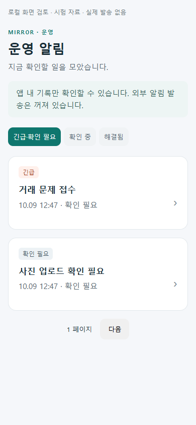
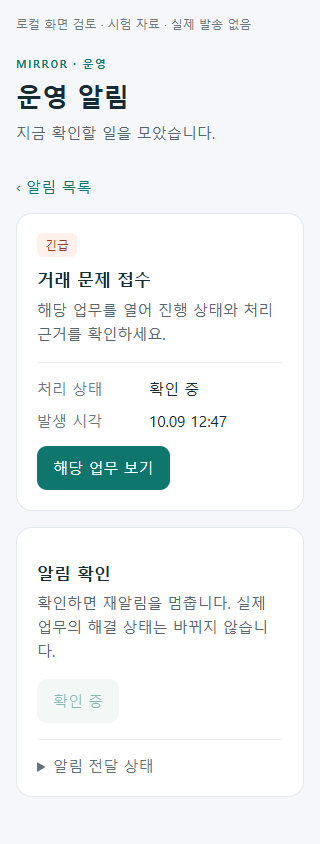

# 공통 운영 알림 r45 변경·검증

상태: `Implemented / LocalValidated / ExternalActivationDeferred`.

관리자 앱에서 문제 목록 → 상세 → 기존 업무로 이동하고 알림 확인을 할 수 있게 구현했다. 음식/생활 배송/화물/지원 사건을 제한 페이지로 관찰하고 MySQL의 알림·채널 outbox·checkpoint·확인 요청에 기록한다. 같은 문제의 재발, 15분 한 번 재알림, 오전 9시 KST 일일 알림을 구분한다. 알림 확인은 실제 배송·사건·수령·지급을 완료시키지 않는다.

Gmail SMTP 전송 기술은 기존 커뮤니티 메일과 공유하되 수신자/문안은 별도다. 외부 메시지는 일반 안내·알림 ID·UTC 시각·로그인 후 조회 링크만 사용한다. 관리자 앱 설치·계정·서버 역할을 대조하고 전송 접수와 실제 수신을 구분한다. 외부 응답 유실의 중복 전달 가능성은 남는다.

## 실제 로컬 검증

| 검증 | 결과 | 기록 |
|---|---|---|
| Fast 및 소비 프로젝트 빌드 | 82개 통과, 실패/건너뜀 0 | `artifacts/local/validation/20261009-125157` |
| Task 전체 회귀 | 9,413개 통과, 실패 0, Mongo 환경 시험 14개 미실행 | `artifacts/local/validation/20261009-125438` |
| 마지막 UTC/FCM 설정·앱 격리 보완 후 집중 시험 | 83개 통과, 실패/건너뜀 0; 알림 전용 23개 포함 | `artifacts/operations-alerts-r45/final-focused.trx` |
| 실제 loopback HTTP + 격리 SQLite | 비로그인 401, 일반 회원 403, 관리자 조회/확인/동일 재요청 200, 잘못된 판본 409, no-store | 위 알림 시험 |
| 실제 Razor/공유 ViewModel 렌더 | 320/390 폭 · 8상황 = 16조합, 가로 넘침/브라우저 오류 0 | `artifacts/operations-alerts-r45/ui/verification.json` |
| MySQL migration SQL/모델 snapshot | 5개 추가 테이블·동시 변경 보호·후속 조회 index 일치, 기존 업무 UPDATE/DROP 없음 | 알림 시험; 실제 MySQL 적용 아님 |
| 관리자 Android Firebase 조건부 build | 로컬 가짜 설정으로 컴파일 성공, AndroidX 버전 제약 경고 존재 | `firebase-compile.log`; 실제 프로젝트 연결/수신 아님 |
| 최종 관리자 Debug APK | Firebase 설정 제거 후 clean/publish 성공; 관리자 Firebase 라이브러리/서비스 미포함 확인 | `apk-verification.json`, `admin-apk-final.log` |
| Azure/운영 설정 | 두 Bicep compile, Compose 합성 config, 월 예산 배분 합계, Bash 문법 검사 통과 | `monitoring.arm.json`, `budget.arm.json`, `compose-config.log` |
| 로컬 암호화 백업 | age 해독·3개 파일 checksum/동일 바이트 확인; 변조 checksum 거부 | `backup-test/roundtrip-r1/verification.json`; 가짜 자료, 실제 DB import/업로드 아님 |

전체 회귀 첫 실행의 등록·메타데이터·인덱스 실패는 수정 후 재검증했다. 동시에 진행 중인 r46 회원 배송 변경은 보존했으며 해당 작업의 후속 수정도 최종 통합 회귀에 포함돼 있다. 이 문서는 r46의 업무 전체 완료를 대신 인증하지 않는다.

## 화면과 APK

아래는 실제 공통 컴포넌트를 로컬 시험 자료로 렌더한 화면이다. 원격 API·실제 알림 수신·실기기 화면은 아니다.

최종 APK: `artifacts/operations-alerts-r45/apk-final/com.ssalddel.adminapp-Signed.apk`, 34,135,553 bytes.

SHA-256: `12CBFC93B81AF45B49556606D3DE803C5AF57D0358752757685537EF332ED8F8`.

개인 Debug 서명, package `com.ssalddel.adminapp`, 연결 주소 `http://127.0.0.1:5363`이다. 향후 USB reverse와 로컬 서버가 필요하며 Azure용 공개 연결 APK가 아니다. 실제 휴대폰 설치·로그인·소리/푸시·이메일 링크 진입은 미검증이다. Firebase 조건부 시험의 가짜 설정은 최종 APK에 포함하지 않았다.

## 비용·외부 활성화

월 500,000원은 서버·저장·알림 등의 배분안이며 거래대금/기사 보수와 분리한다. 정상 목표 300,000원, 예비 200,000원, Azure 경고 400,000원 상당(실제 청구 통화로 환산)을 준비했다. 실제 견적·월 사용액·자동 지출 하드 상한을 검증한 결과가 아니다.

선택적인 신규 서버 경로 견적만 제한하며 수행 중인 배차·배송·사진 증빙은 중단하지 않는다. 네이티브 지도 SDK/전체 외부 API 비용까지 제어하지 않는다. [배포 준비](../../deploy/azure-vm/operations-alerts/README.md)에 독립 health/VM/백업 감시, AMA/DCR, 비밀 설정, systemd 백업 준비와 활성화 전 점검을 기록했다.

감시·외부 발송·예산 제한 기본 OFF. Firebase 프로젝트/관리자 앱 등록·서버 서비스 계정, SMTP/운영자 ID/수신 메일, HTTPS 주소, Azure 청구 통화/권한과 실제 장애·수신·복구 시험이 필요하다. 유료 리소스 생성·공용 DB migration·off-VM 업로드/DB 복구·실제 메일/FCM 발송·실거래/실지급·Unity·영상 수정·commit/push는 실행하지 않았다.
