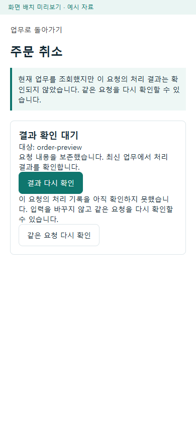

# 역할 앱 예외 후 업무 지속 보완

2026-10-10 사용자의 `보완작업진행`에 따라 [조사 보고서](2026-10-10-cross-app-exception-continuity-audit.md)의 C01~C09를 보완했다. [승인 계획](../AI/Planning/공통/PLAN-OPERATIONS-EXCEPTION-CONTINUITY/exception-continuity.implementation.r1.md)과 [작업 지시](../AI/Planning/공통/PLAN-OPERATIONS-EXCEPTION-CONTINUITY/exception-continuity.r1.work-order.json)를 기준으로 기존 변경을 보존했다. 기준 HEAD는 `d1bab3eec08dc0a49c9a87f882590d394205c9a4`다.

상태: `Implemented / LocalValidated / DeviceAndOperationalDeferred`.

## 화면에서 달라지는 점

| 대상 | 예외 후 다음 행동 | 구현 경계 |
|---|---|---|
| C01·C01a 화주 등록 | 접수 결과 확인 → 필요할 때 같은 요청으로 다시 등록. 차량 조회 실패는 입력을 유지하고 등록 준비 다시 확인. | 계정별 원문·번호 보호 저장, 본인 결과 GET, 새 모바일 접수의 첫 생성 CAS. 등록 확인과 운임·업무 인계 전체 완료는 별개. |
| C02 생활 배송 작성 | 이전 접수 결과부터 확인하고 같은 번호·원문으로 명시 재시도. | 새 번호를 발급해 미확정 요청을 우회하지 않음. 하위 배차 등록이 미완료인 상태도 별도 확인. |
| C03 입고·피킹·전달 사진 업무 | 같은 사진·완료 요청 이어가기, 업로드 결과 확인, 원본이 없으면 현재 업무를 다시 조회해 재촬영. | 사진 원본은 복구 저장소에 넣지 않음. 업무 대상·판본·수량·요청 번호와 영수증을 대조. |
| C04 화물 하차 | 완료 후 같은 운송을 재조회. 확인된 완료면 카드 종료, 결과 미확인은 조회부터 재개. | 확인 전 POST 차단, 사진·확인 입력은 해당 화면 세션에서 보존. |
| C05 운영자 지원 | 종결된 사건에서 연결된 배송 상태 확인 → 기존 재개 또는 픽업 전 취소로 인계. | 기존 관리자 권한·당사자 통지·동의·판본·멱등 검사를 유지. 사건 종결과 배송 복구는 별도 행동. |
| C06·C07 공통 음식 업무·주문자 | 응답 유실 뒤 결과 다시 확인. 근거가 부족하면 같은 요청을 명시적으로 재확인. 지도 카드에서 원주문에 연결된 문제 접수. | 비슷한 현재 상태만으로 원 요청의 성공을 인증하지 않음. 다른 요청이나 수정한 본문으로 재전송하지 않음. |
| C08 회원 수행 지도 | 앱 재개 때 지도 복원. 지도 장애는 카드·업무를 유지하며 지도 다시 표시. | 자동 오류 반복을 막고 지도 재시도가 업무 완료 명령을 대신하지 않음. |
| C09 수입 준비 조회 | 현재 선택한 원장·자동집단·계정의 결과만 표시. | 이전 선택의 늦은 성공·오류 폐기, 30초 조회 유지, 같은 선택의 통신 장애만 이전 확인 내용 유지. 권한 오류는 비공개 표시 제거. |

## 저장과 원장 경계

공통 복구 저장은 사용자와 업무별로 분리한다. MAUI 일반 앱과 화물 기사·주문자·창고 관리자 앱은 각 호스트의 기존 인증 세션 및 단말 보호 저장소를 사용한다. 저장소 객체는 역할 인증 접근자와 같은 scope를 사용하고 저장된 기록은 화면을 넘어 유지된다. 보호 저장 실패 시 새 명령을 보내지 않는다. 원문의 최초 보관 시각을 유지하며, 72시간이 지나면 읽기·저장 시 원문을 제거하고 요청 번호·업무 대상·최초 시각 등 결과 조회용 최소 정보만 남긴다. 진행 저장으로 보관 기한을 연장하거나 삭제된 원문을 복구하지 않는다. 고객 원본 사진·인증값은 복구 기록에 보관하지 않는다.

웹의 기본 저장소는 현재 서비스 수명에 속한 메모리 저장이다. 브라우저 종료 후 영속 복구로 보고하지 않는다. C06 공통 음식 행동과 운영자 지원의 미확정 명령 역시 현재 화면·계정 수명에 속하며 공통 보호 저장을 통한 앱 재시작 복구 대상은 아니다. 배송·수령·사건 종결·정산·지급은 별도 원장과 결과로 유지한다.

## 검증

원시 근거는 Git 제외 `artifacts/local/exception-continuity-hardening-20261010/`에 보관한다. 이전 조사 단계의 927개 시험 결과를 이번 구현 결과로 재사용하지 않는다.

| 검증 | 이번 결과 |
|---|---|
| Fast·관련 회귀 시험 | 543/543 통과, 실패·건너뜀 0. `artifacts/local/validation/20261010-180742/`에 전체 역할 앱 빌드·TRX·음식 기사 코드 지도 검사를 기록했다. |
| 지도 수명 집중 시험 | 8/8 통과. 중지·재개, 늦은 렌더, 연속 예외와 공급자 오류별 명시 재시도를 포함한다. Fast 543에 포함되는 시험이며 별도 건수로 더하지 않는다. |
| 실제 loopback 화면 | 390×844 화면에서 10항목 통과, 브라우저 오류 0. 응답 유실→GET→명시 동일 요청 확인과 지도 장애→카드 유지→명시 지도 재시도를 확인했다. |
| 현행 OS 카탈로그 | 63/63 통과, 오류 0. 10개 OS·62개 책임 단계·4개 인계의 선언 검사이며 `auditedOsCount=0`을 소스 전수 감사 완료로 바꾸지 않는다. |
| Task 전체 회귀 | 10,180개 통과, 실패 0, 환경 의존 시험 15개 미실행. 전체 역할 앱 빌드와 TRX는 `artifacts/local/validation/20261010-181751/`에 보관한다. |

초기 지도 시험의 DI·정적 markup 탐색 오류를 수정했다. 실제 화면 검사에서 공급자의 미설정/인증/시간 초과 상태도 지도 재시도 대상으로 포함했다. 독립 검토에서 발견한 C02 배차 접수 미완료 상태, C03 잘못된 업무/판본의 GET 영수증, C04 늦은 촬영 결과도 보완하고 회귀 시험에 추가했다. 최초 미리보기 빌드는 다른 실행 중 호스트의 출력 잠금으로 실패했으며, 그 호스트를 종료하지 않고 별도 출력 경로로 빌드·실행해 복구했다.

전체 검증 도중 같은 저장소의 다른 마트 작업이 추가됐다. 해당 시험 파일의 누락된 도메인 참조 한 줄만 보완했으며 그 기능과 기존 변경은 유지했다. 첫 전체 회귀의 14개 실패는 C07 보조 문제 접수 링크의 기존 기대 13개와 마트 표본의 포장 재확인 알림 기대 1개였다. 기존 주행동·종료 핀·개인정보 숨김을 유지하면서 원주문 결속 보조 링크만 허용했고, 마트의 완료 사실·감사와 재확인 알림을 구분해 QR 반복의 불변 비교 기준을 바로잡았다. 중간 빌드 실패와 최종 재실행 로그를 모두 보존한다. 기존 NuGet 의존성·nullable 경고 및 일반 회원 실제 푸시 미설정은 이번 기능 성공과 구분한다.

재실행 `20261010-180946`에서는 이번에 수정하지 않은 `FDriverLocationRecoveryTests.CancelingOneCaller_DoesNotCancelSharedForegroundFix`가 공유 결과 적용의 2초 대기에서 한 번 실패했다. 호출자 취소 및 공유 GPS 토큰 보존 검사는 통과했고 같은 산출물의 집중 시험 25개도 662ms에 모두 통과했다. 원인은 미확정이며 제품·시험·제한 시간 설정을 바꾸지 않고 전체 회귀를 다시 확인했다. 시간 초과 로그와 집중 결과를 함께 보존한다.

최종 Fast 시작 전 기록한 소스·시험 7,848개를 Task 완료 후 다시 비교해 해시 변화 0개를 확인했다. 두 화면 캡처의 문서 사본은 원시 렌더 파일과 해시가 같다. 현재 작업·기획·화면 책임 문서의 연결과 승인 hash 보존을 별도로 검사했다. 이 비교 대상 목록을 공유 작업 폴더 전체의 동결 주장으로 확대하지 않는다.

## 실제 렌더 화면

아래는 제품 컴포넌트를 별도 loopback 호스트의 모의 자료로 표시한 화면이다. 운영 주문·실제 지도·단말 카메라 실행 증거가 아니다.

## 남은 실행·운영 경계

- 화주 Mongo 원장 생성 후 SQL 투영이 끝나지 않은 경우 GET의 404는 미생성 확정이 아니다. 같은 요청의 첫 생성은 보류하여 기존 원장을 덮지 않으며 기존 투영 복구가 필요하다. SQL 의뢰 조회 성공도 후속 운임·업무 인계 저장 전체 완료를 보증하지 않는다.
- 화물 하차 사진 업로드 자체의 응답 유실과 앱 재시작 뒤 촬영 원본 보존은 이번 C04의 범위가 아니다. 공통 분산 사진 업무 C03과 구분한다.
- 실제 단말 보호 저장·Android 카메라·지도 재개·인증 HTTP·운영 MySQL/Mongo·Outbox·실배차·외부 알림·입금은 별도 검증이 필요하다.
- Azure·실기기 설치·운영 DB 변경·영상 변경·MYBOX/SNS·Unity·commit/push·배포는 실행하지 않았다.
