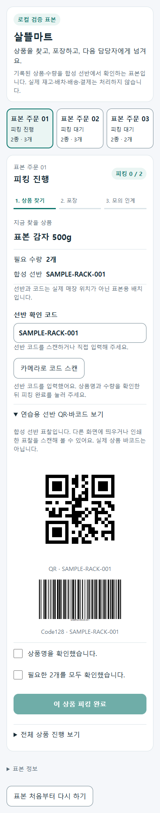

# 살뜰마트 선반 QR·바코드 카메라 입력 r53

2026-10-10. [승인 기획](../AI/Planning/공통/PLAN-OPERATIONS-NEIGHBORHOOD-MICRO-HUB/ssalddel-mart-camera-scan.implementation.r53.md)·[작업 지시](../AI/Planning/공통/PLAN-OPERATIONS-NEIGHBORHOOD-MICRO-HUB/ssalddel-mart-camera-scan.r53.work-order.json)의 좁은 후속 구현이다. [r52 피킹·포장 표본](2026-10-10-ssalddel-mart-picking-sample-r52.md)은 보존한다.

## 사용 흐름과 변경 파일

기존 `/workspace/warehouse/ssalddel-mart-sample`에서 품목의 피킹을 시작한 뒤 **카메라로 코드 스캔**을 누른다. 현재 합성 선반 QR 또는 Code128이 일치하면 선반 입력칸만 채운다. 상품명·수량 확인과 **이 상품 피킹 완료**는 사용자가 직접 수행한다. 포장·모의 인계·실제 운영 경계는 바뀌지 않는다.

- `eng/RoleWorkspacePreview/SsalddelMartRackScanner.razor`·`.razor.css`: 카메라 입력, 한국어 상태 안내, 접힌 연습 표찰, 세션·품목 재검증과 해제.
- `SsalddelMartSamplePage.razor`: 현재 주문·품목·단계·선반 코드가 일치할 때만 입력을 수용한다.
- `wwwroot/js/ssalddel-mart-scanner.js`: 지원 QR/Code128 형식 확인, 후면 카메라 우선 요청, 45초 종료, 영상·트랙·타이머·리스너 해제. 사용자 버튼 전에는 카메라를 요청하지 않는다.
- `test-ssalddel-mart-scanner.mjs`·`verify-ssalddel-mart-scanner.mjs`: 수명·오류·실제 렌더·확인 관문과 서버 로그 구간 검사.

권한 거절·미지원·카메라 없음·오인식·취소에는 직접 입력을 유지한다. URL과 다른 선반·과도한 길이의 값은 입력·서버 전송하지 않는다. 주문/품목 전환·초기화·숨김·이탈·연결 상실과 늦은 권한/인식 결과에서 카메라를 정리한다. 영상·사진·오인식 원문·카메라 상태를 로컬 파일이나 저장소에 남기지 않는다. 일치한 합성 코드만 기존 메모리 입력으로 전달한다.

## 실제 렌더 샘플 — 확정 UI 아님

아래는 합성 상품을 사용한 **샘플 이미지**다. 카메라 장치는 가상, 인식 응답은 모의이며 실제 휴대폰 촬영이 아니다. 코드를 채운 뒤에도 확인란은 선택되지 않고 피킹 완료 버튼은 비활성인 상태다. 연습 표찰은 실제 상품 바코드가 아니다.

PNG SHA256: `106F9AD337B5A10E134F2770CA1F81A214B0C4B91A89862761882C6DF2BFA57F`.

## 별도 검증 증거

| 구분 | 결과와 한계 |
| --- | --- |
| 현재 preview build | 성공, 오류 0. 기존 SQLite 의존성 보안 경고 1건은 남음 |
| 기존 관련 C# 시험 | 39/39, 실패·미실행 0. 피킹/포장 표본·완료 관문·기존 코드 생성기 회귀 |
| JS 수명 시험 | 30/30. 권한·취소·늦은 응답·중복 시작·시간 초과·숨김/이탈·오프라인·DOM 제거·연결 표시·재생/디코더/콜백 실패 |
| 가상 카메라·모의 디코더 UI | 320/390/1280px × 9사례 = 27/27. 확인 관문, URL/다른 코드 차단, 직접 입력 복귀, 주문 전환/초기화, 트랙 해제. 실행 구간 브라우저·서버 오류 0 |
| 기존 수동 UI | 3폭의 피킹→포장→모의 인계 3/3, 실패 0 |
| 실제 생성 표찰 디코딩 | 320/390px × QR/Code128 × 원래 SVG 크기/표시 DPR1/DPR3 = 12/12. 실제 ZXing.Net 디코더가 현재 합성 코드와 형식을 대조한 결과이며 실물 촬영은 아님 |
| Fast·Task routing 검사 | 통과. `eng/`·문서 경로는 build/test 자동 routing 제외라 위 preview build·39건·JS/UI 시험을 명시적으로 별도 실행. 전체 제품 suite를 다시 실행한 것으로 보고하지 않음 |

최종 증거는 Git 제외 `artifacts/local/ssalddel-mart-scan-r53/`의 `preview-build-label-fix.log`, `tests/mart-scan-regression.trx`, `scanner-unit.log`, `ui-scanner-accepted/result.json`, `ui-manual-accepted/result.json`, `labels-roundtrip/decode-result.json`·`capture-result.json`에 있다. UI 전후 소스·바이너리, 표찰 검증 전후 DLL 3개 해시는 불변이다. 마지막 브라우저 활동 후 221초(지연 회로 보존 180초 초과)에도 서버 오류 0·stderr 0바이트이며 `delayed-circuit-audit.json`에 별도 기록했다. 새 문서 링크 33개·소스 지문 6개·기획 hash 일치도 확인했다.

검증에서 찾은 잘못된 코드 종료 후 재스캔 비활성 문제, 늦은 권한 반환의 자원 정리, 창 종료의 `JSDisconnectedException`을 보완했다. Code128의 비정수 축소에서 판독 실패를 발견해 480px 생성 → 240px 표시로 바꿨고 실제 표시 크기에서 재검증했다. 이전 실패 증거는 덮어쓰지 않고 보존한다.

## 남은 경계

현재는 PC loopback 전용 표본이다. 휴대폰 LAN 접속·HTTPS 서비스·MAUI WebView 카메라 권한·APK 결속·실제 Android 촬영은 아직 아니다. 브라우저 카메라는 보안 컨텍스트·사용자 권한이 필요하며 BarcodeDetector는 제한 지원이므로 직접 입력을 유지한다. [MDN BarcodeDetector](https://developer.mozilla.org/en-US/docs/Web/API/BarcodeDetector), [getUserMedia](https://developer.mozilla.org/en-US/docs/Web/API/MediaDevices/getUserMedia).

실제 상품 바코드·선반 대장·운영 DB/API·실배차·정산·Outbox 종단·운영 활성화는 이번 검증에 포함하지 않는다. 기존 `SQLitePCLRaw.lib.e_sqlite3 2.1.10`의 `NU1903` 경고는 출시 전에 별도 보완해야 한다. commit·push·배포는 하지 않았다.
