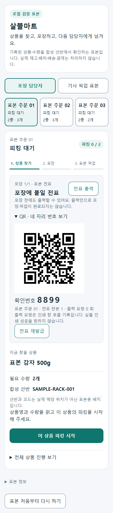
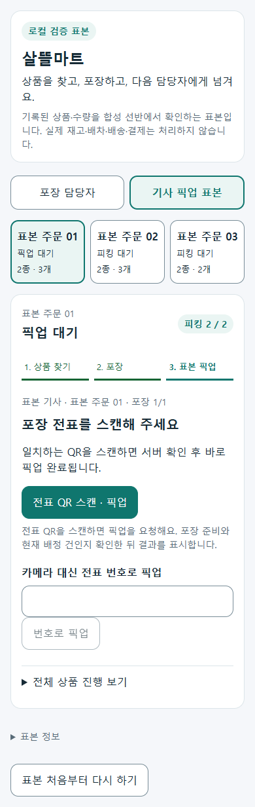
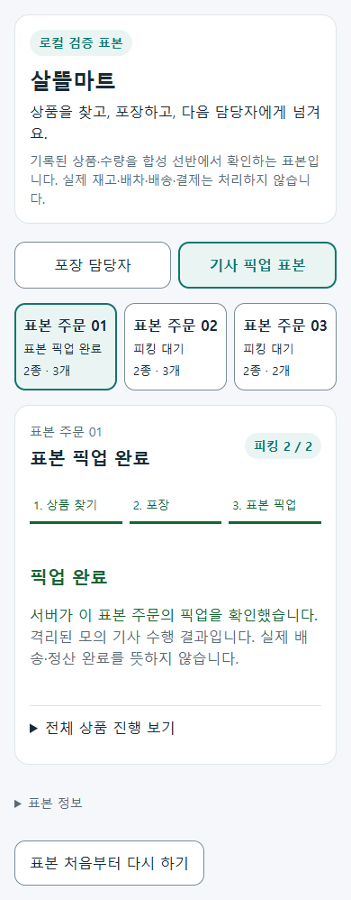

# 살뜰마트 전표 출력·QR 스캔 즉시 픽업 r56

- 상태: `Implemented / LocalValidated / AndroidDeferred / OperationalDeferred`. 실제 기사 앱·운영 연결은 후속이다.
- 기준: [승인·개발 반환](../AI/Planning/공통/PLAN-OPERATIONS-NEIGHBORHOOD-MICRO-HUB/ssalddel-mart-package-pickup.implementation.r56.md), [작업 지시](../AI/Planning/공통/PLAN-OPERATIONS-NEIGHBORHOOD-MICRO-HUB/ssalddel-mart-package-pickup.r56.work-order.json), [페이지 책임](../ProjectOverview/page-docs/ssalddel-mart-package-pickup-r56.md).

## 구현

기존 `/workspace/warehouse/ssalddel-mart-sample`에서 전표 준비·출력 → 상품 피킹 → 주문 포장 → 기사 QR 스캔 즉시 픽업 → 같은 주문 재조회를 연결했다. 추가 픽업 완료 버튼은 없다. 카메라 대체는 네 자리 번호 제출이며 한 주문·한 포장으로 제한한다.

전표는 공통 문서 출력 서비스와 QR 생성기를 이용한 80mm 표본이다. 주문 표시번호·상품·수량·포장 1/1·QR·번호만 출력하며 이름·주소·전화번호·원본 주문 ID는 포함하지 않는다. 인쇄 창 요청 횟수는 종이 출력 성공 횟수가 아니다. 58mm·Bluetooth/USB·물리 프린터는 미검증이다.

표본 Runtime의 전표·요청·인수는 격리 SQLite에 저장한다. 준비 상태·현재 전표 판본·배정 합성 기사를 검사하고 중복 인수를 차단한다. 번호 오입력 제한, 포장 전 재발급, 초기화 시 구 전표 거절을 제공한다. 입력 원본과 운영 MySQL/Mongo/Outbox·실제 배차·배송·정산·지급은 변경하지 않는다. 회로 종료나 초기화로 지워지는 자료이며 영속 운영 복구를 구현한 것은 아니다.

주요 변경은 `SsalddelMartSampleRuntime`·`SsalddelMartSamplePickup`, 기존 표본 페이지, 새 전표/픽업 스캐너 컴포넌트, 카메라 프로필과 인쇄 프레임 Adapter, 집중 시험과 UI 검증 스크립트다. 정확한 파일 목록은 작업 지시에 있다.

## 검증 구분

| 종류 | 이번 결과 | 한계 |
| --- | --- | --- |
| 별도 preview build | 통과, 오류 0 | 앱 설치·운영 API 아님 |
| 집중 C# | 69/69 통과 | 격리 SQLite·기존 UseCase, 운영 DB 아님 |
| JS 수명·입력·인쇄 | 62/62 통과 | 브라우저 API 모의 시험 |
| 실제 Razor/Runtime 렌더 | 320·390·1280px, 7경로 × 3폭 = 21/21 통과 | 가상 카메라·모의 디코더·모의 인쇄 창 |
| 실제 QR 디코딩 | ZXing 실제 디코더 12/12 통과 | 생성 SVG 픽셀만, 단말 촬영·실물 인쇄 아님 |
| Fast/Task | Fast 집중 69건·전체 앱 build·Task 실행 9,993건 통과, 실패 0·Mongo 환경 15건 미실행 | 제품 릴리스·배포와 별도 |

집중 C# 로그/TRX는 `artifacts/local/ssalddel-mart-pickup-r56/`, preview·JS·UI 증거는 `artifacts/local/ssalddel-mart-package-pickup-r56/`에 보존한다. 코드 검토에서 늦은 인쇄 callback의 요청 혼선을 찾아 수정하고 재현 회귀 시험을 추가했다. 기존 SQLite 패키지 `NU1903` 보안 경고와 다른 기존 컴파일 경고는 별도 후속이며 조용히 해소됐다고 보고하지 않는다.

- UI: `ui/result.json`은 검증 전후 소스/호스트 바이너리 변화 0건, 브라우저/서버 오류와 외부 업무 요청 0건을 확인했다. QR·번호 정상, 잘못된 입력, 관점 전환, 초기화·구 전표, 카메라 실패, 늦은 권한 경로를 각각 확인했다. 인쇄 창은 모의이며 실제 HTML의 개인정보 제한·재출력 판본 유지와 서버의 포장 전 거절·주문당 인수 1건을 대조했다.
- QR: `ui/label-capture-result.json`·`ui/label-pixels.json`·`ui/decode-result.json`은 실제 화면/인쇄 HTML QR 두 종류를 320/390px 원본 viewBox·표시 DPR1/DPR3로 래스터화한 12개다. 모의 `BarcodeDetector` 결과와 독립인 실제 ZXing.Net 디코더에서 원문 일치를 확인했다. 물리 스캔·인쇄 증거는 아니다.
- Fast: `artifacts/local/validation/20261010-162324`에서 직접 영향 시험 프로젝트 build·집중 시험 69건·diff 검사를 통과했다.
- Task: `artifacts/local/validation/20261010-162710`에서 `Ssalddel.v3.5.slnx` 전체 관련 역할 앱 build와 실행 9,993건을 통과했다. 실패 0건, 환경 의존 Mongo 시험 15건은 미실행이다. Android 컴파일을 이번 기능의 APK 설치·단말 촬영 검증으로 확대하지 않는다.
- 지연 회로 종료: `delayed-circuit-audit.json`에서 UI 종료 후 242초까지 서버 오류 0건·stderr 0바이트를 확인했다. 최종 UI의 소스·호스트 지문도 다시 대조해 변화 0건을 확인했다. 소유 텍스트 24개 공백 검사·새 문서 3개의 로컬 링크 17개·문서/JSON 정합 검사는 별도 수행한다.

## 화면 자료

공개 화면은 실제 기록이 아닌 **합성 상품 샘플 이미지, 확정 UI 아님**으로 남긴다. 실제 단말·물리 인쇄·운영 인증 HTTP/Outbox·마트 기사 앱·호스트 재시작 복구는 미검증이다. commit·push·배포하지 않았다.

### 포장 전 전표 준비

### 기사 픽업 대기

### 서버 확인 뒤 표본 픽업 완료

