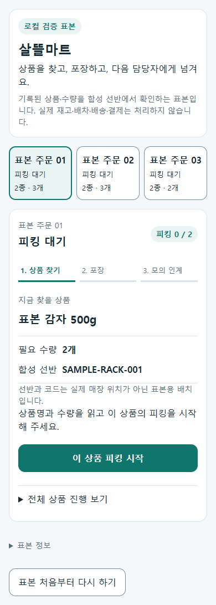
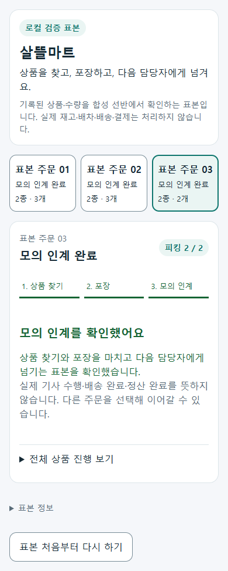

# 살뜰마트 기록 상품 피킹·포장 표본 r52

## 범위와 명칭

[승인 기획](../AI/Planning/공통/PLAN-OPERATIONS-NEIGHBORHOOD-MICRO-HUB/ssalddel-mart-picking-sample.implementation.r52.md)·[작업 지시](../AI/Planning/공통/PLAN-OPERATIONS-NEIGHBORHOOD-MICRO-HUB/ssalddel-mart-picking-sample.r52.work-order.json).

화면·프로세스 이름은 **살뜰마트**다. 원본 B마트 명칭은 비공개 기록의 출처로만 유지한다. 원본 상품명·수량을 보존하되 실제 재고·SKU·선반·기사 정보로 확정하지 않는다. 선택 입력은 3건, 봉투값을 제외한 22품목·36개이며 과거 금액은 현재 판매가·정산에 사용하지 않는다.

## 변경 책임

| 커밋 | 변경 축 | 화면 변경 | 시각 증거 |
| --- | --- | --- | --- |
| 미커밋 | 피킹·포장 선행 조건 / 격리 표본 / 살뜰마트 표시 | 있음 | 아래 합성 상품 실제 렌더 PNG |

- `SsalddelMartSampleInput`: 명시된 비공개 입력·hash·기록 선택, `artifacts/local` 경계와 Development·Simulation 조건. 원문 ID·주소·가격은 UI 자료로 전달하지 않는다.
- `SsalddelMartSampleRuntime`: 별도 SQLite 메모리 DB에서 기존 `피킹작업UseCase`·`포장작업UseCase` 실행. 상품 줄마다 합성 재고 lot를 준비해 기존 전체 가용수량 포장 계약을 유지한다. 감사·Event는 표본 메모리에서만 수집하며 운영 Outbox·외부 소비자를 실행하지 않는다.
- `마트주문피킹완료Guard`: 마트 상품·출고·재고·전체 피킹의 연결과 수량·완료 근거를 양 포장 진입점에서 검사한다. 포장 Event 소비도 실제 재고·이력·작업을 재조회하며 취소 상태와 기존 완료 시각을 보존한다.
- 전용 화면 `/workspace/warehouse/ssalddel-mart-sample`: 주문 선택 → 합성 선반 코드·상품/수량 확인 → 전체 피킹 → 포장 → **모의** 기사 인계. 기존 운영 읽기 전용 마트 상세는 변경하지 않는다.

## 검증

관련 Fast 자동 시험 101건이 통과했고 실패·건너뜀은 0건이다(`artifacts/local/validation/20261010-145253`). 양 포장 진입점·잘못된 연결·전체 피킹·분할 포장·취소 작업·중복 Event·일반 출고 호환과 입력/격리 Runtime을 포함한다. 최초 실행에서 발견한 .NET 10 배열 `Contains` 식 트리 오류는 명시적 `Enumerable.Contains`로 수정했고, 분할 포장은 취소 작업을 제외한 수량 합계로 검증한다.

전용 미리보기 build 및 관련 역할 앱을 포함한 `Ssalddel.v3.5.slnx` build가 통과했다. 후자는 컴파일 호환 증거이며 APK 설치·기기·운영 서버 연결을 뜻하지 않는다. 전체 Task 9,963건 통과, 실패 0건, Mongo 환경 시험 15건 미실행(`artifacts/local/validation/20261010-145925`, 전체 9,978건). 실제 MySQL/Mongo·인증 HTTP·운영 Outbox 소비 종단 검증은 아니다.

실제 Chrome 클릭 검증은 5모드 × 320/390/1280px = 15/15 통과, 실패 0건이다. 기록 상품 3건·22품목·36개와 합성 상품 3건·6품목·8개를 각각 전체 피킹 → 포장 → 모의 인계 → 명시 초기화까지 실행했다. 입력 없음·hash 불일치·Operational에서는 상품이나 작업을 대신 생성하지 않는다. 잘못된 선반·확인 누락·다른 주문 상태 보존·단계별 주 행동 하나·48px 조작 영역·가로 넘침·외부/업무 API 요청·브라우저 오류를 검사했다. 자동 시험의 직접 UseCase 호출과 UI의 버튼 부재/비활성 검증은 서로 별도다.

증거는 `artifacts/local/ssalddel-mart-sample-r52/ui-{private,public,missing,invalid,operational}/result.json`과 PNG 51장이다. 원본 입력/메뉴 대장 hash와 제품·시험·미리보기 소스 15개 지문, UI 검증 전후 빌드 지문이 불변이다. 실제 기록 상품 캡처는 Gitignored 로컬에만 두며 아래 공개 PNG는 합성 상품이다. 기록 상품 검증의 Chrome 종료가 지연됐으나 강제 정리 없이 자연 종료되어 exit 0으로 기록됐다. 시험 후 기록 상품·거절 상태용 호스트 4개는 종료했고 공개 합성 호스트만 남겼다.

## 샘플 이미지 — 확정 UI 아님

별도 합성 입력 3건·6품목·8개로 실제 렌더하고 버튼을 클릭한 390px 화면이다. 기록 상품의 원문 자료나 실제 매장·재고·기사 화면이 아니며, 최종 디자인 승인 또는 모바일 앱 출시 증거로 해석하지 않는다.

## 남은 경계

마트 실제 기사 수행 adapter는 여전히 `ConsumerBindingUnavailable`로 보류한다. 모의 인계 표시는 실제 기사 원장·배송 완료·정산 완료가 아니다. 실제 MySQL/Mongo·Android 앱 연결·실물 바코드 스캔·실제 보관 온도·수량·배차·결제·외부 알림·운영 활성화는 검증하지 않는다. 원본 DB와 운영 플래그, 기존 dirty 작업을 보존하며 commit·push·배포는 수행하지 않는다.

기존 중앙 의존성에서 `SQLitePCLRaw.lib.e_sqlite3 2.1.10`의 `NU1903` 보안 경고가 발생한다. 이번 로컬 표본의 시험 통과가 해당 취약성 해소를 뜻하지 않는다. SQLite 의존성 갱신·전체 소비자 호환 검증은 별도 우선 보완이 필요하며 이 표본을 운영 배포 근거로 사용하지 않는다.
