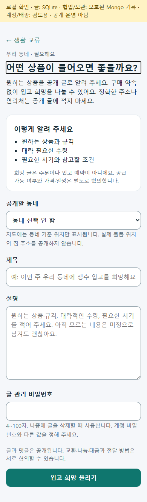
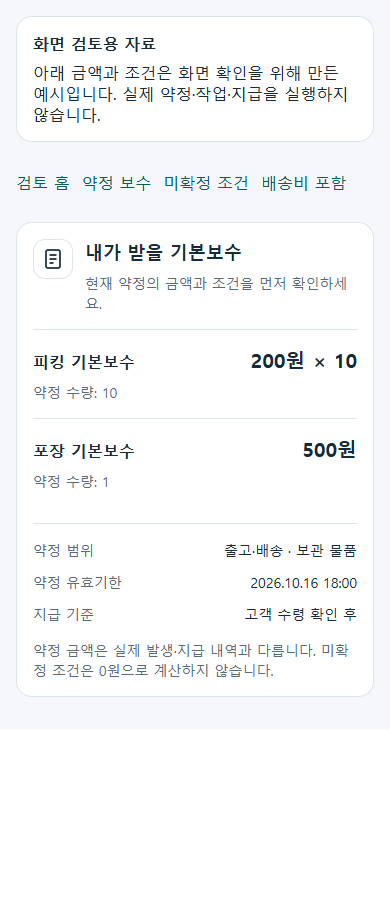
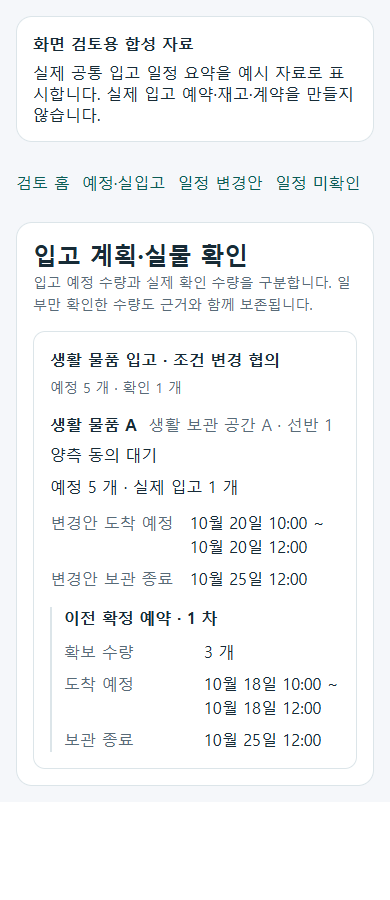

# 공동주택 기획의 기존 역할 화면 반영 r102

2026-10-15. [승인 범위](../AI/Planning/공통/PLAN-OPERATIONS-NEIGHBORHOOD-MICRO-HUB/role-screen-integration.design.r102.md)에 따라 최근 공동주택 기획 중 기존 업무와 같은 책임인 세 가지 표시·진입을 보완했다. 별도 앱·주민 재고 원장·기여금 원장을 만들지 않는다.

현재 상태: `Implemented / LocalValidated / OperationalDeferred`. Fast 34개와 Task 12,017개가 통과했고 환경 의존 16개는 미실행이다. 루프백 Chrome의 20개 화면 배치와 격리 SQLite의 실제 글 저장·재조회도 확인했다. 물리 Android·외부 운영·실제 지급은 별도다.

## 기존 역할별로 반영한 내용

| 역할·업무 질문 | 화면과 코드 | 기존 서버·원장 경계 |
| --- | --- | --- |
| 주민: 어떤 상품이 들어오면 좋을까? | 생활 교류 목록에서 `/community/exchange/write?purpose=inbound-interest`로 진입. 기존 `ExchangeWrite`와 `NeighborhoodExchangeViewModel`을 사용 | 기존 `POST api/v1/community/posts`의 생활 교류·필요해요 공개 글. 주문·상품 판매·입고 예약·관심 모집 원장을 만들지 않음 |
| 작업자: 현재 약정에서 내가 받을 기본보수와 조건은 무엇일까? | 기존 활동정산 상세의 `사전보수요약Panel`과 표시 helper | 기존 인증된 본인 약정·정산 조회 결과만 표시. 보수 발생·동의·지급·금융 상태는 기존 서버 소유 |
| 공급자·공간 제공자: 무엇을 언제 얼마나 받는가? | 기존 `분산입고Screen` 목록에 `분산입고일정요약Panel`을 조립 | 기존 권한으로 조회한 입고 계획·행별 협의·공간 표시명만 사용. 새 예약·실입고·계약·기간 변경 명령 없음 |

### 주민의 공개 입고 희망

빈 초안의 첫 진입에서만 필요해요 분류를 준비한다. 기존 제목·본문·글 관리 비밀번호가 있으면 분류와 작성 내용을 바꾸지 않으며 query 변경으로 작성 중 초안을 덮지 않는다. 원하는 상품·규격, 대략적인 수량과 필요한 시기를 자유롭게 적고 모르는 조건은 미정으로 남긴다. 공개 동네는 기존 검증 목록에서 선택하며 정확한 집 주소·연락처를 입력하도록 요구하지 않는다.

`purpose=inbound-interest`는 작성 화면의 문맥이다. 구조화된 주민 수요 집계 키·공급업체 주문량·구매 의무·확정 매출로 해석하지 않는다. 기존 Client는 판매 정보·연결 원장·관심 모집을 비워 기존 공개 필요글로 전송한다. 공개 글 작성이라는 점을 화면에서 알린다.

응답이 유실되면 오류·초안과 목록 확인 경로를 유지하고 자동 재POST하지 않는다. 기존 게시 API에 새로운 멱등키를 추가한 것은 아니므로 목록에서 등록 여부를 확인하는 절차와 자동 중복 방지는 구분한다. [주민 작성의 페이지 책임](../ProjectOverview/page-docs/community-inbound-interest-r102.md).

### 본인의 약정 기본보수

현재 로그인 사용자가 수령자이며 본인이 지급자와 다른 기본보수 항목만 먼저 보여준다. 단가 방식은 약정 단가·수량, 고정 방식은 약정 금액을 표시하고 미확정 금액·수량·기한·지급 조건은 확인 필요로 남긴다. 배송비에 포함된 항목은 별도 참고 영역으로 분리해 추가 수령액으로 합산하지 않는다.

기본보수 요약은 기존 상세의 전체 약정·동의·발생 내역·지급 신고와 수령 확인을 대체하지 않는다. 상품대금·타인 보수·플랫폼 몫·공동 성과금을 본인 기본보수에 섞지 않는다. 이번 helper는 표시만 하며 합산·채무 발생·공제·지급액 산정을 수행하지 않는다.

### 입고 계획의 상품별 일정

기존 목록에서 계획을 선택하거나 협의 상품을 다시 고르기 전에도 상품별 거점·적재 위치 표시명, 현재 협의 상태, 도착 시간 범위와 보관 종료를 확인할 수 있다. 계획 수량과 실제 입고 수량을 각각 표시하며 승인된 예약도 실제 입고 0개를 완료로 바꾸지 않는다.

현재 변경안과 다른 판본의 이전 확정 예약이 함께 조회되면 각각의 일정·보관 종료·확보 수량을 분리한다. 일정이 없거나 날짜 기본값·역전 범위이면 ‘일정 미확인’으로 남긴다. 공급 준비·실제 출발·실제 도착을 예정일에서 추정하지 않는다. 기존 수용 조건·양측 동의·거절·취소·사진 실입고 화면과 명령은 유지한다.

## 검증과 후속 확인

| 구분 | 현재 확인 |
| --- | --- |
| Fast | 34개 통과·실패 0개. 이번 변경의 좁은 검증 |
| Task | 12,017개 통과·실패 0개·환경 의존 16개 미실행. `artifacts/local/validation/20261015-221749/Ssalddel.Tests.trx`의 개별 outcome과 대조 |
| 실제 브라우저·좁은 화면 | 실제 공유 Razor를 조립한 루프백 Chrome 20개 배치 통과. 보수·입고 3상태씩 320/390/1024px, 주민 작성 390/1024px에서 가로 넘침·페이지 실행 오류 0개. 기존 일반 작성과 입고 희망 진입 링크도 확인 |
| 격리 DB의 실제 필요글 저장 | 화면에서 글 등록 → 상세 이동 → 기존 API HTTP 200 재조회 → 페이지 새로 고침 확인. SQLite 229개 테이블의 행 수 대조에서 글·기존 음성 작업·키워드 검사 후속만 각 1건 증가. 주문·입고·정산 행 수는 그대로이며 판매 정보/연결 원장은 null, 관심 모집/신고 글은 false |
| APK·물리 휴대폰·외부 운영·실제 지급 | 이번 완료 근거에 포함하지 않음 |

렌더 시험은 빈 초안/기존 초안·필요글 payload·오류 후 자동 재전송 없음, 본인/미확정/배송 포함 보수, 상품별 일정·변경안/이전 예약·부분 입고·누락 날짜·비공개 값 미노출을 다룬다. 실제 공유 Razor의 정적 렌더와 브라우저 paint·클릭·스크롤·모바일 터치는 별개다.

대표 PNG는 실제 브라우저 화면을 캡처하고 글자·섹션 간격을 시각 확인했다. 보수·입고 화면 자료는 예시 DTO이며 실제 계약·입고·지급 자료가 아니다. 주민 등록도 가상 글과 새 격리 DB만 사용했다.

| 대표 상태 | 실제 화면 |
| --- | --- |
| 주민 입고 희망 모바일 | [화면](../assets/changes/2026-10-15-community-role-screens-r102/resident-interest-mobile.png) |
| 작업 보수 약정 390px | [화면](../assets/changes/2026-10-15-community-role-screens-r102/worker-fee-ready-390.png) |
| 입고 변경안 390px | [화면](../assets/changes/2026-10-15-community-role-screens-r102/inbound-changed-390.png) |

실행 근거는 `artifacts/local/community-role-screens-r102/{browser-verification.json,db-verification.json,fast.log,task.log}`다. 재현 도구는 `eng/verify-community-role-screens-r102.cjs`이며 `SSALDDEL_PLAYWRIGHT_MODULE`과 필요 시 `SSALDDEL_BROWSER_EXECUTABLE`로 설치된 Playwright/Chrome 경로를 지정한다. 기존 `eng/NeighborhoodExchangePreview`는 `--ExchangePreviewEvidenceName=community-role-screens-r102-db`로 새 격리 DB를 선택하고 `eng/RoleWorkspacePreview`는 `--LifeFacilitationPreviewPort=5482`로 실행한다.

초기 검증에서 오래된 Preview DB의 `PublicNeighborhoodRegionKey` 열 누락을 확인했다. 기존 DB는 보존하고 이름을 지정하는 별도 검증 DB 옵션을 추가했다. 최신 글 상세의 협업 요약 DI 3개도 기본 Preview 모드에 보완했다. 실제 제품 Web/MAUI는 기존 공통 DI가 이미 등록돼 있었다. 기본 Preview에 없는 공개 협업 조회 API는 기존 오류 안내를 표시하며 이번 성공을 협업 신청·완료 이력 통합 검증으로 확대하지 않는다. 기존 API가 만들던 글의 음성/키워드 후속 기록도 보존하며 외부 발송·작업자 실행은 검증하지 않았다.

마지막 제품 Task 뒤 수정한 것은 Preview 호스트·검증 도구·문서다. 두 Preview 호스트는 별도 최종 빌드·실행을 확인했다. 제품 빌드는 오류 0개·기존 경고 66개이며 Preview의 기존 `SQLitePCLRaw.lib.e_sqlite3` 2.1.10 취약성 경고 1개는 별도 패키지 갱신 대상으로 남긴다. 이번 UI 변경으로 해결했다고 기록하지 않는다.

## 이번에 구현하지 않은 것

단지 기여율 5%/10%의 실제 약정·공제·납부, 관리비 반영·송금, 공개 일감 시장, 주민 자가 피킹 완료, 신규 재고/정산 원장과 주민의 창고 운영 권한은 추가하지 않았다. 기존 플랫폼 잔여금 보유율을 단지 기여율로 대신 계산하지 않는다. 계약의 법적 분류·실제 현장 사용 승인·임금 적용 판단도 완료하지 않았다.

r101 및 이전 기획의 미정과 기존 구현 이력은 보존한다. 이번 세 화면 반영을 최근 기획 전체의 구현·운영 완료로 확대하지 않는다. 기능 플래그·Simulation 경계·원장 소유·기존 권한·보수와 실제 지급의 분리는 유지하며 클라우드 배포·새 APK 설치·실제 계약/입출고/지급·Figma·Unity·commit/push는 수행하지 않았다.
