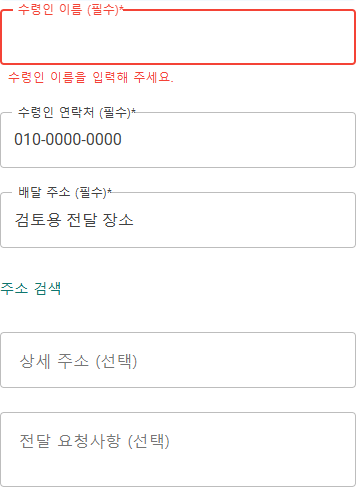

# 2026-10-16 역할 앱 첫 이용 사용성 보완 r1

첫 사용자가 현재 상태와 다음 행동을 이해하기 어렵던 경로를 기존 역할 화면 안에서 다듬었다. 연결되지 않은 계좌를 확인 완료처럼 보여주던 안내, 주기 갱신으로 검색 조건을 잃던 판매 주문 목록, 준비물 없는 빈 화면, 유효하지 않은 복귀, 주문 제출 불가 이유와 내부 개발 용어를 우선 보완했다.

기준선은 `fd55a1c4bca4dffb4752ac34de64c62d07caced3`다. 기존 변경 4개(`eng/git/*`의 세 파일과 음식 기사 알림음)는 이번 범위에서 제외했다. 서버·원장·권한·기능 플래그·운영 worker·실제 지급을 변경하지 않았다. 사용자가 정한 네이티브 지도/추천 카드·색·고정 글자 크기도 유지한다.

## 공식 자료와 적용 범위

[KRDS 버튼/링크](https://www.krds.go.kr/html/site/component/component_05_02.html), [GOV.UK 버튼](https://design-system.service.gov.uk/components/button/), [W3C 라벨](https://www.w3.org/WAI/tutorials/forms/labels/)·[알림](https://www.w3.org/WAI/tutorials/forms/notifications/), [Android 핵심 품질](https://developer.android.com/docs/quality-guidelines/core-app-quality)을 확인했다. 공통 기준은 [시각 디자인 기준 r8](../Architecture/RoleAppVisualDesignStandard.md#첫-이용에서-막히지-않는지-확인하는-기준-r8)에 통합했다. 같은 내용을 역할별 새 규칙으로 복제하지 않는다.

9개 앱의 route 파일325개·route 정의356개·XAML 페이지21개를 목록화하고 대표36개 화면을 소스에서 깊게 검토했다. 수치 정의·역할별 결과·남은 우선순위는 [사용성 점검 보고서](../ProjectOverview/page-docs/first-use-usability-review-r1.md)에 있다. 모든 화면의 실제 렌더·접근성 준수·교육 없이 이용 가능을 인증한 결과가 아니다.

## 확인한 변경

- 판매자: 재생성 대신 동일 목록 갱신, 검색·필터·페이지 보존, 겹친 조회/종료 취소, 빈 상태의 준비 화면 진입, 해당 앱 안의 복귀 경로.
- 주문자/마트: 필수·선택 라벨, 주문 버튼 곁의 준비 안내, 접근 실패 재확인/복귀, 상품/주문 요청 설명. 샘플·실제와 요청·주문 확정의 구분은 유지한다.
- 기사/운영자: 미연결 소셜 로그인 제거, 계좌 미확인과 알림 안내, 읽을 수 있는 연결 실패 안내, 복구 업무로 돌아오는 로그인 행동.
- 화주/창고/인력: 화면 안 보관 범위 명시, CSV 파일 라벨/형식 안내와 미리보기·등록 위계, 고정 샘플 값 제거, 현재 업무 중심 용어. 지도 로딩에는 실패용 재시도를 노출하지 않는다.

책임 카드는 기존 역할 상세 README에 반영했다. 구조적으로 큰 미확정 접수 복구, 기기 설정 왕복, 긴 주소·키보드·포커스 검증은 후속으로 구분한다.

## 검증 기록

대표 컴포넌트를 320/390px에서 실제 렌더하고26개 검사를 통과했다. 기능 OFF의 본문 차단/복귀, 조회 오류의 내부 예외 미노출·명시 재확인, 샘플 안내, 계좌 미확인과 기존 목적지, 필수 입력과 잠긴 제출의 이유, 가로 넘침을 확인했다. 브라우저 오류와 업무/외부 HTTP 요청 시도는0개다. 전체 화면12장과 주문 입력 부분2장, 총14장을 캡처했다. 계좌 링크는 제품 route와 대조했고 이 전용 미리보기에서 전체 운송대금 앱으로 이동한 것은 아니다.

최종 소비 빌드는 솔루션이 만든 공통 UI와 SHA-256이 같은 사본을 사용하는 기본 출력의 미리보기다. `preview-build-final.log`에 소비 빌드 성공·오류0개·기존 의존성 경고1개를 기록했다. 기존 격리 출력의 참조를 다시 만들지 않은 중간 빌드에서 새 문구/안내 검사4개가 실패한 이력(`browser-stale-r2/`)도 보존하고 최종 통과로 덮어쓰지 않는다.

초기 전체 시험은 이전 화면의 조회 의존·문구를 기대한3개 검사에 실패했다. 계좌/휴대폰 알림 안내는 무관한 업무 조회를 하지 않는 것으로 검사했고 상품의 사용자 안내 문구를 검사에 반영했다. 기존 인증·역할·주문 제출 관문은 완화하지 않았다. 최초 코드 지도 검사 중복 실행 중단과 모든 재검증 기록은 Git 제외 `artifacts/local/usability-review-20261016/`에 보존한다.

| 확인 | 결과와 근거 |
| --- | --- |
| 전체 Task | 솔루션 빌드 성공·오류0개, 전체 시험12,286개 통과·실패0개·환경 의존16개 생략. `artifacts/local/validation/20261016-220928/`의 실제 TRX와 로그. 명시 필터가 없는 Full 실행이며 환경 의존 시험을 통과한 것으로 세지 않음 |
| 관련 Fast | 추가한 입력 보존/진행 안내12개와 기존 인증·구성·지도 시험 포함209개 통과·실패/생략0개. 최종 빌드·시험은 `artifacts/local/validation/20261016-221334/`의 TRX/로그. 이전 r3 결과도 별도 보존 |
| 실제 브라우저 | 320/390px26개 통과·오류0개·업무/외부 HTTP 시도0개, 캡처14장. `artifacts/local/usability-review-20261016/browser/result.json` |
| 소스·시각 자산 | 검증 소스 SHA-256 대조, 공개 대표 PNG6개 원본/사본 동일·메타데이터 없음, 문서 링크/경로와 diff 검사 |

빌드에는 기존 nullable/플랫폼 API/미구성 푸시와 패키지 보안 권고 경고가 남아 있다. Task의 증분 빌드 경고54개는 전체 의존성 위험을 전수 조사한 수치가 아니다. 이 작업으로 보안 권고가 해결됐거나 실제 기기 알림이 활성화됐다고 판단하지 않는다.

## 대표 화면

아래는 실제 고객·계좌·주문이 없는 격리 예시다. 음식 주문은 기존 공통 컴포넌트의 검토 테마이며 전체 주문자 앱 shell을 재현한 화면은 아니다. 계좌 화면도 실제 Razor를 링크한 공통 검토 테마이며 네이티브 전체 앱 캡처가 아니다. 공개 문서로 옮긴6장 각각을 Codex가 픽셀로 확인했고 원본과 사본의 해시·PNG 메타데이터 없음도 검사했다. 사람의 사용성 관찰 시험이나 개인정보 자동 탐지 인증은 아니다. [파일·해시·출력 대장](../assets/changes/2026-10-16-first-use-usability/manifest.json)에 근거를 둔다.

필수·선택 입력과 수정 안내가 있는 주문 입력 부분이다. 빈 수령인 입력의 명시적 오류를 보여주며 표시 연락처/장소는 예시 값이다. 아래 그림은 브라우저가 해당 입력 영역만 직접 캡처한 것이며 픽셀 편집은 하지 않았다. [제출 사유까지 포함한 전체 화면](../assets/changes/2026-10-16-first-use-usability/orderer-readiness-390.png)도 보존한다. 전체 페이지가 길게 남아 있는 점은 다음 검토 과제다.

기능이 꺼져 있거나 조회에 실패한 경우 각각 돌아가기·재확인을 제공한다. 정상 복구 뒤에는 실제 상품 대신 명시적인 검토 본문만 표시한다.

| 화면 | 실제 확인 |
| --- | --- |
| [상품 이용 준비](../assets/changes/2026-10-16-first-use-usability/mart-off-390.png) | 상품 본문 차단·유효한 복귀 |
| [상품 조회 실패](../assets/changes/2026-10-16-first-use-usability/mart-error-390.png) | 재확인과 복귀·내부 오류 원문 미노출 |
| [명시적 재확인 후](../assets/changes/2026-10-16-first-use-usability/mart-recovered-390.png) | 상품 탐색·주문 요청의 짧은 설명, 요청은 확정 전 단계 |
| [기사 계좌 안내](../assets/changes/2026-10-16-first-use-usability/driver-bank-390.png) | 미확인 상태·예시 계좌/허위 확인 버튼 없음·운송대금/메뉴 목적지 |

## 실행·공유 경계

이번 실제 화면 확인은 루프백의 격리 자료를 사용하는 브라우저 컴포넌트 검증이다. MAUI WebView·네이티브 전체 화면·APK 설치·USB 기기·GPS·FCM 청취·실주문/송금·배포·커밋·푸시는 실행하지 않았다. 이전 기기 검증 결과를 이번 소스의 검증으로 승격하지 않는다. 대표 캡처에도 실제 고객·계좌·위치·주문 자료를 사용하지 않는다.
