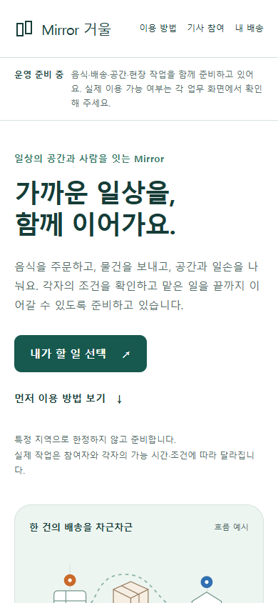

# 전체 역할 통합 공개 준비 r105

작업 시작2026-10-16, 검증2026-10-17. 기준은 [승인 계획](../AI/Planning/공통/PLAN-OPERATIONS-NEIGHBORHOOD-MICRO-HUB/integrated-public-release.r105.md)이다. `LocalChangesVerified / ExternalReleasePending / OperationalDisabled`. 이 기록은 전체 공개·Azure 배포·실수납·실송금 완료가 아니다.

## 구현

- 웹·통합앱의 기존 역할 선택 홈에 `/services` 안내를 연결했다. `/quick` 호환 유지. 음식·퀵/화물·공간/현장 작업과 현재 제공 조건·준비 중인 주간 지급을 구분한다.
- 음식 취소 합의: 제안→각자 동의/철회→양측 동의·현재 판본·조리 전·기사 미확정 검사→명시 실행·영수증. 환불/송금은 별도 미완료 상태다. 지급 재원 누락도 운영 지급 준비와 분리한다.
- 퀵/화물: 상차 이후 일반 수락 취소를 최신 정본·원의뢰·담당 기사·사건 보류로 차단한다. 물품 보유·증빙을 취소로 지우지 않는다.
- 창고/판매: 기존 반출에 불량 처분·실사 소실 정정 합의와 증빙을 연결한다. 품목 매핑 일부 실패를 부분 출고로 성공 처리하지 않고, 수집기 미연결을 주문0건으로 숨기지 않는다.
- 정산: 기존 승인 운송 채무의 닫힌 완료 주만 자동 명세로 준비한다. 기존 준비/보류를 재검증하고 거부 후보의 진행을 남긴다. 새 채무·승인·송금·신고 종결은 만들지 않으며 기본OFF·관리자API 권한 유지다.
- 배포: 같은 판본·소스·설정·역할·증거종류·파일hash를 연결하는 읽기 점검기와 격리Simulation 준비 profile. 기존 standalone USB 제작 도구에 통합앱·화물·창고 선택을 추가했다.

## 검증 기록

| 구분 | 결과 |
| --- | --- |
| 최초 Fast | 소개의 미존재 `NeighborhoodDeliveryRoutes.List` 참조로 실패. 정본 `Home`으로 수정 |
| 중간 Fast | 작성 중 음식 취소 UseCase using누락으로 실패. 담당 수정·실패 로그 보존 |
| 소개 루프백 렌더 |320/390/1280px·두route·FAQ/현재 상태/링크/넘침9개 통과, 오류/업무·외부 요청0. 최종CSS의 PNG4장 확보 |
| 판매 연속 첫 회차·재시험 | 입력DOM/포커스/초안·기능OFF·조회오류6개 통과, 계정/역할/로그아웃 즉시 비노출6개 timeout을 발견. 실제 세션Changed 구독을 보완했고, 최종320/390px 14개 통과·오류/업무·외부 요청0·PNG4장. 재시험 중 대기 완료 신호와 조회 완료의 시각 차이1개도 기록한 뒤 실제 조회 완료를 기다리도록 검증 절차 수정 |
| 공개 준비 자체 검사 |최종19개 반례 통과. 소스5,355파일의 지문을 다시 확인. 점검 실행 성공과 `releaseReady`는 별개이며 현재 `NotReady / SafeDisabledPreparation` |
| USB 제작 자체 검사 |21개 통과. 모의APK 인수계약 검사이며 실제 APK/기기 증거 아님 |
| schema |EF pending model 차이0. DB 연결 없이 R73→신규3개 migration MySQL SQL 생성. 테이블1·nullable 열3 추가, 기존 업무 데이터 삭제/수정 없음 |
| 집중 시험·수정 | 최초285개 중275개 통과·10개 실패. 음식 fixture의 요청자 보존/정본 출처 코드와 SQL 검사 오탐을 바로잡음. 중간16개 중13개 통과·3개 실패와 최종 음식 fixture12개 통과를 각각 보존. 제품의 권한/출처 guard는 완화하지 않음 |
| 최종 Fast |최초287개 통과 뒤 후속 수정을 포함해 v3.5 솔루션 빌드·관련506개 통과, 실패/생략0. 최종 `validation/20261017-005210` |
| 전체 Task 첫 회차·후속 |빌드는 통과, 전체12,416개 중12,344개 통과·56개 실패·환경 의존16개 생략. 화물 시험의 매회 새 InMemory root로 내부 provider가 누적되어54개 연쇄 실패, 소개route capability 미분류1개, 재고 UI의 이전 문구 조작1개. 공용root+고유DB명·정본route분류·동의 재사용 차단을 유지한 문구 수정 후 집중293개 통과 |
| 최종 전체 Task |v3.5 솔루션 빌드·전체12,402개 통과, 실패0·환경 의존16개 생략. `validation/20261017-005314`. 기존 패키지 제약 등 빌드 경고54개는 남아 있으며 오류0·시험 성공을 모든 의존성 문제 해소로 확대하지 않음 |
| APK 제작·설치 |통합앱188 standalone Debug 제작·서명/ABI/정렬·인계hash 및 USB 업데이트 설치 성공. 최종 capability 수정 포함189도 같은 제작 검사 통과·빌드 중 소스 변경 없음·미설치. 사용자가 화면 시험을 미뤄 이후 기기 조작을 하지 않음. 초기JDK/긴중간경로 실패는 보존. 기기 표시·전체 업무·실서버 통신은 별도 |

원시는 Git 제외 `artifacts/local/integrated-platform-r105/`, `artifacts/local/integrated-platform-readiness-r105/`, `artifacts/local/schema-integration-r105/`다. 판매 최종은 `sales-r3/result.json`, 직전13개 통과·1개 시각 차이 실패 원시는 `sales-failed-r2/`에 보존한다. 최초6개 timeout은 당시 도구 출력과 이 기록으로 보존하며, 같은 결과 파일이 후속 실행에 갱신됐으므로 최초 원시 JSON까지 그대로 남았다고 주장하지 않는다. 대표 화면만 문서 자산으로 연결한다.

서버 프로젝트1개의 NuGet 전이 의존성 취약점 조회에서는 항목이 반환되지 않았다(`package-audit-server.json`). 모바일/시험 전체 의존성을 조사한 결과나 보안 인증으로 확장하지 않는다. 새 책임 문서9개의 로컬 링크36개와 대표 PNG3개의 해시도 대조했다.

현재 로컬 시험용 APK는 `artifacts/local/integrated-platform-r105/apk/0.1.189-189/handoff/shipper-usb-debug.apk`, SHA-256 `3e0d01fddc054ecfcc07e4fcb138dbbbd6b40ef5c11969cd40c29c5bf5b4125f`다. 실제 휴대폰에는188이 설치돼 있다. 189의 서명·독립 실행 파일 포함은 확인했으나 Release 배포본·실기기 실행·현재 서버 통신을 확인한 것은 아니다. 최종 구조화 요약은 `artifacts/local/integrated-platform-r105/validation-summary.json`이다.

## 화면 확인

아래는 실제 공통 소개 화면의 루프백 렌더다. 앱 설치 화면이나 공개 운영 중인 사이트가 아니다. [대표 PNG와 SHA-256](../assets/changes/2026-10-17-integrated-platform-r105/manifest.json)을 함께 보존한다.

[모바일 전체 화면](../assets/changes/2026-10-17-integrated-platform-r105/services-390.png) · [데스크톱 전체 화면](../assets/changes/2026-10-17-integrated-platform-r105/services-1280.png)

## 외부 상태·남은 조건

개발 휴대폰1대의 USB(device)와 통합앱188 업데이트 설치를 확인했다. 실행 직후 다른 앱으로 화면이 전환되어 추가 조작을 멈췄고, 사용자는 화면 시험을 다음으로 미뤘다. 기기 홈/소개/역할별 화면 완료로 기록하지 않는다. 다른 앱의 임시 UI 덤프는 폐기했으며 기기 원본을 문서 자산에 복사하지 않았다. APK의5363 주소는 기존 격리 호스트용이며 이번 서버 변경 전체를 검증한 공개 HTTPS 서버가 아니다. Azure 기본 구독 관리API 인증·조회는 성공했지만 기존 App Service는 AlwaysOn/WebSocket OFF이며 이번 통합 서버의 판본·DB·실행 기능을 확인한 배포 대상이 아니다. 다른 기존 구독 하나는 인증 만료로 조회하지 못했다. 구독 변경·서버 변경·배포는 하지 않았다.

실수납/기사·작업자 지급 계약·재원, 음식·작업비 공통 수납, 은행 영업일·실지급 최종 결과, 창고/활동 정산 Operational adapter, 전체 역할 외부HTTPS·실기기 생명주기·서버 밖 독립복구가 남아 있다. 통합앱의 일반 회원 push 설정도 미연결이며 서버 알림함 조회와 실제 기기 push 수신은 별개다. 기존 전문 앱의 알림 결과를 이번 통합앱으로 승계하지 않는다. 작은 자동 준비 도구가 이 경계를 대체하지 않는다.

책임 문서: [소개](../ProjectOverview/page-docs/quick-service-introduction-r1.md), [음식 합의 취소](../ProjectOverview/page-docs/food-order-cancellation-agreement-r1.md), [화물 보유·취소](../ProjectOverview/page-docs/cargo-custody-cancellation-boundary-r1.md), [창고·판매](../ProjectOverview/page-docs/warehouse-sales-closeout-r1.md), [자동 주간 명세](../ProjectOverview/page-docs/weekly-statement-preparation-review-r1.md), [공개 점검](../../eng/release/README.integrated-platform-readiness.md).

commit·push·사이트 공개·클라우드 생성/변경·운영DB 적용은 수행하지 않았다.
