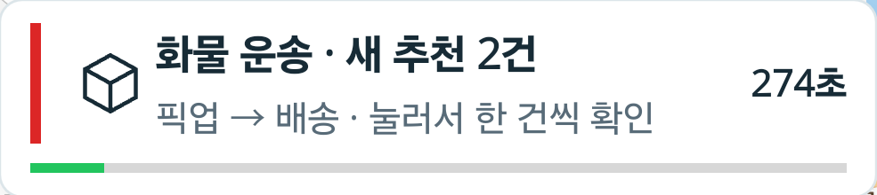
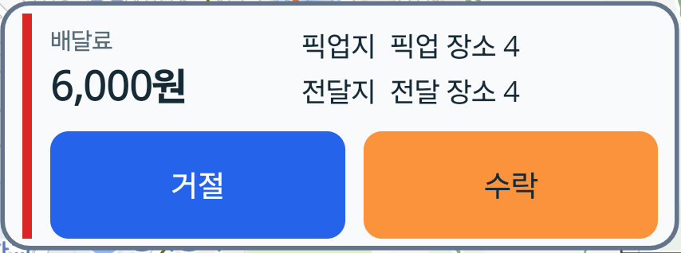
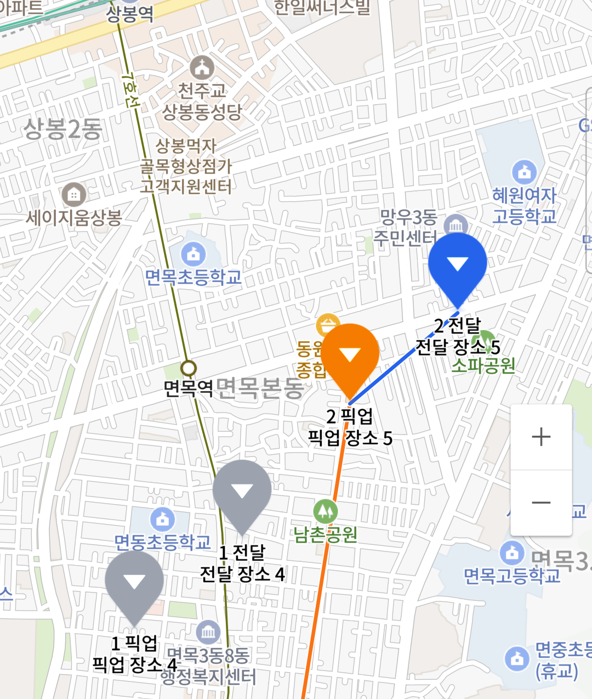
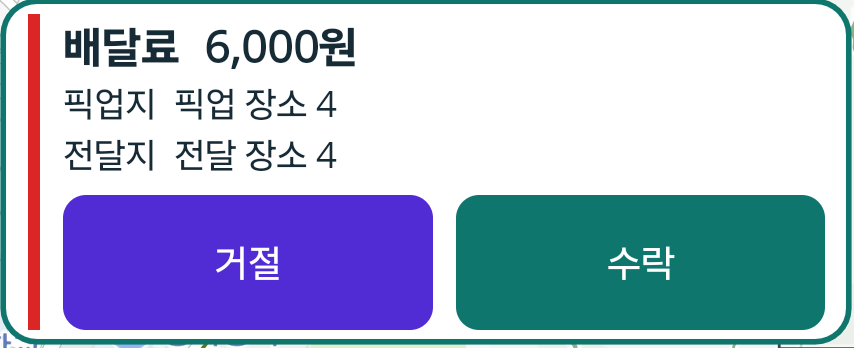
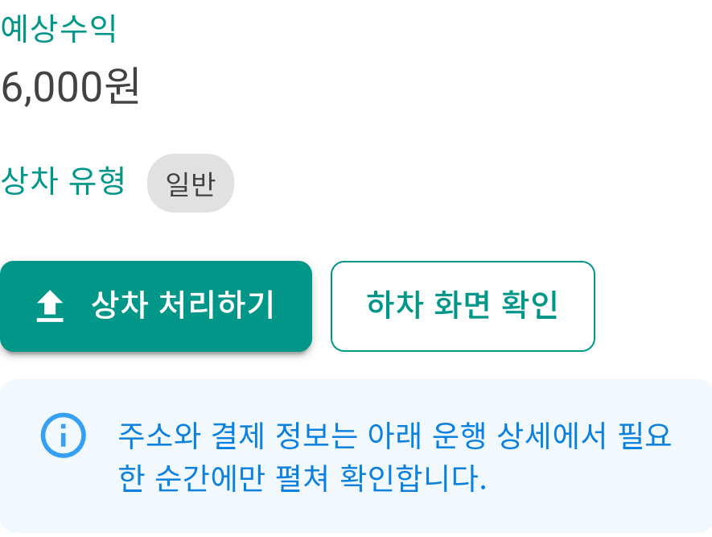
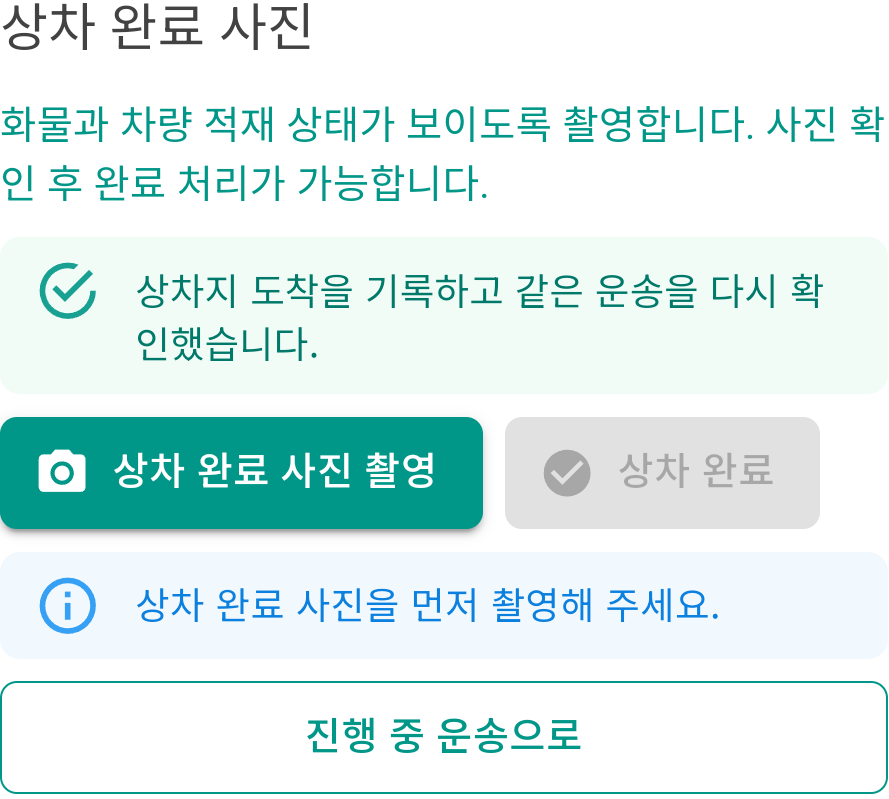
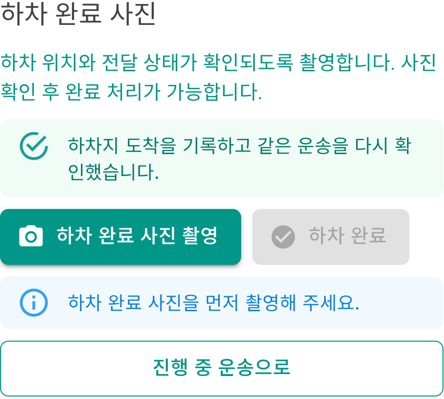
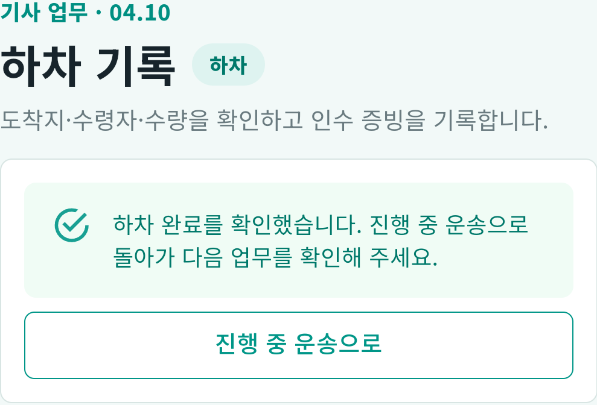
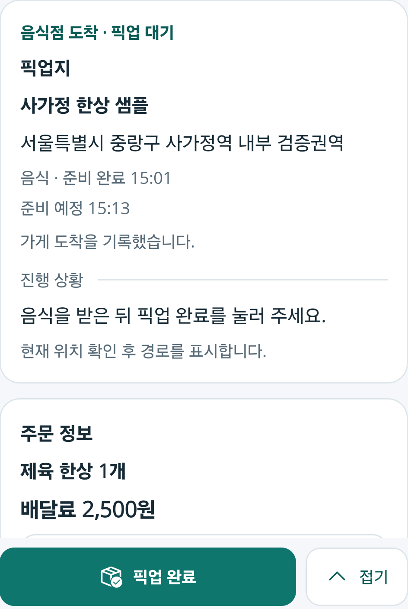
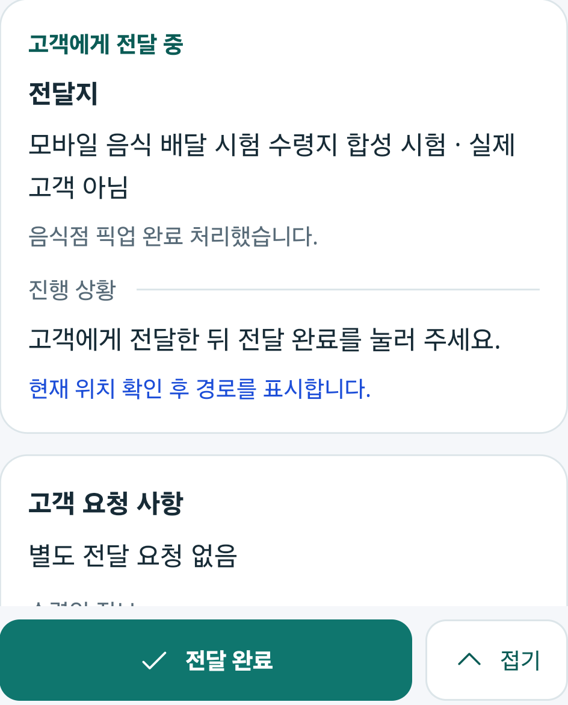

# 휴대폰 화면으로 보는 배차·수행 과정과 디자인 변경

2026-10-16. 기존 실제 휴대폰 캡처에서 검토한 부분을 문서 자산으로 보존했다. 화면을 설명하는 글과 PNG를 함께 Git에서 추적한다. **이번 작업은 기존 화면의 문서화이며 새 APK 제작·설치·업무 재실행은 아니다.**

사진은 격리 서버의 합성 주문·장소로 진행한 실제 앱 화면이다. 실제 GPS, 계정 머리글, 시스템 상태 표시줄, 첨부 식별자와 카메라로 촬영한 사진은 제외하고 필요한 영역만 잘랐다. 표시된 글자·버튼·색을 새로 그리거나 AI로 재구성하지 않았다. 아래에는 확인한 부분과 제외한 부분을 각각 설명한다.

## 먼저 볼 화면과 판본

| 구간 | 화면에서 볼 수 있는 내용 | 당시 앱과 상세 근거 |
| --- | --- | --- |
| 추천 수신 | 운행 화면 위 배너의 추천 건수와 남은 시간 | 화물 APK184, [r69](2026-10-16-recommendation-map-carousel-r69.md) |
| 추천 비교 | 배달료·픽업지·전달지·거절/수락과 선택 핀 | 화물 APK190, [r73](2026-10-16-compact-recommendation-card-design-r73.md) |
| 디자인 전후 | 세로 나열된 카드에서 두 열 배치로, 버튼 색과 높이 변경 | 화물 APK189 → 190, [r72](2026-10-16-direct-recommendation-card-actions-r72.md) → [r73](2026-10-16-compact-recommendation-card-design-r73.md) |
| 화물 수행 | 수락 후 상차 행동 → 사진 필수 → 하차 사진 필수 → 완료 확인 | 화물 APK180의 **같은 사례05**, [r67](2026-10-16-physical-phone-verification-r67.md) |
| 음식 수행 | 음식점 도착/픽업 대기에서 고객 전달 카드로 변경 | 음식 기사 APK178의 **같은 사례02**, [r67](2026-10-16-physical-phone-verification-r67.md) |

서로 다른 판본의 화면을 한 주문의 연속 실행으로 합치지 않는다. 특히 APK190에서는 카드 표시·선택·확인 창 취소·복귀를 확인했으며 실제 수락/거절 확정은 하지 않았다. APK180의 완료 사례가 APK190의 전체 업무 재검증을 대신하지 않는다.

## 추천이 왔을 때 무엇이 보이는가

추천 배너에는 종류·건수·남은 시간이 보이고, 배너를 눌러 별도 추천 지도에서 한 건을 판단하는 구조다. 아래 배너는 APK184, 카드는 APK190에서 관측한 각각의 화면이다.

| 추천 배너 · APK184 | 최신 추천 카드 · APK190 |
| --- | --- |
|  |  |

배너의 원본 지도·GPS와 카드 바깥 지도·인접 카드는 제외했다. 이 잘라낸 사진만으로 전체 화면 비율이나 배너에서 카드로 이동하는 동작을 입증하지 않으며, 이동 관측은 연결된 상세 기록을 따른다.

## 카드를 넘기면 선택한 건을 지도에서 구분한다

| 두 번째 건을 선택한 지도 일부 · APK190 | 세 번째 추천 카드 · APK190 |
| --- | --- |
|  |  |

지도 제공: **NAVER**. 지도 사진은 원본 V07에서 합성 장소 핀이 보이는 영역만 잘랐으며 실제 현재 위치와 그 끝점이 있는 아래쪽은 제외했다. 선택한 두 번째 건의 주황 픽업·파랑 전달과 다른 건의 회색 핀을 볼 수 있다. 오른쪽 V10은 별도 시점의 세 번째 카드다. 양방향 넘김과 카메라 유지 관측은 [r73 기기 기록](2026-10-16-compact-recommendation-card-design-r73.md#apk190-실제-기기-확인)에 남아 있다. 이 지도 일부는 전체 지도 범위·실제 GPS·실제 주행 경로의 검증 자료가 아니다.

## 추천 카드가 어떻게 바뀌었는가

같은 크기의 원본 픽셀에서 카드 부분만 잘랐다. 문서의 두 이미지 폭도 같게 표시해 높이와 정보 배치를 비교할 수 있다.

| 변경 전 · APK189 | 변경 후 · APK190 |
| --- | --- |
|  |  |
| 높이128 DIP, 배달료·주소 세로 배치, 보라 거절·청록 수락 | 높이116 DIP, 왼쪽 배달료/오른쪽 주소, 파랑 거절·주황 수락 |

이 비교는 두 열 배치·여백·버튼 색의 변화다. 양쪽 모두 한 줄 합성 장소이며 긴 실제 주소의 스크롤은 미검증이다. 앞선 [독립 카드 r70](2026-10-16-independent-recommendation-cards-r70.md)와 [지도 우선 r71](2026-10-16-map-first-recommendation-cards-r71.md)의 중간 시도·실패 이력도 기존 문서에 보존한다.

## 화물 기사: 수락부터 완료 후 복귀까지

아래 네 사진은 **모두 APK180의 같은 사례05**에서 확보했다. 화면에 보이는 다음 행동과 제한을 따라 읽으면 된다.

```text
수락한 운송 확인
  └─ 상차 처리하기
      └─ 상차지 도착·확인 → 상차 사진 촬영·첨부 → 상차 완료
          └─ 하차지 도착·확인 → 하차 사진 촬영·첨부 → 하차 완료
              └─ 완료 확인 → 진행 중 운송으로 돌아가 다음 업무 확인
```

| 1. 수락 후 현재 업무 | 2. 상차 사진이 필요한 상태 |
| --- | --- |
|  |  |
| 운임과 `상차 처리하기`를 확인한다. 계정 머리글과 다른 상세 영역은 제외했다. | 사진 촬영 행동이 보이고, 사진이 없으면 `상차 완료`가 비활성이다. 실제 촬영 사진·첨부 식별자는 넣지 않았다. |

| 3. 하차 사진이 필요한 상태 | 4. 하차 완료 확인 |
| --- | --- |
|  |  |
| 하차에도 별도 사진 관문이 있다. 계정·수금 영역·촬영 사진을 제외했다. | `하차 완료를 확인했습니다`와 다음 업무로 돌아가는 행동을 확인할 수 있다. |

사진 첨부·전송과 서버의 `인수완료` 재조회 근거는 [r67](2026-10-16-physical-phone-verification-r67.md#사진-필수-관문과-실제-카메라전송)에 연결돼 있다. 완료 버튼을 누른 직후의 처리 중 사진을 완료 확정 화면으로 쓰지 않았다. **운송 완료와 화주의 별도 수령, 결제·정산·은행 입금은 서로 다른 결과**이며 뒤의 금융 업무까지 완료했다는 의미가 아니다.

## 음식 기사: 픽업 전과 픽업 후 필요한 카드

아래 두 사진은 음식 기사 APK178의 같은 사례02다. 지도/GPS·시스템 정보와 다른 상태 안내는 제외하고 카드와 다음 행동 부분을 남겼다.

| 음식점 도착 · 픽업 대기 | 픽업 후 · 고객에게 전달 중 |
| --- | --- |
|  |  |
| 음식점·준비 상태·주문 정보와 `픽업 완료`를 보여준다. | 전달지·고객 요청사항과 `전달 완료`를 보여준다. |

`사가정 한상 샘플`, `검증권역`, `합성 시험 · 실제 고객 아님`은 시험 자료의 표시다. 실제 매장 주문이나 고객 상세주소가 아니다. 기사 전달 뒤 주문자의 별도 수령 확인과 알림음 청취는 [r67](2026-10-16-physical-phone-verification-r67.md)의 다른 근거로 확인하며 두 사진 자체에 그 완료를 합치지 않는다.

## 화면 자료를 다시 확인하는 방법

- 대표 PNG **11개**와 [이미지 대장](../assets/changes/2026-10-16-phone-ui-progress/manifest.json)을 문서와 함께 보존한다. 대장에는 원본 캡처명·SHA-256, 자른 원본 픽셀 범위, 파생 PNG 해시·크기, 당시 APK, 단계, 상세 변경 기록과 그 커밋을 연결했다. 원본 PNG·UI 덤프·카메라 사진·기기 식별자는 옮기지 않았다.
- 이 문서와 PNG를 받으면 다른 PC에서도 위 표의 화면을 볼 수 있다. 상세 기록의 `artifacts/local/` 링크는 여전히 해당 PC의 비공개 증거이며 Git만으로 함께 옮겨지지 않는다.
- 문서 보완 전 기준 커밋은 `6cea0e9ed72903c2dac4cb5e33576ba6107927f2`다. 당시 제품 소스와 판본별 상세 기록은 `e216cb8d13294fba4bc5d493e6261b6204b7190a` 이력에 있다. 기존 캡처를 이번 문서 커밋으로 남긴 것이며 그 커밋으로 과거 APK를 새로 빌드하거나 시험했다고 표시하지 않는다.
- 이후 화면 변경도 [공통 기록 원칙](README.md#기록-원칙)에 따라 **변경 이유·전후 대표 화면·상태/다음 행동·검증 범위**를 코드 변경과 함께 연결한다. 실제 캡처가 없는 상태는 미검증으로 남기고 임의 시안으로 대체하지 않는다.
