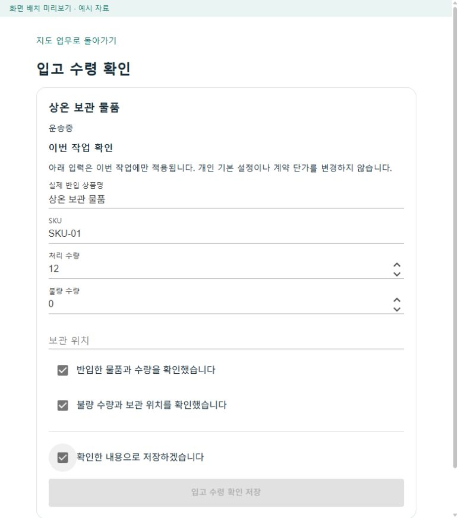
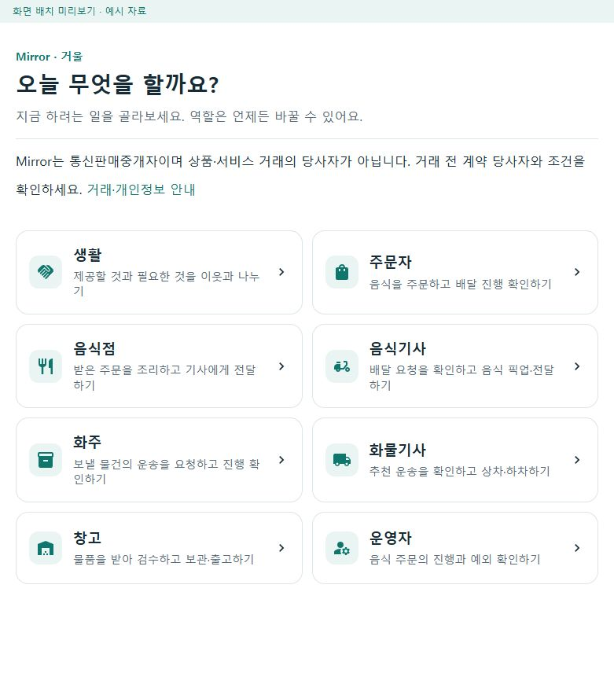
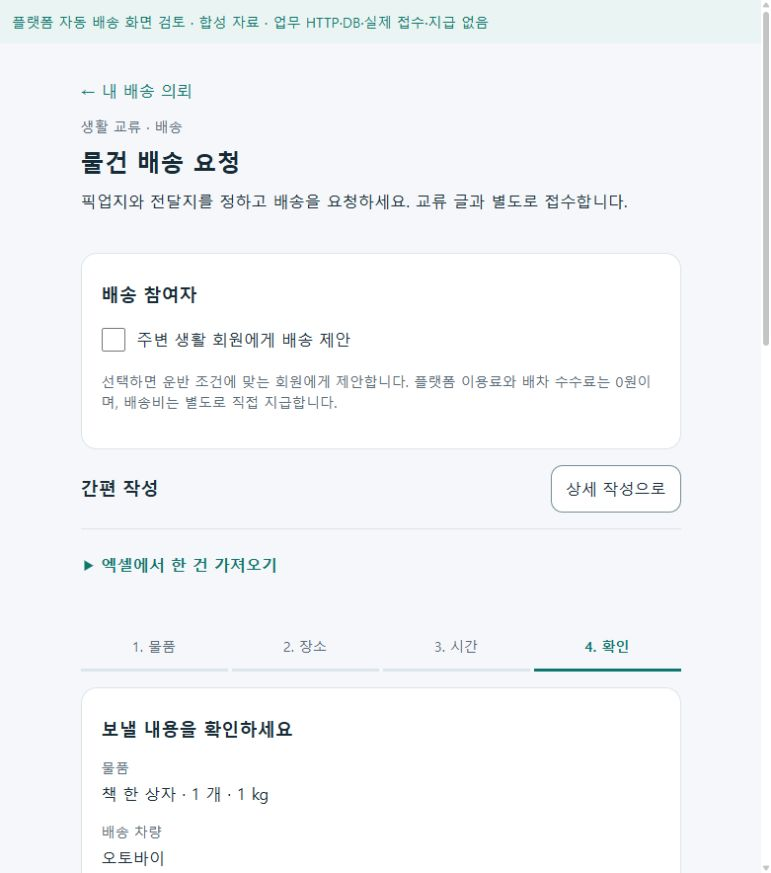

# 화면만 보고 업무를 마칠 수 있는지 점검 r109

2026-10-18. 현재 판정은 **업무별 화면은 갖춰져 있지만, 처음 사용자가 설명 없이 끝까지 진행할 수 있다고 판단하기에는 인계와 복구 안내가 부족하다**이다. 색·여백을 다시 바꾸기보다 시작할 행동, 현재 상태에 맞는 다음 행동, 저장이 막힌 이유를 먼저 보완한다. 이번 작업은 조사·로컬 화면 검증이며 제품 코드를 수정하지 않았다.

기존 [첫 이용 점검 r1](../ProjectOverview/page-docs/first-use-usability-review-r1.md)과 [r108 업무 완주 결과](2026-10-18-local-workflow-recovery-r108.md)를 현재 소스와 다시 대조했다. 서버에서 API를 호출해 완주한 것과 사용자가 화면에서 그 절차를 찾을 수 있는 것은 다르다. 아래의 `화면 확인`은 모의 자료로 실행한 제품 공통 컴포넌트의 관찰이며 실제 처음 쓰는 사람의 시험이나 APK 결과가 아니다.

## 점검 방법과 범위

- 통합 홈의 생활·주문자·음식점·음식기사·화주·화물기사·창고·운영자와 전문 판매자·인력관리자 화면을 소스에서 나눠 검토했다. 통합앱과 전문 앱에 같은 기능이 있다고 가정하지 않았다.
- 최신 공통 UI를 소비하는 기존 `RoleWorkspacePreview`를 빌드하고 격리 사본을 loopback5592에 실행했다. 지도 키·운영 DB는 연결하지 않았다. 소스1,462개·실행 DLL5개의 검사 전후 해시 변화0을 확인했다. 이 개수는 검토한 화면 수가 아니다.
- Codex가 별도 브라우저에서 홈→화주 목록, 음식 주문 필수값 오류, 창고 입고 입력·재확인, 생활 배송4단계 작성, 기사 전달/상대 수령 상태를 직접 조작·관찰했다. 이 브라우저 캡처 파일은 폭771~781px이며 모바일 폭으로 표현하지 않는다.
- 기존 목적의 사용성 검사 스크립트는 무시 폴더의 사본에서 출력 위치와 현행 접힘/선택자 가정만 조정했다. 320/390px **26개 검사 통과·실패0·브라우저 오류0·업무/외부 HTTP0·캡처14장**이다. 이 검사는 상품 준비/오류/복귀·계좌 미확인·음식 주문 필수값을 대상으로 하며 모든 역할·상태를 통과했다는 뜻이 아니다.
- 별도 사람 관찰, 단말 뒤로가기·키보드·카메라·스크린리더·실제 지도·운영 데이터는 미검증이다. 교육 없이 사용 가능한 비율이나 접근성 인증을 산출하지 않았다.

기준은 기존 [역할 앱 시각 기준 r8](../Architecture/RoleAppVisualDesignStandard.md#첫-이용에서-막히지-않는지-확인하는-기준-r8)을 유지한다. 오늘 다시 확인한 [KRDS 버튼](https://www.krds.go.kr/html/site/component/component_05_02.html)과 [GOV.UK 버튼](https://design-system.service.gov.uk/components/button/)은 행동을 예측하는 문구와 주 행동의 구분을, [W3C 입력 결과 안내](https://www.w3.org/WAI/tutorials/forms/notifications/)는 오류·성공과 수정 방법의 안내를 참고했다. 아래의 우선순위와 개선안은 그 원칙을 이 프로젝트에 적용한 판단이다.

## 먼저 보완할 순서

| 순서 | 사용자가 멈추는 장면 | 현재 근거 | 최소 보완 |
|---|---|---|---|
| 1 | 처음 화물기사로 들어왔는데 추천이 없고, 운행·신규 수신을 어디서 켜는지 모름 | **통합앱 소스 확인.** 실제 화물 adapter의 빈 상태에 시작 행동이 없고 공통 운행/수신 제어는 음식기사 전용이다. 전문 DriverApp의 시작 화면이 통합앱에도 연결된 것은 아니다. 처음 빈 상태의 렌더는 대기 | 기존 화물 운행·수신 계약을 이용해 현재 상태와 `운행 시작/신규 배차 받기`로 진입할 수 있게 연결 |
| 2 | 창고에서 배송 초안만 만들었는데 “기사 배차 대기”를 보고 계속 기다림 | **현재 UI 분기와 r108 실제 API 절차 대조.** 운송 ID만 있어도 대기로 설명하지만 실제로는 위치·견적 보완과 승인 전일 수 있다. 현재 preview는 이미 배정된 상태라 이 공백을 렌더로 재현하지 못함 | `조건 보완→운임 확인→승인→기사 배차 대기`를 실제 상태로 구분하고 기존 화주 업무에 인계 |
| 3 | 확인을 다 했는데 저장 버튼이 계속 회색임 | **창고 입고 화면에서 직접 재현.** 체크3개를 선택해도 보관 위치가 비면 비활성이고 부족 이유가 없다. A-01 입력 직후 활성화됐다. 화물 사진·인수증/체크 조건도 소스상 같은 안내 공백 | 기존 저장 조건에서 첫 미충족 항목을 버튼 가까이 설명하고 필수/선택/대안을 표시. 사진·권한 조건을 완화하지 않음 |
| 4 | 실패·부분 성공 뒤 완료 여부나 원래 화면을 찾기 어려움 | **소스 확인·일부 실행 대기.** CSV 부분 실패에도 성공 문구, 판매채널의 존재하지 않는 복귀 경로, 출품 선택 오류 시 폼 숨김/선택 초기화, 화물 완료 응답 유실 뒤 완료 표시 복원 부족 | 결과 미확정은 원 결과 조회부터 안내. 전체/부분 성공을 구분하고 입력을 보존하며 해당 앱의 유효한 복귀 경로 제공 |
| 5 | 간단히 음식 주문하려는데 배송 처리 방식과 여러 조건을 길게 읽어야 함 | **현재 모의 자동 배송 설정의 좁은 폭 렌더 확인.** 390px 기본 상태 전체 문서2,863px, 320px3,064px. 표지/하단 시험 표시 포함이며 모든 주문의 길이가 아님 | 주문 요약·수령 정보·예상 부담·주 행동을 우선 배치하고 배송 상세 조건을 단계/묶음으로 정리. 필요한 비용·동의·미확정 안내는 보존 |
| 6 | 운영자가 예외를 알아도 어디서 처리하는지 다시 메뉴를 찾음 | **소스 확인.** 확인 필요한 운송 카드와 재예약 불가 복구 항목에 원 업무/사건으로 이동하는 연결 부족 | 기존 권한 안에서 원 업무·사건 상세와 다음 담당/확인 행동으로 연결 |

1·2번은 업무 시작/인계 경로, 3·4번은 현장에서 막힌 이유와 결과 복구, 5·6번은 정보 위계와 처리 탐색 문제다. 메뉴를 전부 합치거나 기능을 없애는 방식으로 처리하지 않는다.

### 후속 수정 시 확인할 코드

- 화물 시작: [실제 화물 역할 adapter](../../Ssalddel.Ui.Common/Areas/App/RoleWorkspace/Cargo/CargoWorkspaceAdapters.cs)와 [공통 지도 역할 화면](../../Ssalddel.Ui.Common/Areas/App/RoleWorkspace/Core/RoleMapWorkspace.razor). 통합앱과 전문앱 경로를 나눠 확인한다.
- 창고 초안 인계: [운송 초안 화면](../../Ssalddel.Ui.Common/Areas/App/Components/WarehouseOperations/SsalddelTransportRequestDraftWorkspace.razor)과 r108의 화주 조건 보완/승인 절차를 대조한다.
- 입고 저장 이유: [입고 작업 화면](../../Ssalddel.Ui.Common/Areas/App/RoleWorkspace/Cargo/WarehouseTaskActionScreen.razor)과 [현재 저장 조건](../../Ssalddel.Ui.Common/Areas/App/RoleWorkspace/Cargo/WarehouseTaskActionViewModel.cs)을 같은 근거로 사용한다.
- 결과/복귀: [화주 일괄등록](../../SsalddelApp/Components/Pages/ShipperBulkImportPanel.razor), [판매자 출품 화면](../../SellerApp/Components/Pages/ListingCreate.razor), [판매자 채널 화면](../../SellerApp/Components/Pages/SalesChannels.razor), [판매자 입력 상태](../../SellerApp/ViewModels/SellerSalesPageViewModels.cs)를 각각 보완한다.
- 정보 위계: [음식 주문 작성](../../Ssalddel.Ui.Common/Areas/App/Components/Food/OrdererFoodOrderComposer.razor). 운영자 후속 탐색은 [운영 현황](../../SsalddelAdminApp/Components/Pages/Operations.razor)에서 원 업무로 이어지는지 확인한다.

## 직접 확인한 예

### 입고 작업에서 이유를 모르는 비활성 저장

아래는 확인3개를 모두 선택하고 보관 위치를 비워둔 상태다. 필수 표시나 빠진 항목 안내 없이 저장이 비활성이다.

같은 화면에 A-01을 입력하면 저장이 활성화된다. 저장을 누른 뒤에는 미리보기의 **의도적인 업무 쓰기 차단**으로 일반 오류가 나왔다. 실제 API/서버 실패가 아니다. `현재 상태 다시 확인`을 누르자 A-01과 확인3개가 유지되고 저장이 다시 활성화됐다. 입력 보존과 재확인 행동은 긍정적으로 확인했다.

[입력 보존 후 재확인 화면](../assets/changes/2026-10-18-first-use-r109/warehouse-inbound-rechecked.jpg)

### 이해하기 쉬운 기존 흐름

통합 홈은 역할 이름 옆에 할 일을 설명하고, 생활 배송은 물품→장소→시간→확인으로 나눠 현재 단계와 다음 행동을 보여준다. 시간 확인을 빠뜨리고 다음을 누르면 같은 단계에서 이유를 안내했다. 최종 확인까지 이동했으며 실제 배송 요청은 제출하지 않았다.

| 역할 선택 | 생활 배송 최종 확인 |
|---|---|
|  |  |

음식 주문은 수령인 이름을 비우면 해당 입력과 제출 근처에 부족한 이유를 안내한다. 생활 배송의 `전달 완료·수령 확인 대기`와 `수령 확인됨·배송비 지급은 별도`도 모의 화면에서 서로 다르게 표시됐다. 이런 패턴을 다른 업무에도 맞춰 적용하는 것이 좋다.

[390px 음식 주문 전체 확인 화면](../assets/changes/2026-10-18-first-use-r109/orderer-readiness-390.png)은 선택 정보를 펼치고 필수 이름 오류를 보인 별도 상태이며, 전체 문서 높이는3,053px다. 320px 같은 상태는3,254px다. 위 기본 상태 측정과 합치지 않는다.

## 역할별로 남은 구체 항목

| 역할 | 확인한 남은 항목 | 관찰 수준 |
|---|---|---|
| 생활 이용자 | 간편 작성4단계는 다음 행동과 누락 확인이 분명하다. 실제 가격 확인·접수·복귀까지 첫 이용자 과제로 이어갈 것 | 작성4단계 직접 관찰, 실제 접수 미수행 |
| 주문자 | 자동 배송 조건이 켜진 주문 확인의 정보량·제출까지 스크롤, 비용과 선택의 우선순위 | 현재320/390px 렌더·직접 입력 오류 관찰 |
| 음식점 | 주문 목록의 알림 허용 성공 결과가 닫힌 상세 정보에만 있어 결과를 못 알아챌 수 있음 | 소스 확인, 실제 기기 알림/허용 시험 대기 |
| 음식기사 | 알림 설정 외부 왕복의 같은 계정 미저장 선택 보존은 현재 코드에 보완돼 있음. 과거 r1 위험을 새 결함으로 재사용하지 않음 | 현재 소스 재확인, 단말 관찰 대기 |
| 화물기사 | 통합앱 첫 운행/수신 시작, 사진/필수 체크의 부족 이유, 완료 응답 유실 후 정본 완료/다음 업무 표현, 내역 메뉴 맥락 | 진행 화면 관찰·시작/오류 경로 소스 확인 |
| 화주 | CSV 부분 성공/미확정, 상세의 내부 용어·원시 오류 메시지, 창고 초안 인계 | 소스 확인·지도 불가 시 목록 전환 직접 관찰 |
| 창고 | 필수 보관 위치 안내, 초안과 배차 대기의 구분, 예시 식별값을 전제로 하는 시작 경로 | 보관 위치 문제 직접 재현·나머지 소스 확인 |
| 판매자 | 채널 복귀 경로, 출품 입력 오류와 조회 실패의 분리, 저장 미확정 결과 확인 | 소스 확인, 해당 전문 앱 렌더/응답 유실 대기 |
| 인력 관리자 | 긴 필터와 명단이 한 흐름에 있어 주 행동/현재 선택을 놓칠 위험 | 소스만 확인, 좁은 폭 넘침을 재현했다고 보지 않음 |
| 운영자 | 알림 확인/재예약/업무 해결의 구분은 유지. 원 업무·사건으로 바로 이동하는 연결이 부족함 | 소스 확인, 실제 권한별 과제 관찰 대기 |

추가 용어 후보는 SKU·시간창·처리처·운영체제·workflow·endpoint 등이다. 전문 업무에서 필요한 용어는 의미를 함께 설명하고, 사용자 판단에 필요 없는 구현 설명은 기본 화면에서 줄인다. 확인되지 않은 가격·위치·완료 상태를 만들거나 중요 경고를 숨기지 않는다.

## 검증 기록의 한계와 보존

- 26개 검사 통과는 일부 기존 회귀의 결과다. 모든 역할을 처음 사용하는 사람이 혼자 완주했다는 결론이 아니다. 전체 route 수를 사용성 점수로 바꾸지 않았다.
- 초기 자동 검사 실패는 구형 시험이 선택 입력을 기본 노출로, 두 입력 묶음을 하나로, HTML 접기를 특정 ARIA 역할로 가정한 차이였다. 실패 원본과 수정된 검사 사본의 해시를 남겼다. 별도 구형 자동 배송 시험도4단계 첫 화면에서 마지막 동의를 찾다 중단됐으며 제품 결함으로 세지 않았다.
- 화물 첫 빈 상태는 preview의 허용 시나리오에 없다. `?scenario=empty`를 넣으면 기본 진행 상태가 되므로 그 화면을 시작 문제의 재현으로 쓰지 않았다. 화물 상차 직접 진입 시 브라우저 도구의 `ERR_BLOCKED_BY_CLIENT`도 있었으며 제품 오류로 판정하거나 다른 경로로 우회하지 않았다.
- 지도 키가 없는 미리보기의 빈 지도/목록 대안은 실제 SDK 품질 검증이 아니다. 기존에 승인한 전체 지도·독립 카드·추천 색/넘김·고정 글자 크기를 변경하지 않았다.
- CUA 스크롤 후 흰 캡처1장은 관찰 도구의 표시 한계로 제외했다. JPEG 바이트를 처음 `.png` 이름으로 저장한 생성 캡처는 확장자만 바로잡았고 재인코딩·픽셀 변경은 없다. 문서 대표5장의 원본/사본 해시는 [대장](../assets/changes/2026-10-18-first-use-r109/manifest.json)에 기록했다.
- 비공개 조사·소스 해시·수동 관찰·초기 실패·최종 회귀는 `artifacts/local/usability-review-r109/`에 보존한다. `orderer-restaurant-seller.json`, `driver-admin.json`, `shipper-warehouse-hr.json`, `manual-walkthrough.json`, `workspace/usability-browser-r3/result.json`을 구분한다. 현재 자료로 새 APK·DB·서버 업무·실결제·운영 플래그·commit/push를 만들지 않았다.
- 검증용 브라우저 탭과 소유권을 확인한 전용5592 서버만 종료했다. 종료·포트 해제는 `workspace/server-stop.json`, 최종 소스/실행 파일 해시 대조는 `workspace/source-binary-final.json`에 보존했다. 다른 서버·DB는 조작하지 않았다.

## 다음 관찰 시험

먼저 위1~4번의 진행/복구 공백을 보완하고, 프로젝트 설명을 듣지 않은 사람에게 아래 과제만 준다. 안내자는 화면 사용법을 알려주지 않고 막힌 위치를 기록한다. 이는 제안한 시험 방식이며 이번에 실제 참가자 시험을 진행한 것은 아니다.

1. 기사: 처음 로그인한 계정으로 배차 받기를 시작하고 한 건의 사진·전달·완료 내역을 찾는다.
2. 창고/화주: 출고 초안에서 조건 보완·견적·승인을 거쳐 현재 누구를 기다리는지 설명한다.
3. 주문자/음식점: 주문 중 입력 하나를 고치고, 음식점은 수락·기사 배정·조리·픽업 준비를 진행한다. 주문자는 전달과 수령을 구별한다.
4. 판매자: 출품 선택 하나를 빠뜨렸다가 제자리에서 고치고 같은 작업으로 돌아온다.
5. 운영자: 예외 알림을 보고 원 업무로 이동해 필요한 다음 조치를 찾는다.

과제별로 **도움 없이 완료했는지·처음 멈춘 화면·오선택/되돌아감·입력 재작성·완료 오해·설명 요청**을 기록한다. 통과 시간·대상자 수·관찰 방식의 구체 수치는 실제 시험을 준비할 때 합의하며, 이번 코드/화면 감사로 임의의 합격률을 만들지 않는다.
