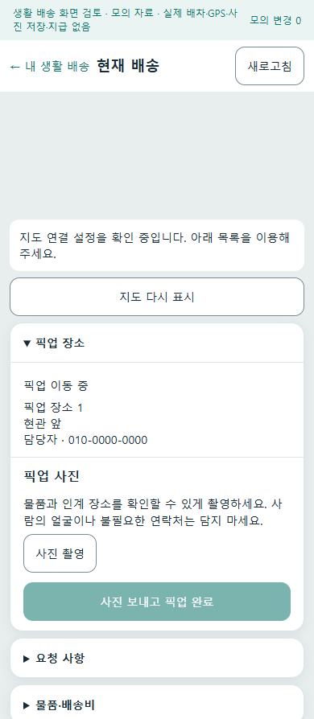
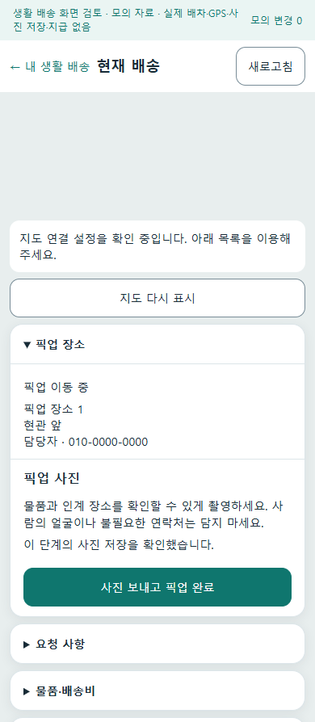
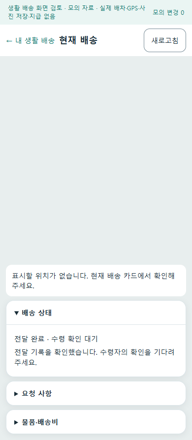

# 로컬 업무 완주와 화물 수락 후속 복구 r108

2026-10-18. 사용자 승인 범위는 최신 앱·서버의 업무 완주 검증과 중단·응답 유실 복구다. 실제 지급·외부 공개·클라우드 배포·기기 설치는 포함하지 않는다. 사용자는 이번 실행에서 로컬 검증만 진행하도록 선택했다. 기존 [통합 공개 r105](../AI/Planning/공통/PLAN-OPERATIONS-NEIGHBORHOOD-MICRO-HUB/integrated-public-release.r105.md)의 역할 인계·예외 검증을 이어간다.

상태: `ImplementedWithinScope / CompletedLocalBoundedVerification / LocalApkPrepared / DeviceDeferred / OperationalDisabled`. 창고 초안 화면 인계·일시적 DB 연결 오류 원인·실기기/운영 검증은 아래 후속 항목을 따른다.

[종합 검증 기록](../../artifacts/local/workflow-closeout-r108/final-verification.json)은 아래 시험·API/DB·앱·화면·APK 근거의 경로와 해시를 연결한다. 로컬 시험 산출물이며 저장소의 깨끗한 기준 판본이나 운영 완료 인증이 아니다.

## 보완하는 문제

기존 화물 수락은 배정 SQL commit 뒤 시간약속 잠금·후속 사건 발행을 시도했다. 그 사이 프로세스가 중단되면 이미 배정된 원장은 남아도 후속 의도가 없을 수 있었고, 같은 기사의 중복 수락은 성공만 반환했다. 이미 생성된 알림 Outbox의 발송 재시도와, Outbox를 만들기 전의 유실은 구분한다.

새 테이블 대신 기존 운송 이벤트에 수락 후속 의도를 배정과 같은 transaction으로 저장한다. 정상 수락 뒤 즉시 처리·동일 본인 수락 명령의 멱등 재호출·명시적 복구 서비스·기본 OFF인 복구 worker가 같은 의도를 재사용한다. 일반 GET 재조회는 현재 상태 확인만 하며 후속 처리를 실행하지 않는다. 현재 의뢰·기사·추천 차수·수락 세대를 확인하고 시간약속·알림 Outbox·완료 표식을 같은 SQL 변경으로 마감한다. 새 수락이나 취소 뒤의 과거 의도는 보류하며 실제 발송·금융 효과를 만들지 않는다.

## 검증 구분

```text
현재 소스
├─ 서버 집중 회귀: 저장 직후 중단·새 Context·중복·경합·단계 실패·실행 경계
├─ 격리 로컬 API/실제 DB: 정상 업무의 접수·수락·증빙·전달·별도 수령
└─ 앱 공통 VM/HTTP client: 응답 유실·요청 보존·정본 재조회·복귀

별도 미검증
└─ Android 실행·카메라·실제 GPS·기기 알림/청취·실수납·실송금·외부 공개
```

각 실행의 실제 결과·소스/바이너리·SQL/Mongo·합성/외부 어댑터 범위는 `artifacts/local/workflow-closeout-r108/`와 각 실행기 결과에 따로 보존한다. 기존 r67 전문 앱 수행과 r106 통합앱192 푸시 기록을 이번 최신 판본 완주로 합치지 않는다. 새 로컬 DB의 현재 모델 생성은 운영 migration 적용 증거가 아니다.

## 함께 드러나 보완한 연결 문제

창고 출고가 만든 운송 초안에 창고의 저장된 좌표가 빠져 있었고, 위치·견적을 채우기 전에 승인하면 수정이 잠겨 배차로 진행할 수 없었다. 확인된 창고 좌표만 초안에 복사하고, 창고 출고 연계 의뢰는 상하차 좌표·저장 운임·거리·기사 보수·결제 예정액의 연결을 승인 전에 검사한다. 부족하면 409로 안내하며 기존 화주 상세에서 조건과 견적을 보완한 후 다시 승인한다. 주소로 좌표를 추정하거나 일반 화물·음식의 승인 조건을 넓히지 않는다.

공통 앱 HTTP client가 서버의 `code` 오류 항목을 읽지 못해 일부 구조화된 404 오류를 단순 사진 미등록으로 처리할 수 있었다. 기존 `errorCode` 우선순위와 오류 값은 보존하면서 `code`도 읽는다. 개인정보 보호를 위해 빈 404를 반환하는 증빙 조회 계약은 변경하지 않는다. 존재하지 않는 업무를 그 조회에서 `MemberWorkNotFound`로 받을 것이라 가정한 초기 보조 시험은 실패 이력으로 보존하고 실제 계약에 맞춰 정정했다.

창고 정상 사례에서 거리만 보낸 사전 견적과 좌표가 있는 저장 견적의 차이도 드러났다. 서버는 서로 다른 운임을 `WarehouseReconsignmentFareChanged`로 막고 초안 수정은 유지했다. 앱의 기존 신규작성 기준운임 버튼에는 차량·거리와 함께 공급된 상하차 위치·추가비 조건을 기존 견적 DTO로 전달하도록 연결했다. 초안 왕복·신규등록 인계에서도 공급된 좌표를 보존하고, 주소가 바뀌면 그쪽 좌표를 지운다. 이 견적 실패를 샘플 금액으로 대체하지 않으며 기존 지급 예정액을 자동 변경하지 않는다.

이는 기존 창고 초안 상세 화면의 수정→견적→승인 인계를 구현했다는 뜻은 아니다. 해당 상세/CRUD에는 이 기준운임 버튼의 소비가 없으며, 신규 화면이나 주소→좌표 해소를 이번에 추가하지 않았다. 서버의 창고 API 정상 완주와 앱 신규작성 조건 전달의 회귀를 구분한다.

## 업무 절차와 복구 위치

```text
접수
├─ 음식: 주문 → 음식점 수락 → 기사 배정 → 조리 → 픽업 → 전달
│                                                   └─ 주문자 수령 확인 → 정산 조회
├─ 퀵·화물: 운송 접수 → 추천 → 기사 수락 → 상차 사진·상차 → 하차 사진·전달
│                         │                               └─ 지급 준비 조회
│                         └─ 수락과 후속 의도를 함께 저장
│                            ├─ 정상: 시간약속·알림 의도 준비
│                            └─ 실패: 같은 의도 재개 / 기존 관리자 복구 목록
├─ 창고 출고 연계: 초안 → 위치·견적 보완 → 승인 → 배차 → 운송 → 출고 원장 확인
└─ 생활 배송 앱: 제안 → 수락 → 픽업 사진·완료 → 전달 사진·완료 → 상대 수령 확인
                  └─ 응답 유실: 보관한 요청 ID로 정본·증빙 조회 → 같은 업무 재개
```

위 트리는 서로 다른 전문 원장의 업무를 한 상태로 합치지 않는다. 기사 전달, 수령자 확인, 지급 준비, 실제 지급은 각각 별개다. 수락 후속 복구의 `Done`도 현재 설정에서 필요한 준비 완료이며 실제 알림 수신이나 배송·송금 완료가 아니다.

## 대표 화면

다음은 제품의 공통 Razor 화면·ViewModel에 모의 데이터를 넣은 로컬 브라우저 390px 캡처다. 실제 DB를 따라간 HTTP 검증과 별도의 화면 검사이며 Android 화면·네이버 지도 SDK·GPS·실제 카메라 검증이 아니다. 화면 위 모의 자료 표시와 지도 미연결 안내를 그대로 보존했다.

| 픽업 사진 저장 전 | 저장 확인 후 | 전달 완료 후 |
|---|---|---|
|  |  |  |

대표 세 장은 원본과 같은 해시로 복사했고 Codex가 각각 직접 검토했다. [출처·범위·SHA-256 대장](../assets/changes/2026-10-18-local-workflow-r108/manifest.json)을 보존한다. 전체 사람 검수나 실기기 검증으로 표시하지 않는다.

## 운영 경계와 남은 검증

- 수락 복구 worker의 기본값은 OFF다. 운영 모드·기능 경계는 기존 정책을 따르며 이번 시험은 이를 자동 활성화하지 않는다.
- 관리자 재예약은 기존 권한으로 현재 실패 판본만 받는다. 취소·재배정된 과거 수락은 조회 전용이다. 재예약 commit의 응답까지 끊기면 성공 응답을 재생하는 기능은 없으므로 새로 조회해 현재 상태를 확인한다.
- 실제 로컬 DB는 새 시험 DB이며 기존 데이터를 초기화하지 않는다. 외부 지도·실제 FCM·클라우드·수납·송금은 사용하지 않는다. 알림은 로컬 대체 발송기로만 확인한다.
- 생활 배송의 경로 제공자 관문은 합성 경로 어댑터로 검증한다. `memberProviderRouteGuardEmulated=true`, `actualRouteVerified=false`이며 실제 도로 경로 확인이 아니다.
- 실제 업무 worker 상시 실행·프로세스 강제 종료의 모든 지점·DB 장애 복구·운영 migration·외부 HTTPS·Android 종료/재시작·보안 저장소·잠금·실기기 사진/배너/알림음·실지급은 후속이다.
- 다음 화면 보완은 기존 창고 초안의 상세→수정·견적·승인 인계다. API에서 성공한 절차를 앱에서 실제로 밟는 검증이 필요하다. 현재 신규작성의 확인된 좌표 보존을 실제 주소 선택/지도 좌표 해소까지 구현한 것으로 보지 않는다.

## 실행 결과

| 검증 | 결과와 실제 범위 | 비공개 로컬 증거 |
|---|---|---|
| 앱 견적 연결 보완 전 집중 회귀 | 전체 역할 앱 빌드·234개 시험 통과, 실패·생략 0 | `artifacts/local/validation/20261018-210144/` |
| 앱 견적 연결 보완 전 전체 회귀 | 전체 역할 앱 빌드·12,509개 시험 통과, 실패0·환경 의존16개 생략. 검사한 제품·시험22파일의 실행 중 해시 변화0 | `artifacts/local/validation/20261018-210507/` |
| 음식 업무 | 접수·기사 수락 응답 유실 후 재조회, 서버 재시작 후 조리·픽업·전달·주문자 별도 수령·정산 조회 | `artifacts/local/integrated-workflow-r108/46d8388bbe50489cba65941341aa1a77/workflow/food.json` |
| 퀵·화물 업무 | 수락·상하차 합성 사진 HTTP 업로드·전달·지급 준비 조회. 실제 지급 없음 | 같은 폴더 `quick.json` |
| 알림 의도 | 제품 추천 Outbox→로컬 가짜 발송기→제안 조회·수락. 두 번째 처리에서 추가 발송 0 | 같은 폴더 `food-notification.json` |
| 수락 후속 장애 | 알림 Outbox INSERT 1회 실패 후 수락 보존·Retry 확인. 후속 재개 두 번으로 알림 수 1→2→2, 중복 추가 0 | 같은 폴더 `quick-fault.json` |
| 창고 출고 연계 | 준비 누락 승인409·화주 수정/같은 좌표 견적·승인·추천·수락 응답 유실/조회 복구·인계 전 픽업409·창고 인계·상하차 사진·전달·정산 조회, 출고 movement/history 각1. 입고·피킹·포장 전 과정은 별도 | `artifacts/local/integrated-workflow-r108/1f443a979b5947eca2add4b2a32ddab4/workflow/warehouse.json` |
| 실제 앱 공통 VM·HTTP | 43개 검사 통과. 수락·픽업 사진·픽업 완료·전달 사진·전달 완료의 성공 응답 5회 유실 후 새 VM/세션·보관 요청·GET/증빙 영수증으로 복구. 실제 업무 POST 5회·복구 재전송 0 | `artifacts/local/local-operations-r108/mobile/http-clean-01/verification.json` |
| 별도 수령·DB 대조 | 위 VM 전달 완료와 분리하여 제공자 완료 제안→수령자 확인·같은 요청 재생. SQL `Delivered` revision7·사진2·증빙 영수증2·수령 영수증1·활성 수행 해제, 저장 사진 해시2/2 일치·Mongo 보호 문서 revision11 확인 | API 실행 폴더 `workflow/member-clean-after-receipt.json` |
| 모의 화면 | 제품 Razor/VM 32개 상태·연속 흐름2개·캡처40장·실패0. 320/390px, 업무·외부 HTTP 요청0. 위 실제 DB 흐름과 별도 | `artifacts/local/local-operations-r108/mobile/ui-02/verification.json` |
| 화주 신규작성 견적 조건 | 실제 작성 VM·서버 adapter의 요청 직렬화·초안/등록 인계 6개 회귀 통과. HTTP 응답은 모의이며 실제 도로 운임 확정 시험이 아니다 | `Ssalddel.Tests/Clients/ShipperFareEstimateConditionsTests.cs` |
| 견적 보완 포함 집중 회귀 | 전체 역할 앱 빌드·291개 시험 통과, 실패·생략0 | `artifacts/local/validation/20261018-211249/` |
| 최종 전체 회귀 | 전체 역할 앱 빌드·제품 시험12,515개 통과, 실패0·환경 의존16개 생략. 최종 소스/시험30파일의 실행 중 해시 변화0 | `artifacts/local/validation/20261018-211440/` |

HTTP 시험에서 미확정 요청은 로컬 DataProtection 파일에 보관하며 사진 원문·토큰 평문을 넣지 않았다. 이것은 MAUI SecureStorage나 Android 프로세스 재시작 시험이 아니다. 이번 생활 배송 DTO는 제품 계약상 전송 암호화를 요구하지 않아 암호화 모듈 호출은 0회다. 보호된 미확정 요청 파일의 복구와 DTO 전송 암호화 검증을 혼동하지 않는다.

서버는 loopback `5378`, `Simulation`에서 실행하고 HostedService를 모두 제거했다. 추천은 단발 제어로 실제 제품 후보 정책을 호출했다. 수락 후속 복구도 명시적인 제품 서비스 호출이며 주기 worker 상시 운영을 검증한 것이 아니다.

서버 정상 흐름·수락 후속 장애·별도 수령·재시작 후 DB/파일 유지의 결속은 API 실행 폴더의 `integration-summary-final.json`·`source-binding-final.json`·`host-binary-r108-final.json`에 기록했다. root가 결속된 소스21개의 현재 해시 변화0을 확인했다. 시험 뒤 소유 PID·DLL 경로·포트 확인 후 전용 서버만 종료했고 DB·사진·키링·로그는 유지했다. `server-stop-final.json`은 실제 서버 종료 기록이며 다른 서비스나 기존 DB를 정리한 것이 아니다.

초기 잘못된 앱 키·프로필 누락·깨진 합성 PNG의 정규화 거절·helper의 404 가정 오류·경로 어댑터의 실제 경로 관문 차단·로그인 429·준비 전 창고 승인 정체 기록은 지우지 않았다. 최초 사진은 1×1이라는 크기만의 문제가 아니라 IDAT CRC 오류가 있는 잘못된 시험 파일이었다. 정상 자료·정상 입력 절차로 다시 검증했으며 보안·사진·경로·요청 제한 관문을 완화하지 않았다. 신규 모의 업무 준비 중 Mongo 연결 409는 같은 DB·키링으로 서버를 다시 시작한 뒤 회복했지만 최초 원인은 `Unknown`으로 남긴다. 이 결과로 장시간 DB 연결 안정성을 인증하지 않는다.

앞선 집중94개·전체12,475개, 이후 집중234개·전체12,509개 결과도 각각의 판본으로 보존했다. 최종 결과는 위 291개/12,515개이며 기존 컴파일 경고까지 0개라고 주장하지 않는다. 앱 견적 조건 보완 후 서버 제품 소스는 변경되지 않았고, 서버 API 결속과 앱 HTTP/모의 화면 결과를 같은 실기기 실행으로 합치지 않는다.

## 로컬 시험 APK

- [통합 시험 APK193](../../artifacts/local/local-operations-r108/mobile/apk/0.1.193-193/handoff/shipper-usb-debug.apk): 버전 `0.1.193`/code193, Debug. 기존192와 동일 서명·정렬·`arm64-v8a`/`x86_64`를 확인했다. 파일 SHA-256은 `ce9045dbf520c72c5de74c2afe1ddda11d45b12c55c1166f7e5b510b1dab4623`이다.
- 빌드 입력3,050파일 fingerprint의 빌드 중 변경0, 이번 typed 견적/좌표 관련7소스의 현재 해시 일치를 확인했다. 두 ABI의 실제 APK payload에서 새 오류 판독·견적 DTO/좌표 접근자·공용 Draft/작성VM 좌표 setter를 확인했다. 별도로 root도 APK 파일 해시와 최종 검증30파일의 빌드 후 변화0을 확인했다. 근거는 `artifacts/local/local-operations-r108/mobile/final-apk-payload-verification.json`이다.
- 주소는 기존 USB 로컬 시험 계약인 `http://127.0.0.1:5363/`를 유지한다. 이번 API 하네스의 `5378`을 APK에 넣지 않았으며 휴대폰과 이번 서버가 통신했다는 뜻이 아니다. 다음 USB 시험에서 서버 실행·연결을 따로 확인해야 한다.
- APK 생성·서명/탑재 검사까지만 수행했다. 휴대폰 설치·실행·실제 사진/알림·업로드·외부 배포는 수행하지 않았다. 기존 APK192·시험 DB·실패 기록·개인 설정은 보존했다.
