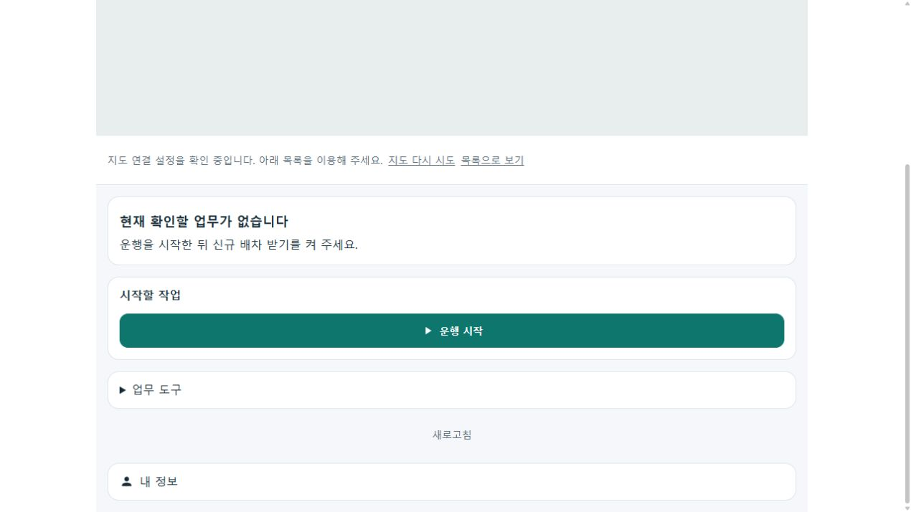
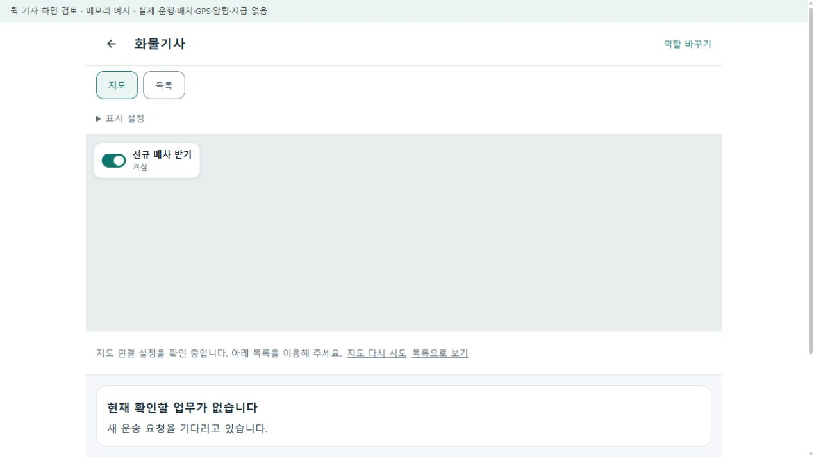
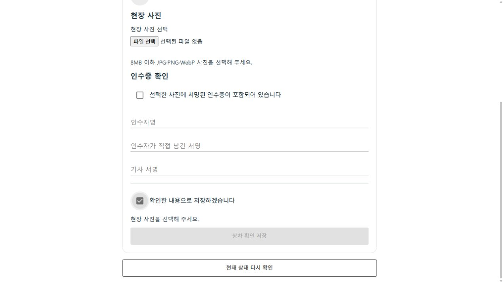
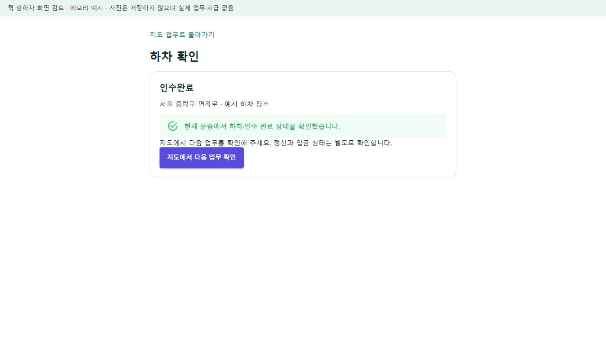

# 퀵 기사 업무 시작·픽업·전달 안내 r110

2026-10-18. 사용자는 [화면 점검 r109](2026-10-18-first-use-task-audit-r109.md) 후 퀵 배송을 우선해 구현하도록 요청했다. 이번에는 **통합앱 퀵/화물기사의 업무 시작, 본인 신규 배차 수신, 상하차 준비 이유, 완료 결과 재확인**을 기존 계약에 연결했다. 페이지 책임과 접수 원천별 차이는 [r110 책임 카드](../ProjectOverview/page-docs/quick-driver-usability-r110.md)가 소유한다.

## 바뀐 사용 흐름

```text
퀵/화물 기사 지도
├─ 아직 운행 전 → 운행 시작
│  ├─ 현재 위치 확인 실패 → 권한·GPS 확인 안내, 시작 요청 안 보냄
│  └─ 서버 운행 확인 → 신규 배차 받기는 본인 토글로 켬
├─ 운행 중 → 기존 신규 배차 토글 / 현재 운송
│  ├─ 진행 운송 있음 → 먼저 그 업무 처리, 운행 종료 차단
│  ├─ 위치 갱신 실패 → 안내, 현재 업무를 완료로 바꾸지 않음
│  └─ 음식·미확인 유형 근무 → 퀵 운행·수신 임의 변경 차단
├─ 상차/하차 확인
│  ├─ 사진·현장 확인·인수증 조건 부족 → 저장 옆에 첫 부족 항목 안내
│  ├─ 준비 완료 → 기존 사진 업로드와 해당 단계 완료 요청
│  └─ 응답 유실 → 같은 운송 현재 상태부터 재조회
└─ 정본에서 상차/인수 완료 확인 → 다시 저장하지 않고 지도에서 다음 업무 확인
   └─ 정산·입금 완료와는 별개
```

새 배차 엔진·화물 원장·운임 계산·정산 정책을 만들지 않았다. 수락 추천의 독립 카드·색상·지도와 기존 음식기사 동작을 보존했다. 기존 기본 OFF 기능·worker와 서버 권한·사진 증빙·서명 규칙은 그대로다.

## 구현 경계

- `CargoDriverWorkSession`이 기존 화물 근무·위치·수신 API의 현재 상태를 읽는다. 지도 좌측 신규 수신 토글을 같은 표현으로 사용하고 운행 종료는 내 정보에 둔다. 수신을 자동으로 켜지 않는다.
- 시작·수신·종료 결과가 불명확하면 현재 상태 확인으로 복구하며 POST/PUT을 자동 재전송하지 않는다. 기존 서버의 명시적 시작 거절 표식과 같은 요청 ID를 확인한 경우에만 거절로 구분한다. 다른 요청의 거절을 새 요청에 재사용하지 않는다.
- 위치 확인과 전송은 기존 전경 갱신 주기를 사용한다. 백그라운드 GPS, 앱 종료·객체 폐기·재로그인 뒤의 영속 복구를 새로 보장하지 않는다.
- `CargoTransportActionViewModel`의 기존 저장 조건으로 첫 부족 항목을 산출한다. 조건을 낮추거나 사진 대신 체크만으로 저장하지 않는다. 이전 입력의 저장 성공과 현재 정본에서 확인한 완료를 별도 상태로 둔다.
- 취소·운영 검토·미확인 단계·조회 실패·개인정보 제공 보류를 상차/하차 완료로 해석하지 않는다. 오류 원문·사진·고객 정보를 새 기록에 추가하지 않는다.

## 검증

최종 Fast 집중 **193개 통과·실패/생략0**, Task 제품 전체 **12,568개 통과·실패0·환경 의존16개 생략**이다. Task는 `Ssalddel.v3.5.slnx` 빌드와 전체 제품 시험을 실행했으며 빌드 오류0·경고145다. 실제 TRX의 개별 `NotExecuted`16건과 시험 로그를 대조했으며 집계 속성의 `notExecuted=0`만으로 생략0이라고 기록하지 않았다.

- 집중 검증: `artifacts/local/validation/20261018-215336/`; 전체 검증: `artifacts/local/validation/20261018-215502/`.
- 수정 소스/시험/미리보기21파일의 검사 전후 SHA-256 변화0이다. 기존 dirty280파일을 기준으로 허용 범위 밖의 삭제/변경0을 확인했다. 생성 색인 갱신은 별도다.
- 독립 검토에서 이전 시작 요청의 명시 거절 표식이 새 요청에 남을 수 있음을 찾아 초기화와 순차 요청 회귀를 추가한 뒤 위 최종 시험을 실행했다. 401/403, 다른 근무 유형, 위치 실패, 중복 요청 금지, 사진·인수증 조건, 정본 완료·취소/조회 실패의 분리도 검사했다.
- 현재 의존 DLL을 다시 쓰지 않는 방식으로 공통 UI 소비 미리보기를 빌드했다. 오류0·기존 SQLite 의존성의 NU1903 경고1이 남았다. 실제 소비한 공통 DLL 해시를 현재 제품 출력과 대조했다. 미리보기는 운영 DB/실제 API에 연결하지 않는다.
- 브라우저에서는 운행 시작 후 수신 OFF 유지→본인 토글 ON, 사진 없는 저장 안내, 완료 후 다음 업무 링크, 위치 권한 실패 안내, 시작 응답 유실→정본 조회 복구, 업무 중 내 정보의 운행 종료 비활성을 직접 조작·관찰했다. 저장한 캡처9장 중 대표8장을 문서에 보존한다. 사진 선택/카메라·실제 업로드는 브라우저에서 실행하지 않았으며 관련 요청 재전송 검사는 단위시험 결과다.
- 캡처는 데스크톱 검토 호스트다. Android·좁은 휴대폰 화면·실제 SDK 지도/GPS·FCM·서버 DB 완주나 실수납/송금의 증거가 아니다. 독립 상하차 검토 호스트의 테마를 앱 최종 색상 검증으로 확대하지 않는다.
- 이번 전용5593 서버와 생성한 검증 탭만 종료하고 포트 해제를 확인했다. 다른 서버·DB는 조작하지 않았다. 임시 원시 자료·소스/실행 결속·수동 관찰·종료 기록은 `artifacts/local/quick-usability-r110/`, 기사 제어의 변경 전 사본은 `artifacts/local/usability-review-r110/`에 보존한다.

초기 Fast는 코드 지도 도구의 복원 자료가 없어 중단됐다. 복원 후에는 기존 Outbox 소스 줄번호와 생성 색인이 다른 것을 검출했다. 기존 생성본을 보존하고 전용 생성기로 두 문서의 참조 줄번호만 갱신했으며, 이를 제품 기능 실패로 합산하지 않는다.

### 대표 화면

아래는 실제 공통 컴포넌트에 연결한 **로컬 메모리 예시**다. 지도 키를 연결하지 않아 빈 지도와 목록 대안이 표시된다. 기존 실제 SDK 지도의 준비/작동 여부는 이 화면으로 판정하지 않는다. 원본·사본 해시와 관찰 범위는 [대장](../assets/changes/2026-10-18-quick-driver-r110/manifest.json)에 기록했다.

| 시작할 행동 | 본인이 켠 신규 수신 |
| --- | --- |
|  |  |





[위치 권한 안내](../assets/changes/2026-10-18-quick-driver-r110/06-location-denied.jpg) · [시작 결과 미확정](../assets/changes/2026-10-18-quick-driver-r110/07-start-response-lost.jpg) · [조회 후 복구](../assets/changes/2026-10-18-quick-driver-r110/08-start-recovered.jpg) · [수행 중 종료 차단](../assets/changes/2026-10-18-quick-driver-r110/09-active-stop-blocked.jpg)

### 주요 코드

- [운행·수신 세션](../../Ssalddel.Ui.Common/Areas/App/RoleWorkspace/Cargo/CargoDriverWorkSession.cs), [기존 화물 API](../../Ssalddel.Ui.Common/Areas/App/RoleWorkspace/Cargo/CargoWorkspaceApiClients.cs), [화물 역할 adapter](../../Ssalddel.Ui.Common/Areas/App/RoleWorkspace/Cargo/CargoWorkspaceAdapters.cs).
- [공통 지도](../../Ssalddel.Ui.Common/Areas/App/RoleWorkspace/Core/RoleMapWorkspace.razor), [기존 토글의 역할별 행동 키](../../Ssalddel.Ui.Common/Areas/App/RoleWorkspace/Core/FoodDriverDispatchToggle.razor), [명시 거절 표식 전달](../../eng/role-workspace/RoleWorkspaceAccess.cs).
- [상하차 상태/준비 안내](../../Ssalddel.Ui.Common/Areas/App/RoleWorkspace/Cargo/CargoTransportActionViewModel.cs), [상하차 화면](../../Ssalddel.Ui.Common/Areas/App/RoleWorkspace/Cargo/CargoTransportActionScreen.razor).
- [기사 시작·수신 회귀](../../Ssalddel.Tests/Ui/Common/CargoDriverStartReceptionR110Tests.cs), [상하차 회귀](../../Ssalddel.Tests/Ui/Common/CargoTransportActionUsabilityTests.cs).

## 다음 퀵 우선순위

후속 사용자 요청으로 [기기별 마감 범위 r111](../ProjectOverview/page-docs/quick-driver-usability-r110.md#기기별-마감-범위-r111--2026-10-18-사용자-확정)을 우선한다. 화주는 데스크톱·모바일, 기사는 모바일 수행을 기준으로 나누며 아래 업무 공백은 해당 기기 책임에 맞춰 처리한다.

1. 보내는 사람의 접수 원천과 결제/승인 방식에 맞는 다음 행동을 연결한다. 일반인 간편 퀵의 직접 현장지급과 일반 화주 의뢰의 선결제·플랫폼 수납, 기존 후불승인을 같은 방식으로 표시하지 않는다.
2. 기존 후불승인 화면을 추가하기 전 서버의 현재 권한·모의 처리 제외·준비 상태를 안전하게 판독하는 계약부터 보완한다. 지금 부족한 값을 추정해 승인 버튼을 노출하지 않는다.
3. 같은 실행의 접수→추천→수락→픽업→전달→내역을 로컬 서버와 앱에서 다시 대조하고, 이후 USB 기기에서 동일 경로를 확인한다. 이번 시작/수신/완료 화면 검증을 전체 접수 완주로 합치지 않는다.

이번 작업은 기사 UI 개선이며 퀵 서비스 전체의 실제 운영·실수납·지급 완료, APK 설치·외부 공개·commit/push를 뜻하지 않는다. CSV 일괄등록, 음식·창고·판매자 전반 개선은 이번 단건 퀵 기사 범위에서 제외했다.
