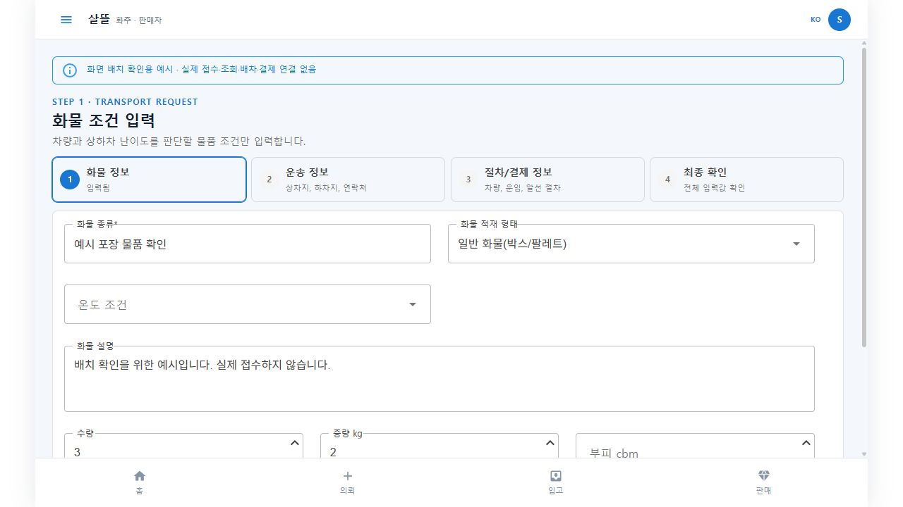
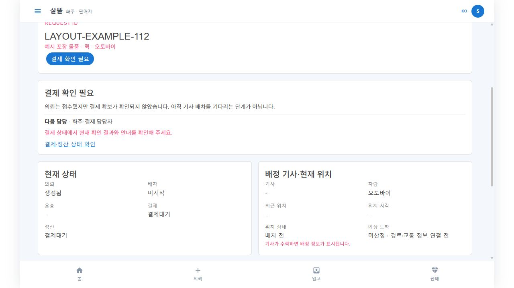
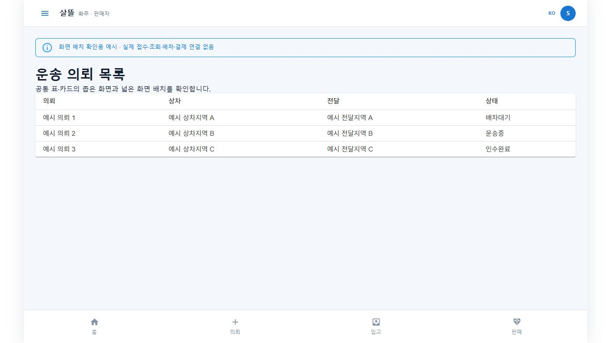
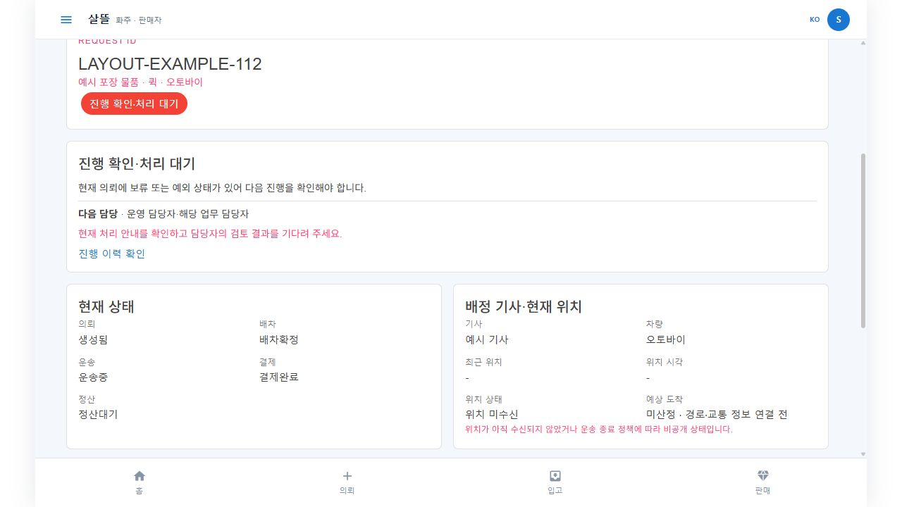
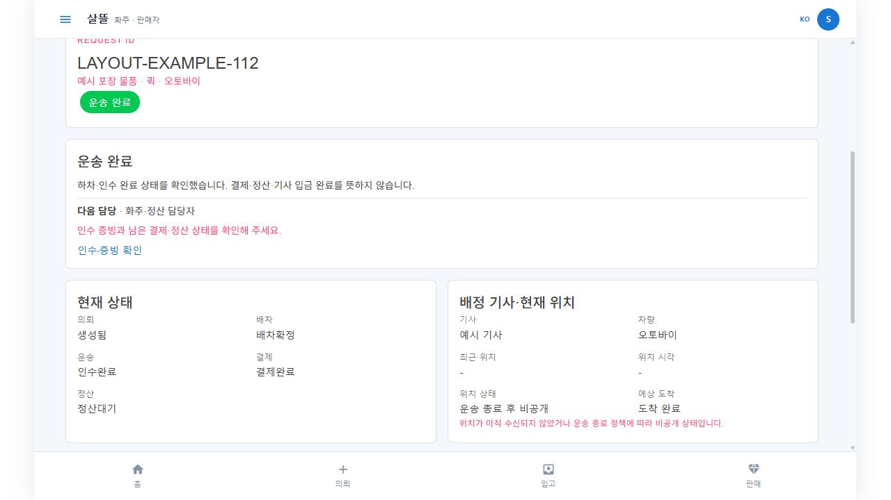

# 화주 PC MAUI 재확인·접수 후 안내 r112

2026-10-18. 사용자는 기사 모바일·화주 모바일/데스크톱 분담에 이어 기존 화주 PC 앱의 .NET MAUI 구성을 조사하고 보완하도록 요청했다. 기사 데스크톱 제품을 새로 만들지 않고 기존 화주 호스트·원장·계약을 재사용한다.

## 현재 호스트

- `SsalddelApp/SsalddelApp.csproj`는 .NET 10 MAUI Blazor Hybrid이며 Windows target을 선언한다. WinUI → MauiProgram → MainPage BlazorWebView → 역할 선택 → 화주 화면으로 진입한다. 실제 서버 서비스가 등록돼 있고 기본 샘플 대체는 꺼져 있다.
- `Ssalddel.Web.ShipperApp`은 별도 Blazor WebAssembly 소비자다. 두 실행물을 같은 앱으로 표현하지 않는다. 이전 `ShipperApp` 기억 대신 현재 소스로 확인했다.
- Windows 지도는 현재 Android 전용 네이티브 구현을 사용할 수 없어 기존 목록 대체 상태다. 이 조사에 지도 API나 APK 연결을 전제하지 않는다.

## 책임과 변경 범위

[화주 작성 책임](../ProjectOverview/page-docs/SsalddelApp/SsalddelApp-P02/README.md) · [상세 다음 행동 책임](../ProjectOverview/page-docs/SsalddelApp/SsalddelApp-P03/README.md) · [기기 분담](../ProjectOverview/page-docs/quick-driver-usability-r110.md).

1. 기존 MAUI 화주 셸의 모바일 폭 고정을 반응형으로 조정한다. 같은 업무·단계·메뉴·권한을 유지한다.
2. 접수 후 현재 대기 이유와 다음 담당을 공통 상세에 표시하고 상차·하차·정산의 서로 다른 완료를 구분한다.
3. 별도 웹의 새 접수 응답 유실은 같은 접수번호·입력을 보존하고 정본 조회로 복구한다. 실제 선결제·후불 승인·배차를 임의 실행하지 않는다.

### 변경 전후

| 대상 | 이전 | 이번 변경 |
| --- | --- | --- |
| MAUI PC 배치 | 화주 셸이 최대520px이며 넓은 창에도 압축한 1열/카드 배치 강제 | 767px 이하 기존 배치 유지, 768px 이상 최대1180px·기존 공통 grid/표 소비 |
| 접수 후 다음 행동 | 등록·배차·승인·정산 단계가 일부 ‘완료’ 부분문자열로 혼동 | 원천 운송 상태를 우선해 현재 이유·다음 담당·기존 확인 화면 안내. 상차와 하차·후불 승인과 정산·운송 완료와 기사 입금 구분 |
| 취소·모의 제외 | 조건 미확인 설명이 배차 원천값을 대체하거나 모의 제외에 결제/승인 안내 가능 | 원천 배차값 유지, 대기 설명 분리. 정확한 `모의 수행·정산 제외`는 실제 결제·승인·정산 대상에서 구분 |
| 웹 접수 응답 유실 | 호출마다 새 클라이언트 접수번호로 재등록할 위험 | 계정별 번호·최초 시각·확인 결과를 선보관하고 같은 번호의 정본 GET으로 복구. 서버의 기존 `shipper-app-{Guid:N}` 멱등 형식 재사용 |
| 여러 탭·초안·계정 | 공용 초안 키·다른 입력 화면에서 미확정 원문 변경 가능 | 계정별 키, Web Lock 안에서 첫 번호/초안 저장, 작성5개 route에서 미확정/전송 중 편집 화면을 렌더하지 않음. 늦은 실패가 다른 탭 확인 결과를 지우지 않음 |
| 실제 소비자 | 통합 웹과 별도 역할 WASM의 등록 경로가 각각 존재 | 두 호스트 모두 같은 scoped 등록 서비스의 새 인터페이스 별칭 연결. 기존 전문 앱과 원장은 유지 |

### 업무 트리

```text
화주 — 기존 Windows MAUI / 모바일 MAUI / 별도 웹
├─ 작성: 화물 → 상하차·시간 → 차량·운임·조건 → 최종 검토
├─ 서버 접수 결과
│  ├─ 확인됨 → 같은 의뢰 ID의 요약·진행 이력
│  └─ 응답 불명 → 기존 접수번호 유지 → 정본 재조회
│     ├─ 발견 → 기존 의뢰 열기
│     └─ 미발견·조회 실패·거절 → 중복 전송 없이 재확인·담당자 문의
└─ 접수 이후 조회 안내
   ├─ 선결제 미확보 → 화주·결제 담당의 확인 필요
   ├─ 후불/현장 조건 미확인 → 해당 조건 담당의 확인 필요
   ├─ 조건과 실제 배차대기 원장 확인 → 기사 배차 대기
   ├─ 배정·상차·운송·인수 → 확인된 현재 단계 안내
   ├─ 운송 완료 → 증빙·남은 결제·정산 확인
   └─ 취소·보류·모의 제외·미확인 → 각각 별도 안내
```

이 트리는 화면과 복구 책임 설명이다. 이번 작업에서 실제 서버·기사·결제 흐름을 완주했다는 실행 기록이 아니다. 등록 정본이 확인된 뒤에만 명시적 `새 의뢰 작성`으로 기존 접수를 닫는다.

## 대표 화면

실제 MAUI 레이아웃 `.razor`와 scoped CSS를 링크한 **루프백 브라우저 예시**다. 공통 입력·요약·표를 렌더했으며 실제 원장/API·Windows 네이티브 창·휴대폰이 아니다. 한국어 언어값만 제공하는 미리보기 어댑터와 기본 MudTheme를 사용하므로 네이티브 테마의 색상 일치 증거로 쓰지 않는다.











## 검증

최종 로컬 검증 완료. 구현·시험·공통 UI 브라우저와 실제 Windows 창/서버·금융의 실행 범위는 아래와 같이 구분한다.

| 검사 | 최종 결과 |
| --- | --- |
| 집중 Fast | 154개 통과·실패0·생략0 (`artifacts/local/validation/20261018-223754/`) |
| 전체 Task | 12,644개 통과·실패0·환경 의존16개 생략·전체12,660개 (`artifacts/local/validation/20261018-223903/`) |
| 최종 제품 솔루션 빌드 | 오류0·경고70. 깨끗한 경고0 빌드로 보고하지 않음 |
| 저장·동시 실행 JS | 격리 단위시험8개 통과·실패0 |
| 소스·기존 작업 보존 | 검사 소스31파일의 검증 전후 해시 차이0. 기존 dirty312파일에서 허용 범위 밖 변경0, HEAD/branch 유지 |
| 소비 DLL 결속 | 현재 공통 UI DLL·Windows 앱 사본·브라우저 미리보기 사본 해시 일치 |
| 화면 | CUA 브라우저5장면·캡처7장·대표5장, 오류 콘솔0. 실제 Windows 창·휴대폰·서버/DB·실금융은 미검증 |

- Windows MAUI Debug 빌드: 성공, 오류0·경고5. 최초 검증 호출에서 전역 `TargetFrameworks`를 잘못 제한해 참조 프로젝트 복원 오류가 났으며, 해당 호출 옵션을 제거하고 정상 복원/빌드했다. 프로젝트 타깃을 변경하지 않았다.
- PC 브라우저: 입력·결제 대기·보류·운송 완료·표 목록5장면, 캡처7장·대표5장. 1280×720에서 셸1180px·요약2열·가로 넘침 없음, 메뉴 열기/닫기 후 입력 유지·목록 표 표시를 관찰했다. 콘솔 오류0. 현재 CUA에 화면 폭 변경 기능이 없어320/390px·휴대폰 새 렌더는 확인하지 않았다. 별도 폭 검사 스크립트는 준비만 하고 실행하지 않았다.
- 실제 제품 JS의 Web Lock·저장 실패·동시 탭·늦은 확인 결과 보존 등 격리 단위시험8개 통과. 실제 브라우저 저장소·다중 탭 서버 접수를 실행한 결과는 아니다.
- 첫 Fast에서 신규 시험이 기존 source-link 인증 타입과 WebApp DLL의 같은 이름 타입을 혼용해 컴파일2건 실패했다. 기존 링크를 유지하고 해당 시험 소비3개 소스만 기존 방식으로 연결했다. 제품 인증 구현은 변경하지 않았다.
- 첫 Task는12,642개 통과·1개 실패·16개 생략이었다. 실패는 기존 개인정보 동의 구성 시험이 괄호 추가 전 조건 문자열만 찾은 경우다. 제품의 동의 여부+증적 확인 조건을 유지하고, 시험이 동의/복구/편집의 배타 구성과 새 작성 때 동의 재설정을 확인하도록 갱신했다. 새 구성 회귀1개를 포함한 최종 Fast154개·Task12,644개 통과를 다시 확인했다. 이 검사는 소스 구성 검사이며 실제 Web 개인정보 동의 페이지의 브라우저/단말 조작 증거는 아니다.
- 전용5594 미리보기와 만든 탭16은 종료했으며 다른 서버·DB·사용자 탭은 조작하지 않았다.

Raw 로그·소스 결속·CUA 관찰은 `artifacts/local/shipper-pc-closeout-r112/`, JS·웹 접수 구현/초기 사본은 `artifacts/local/usability-review-r112/`에 보존한다. 대표 화면의 파일 해시는 [manifest](../assets/changes/2026-10-18-shipper-pc-r112/manifest.json)를 따른다.

현재 Web 접수 VM·HTTP 검증은 저장소에서 기존에 사용하는 source-link 방식으로 같은 실제 소스를 소비한다. WebApp DLL이 주입하는 VM과 시험의 source-link VM은 서로 다른 CLR 타입이므로, 새 Web 작성5개 route의 복구/편집 분리는 구성 검사로 확인했다. 이를 실제 Web 전체 페이지 렌더·실제 다중 탭 서버 접수로 확대하지 않는다. 공통 요약·다음 행동의 HtmlRenderer 회귀와 CUA 배치 관찰은 별도 증거다.

## 남은 마감

일반 화주 접수는 선결제·플랫폼 수납이다. 기존 서버에는 결제준비/확인/승인 outbox → 배차대기 파이프라인이 있지만 기본 OFF이며, 현재 MAUI 결제 UI의 FakePG/상차 후 조건과 초기 선결제 진입은 별개로 남아 있다. 이번 표시 개선으로 실제 결제·배차 전체 완주를 통과 처리하지 않는다. 생활 간편접수의 직접 현장지급과 일반 화주 선결제를 같은 흐름으로 합치지 않는다.

일반 웹4xx에는 ‘확실히 저장되지 않음’을 증명하는 서버 영수증이 없고 중복 요청도400을 반환한다. 따라서 거절/GET404만으로 새 번호를 발급하지 않는다. 이 경우 재조회·접수번호로 담당자 확인이 필요하며 자동 해제까지 완성된 것은 아니다. 주소·연락처 초안은 기존72시간 보존 정책을 계정별로 적용하고, 만료 후에는 결과 조회용 접수번호만 유지한다. 브라우저 Web Locks/저장이 지원되지 않거나 실패하면 전송 전 차단한다.

배포·외부 공개·실수납/실송금·USB/설치·commit/push는 이번 범위가 아니다.
