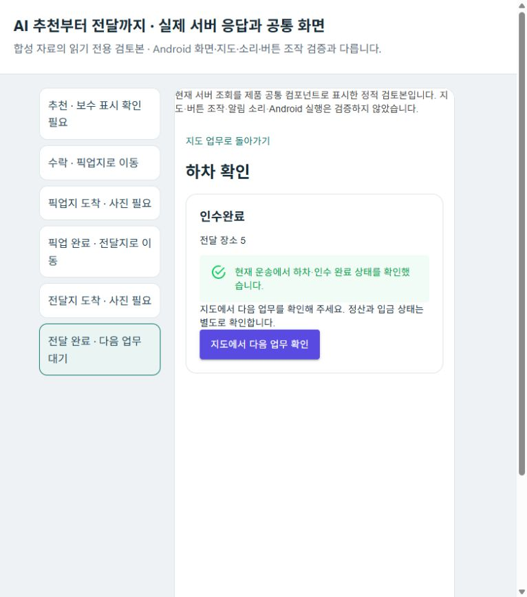

# 화물 AI 선택 → 실제 앱 API 업무 마감 r114

2026-10-19 · `PLAN-OPERATIONS-DISPATCH-CORE / dispatch-core.r68` · **로컬 API 마감 통과 / 추천 화면 공백 확인 / 실기기 보류**

사용자는 법정동을 넣은 가상 주문·기사를 이용해 AI 배차부터 기사 수락·픽업·전달까지 검증하도록 요청했다. USB는 최초 조회에서 디버깅 승인 대기였고, 최신 답변은 **지금은 로컬 검증만 진행**이었다. 따라서 휴대폰 설치·조작·촬영·지도·배너·소리 시험을 수행하지 않았다.

- [작업 명세](../AI/Planning/공통/PLAN-OPERATIONS-DISPATCH-CORE/cargo-ai-device-verification.r68.work-order.json)
- [구현·책임 정본](../AI/Planning/공통/PLAN-OPERATIONS-DISPATCH-CORE/cargo-ai-device-verification.implementation.r68.md)
- [현재 단계별 정적 검토 화면](http://127.0.0.1:5365/view/completed) — 로컬 검토기를 실행한 동안만 열린다. Android 화면이나 실제 버튼 조작은 아니다.

## 이번에 확인된 업무 트리

```text
공식 보관본의 법정동 코드 15개 + 고정 seed의 가상 사례 3개
├─ 사례 01: 중화동 → 휘경동, 제안 운임 6,000원
│  └─ 실제 모델의 이유 불일치 → 추천하지 않음, 주문·시도 기록 보존
├─ 사례 02: 장안동 → 면목동, 제안 운임 6,200원
│  └─ 실제 모델의 이유 불일치 → 추천하지 않음, 주문·시도 기록 보존
└─ 사례 03: 회기동 → 망우동, 제안 운임 6,200원
   ├─ 최신 서버 정책의 허용 기사 2명 → 실제 Ollama가 C2 선택
   ├─ 소스·원장·후보 재검사 → 기존 추천 전환 → 알림 Outbox 1개
   ├─ 추천 GET·공통 화면 → 보수 미확인과 만료 시각 해석 공백: 화면 수락은 보완 필요
   └─ 이번에는 같은 추천을 실제 앱 API로 수락
      ├─ 확정 → 현재 행동: 상차지 도착
      ├─ 상차지도착 → 사진 없이 상차 완료: 400, 상태 유지
      ├─ 시험 PNG 업로드 → 상차완료 → 현재 행동: 하차지 도착
      ├─ 하차지도착 → 사진 없이 전달 완료: 400, 상태 유지
      └─ 시험 PNG 업로드 → 인수완료
         ├─ SQL 투영·Mongo 원장·화주 조회의 운송상태 일치
         ├─ 기사 활성 운송 0개·다음 업무 대기
         └─ 정산 입금대기, 실제 지급·입금은 별개
```

위 법정동 이름은 2026-08-11 수집본에서 투영한 **시나리오 표식**이다. 랜덤 표식과 허용된 합성 좌표를 따로 사용했다. 좌표가 해당 법정동에 속한다거나 실제 경계·인접 지역·주행 경로·ETA가 확인됐다는 뜻이 아니다. 운임도 시험 입력이며 실제 지급 재원·시장 단가·입금의 증거가 아니다.

## 구현 범위와 실제 실행

새 `eng/CargoAiDeviceVerificationR114/`는 기존 격리 MySQL 13310·Mongo 27021의 새 논리 DB `mirror_ai_device_r114_20261019`와 loopback 5364만 사용한다. 기존 의뢰·기존 시험 DB를 초기화하지 않았다. 기존 공용 Factory·seed·합성 지오코더/직선 경로 adapter를 연결하고 가상 기사 두 명의 운행 시작·참여·수신 의사·위치를 실제 API로 제출했다.

현재 화물 모델 비교 코드는 추천 적용까지 연결돼 있지 않았으므로 **검증 호스트 안에만** 명시적 1회 연결을 만들었다. `용달운송배차업무정책.후보검토Async` → 익명 후보 → 실제 Ollama → 독립 응답 검사 → 소스·원장·후보 재검사 → `대상후보조회Async` → 기존 `추천시작Async` 순서다. 제품 배차 worker나 지속 자동 배차를 활성화한 것이 아니다.

기존 `qwen3:1.7b`를 실제 3회 호출했다. 첫 두 건은 각각 7,376ms·3,225ms 뒤 `UnsupportedReasonFact`로 제외됐다. 첫 건은 `C2`를 고르면서 `SERVER_ALLOWED`와 보류 전용인 `REVIEW_NEEDED`를 함께 반환했다. 거절 자료를 지우거나 같은 의뢰를 다시 추론하지 않았다. 이전 Selector 소스도 해시와 함께 보존했다.

이유 규약 r2는 선택·보류 이유를 프롬프트에 명시하고 후보별 성립 가능한 이유의 Schema를 제공한다. 후보 두 명과 보류 선택은 그대로 유지한다. 엄격한 독립 검사는 변경하지 않았다. 별도 세 번째 건은 5,104ms 뒤 `C2 / SERVER_ALLOWED`로 통과했고, 추천 차수 1·기사 `cargo-journey-driver-b`의 원장과 연결됐다. 한 건의 유효한 선택이며 최적성·공정성 개선이나 모델 학습 완료를 증명하지 않는다. 모델 가중치는 바꾸지 않았다.

추천 유지 시간은 전용 호스트에서 300초이며 제품 기본 60초는 변경하지 않았다. 기본 60초 내 사용자 수락은 이번에 검증하지 않았다. worker·외부 FCM·자동 지급은 OFF다. 알림 Outbox는 `Pending / attempts=0 / readAt=null`이므로 휴대폰 배너·전송·읽음·소리가 확인된 것으로 표시하지 않는다.

사진은 68바이트의 시험용 PNG 두 번이다. 상차/하차 영수증의 업무·파일 연결, 완료 참조, 저장 바이트와 SHA-256 일치를 확인했다. 실제 카메라 사진·실물 인계·수령인의 별도 확인은 아니다. 화주의 의뢰 헤더는 `생성됨`을 유지하면서 전문 운송 상태를 `인수완료`로 제공한다. 헤더 값을 임의로 전체 업무 완료로 바꾸지 않았다.

## 검증 결과와 발견한 공백

| 구분 | 결과 | 의미와 한계 |
| --- | --- | --- |
| 전용 호스트·읽기 probe 빌드 | 경고 0·오류 0 | 새 검증 도구만 빌드, APK 제작·설치 아님 |
| 순수 모델 응답·적용 증거 검사 | 31개 통과 | 실제 모델 성능 시험과 별도 |
| 실제 모델 호출 | 3회 중 2회 거절·1회 적용 | 규칙 대체 성공을 AI 성공으로 표시하지 않음 |
| 추천 보호 | 5개 통과 | 다른 기사 수락 409·잘못된 추천 차수 409·키 없는 제어 조회 401·동일 명령 재조회·다른 키 충돌 409 |
| 사진 필수 보호 | 상차·하차 각 400 | 두 경우 모두 운송 상태·알림 Outbox 변화 없음 |
| 업무 API 마감 | 1건 인수완료 | 앱 API로 수락, 실제 화면 수락·촬영 아님 |
| 완료 후 읽기 | 화주·기사 일치, 다른 기사 상세 거절 | 기사 활성 업무 0·다음 행동 대기 |
| 실제 GET·공통 ViewModel·Razor | 수락 후 5단계 검사 통과 | 추천 단계는 보수 근거 검사 실패, 실제 UI 통과로 확대하지 않음 |
| Fast·Task 경로 검사 | 도구 경로는 guidance 분류 | 이 작업에 대한 제품 시험은 라우터가 생략함. 직접 빌드·31개 자체 검사·실제 HTTP와 구분 |

**먼저 보완할 부분은 추천 만료 시각의 시간대와 기사 보수 계약이다.** 이번 1톤 직접운임 의뢰는 소형배송 `Pricing`이 없어 공통 추천 화면의 보수가 `미확인`이었다. 별도로 `ServerCandidateAvailable=false`여서 참여 버튼도 비활성이었다. 보수 부재가 버튼 차단의 원인인 것은 아니다. `CanSubmit`은 Pricing을 검사하지 않는다.

저장·응답의 만료 값 `2026-10-19T00:19:30.682334`에는 UTC 표시가 없다. 한국 시간대의 공통 client가 이를 `Unspecified`로 읽어 `ToUniversalTime()` 하면 `2026-10-18T15:19:30.682334Z`가 된다. 원래 서버 UTC 의미보다 9시간 빠르므로 추천 관찰 시점에 만료로 평가되는 충분한 원인이다. 서버 API 수락은 유효 차수로 성공했다. 제품 만료 계약을 임의 보정하지 않고 진단으로 남겼다. 차량 제원 미등록 경고는 별개다. **화면 수락부터 시작하는 전체 UI 업무 검증은 미통과**다.

API의 제안 운임/확정 보수와 화면의 보수 근거를 일치시키는 계약 검토도 필요하다. 화주의 결제 예정액을 곧바로 기사 실지급액으로 이름만 바꾸는 수정은 하지 않았다.

**서버 전체 준비 검사는 통과하지 않았다.** live 200·ready 503이다. 이번 `EnsureCreated` 환경의 미적용 migration이 main 66·전통시장 2·농수산 17·공공수집 7개로 보고됐다. 검사 완화나 실제 migration 실행 없이 실패로 남겼다. 전용 업무 API가 성공해도 운영 배포 준비가 완료됐다는 뜻은 아니다.

검증 도구를 매번 새로 시작하며 로그인 제한 429도 관찰했다. 도구를 수정해 앱처럼 유효한 토큰을 비공개 시험 캐시에 재사용했다. 서버 인증 제한은 변경하지 않았고 제한 기간이 지난 뒤 화주·다른 기사 읽기를 마무리했다.

## 화면 기록

실제 공통 컴포넌트가 저장한 정적 HTML에 같은 빌드의 scoped CSS·기본 MudThemeProvider를 연결한 **브라우저 캡처**다. 정적 검토기는 허용 HTML/CSS만 제공하며 인증 파일·저장소 전체를 서빙하지 않는다. 원본 SSR·CSS·테마와 파생본의 해시를 별도로 남겼다. 첫 검토 창의 가로 잘림은 로컬에 보존한 뒤 검토 창만 조정했다. 제품 레이아웃을 변경한 것이 아니다.

| 단계 | 대표 화면 |
| --- | --- |
| 추천·보수 공백 | [01](../assets/changes/2026-10-19-cargo-ai-device-verification-r114/01-recommended-pricing-gap.png) |
| 수락·픽업 이동 | [02](../assets/changes/2026-10-19-cargo-ai-device-verification-r114/02-accepted.png) |
| 픽업 도착·사진 입력 | [03](../assets/changes/2026-10-19-cargo-ai-device-verification-r114/03-pickup-arrived.png) |
| 픽업 완료·전달 이동 | [04](../assets/changes/2026-10-19-cargo-ai-device-verification-r114/04-picked-up.png) |
| 전달 도착·사진 입력 | [05](../assets/changes/2026-10-19-cargo-ai-device-verification-r114/05-dropoff-arrived.png) |
| 전달 완료 | [06](../assets/changes/2026-10-19-cargo-ai-device-verification-r114/06-completed.png) |



## 보존 자료와 다음 확인

Git 제외 `artifacts/local/cargo-ai-device-r114/`에 `fixtures.json`, `final-review.json`, `api/http.jsonl`, 세 가지 `*-guards-*.json`, 모델 시도/원응답/소스·후보 해시, `client/r114-03/*/result.json`·SSR, `client/gallery-manifest.json`, 빌드·자체·경로 검사 기록을 보관한다. 인증 정보는 `.private` 안에만 두며 공개 문서·모델 입력·스크린샷에 실제 고객 자료를 넣지 않았다.

완료된 건을 다시 요청할 때는 현재 인수완료 정본만 조회하고 변경을 반복하지 않는 것도 확인했다. 기존 dirty 372개 파일의 해시를 비교했고 허용된 두 문서 밖의 기존 변경은 없었다. 로컬 링크 25개와 대표 화면 6장의 해시를 기록했다. 검증 후 전용 API 호스트와 이번에 시작한 세 컨테이너를 중지해 시작 전 상태로 복원했으며 DB·볼륨은 보존했다. 기존 Ollama·5595 검토 서버는 유지했다. 5365의 읽기 전용 정적 화면 검토기만 사용자 확인용으로 남겼다.

다음은 ① 추천 시간대·제안 보수·적격성·화면 수락 계약을 연결하고 ② 실제 휴대폰에서 같은 절차의 새 추천으로 배너·수락·카메라·백그라운드 수신을 검증하는 순서다. 실제 도로 ETA와 여러 업무를 수행 중인 기사의 최종 목적지 기준 추천, 다건 조합·미응답/네트워크 단절·운영 migration·실제 FCM·지급은 별도 미검증이다. 제품 코드·공유 설정·기존 원장·APK·Unity·영상·외부 배포·commit/push는 변경하지 않았다.
