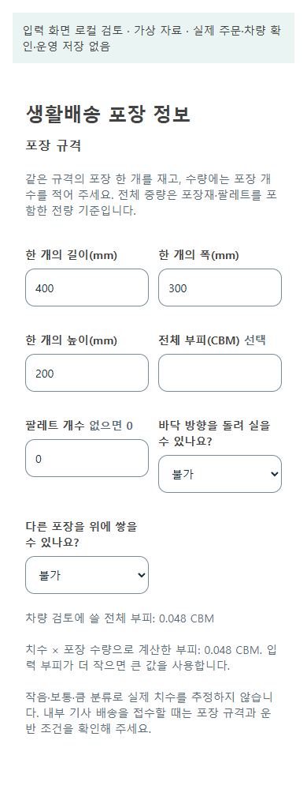

# 화물 입력 완결·이동 중 추천 갱신 r77

- [승인 계획](../AI/Planning/공통/PLAN-OPERATIONS-DISPATCH-CORE/cargo-input-refresh.implementation.r77.md) · [소유 경로·검증 명세](../AI/Planning/공통/PLAN-OPERATIONS-DISPATCH-CORE/cargo-input-refresh.r77.work-order.json)
- 기준 `dev/mirror-integration` / `fd55a1c4bca4dffb4752ac34de64c62d07caced3`, 시작 dirty 559항목 보존.
- 상태: **로컬 구현·검증 완료 / 운영 미활성**. 전체 소비 빌드, 최종 전체 시험 13,165개 통과·실패 0개·환경 의존 16개 생략, 실제 Razor 화면 18상태 검사를 확인했다. 실제 DB·운영/worker·기기·클라우드·가중치 학습·commit/push는 별도다. r76 실제 Ollama 응답 시간 초과를 이번 변경으로 해결했다고 표시하지 않는다.

```text
물품/화주 접수
├─ 같은 포장 치수 × 개수 / 전량 중량 / 팔레트·회전·적층 확인
├─ 픽업·하차 예상 작업시간과 약속시간 확인
│  └─ 초안 → App/Web → 생성/수정 → 정본/조회 → 계획·수락 검사
├─ 관리자: 선택 기사 실차의 확인 근거·제원·기간 기록
│  └─ 본인 차량 선택 / 법정 자격과 구분, 충돌·응답 유실은 재조회
└─ 기사 현재 추천
   ├─ 같은 위치 heartbeat → 현재 신선도 검사, 불필요한 알림·라운드 없음
   ├─ 이동/첫 수락으로 기존 수행 변경 → 본인 남은 추천만 전체 계획 재검사
   ├─ 가능 → 최신 판본 제시 → 기사 다시 확인 → 수락
   └─ 과적·시간 초과·정보 부족·동시 조건 변경 → 보류, 기존 수락 보존
```

[페이지·코드·정본 책임](../ProjectOverview/page-docs/cargo-input-refresh-r77.md)과 [실차 관리 화면](../ProjectOverview/page-docs/vehicle-management-actual-loading-r77.md)을 분리했다. 미입력 작업시간을 0분으로 채우거나 포장 등급을 실측으로 환산하지 않는다. 정본과 상충하는 조율 입력은 미확인으로 처리한다. 구형 명시 검토 입력의 호환과 실제 정본 입력도 구분한다.

## 검증

최종 완료 근거는 `artifacts/local/cargo-input-refresh/20261019-r77/completion-evidence.json`이며 SHA-256은 `714b1583915db2b73acbb3d65278be119c0e25099a72757f937ddb74718b54cb`다. 시험·소비 빌드·실제 화면을 별도 실행 근거와 해시로 연결했고 중단·실패 기록도 같은 폴더에 보존했다.

- 첫 Fast(`artifacts/local/validation/20261019-215815/`)의 전체 소비 솔루션 빌드는 오류 없이 통과했다. 집중 시험은 537개 통과·4개 실패·생략 0개였다. 최초 동결 소스 73개의 기록과 실패 로그/TRX를 보존했다.
- 실패 3개는 새 R77 합성 상자의 팔레트 수가 null인 상태로, 실제 구간 적재 검사가 미확인으로 차단한 결과다. 시험 입력에만 팔레트 0개·상온을 명시했으며 적재/시간 관문과 기대 결과는 유지했다.
- 실차 화면 1개는 정적 HTML의 빈 값 속성 직렬화에 대한 정규식 가정이 틀렸다. 선택 구조·라벨을 검사하고 실제 선택 상태는 브라우저에서 별도로 확인하도록 검증 층을 나눈다.
- 재실행 Fast(`artifacts/local/validation/20261019-220910/`)는 541개 통과·실패/생략 0개다.
- 첫 브라우저 검사의 실패 화면은 `ui-verify-r1-2026-10-19T13-16-16-046Z/`에 보존했다. 생활배송의 nullable bool 선택에서 `false`가 미확인으로 표시되던 문제를 명시적 세 값 연결로 수정했다. 화주 작업시간의 음수 경고도 작업시간 영역에 직접 표시했다. 첫 Task 빌드는 이 수정 전에 중단했으므로 완료 증거로 사용하지 않는다.
- 검토 호스트에 다른 웹 호스트를 직접 참조했을 때 공통 정적 파일이 중복됐다. 기존 관리자 컴포넌트·모델 및 필요한 소스만 링크하도록 도구 구성을 바꿨다. 운영 API·관리자 인증 서비스는 검토 클라이언트로 등록하지 않는다. 초기 빌드 실패 로그도 보존한다.
- 화면 수정 후 집중 Fast(`artifacts/local/validation/20261019-222210/`)는 279개 통과·실패/생략 0개다. 이 수는 앞의 541개와 일부 겹치므로 독립 총합으로 더하지 않는다.
- 최종 실제 Razor 브라우저 검사는 PC 1280px/모바일 폭 390px의 18상태를 모두 통과했다. 생활배송 포장 입력·선택창 테두리/최소 높이 48px, 가로 넘침 없음, 부피 재계산, 음수/미입력, 실차 미등록·조회 실패·409 충돌·작성값 보존/재조회를 확인했다. 24장 캡처 중 대표 10장을 장기 보존했다. 외부/제품 API 요청·브라우저 오류·소스/계획 해시 변경은 0개다.
- 최종 화면 근거는 `artifacts/local/cargo-input-refresh/20261019-r77/ui-verify-r4-2026-10-19T13-30-53-852Z/`다. 앞선 r3의 화면 18개는 통과했지만 검토 브라우저 종료가 지연돼 전체 도구 결과는 실패로 보존했다. 자기 프로세스만 확인해 종료한 사후 기록과, 이중 종료를 피한 r4의 정상 종료를 따로 남겼다. r4는 종료 경고·오류 없이 통과했다.
- 화면 동결은 `source-frozen-r7.json`의 소스 77개(추가 읽기 전용 관리자 지원 소스 4개 포함)다. 계획 본문 해시는 `d94dc037404df80af9df353d0c2fc14950366bad66e7264766d479cbf587e37a`로 유지했다. 검토 도구의 기존 SQLitePCLRaw 패키지 취약성 경고와 전체 앱의 기존 컴파일 경고는 이번에 해결한 것으로 표시하지 않는다.
- 첫 완료 Task(`artifacts/local/validation/20261019-222623/`)는 전체 소비 빌드 통과, 시험 13,154개 통과·11개 실패·환경 의존 16개 생략이었다. 실패는 전부 새 Factory의 현재 수행 조회에서 배열 `Contains`가 .NET 10의 span 오버로드로 선택돼 EF 식 평가가 중단된 것이었다. 기존 복귀 조율 경로까지 영향을 주는 실제 결함이며, 세 호출만 명시적 `Enumerable.Contains`로 고쳤다. 실패 로그와 TRX는 보존한다.
- 이 서버 조회식 수정 뒤 소스 동결은 `source-frozen-r8.json`이다. r7과 다른 파일은 서버 Factory 한 개뿐이고, 화면·모델·가상 클라이언트·공유 계약·시험 소스는 같다. 이 조회식은 UI 검토 클라이언트에서 실행되지 않으며, UI r7의 18상태·PNG와 서버 r8의 재검증을 구분해 보존한다.
- 조회식 수정 뒤 집중 Fast(`artifacts/local/validation/20261019-223557/`)는 기존 복귀 조율 사례와 r77 사례 61개를 모두 통과했다. 실패했던 11개도 이 재검증에 포함된다.
- 최종 Task(`artifacts/local/validation/20261019-223655/`)는 전체 소비 솔루션 빌드와 전체 시험 13,165개 통과·실패 0개·환경 의존 16개 생략을 확인했다. 생략은 별도 Mongo/MySQL 환경을 요구하는 시험으로 이번 실행의 성공 항목에 포함하지 않는다. 소스 77개 및 계획 해시의 종료 시 변경은 0개다. 실제 운영 DB·기기·송금 완료로 해석하지 않는다.

## 화면 기록

[PNG·검증 연결과 해시](../assets/changes/cargo-input-refresh-r77/manifest.json). 모든 화면은 가상 자료를 사용한 로컬 검토본이며 APK나 실제 측정·운영 저장의 증거가 아니다. 최초 검토본에는 스타일 컨테이너 누락도 있어 과거 출시 화면을 뜻하지 않는다.

| 업무 | PC | 모바일 폭 | 예외와 최초 검토본 |
|---|---|---|---|
| 생활배송 포장 | [포장 입력](../assets/changes/cargo-input-refresh-r77/package-valid-1280.png) | [포장 입력](../assets/changes/cargo-input-refresh-r77/package-valid-390.png) | [최초 선택 표시 오류](../assets/changes/cargo-input-refresh-r77/before-package-valid-390-failure.png) |
| 화주 상하차시간 | [일정 입력](../assets/changes/cargo-input-refresh-r77/shipper-valid-1280.png) | [일정 입력](../assets/changes/cargo-input-refresh-r77/shipper-valid-390.png) | [음수 경고](../assets/changes/cargo-input-refresh-r77/shipper-negative-390.png) · [최초 경고 누락](../assets/changes/cargo-input-refresh-r77/before-shipper-negative-390-failure.png) |
| 관리자 실차 확인 | [실차 기록](../assets/changes/cargo-input-refresh-r77/vehicle-valid-1280.png) | [실차 기록](../assets/changes/cargo-input-refresh-r77/vehicle-valid-390.png) | [저장 충돌 후 작성값 보존](../assets/changes/cargo-input-refresh-r77/vehicle-conflict-390-conflict.png) |



## 남는 경계

- 갱신은 r77 근거가 있는 본인 유효 추천의 조회·수락 전·수락 후 복구 시점에 이루어진다. GPS 이벤트만으로 상시 재추천하는 새 감시 작업은 만들지 않았다. 구형 근거 없는 일반 큐·직접 추천을 새 검증 완료 상태로 승격하지 않는다.
- 일반 화주의 미입력 작업시간과 과거·외부·자동 수행 자료는 추정하지 않는다. 자동 수행에서 내부 기사도 허용했더라도 필요한 근거가 없으면 해당 후보가 보류될 수 있다.
- 신규 nullable DB 두 열은 migration 준비만 했다. 실제 측정·운영 DB 적용·GPS/외부 길찾기·푸시·휴대폰 연속 수락·지급은 이번 로컬 합성 검증과 별개다. 실제 모델의 유효 판단·가중치 학습·검토 데이터 사람 승인도 새로 완료한 것은 아니다.
