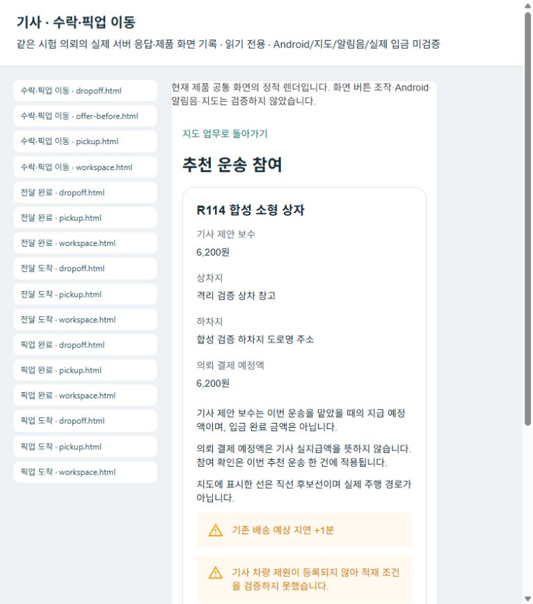
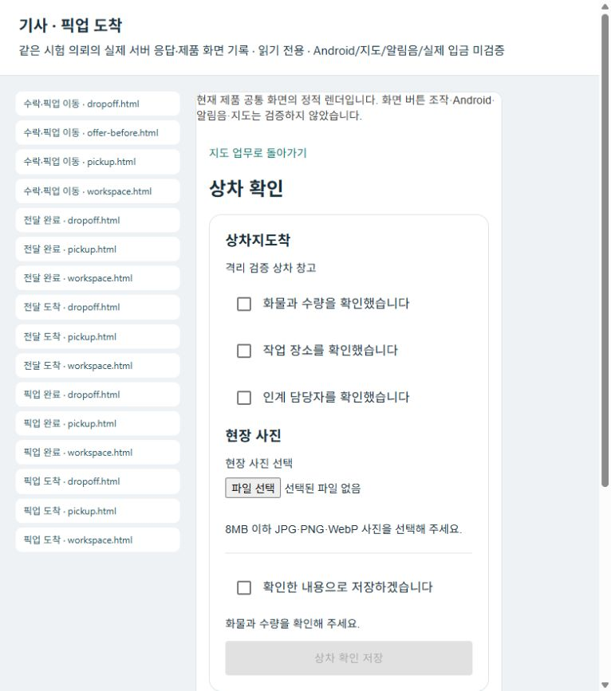
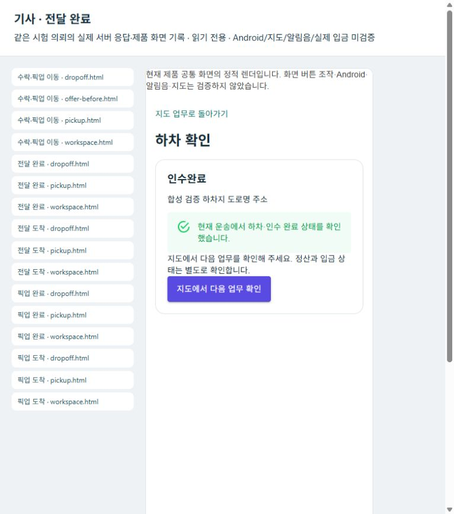
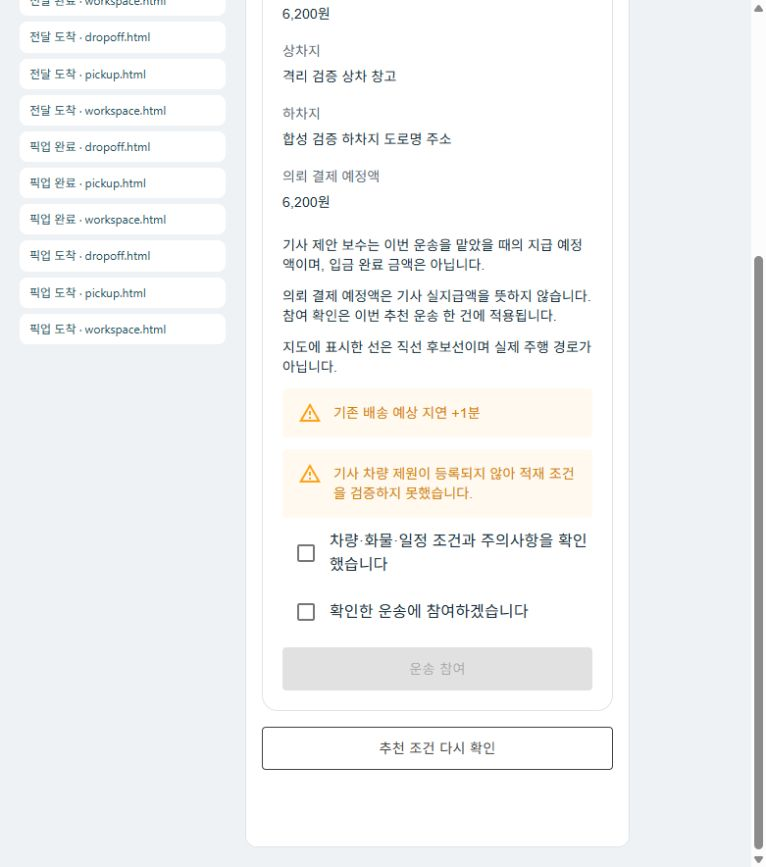
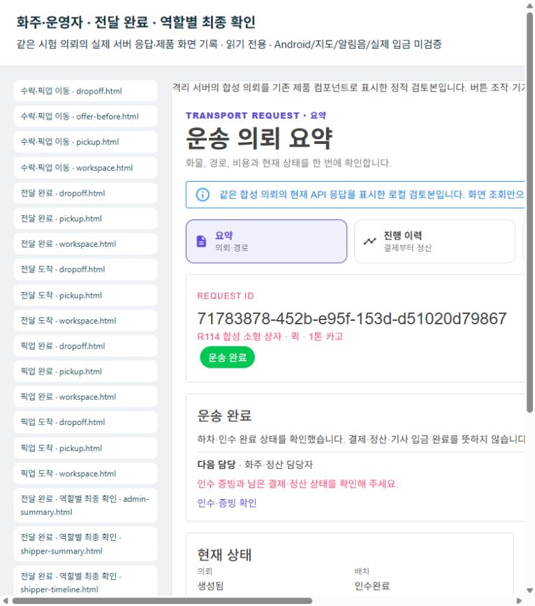
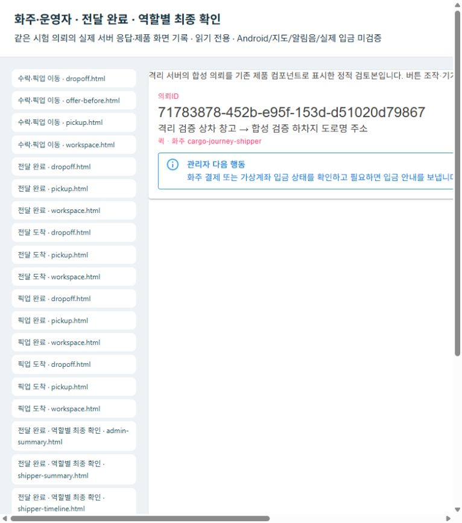

# 퀵 주문 한 건의 화면 수락·보수·역할 연결 마감 r70

2026-10-19 · `PLAN-OPERATIONS-DISPATCH-CORE / dispatch-core.r70` · **CompletedLocalValidation — 로컬 업무·역할 조회 마감 / 실제 운영 미검증**

사용자는 새 기능과 세부 정책 확대를 보류하고, 주문 한 건을 화주·기사·운영자 입장에서 끝까지 처리한 뒤 실제 운영 경험으로 개선하도록 요청했다. 이번 범위는 이전 r114에서 확인한 추천 만료 시각 해석과 일반 화물 기사 보수 표시를 보완하고 같은 의뢰의 역할별 상태를 대조하는 것이다. 제품 기본 기능·운영 배차·외부 발송·금융을 활성화하지 않는다.

- [승인 기획](../AI/Planning/공통/PLAN-OPERATIONS-DISPATCH-CORE/order-closeout.design.r70.md) · [작업지시서](../AI/Planning/공통/PLAN-OPERATIONS-DISPATCH-CORE/order-closeout.r70.work-order.json)
- [화면·API·전문 원장 책임](../ProjectOverview/page-docs/cargo-order-closeout-r70.md)
- [선행 r114의 실제 API 결과와 추천 화면 실패](2026-10-19-cargo-ai-device-verification-r114.md)

## 이번에 닫을 문제

| 문제 | 수정 내용 | 유지하는 보호 |
| --- | --- | --- |
| SQL에서 다시 읽은 UTC 의미의 추천 시각에 시간대 정보가 없어 한국 시간대에서 9시간 일찍 만료로 해석됨 | 추천 시작·만료의 응답 계약에서 UTC 의미를 보존 | 실제 만료 시각·추천 유효시간·추천 차수·현재 후보 재검사 |
| 일반 화물에 소형 전용 `Pricing`이 없으면 기사 보수가 미확인으로 표시됨 | 수락 전에는 원의뢰에 결속된 기사 약정액, 수락 후에는 운송 전문원장의 동결 기사액을 표시 | 고객 청구액과 기사 보수 분리, 누락·음수·소수·근거 충돌 시 임의 계산 금지 |
| 수락 직전 조건이 바뀌어도 이전 보수 확인으로 처리할 수 있음 | 최신 추천을 다시 읽어 현재 보수가 달라지면 확인을 다시 받음 | 불확실한 쓰기 자동 재전송 금지·결과 재조회·원장과 현재 후보 권위 |
| 관리자 조회에서 숫자 정산 열거값을 문자열 DTO로 읽다가 실패 | 공유 화주 응답을 엄격하게 읽은 뒤 제품의 `AdminShipperRequestProjection`으로 기존 관리자 표시 DTO에 투영. 목록·단건·취소 성공 응답에 같은 경로 사용 | null은 미확인, 정의된0값은 원래 이름, 미정의 값은 실패. 명령·권한·금액 정책 유지 |
| 운송 원장·결제·배차대기·POD·기사월정산 GET이 기능 경계 미분류404로 차단됨 | 필요한 기존 GET action5개에 국내 화물 기능 메타데이터 추가 | POST·권한·기능 설정·기본 OFF 경계 유지. 전체 기능 활성화나 보호 검사 완화 없음 |

추천의 보수 미확인이 r114의 수락 버튼 차단 원인이었다고 바꾸지 않는다. 선행 `CanSubmit`은 보수를 검사하지 않았고, 만료 시각 해석 문제가 별도로 확인됐다. 보수 표시 수정과 만료 계약 수정을 각각 검증한다.

## 같은 의뢰로 확인할 업무 트리

```text
화주 단건 접수
├─ 본인 의뢰 ID·조건·고객 금액 확인
└─ 배차 대기 전문원장
   └─ 적격 기사 추천 → 최신 유효 시각·기사 약정 보수 확인
      └─ 공통 앱 ViewModel에서 명시적으로 수락
         ├─ 픽업 이동 → 도착 → 사진 영수증 → 픽업 완료
         └─ 전달 이동 → 도착 → 사진 영수증 → 인수완료
            ├─ 기사: 완료 상태·동결 보수·다음 업무 확인
            ├─ 화주: 같은 의뢰 운송 완료 조회, 인수증 미등록·정산 미완료 유지
            └─ 운영자: 같은 의뢰·운송·이벤트·Mongo 원장 조회
```

아래 최종 사례에서 이 업무 경로를 확인했다. 기사 전달·전문 운송 완료, 화주의 별도 인수증/수령 확인, 정산 준비와 실제 입금은 서로 다른 상태다. 이번에는 인수증을 등록하거나 실제 수납·입금을 완료하지 않았다.

## 주문 원장과 운송 전문원장의 현재 경계

상위 주문 원장은 업무 이유와 하위 전문 원장 참조를 소유한다는 설계는 유지한다. 그러나 **현재 일반 퀵 접수는 상위 통합 `order` 원장을 자동 생성·연결하는 경로가 확인되지 않았다.** 이번에 그 기능을 새로 만들지 않는다.

이번 검증의 실제 연결은 `화주운송의뢰.의뢰Id` → SQL 배차·운송 원장 → Mongo `transport:{requestId}` → 역할별 조회다. Mongo `transport:` 문서는 운송 전문원장이며 상위 주문 원장 연결 성공의 증거가 아니다. 분산 배송의 명시적 `RootOrderLedgerId`·판본·당사자 검증 경로와 일반 퀵 접수를 혼동하지 않는다.

## 최종 로컬 결과와 판본별 시험

| 검증 | 현재 결과 | 최종 기록 |
| --- | --- | --- |
| 초기 Fast | 131/131 통과 | 후속 EF·관리자 계약·GET 분류 이전의 중간 결과로 보존 |
| 초기 Task 전수 | 전체12,705개 중 통과12,689·생략16·실패0 | [110229 로그](../../artifacts/local/validation/20261019-110229/tests-01.log). EF `Enumerable.Contains` 수정·회귀시험1개 추가 이전 판본 |
| EF 수정 후 Task 전수 | 전체12,706개 중 통과12,690·생략16·실패0 | [112105 로그](../../artifacts/local/validation/20261019-112105/tests-01.log). 후속 관리자 투영·GET action5개 분류 추가 이전 판본 |
| 최종 제품 Fast | 114/114 통과·생략0·실패0 | [113523 로그](../../artifacts/local/validation/20261019-113523/tests-01.log). 관리자 계약·GET 경계 보완 이후의 집중 검증 |
| 최종 솔루션 빌드 | 오류0·경고207 | 경고를0으로 보고하지 않음. 후속 검증 호스트·client 빌드는 각각 오류0·경고0 |
| case2 공통 앱 수락·수행 | 수락 POST1회, 기사 제안6,200원=동결6,200원, 인수완료 | 픽업/전달 사진 필수400, 다른 기사 상세404, SQL/Mongo·화주 운송 완료·기사 활성0/대기 확인 |
| 최종 역할 조회·제품 SSR | 같은 의뢰의 GET9개 모두200·SSR3개 통과 | [completed-r3 결과](../../artifacts/local/cargo-order-closeout-r70/roles/completed-r3/result.json). 같은 의뢰·운송5·Mongo 연결과 상태 대조 |
| APK | 통합앱0.1.194 / code194 / Debug 제작 완료 | 서명·정렬·소스 유지·인계 사본 해시 통과. 내장5363 로컬 전용이며 설치·기기 통신 미검증 |
| Drive 보관 | 웹 업로드 완료·파일 ID/이름/138,097,264bytes/소유자 권한 재조회 | 원격 SHA 미제공·전체 재다운로드 미실행. 익명 공개 권한·GitHub push 없음 |

전수 Task 두 회와 최종 관리자/경계 보완은 서로 다른 소스 판본이다. **최종 보완까지 모두 포함한 전수 재실행을 했다고 합치지 않는다.** EF 수정은 후속 전수와 실제 MySQL 경로, 이후 관리자 계약/GET 경계는 최종114개 집중검사·제품/검증 도구 빌드·실제 GET/SSR로 구분해 확인했다. 과거 r114의 직접 API 수락은 이번 공통 앱 화면 수락의 증거로 대신하지 않는다.

### 보존한 중간 실패와 재검증

- case1은 추천 GET의 EF `Contains` 변환 오류로 수락 POST 전에 중단됐다. 수정 뒤 별도 case2를 사용했으며 같은 수락 요청을 무조건 재전송하지 않았다.
- `roles/accepted/result.json`은 서버200의 숫자 정산 열거값과 관리자 문자열 DTO 계약 불일치로 실패했다. [관리자 계약 보완](../AI/Planning/공통/PLAN-OPERATIONS-DISPATCH-CORE/order-closeout.admin-contract.r70.md)은 도구 우회가 아닌 제품 목록·단건·취소 성공 응답의 공유 계약 투영으로 처리했다.
- 필요한 GET5개의 `FeatureBoundaryUnclassified`404를 확인하고 action 메타데이터를 명시했다. 명령이나 기존 권한·기능 설정은 변경하지 않았다.
- `roles/completed-r2`는 GET9개가 모두200인 뒤 검증 도구의 Navigation URI 끝 `/` 누락으로 SSR에서 실패했다. 도구 한 줄을 보완하고 기존 결과를 유지한 채 새 `roles/completed-r3`에서 GET9개·제품 SSR3개를 통과했다.

이전 문서의 `InProgress`·`최종 결과 대기` 표시는 중간 기록이었다. 현재 판정은 위 최종 로컬 결과이며 실제 운영 승인이나 실금융 완료가 아니다.

## 화면 기록

case2 `71783878-452b-e95f-153d-d51020d79867` / 운송5에서 실제 공통 앱 VM 수락 POST1회와 저장 재조회가 통과했다. 수락 전 기사 보수6,200원과 운송 전문원장의 동결6,200원·근거를 대조했다. 픽업 도착→사진 업로드→픽업→전달 도착→사진 업로드→인수완료를 실제 로컬 API로 진행했고 각 단계 공통 VM·SSR이 통과했다. 사진 없는 픽업/완료 요청은400으로 거절됐으며 상태가 유지됐다. 화주 운송상태 인수완료, 기사 활성 운송0·다음행동 대기, 다른 기사 상세 조회 차단과 SQL/Mongo 완료 결속을 확인했다. 합성1×1 PNG를 사용했으며 현장 사진·실제 기기·입금 검증은 아니다.













현재 대표 화면은 이번 소스의 제품 공통 컴포넌트 SSR을 표시한 브라우저 캡처다. Android 캡처·물리 카메라·실제 Windows MAUI 창 조작은 아니다. 실제 GET을 사용한 화주 요약·진행과 기존 운영자 Factory/요약 카드의 SSR3개는 최종 `completed-r3`에 결속했고, 과거 r114 캡처를 이번 변경 후 화면으로 재사용하지 않았다.

최종 GET에서 같은 의뢰의 운송상태는 `인수완료`, Mongo는 `완료 / 인수완료`, 화주 의뢰 헤더는 `생성됨`이다. 결제는 `결제대기`, 정산은 `입금대기`, `receiptRecorded=false`, `legacyPodCount=0`을 그대로 유지했다. 가상계좌 결제대기 fixture는 실제 결제 검증이 아니며, 운송 완료로 인수증·결제·입금 완료를 대신하지 않는다.

운영자 화면은 기존 `SsalddelAdmin`의 Factory·요약 카드를 재사용한다. 운송 첨부 사진 영수증과 기존 POD 표는 별개다. 사진이 저장됐다는 이유로 POD 검수 완료 자료를 만들어 넣지 않으며, 기존 화면의 증빙 확인 안내가 남으면 실제 조회 범위와 함께 기록한다.

## 배포와 실제 운영의 남은 관문

Google Drive에 통합앱 APK를 소유자 전용으로 보관하고 [다운로드 안내](../../eng/release/downloads/README.md)에 실제 파일 링크를 기록했다. 기존 제작 도구의 [USB manifest](../../artifacts/local/cargo-order-closeout-r70/apk/0.1.194-194/usb-test-manifest.json)는 `0.1.194 / versionCode194 / Debug`, 패키지 `com.companyname.ssalddelapp`, 138,097,264bytes, 서명·정렬·빌드 중 소스 유지·인계 사본 해시 통과를 기록한다. 제작 후 추가 수정은 서버·관리자 경로이며 통합앱 소스는 변경하지 않았다. 내장 주소는 `http://127.0.0.1:5363/`이므로 PC 서버·USB 연결이 필요한 로컬 시험판이다. 이번 업무 API 검증 호스트5364와 APK 내장5363 통신을 같은 실행으로 표시하지 않는다.

연결 도구의 업로드 시도는 100MiB 제한으로 업로드 전413을 반환했다. 이를 성공·불명확한 원격 생성으로 처리하지 않고 브라우저 업로드를 사용했다. Drive 파일 `12bNrZsRXpsfxPvY85onB0N8yQ7KouKhz`의 이름·크기와 소유자 전용 권한을 메타데이터로 재조회했다. 원격 SHA-256은 제공되지 않았고 전체 재다운로드도 하지 않았으므로 **업로드 사본 전체 바이트 일치까지 확인한 결과는 아니다.**

익명 공개 권한을 부여하거나 GitHub에 push하지 않았다. 로컬 안내 작성·Drive 비공개 보관과 외부 사용자의 다운로드·업데이트·설치·통신·운영을 각각 구분한다. 외부 서버 주소가 확정되지 않은 로컬 시험판을 외부 사용자 운영용으로 표시하지 않는다.

- 실제 휴대폰 설치·업데이트·GPS·지도·촬영·배너·알림음은 이번 로컬 검증과 별개다.
- 외부 서버 HTTPS·상시 worker·ready/migration·실제 FCM·수납·입금·공개 GitHub 링크는 미검증이다.
- 초기 case1 실패와 최종 사례, 시험·SSR·APK·설치·운영 결과를 한 완료 상태로 합치지 않는다.
- 상위 주문 원장 자동 연결은 현재 공백으로 남기며, 이번 차단 두 건 마감에 새 원장·권한·정책·모델 학습 기능을 추가하지 않는다.
- Unity·영상·기존 DB 초기화·운영 기본값 변경·commit/push는 이번 범위에서 수행하지 않는다.

## 다음 운영 관문

이번 로컬 한 건의 수락·수행·역할 조회 마감은 통과했다. 다음은 현재 APK의 실제 휴대폰 설치/업데이트·5363 서버 왕복, 외부 HTTPS·ready/migration·초대 접근, 실제 FCM·카메라와 실수납/입금의 독립 검증이다. 인수증/POD 미등록 및 상위 주문 자동 연결 공백은 별도 상태로 남긴다. 소유 API 프로세스와 처음 꺼져 있던 MySQL·Mongo·gateway 컨테이너3개는 실제 확인 후 종료해 원래 상태로 돌렸다. 볼륨·DB·원본·초기 실패·사진 근거는 보존하고 다른 컨테이너는 중단하지 않았다. 현재 읽기 전용 화면 기록은 `http://127.0.0.1:5366/`에서 볼 수 있다. 정리 결과는 `artifacts/local/cargo-order-closeout-r70/cleanup.json`에 보관했다.
