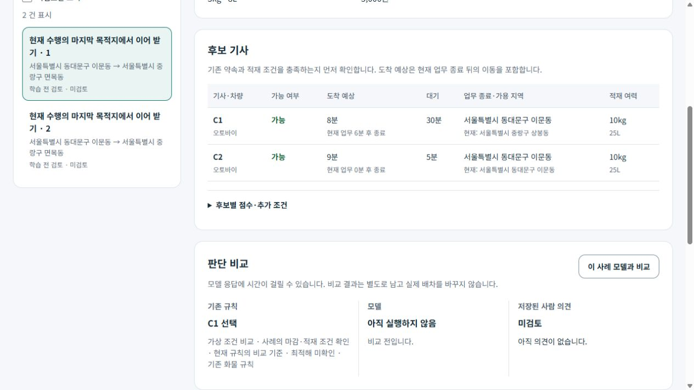
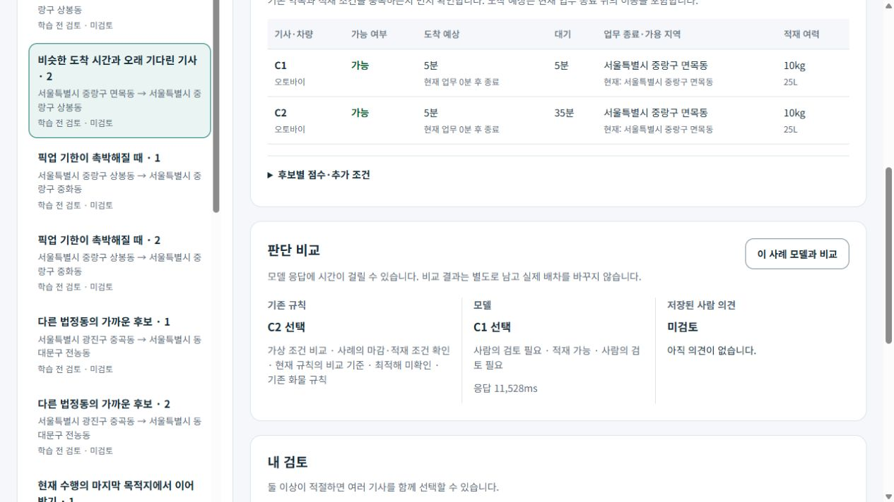
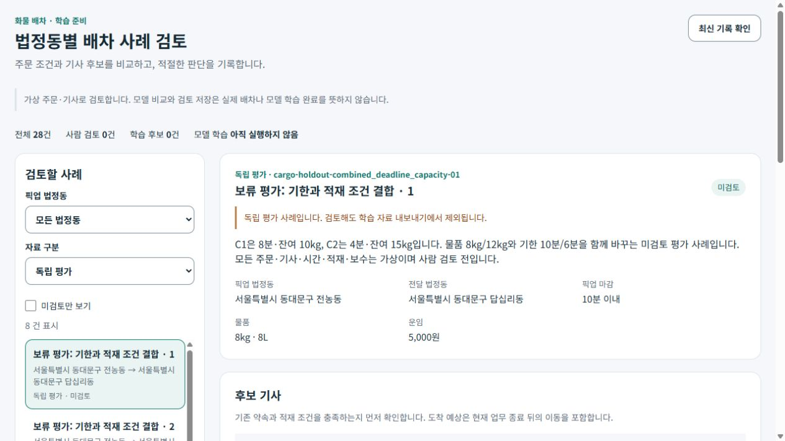

# 법정동별 퀵 배차 학습 준비와 PC 검토 r113

2026-10-19. 사용자가 화물·퀵 배차 AI 학습을 우선하고, 법정동별 주문·기사 상황에서 판단을 직접 검토할 수 있도록 준비하는 방향을 승인했다. [기획·구현 r67](../AI/Planning/공통/PLAN-OPERATIONS-DISPATCH-CORE/cargo-regional-training.implementation.r67.md), [현재 스레드 작업 명세](../AI/Planning/공통/PLAN-OPERATIONS-DISPATCH-CORE/cargo-regional-training.r67.work-order.json), [화면 책임](../ProjectOverview/page-docs/cargo-regional-training-review-r113.md)을 따른다.

## 준비한 흐름

```text
공식 법정동 수집본 검증 — 15개 코드·명칭, 고객 주소 없음
└─ 가상 퀵 주문·기사 사례 28개
   ├─ 사용자 검토 20개 — 10개 상황군 × 2개 조건 변화
   └─ 별도 평가 8개 — 다른 4개 상황군 × 2개 조건 변화
      ↓
한 사례의 주문 조건과 기사 후보 비교
├─ 기존 순수 화물 조율 엔진: 비교 기준
├─ 기존 로컬 Ollama: 선택적 제안·실패·지연 기록
└─ 사용자: 적절함 / 수정 의견 / 판단 보류
   ├─ 적절한 후보 여러 명 또는 배정 보류를 함께 허용
   ├─ 정확한 입력·정책·모델 실행·검토 차수에 의견 결속
   └─ 검토 분할의 명시 승인만 학습 후보로 내보내기
      └─ 평가 분할·미검토·판단 보류는 학습에서 제외
```

사례는 소형 오토바이 퀵 기준이다. 기존 수행의 마지막 목적지에서 가용해지는 시간, 픽업 기한, 장기 대기, 잔여 중량·부피, 신규 수신 의사, 위치 만료, 복귀 방향, 미확인 ETA를 비교한다. 법정동 코드 일치를 실제 인접·거리·경로·도착 시간으로 바꾸지 않는다. 이 검토용 적격성·점수는 교육용 가정이며 실제 운영 guard의 완전한 실행이 아니다.

## 화면과 보존

관리자 프로젝트의 공용 Razor 컴포넌트를 전용 loopback 호스트가 그대로 연결한다. 기존 운영 관리자 메뉴·route·DI는 바꾸지 않았고 역할 앱을 추가하지 않는다. 기본 주소는 `http://127.0.0.1:5595/admin/freight-delivery/dispatch-ai-review/training`이다.

실제 조율 엔진을 순수 호출하지만 운영 DB·추천 확정·수락·실제 FCM·지급은 호출하지 않는다. 계약·서버 실행 모드·worker 기본값도 바꾸지 않는다. 학습자료 준비, 모델 추론, 사람 검토와 가중치 학습은 각기 다른 상태다.

자료·소스·런타임 DLL의 해시, 공식 ZIP/내부 원문/행 해시를 보존한다. 초기 자료와 출처 파일은 불변이고 검토·모델 결과는 JSONL에 추가한다. 파일 잠금·현재 차수·요청 ID로 중복/동시 변경을 보호하며 모델 포트에는 입력 복사본만 전달한다. 복원 때도 내부 사례·입력·정책·후보 적격성을 재검사하고 내보내기까지 같은 잠금을 유지한다. 모델 입력에는 기존 엔진의 답·점수·사람 의견을 포함하지 않는다.

자료는 `artifacts/local/cargo-regional-training-r113/`에 비공개로 보관한다. 실제 사용자 검토 원장과 자동 검사의 모의 승인 사본은 저장 위치와 표시를 분리한다.

## 검증 결과

- 최초 연결 빌드의 Razor namespace/type 충돌과 반복 변수 이름 충돌을 수정했다. 후속 연결 빌드는 경고·오류 0개로 성공했다.
- 최초 자체 검사는 Windows 혼합 경로 표기 때문에 24개 중 23개가 준비 단계에서 실패했다. 절대경로 정규화 후 공식 ZIP의 CP949 파일명 해석 누락을 확인했고, 26개 중 25개가 `RegionMemberMissing`으로 실패한 기록도 보존했다. 두 실패를 이후 통과로 소급하지 않는다.
- Fast는 계약/관리자 프로젝트 빌드와 공백 검사를 통과했다. 현재 경로 매핑의 Fast 시험 계획은 0개다. 새 도구의 자체 검사와 Task 전체 시험은 별도로 기록한다.
- 최종 연결 호스트는 경고·오류 0개로 빌드했다. 별도 사본의 자체 검사 **26개 통과·실패 0개**다. 공식 코드·해시, 상황군 분리, 적격성·끝점 ETA, 복수 정답·보류·내보내기, 재시작·동시 revision·중복 요청, 모델의 입력 변조·근거 불일치·지연, 정상 JSON 형태의 이력 변조를 포함한다. 자동 검사에서 만든 승인은 사본의 모의 승인이다.
- 최종 Fast 계약/관리자 빌드와 Task 솔루션 빌드·전체 시험 **12,644개 통과·실패 0개·환경 의존 16개 생략**을 확인했다. Task는 현재 도구 계약상 전체 시험이고 새 자체 검사 26개와 합산하지 않는다. Task 결과는 `artifacts/local/validation/20261019-084638/Ssalddel.Tests.trx`, 최종 Fast는 `artifacts/local/validation/20261019-085605/`다. Task 솔루션에 포함되지 않는 관리자 프로젝트의 마지막 메모 길이/보류 입력 변경도 최종 Fast로 다시 빌드했다.
- 실제 연결 컴포넌트의 브라우저에서 법정동 필터, 수행 중 마지막 목적지·가용 시각/도착 예상 비교, 평가 8개 및 학습 제외 안내, 규칙/모델 불일치 표시를 확인했다. 별도 `ui-check/` 사본에서는 복수 후보 저장·새로 열기 복원·보류 전환 시 답안 해제/비활성·보류 저장과 학습 후보 제외를 관찰했다. 실제 검토 자료에는 사용자 의견을 대신 입력하지 않았다. 관찰한 브라우저 오류는 0개다.
- 전체 페이지 캡처 호출은 사용할 수 없어 실패를 보존하고 실제 viewport 캡처를 사용했다. 대표 화면은 아래에 연결했다. 휴대폰·운영 서버의 검증을 뜻하지 않는다.

### 실제 Ollama 비교

기존 Docker `mirror-local-dispatch-ai-ollama-1`을 시작해 설치된 `qwen3:1.7b`로 **3회 추론**했다. 추가 설치나 모델 다운로드는 하지 않았다. 실제 모델 digest는 `8f68893c685c3ddff2aa3fffce2aa60a30bb2da65ca488b61fff134a4d1730e7`이다.

| 사례 | 결과 | 시간 | 해석 |
| --- | --- | --- | --- |
| 장기 대기 조건 1 | 근거 불일치로 응답 제외 | 15,630ms | `UnsupportedReasonFact`, 채택 후보 없음 |
| 장기 대기 조건 2 | 구조·입력 사실 검사 통과, C1 제안 | 11,528ms | 같은 ETA 5분에서 C1 대기 5분·C2 대기 35분이다. 기존 엔진은 C2이며 모델은 장기 대기 우선 방향과 다르다. 사람 품질 승인이 아니다. |
| 픽업 기한 조건 1 | 근거 불일치로 응답 제외 | 11,495ms | `UnsupportedReasonFact`, 채택 후보 없음 |

3개는 실행 연결을 확인한 시작 표본이다. 전체 판단 품질·모델 개선을 입증하지 않으며, 반복 근거 문구도 그대로 관찰했다. 모델의 구조 검사 통과와 적절한 배차 판단은 별개다. 기존 엔진 결과도 확정 정답으로 승격하지 않는다. 승인 자료를 만들 때 이 차이를 사용자와 검토하는 것이 다음 단계다.

최종 자료 해시는 `422cac104ae96e00b8a4e0cb1d587efea0cb6db39f28d877953ecb1ed12e4f13`, 정책/런타임 해시는 `329161ca05481ff11fb5263f516cfc3ccc473cf7aa5c0dd3f5b651af3bbf07df`다. 최종 자료의 **사람 의견 0건·학습 가능 0행·내보내기 0행**, 평가 제외 8건을 다시 확인했다. 실제 모델 비교만으로 학습 가능 상태를 올리지 않았다.

로컬 증거: [검증 요약](../../artifacts/local/cargo-regional-training-r113/validation-summary.json), [모델 비교 3회](../../artifacts/local/cargo-regional-training-r113/model-comparisons.jsonl), [최종 자료 조회](../../artifacts/local/cargo-regional-training-r113/workspace-final.json), [최종 내보내기](../../artifacts/local/cargo-regional-training-r113/export-final.json), [기존 작업 보존 감사](../../artifacts/local/cargo-regional-training-r113/ownership-audit.json). 당시 변경 파일 367개의 체크포인트에서 허용 범위 밖 변경 0개를 확인했고 종료 전 재대조도 0개다. 기존 원본 ZIP과 이전 실패·표본·검토 사본도 보존한다.

전용 UI 시험 서버 5596은 종료했다. 사용자 검토 서버 5595와 기존 Ollama 컨테이너는 로컬 검토를 이어갈 수 있도록 실행 상태로 남겼고 자동 시작·예약 작업은 추가하지 않았다.

### 대표 화면

현재 위치와 마지막 업무 종료 지역을 구분하고 가용 6분 뒤 이동 2분을 더해 8분으로 표시한 사례다.



두 후보 ETA는 같지만 대기 35분인 C2와 다른 C1을 모델이 선택한 사례다. 사람의 의견은 미검토 상태다.



평가 분할 8개와 학습 내보내기 제외 안내다.



## 한계와 다음 단계

사용자 실제 승인 전에는 학습 가능 행이 0개인 것이 정상이다. 28개 합성 사례는 학습 충분성·운영 품질을 입증하지 않는다. 현행 법정동 재조회·경계/인접·실경로·실제 차량 화물 제원·원가·요금·지급 재원·실주행은 별도다. 공식 자료는 2026-08-11 수집본이고 공급처 효력 기준일은 미확인이다.

먼저 장기 대기·기한 변화·수행 중 마지막 목적지 사례를 사용자와 검토한다. 이후 승인 사례와 새 독립 평가 자료가 쌓이고 기존 엔진 대비 반복 오류·개선 여부를 확인한 뒤 소규모 가중치 학습을 검토한다. 이번 범위에는 학습 실행·운영 배차 활성화·APK/휴대폰·Unity·영상 변경·커밋/푸시·외부 배포가 없다.
