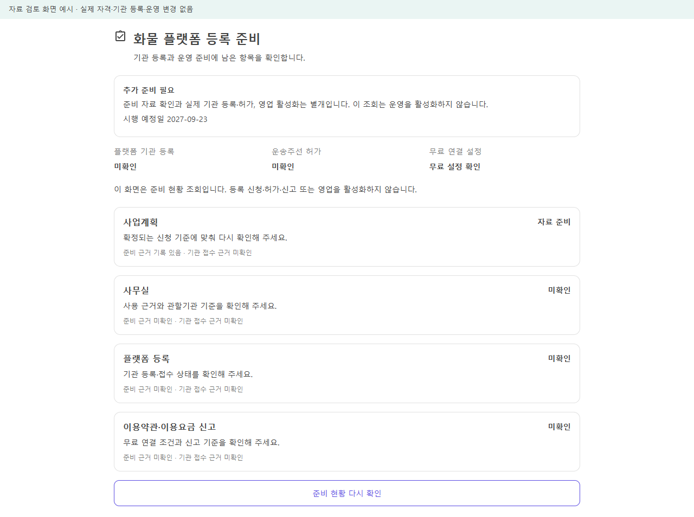

# 무료 퀵·화물 등록 준비·운송 자격 연결 r71

- 일자: 2026-10-19. [사용자 승인 구현 범위](../AI/Planning/공통/PLAN-OPERATIONS-DISPATCH-CORE/registration-readiness.implementation.r71.md) · [선행 법령·코드 감사](2026-10-19-freight-platform-registration-readiness-audit.md).
- 상태: **로컬 구현·검증 완료 / 기관 등록·법정 적격·운영 활성화 미확인**.
- 기존 `dev/mirror-integration` HEAD `fd55a1c4b`와 작업 시작 당시 351개 변경을 보존한다. Unity·배달 영상·원본·기존 송금/정산 원장은 수정하지 않는다.

## 이번 변경

기존 기사 역할·프로필의 `활동중`을 법정 자격 확인으로 해석하지 않도록, 개인·실제 차량·운송사업자 검토와 플랫폼 자신의 등록 준비를 분리했다. [법률 제21970호 개정문](https://law.go.kr/LSW/lsRvsDocListP.do?chrClsCd=010202&lsId=001748&lsRvsGubun=all)의 2027-09-23 시행을 준비하는 구조다. 세부 등록기준은 국토교통부령에 위임되어 있으므로 내부 검토 결과를 법정 적격 확정으로 표시하지 않는다.

| 책임 | 반영한 동작 | 완료로 해석하지 않는 것 |
|---|---|---|
| 기사 본인 | 내 정보 → 운송 자격 확인, 수단·프로필·실차와 비공개 자료 참조 제출, 검토 상태 조회 | 번호·서류 원본 수집, 자료 진위·소유 자동 확인 |
| 기존 서버관리자 | 해당 기사 검토·보완·정지·효력 및 판본 확인, 자기 승인 차단 | 공식기관 조회·허가 발급 |
| 신규 배차 | 운행 시작·후보 점수 계산·AI 입력·공개/전국 콜·추천 저장·추천 조회·수락·알림 생성/발송 전 확인 | AI가 법정 적격을 판정하거나 운영 기능을 활성화하는 것 |
| 기존 운송 | 자격이 정지돼도 조회·사진·전달·안전 인계와 같은 수락의 결과 재확인 유지 | 계속 신규 운송을 받아도 된다는 허용 |
| 플랫폼 관리자 | 사업계획·사무실·보안·요금/약관·위반 고지/신고/제한 등 준비와 실제 기관 확인을 별도 조회 | 실제 등록 신청·신고 전송·수리 |
| 화주 | 화물 종류·포장/깔판 포함 총중량·길이/너비/높이·출도착 보존, 운영 신규 접수·배차 시 누락 차단 | 미확인 치수 추정, 기존 접수 원문 자동 수정 |
| 무료 연결 | 기본/개발 설정의 기사 이용료·월 상한을 0원으로 일치 | 배포 환경 과금 확인, 운임 자체가 무료라는 뜻 |

## 업무 흐름과 실패 복구

```text
기사 본인 자료 검토 요청
└─ 기존 관리자 검토
   ├─ 검토 중·반려·만료·정지·차량 불일치 → 신규 업무 제외 + 보완 사유
   └─ 내부 검토 유효
      └─ 플랫폼 준비·실제 등록/신고 근거 + 무료 설정 확인
         └─ 기존 수신·차량 적합·적재·시간창·운임 조건 확인
            └─ 후보 / AI 조율 / 공개·전국 콜
               └─ 저장·알림·수락 시 재확인 → 기존 픽업·전달 절차

어느 단계에서 자격이 바뀌어도
├─ 신규 추천·수락·대기 알림 → 중단 또는 취소
└─ 이미 맡은 운송 → 조회·증빙·완료·안전 인계 계속
```

플랫폼 준비·실제 등록·이용요금/약관 확인을 함께 요구하는 것은 **이번 내부 출시 관문**이다. 아직 시행 전인 개정법을 현재 모든 오토바이 서비스에 일괄 적용한다는 법적 판단이 아니다. 오토바이와 화물차 자료 목록을 구분하며 화물차 종사자격을 오토바이 공통 요건으로 복사하지 않는다. 유상 주선 허가는 플랫폼 등록과 별도이며 이번 무료 직접 연결이 모든 법적 의무를 면제한다고 판단하지 않는다.

검토 정책의 현재 자동 분류는 기존 참여 원장의 `Motorcycle`과 `Truck`/`Van`을 대상으로 한다. 그 밖의 미정의 수단은 내부 자격 유효로 추정하지 않고 신규 업무를 막는다. 이는 해당 수단이 법적으로 언제나 금지된다는 판단이 아니며 별도 수단 정책을 확인한 뒤 추가해야 한다.

DB의 동시 변경 판본을 보존하고 타인 제출·자기 승인·정지 상태의 본인 해제를 거절한다. 수락은 트랜잭션 안에서 처음과 확정 직전에 자격 판본을 비교한다. 결과가 불확실한 제출은 자동 POST 재전송 대신 최신 GET으로 확인한다. 신규 의존성이 누락되면 허용으로 대체하지 않는다. Simulation 우회는 명시적 실행 모드·옵션 또는 시험 전용 대역만 사용하며 운영 승인으로 저장하지 않는다.

## 데이터·개인정보 경계

- `driver_transport_qualification` 전문 검토 기록과 기존 기사 프로필의 실차 내부 참조를 추가했다. 운송 원장 상태의 권위를 이 테이블로 옮기지 않는다.
- 비공개 근거·변경 이력·실차 참조는 기존 개인정보 보호 저장 체계를 사용한다. 자격 자료 API는 본인 또는 기존 서버관리자에게만 제공하며 응답 캐시를 막는다. 별도의 플랫폼 준비 조회는 기존 서버관리자 권한으로 제한하고 비공개 원문 참조·검토자 원문을 반환하지 않는다.
- `private-evidence:` 참조는 형식을 검사한다. 이 화면에서 실제 파일의 존재·소유·원본 진위까지 검증하지 않는다. 별도 비공개 자료관리와 관리자의 실제 자료 검토가 선행돼야 한다.
- 이번 마이그레이션은 격리 시험용 DB에서 확인한다. 사용자 개발 DB·운영 DB에 자동 적용하지 않는다. 실제 자료의 보관기간·권리·삭제를 기존 개인정보 처리와 연결하는 후속 검토가 필요하다.

## 화면과 검증 증거

[역할별 페이지 책임](../ProjectOverview/page-docs/transport-qualification-registration-r1.md)을 따른다. 브라우저 예시는 실제 공통 컴포넌트와 메모리 자료를 사용하며 실제 API·기관·휴대폰 화면과 구분한다. HTTP·DB 시험은 별도 격리 서버와 SQLite에서 실제 Controller·인증/권한·기능 경계·UseCase·암호화·마이그레이션·동시 변경을 확인한다.

HTTP 인증은 시험용 ASCII 헤더를 기존 기사·서버관리자 권한으로 매핑한다. 실제 사용자 로그인·Bearer 토큰 발급/검증·공식기관 인증을 시험한 것은 아니다. 저장 암호화는 격리 DataProtection 키로 확인하며 운영 키 보관·복구 검증은 별도다.

최종 Fast 집중 시험은 **333개 통과 / 실패·생략 0개** (`artifacts/local/validation/20261019-124728/`), 최종 Task는 전체 소비 솔루션 빌드와 **12,823개 통과 / 실패 0개 / 환경 의존 16개 생략 / 전체 12,839개**를 확인했다 (`artifacts/local/validation/20261019-125150/`). 생략된 격리 Mongo/MySQL 등 환경 시험은 통과로 계산하지 않는다. 초기 시험 코드·소비 웹 레이아웃 오류, 코드 안내 목록의 갱신 필요, 시험 인증 헤더와 알림 예시 자료의 4개 실패는 각 `focused.log`, `fast.log`, `fast-r2.log`, `fast-r3.log`와 해당 검증 폴더에 보존했다. 원인을 수정한 뒤 Fast-r4의 298개와 최종 Fast-r5의 333개를 통과했으며 과거 실패를 성공으로 소급하지 않는다.

첫 Task 전체 회귀는 **12,819개 통과 / 3개 실패 / 환경 의존 16개 생략**이었다 (`artifacts/local/validation/20261019-123922/`). 실패한 두 음식/화물 경계 시험에는 화물 사례의 명시적 Simulation 자격·원본 의뢰 전제를 보완했다. Schema 시험은 이전 마지막 migration을 현재 모델과 비교하던 포인터를 갱신하고, 새 migration의 고정 TargetModel과 실제 Up의 정확한 차이를 검사하도록 보완했다. 기존 migration의 과거 TargetModel은 바꾸지 않았다. 새 고정 모델의 실차 참조 2열·자격 전문표 1개의 정확한 차이 시험을 추가한 뒤 최종 Fast와 Task를 통과했다.

이전 로컬 합성 운송 도구 네 개도 Development·loopback·전용 DB 경계를 확인한 뒤 `TransportQualification:AllowSimulationBypass=true`를 해당 전용 설정에만 명시했다. 기본·운영 설정에는 추가하지 않으며 실제 자격 승인으로 저장하지 않는다. 네 도구 빌드는 오류 0으로 통과했다. DispatchTraining의 최초 복원 자산 누락은 보존하고 의존성 복원 후 다시 빌드했다. 이번에는 도구의 실제 시나리오·모델 실행을 하지 않았다.

현재 소스의 DB 모델 소유권 목록도 생성기로 갱신했다. 모델 표 289개·이력 표 4개·중복 소유 0개이며 자격 전문표는 `SsalddelContext`가 단독 소유한다. 이는 소스 모델 검사이고 실제 운영 DB 조회가 아니다. 기존 목록 사본과 생성·검사 결과는 `artifacts/local/freight-registration-r71/`에 보존했다. 최종 대표 입력·소비 DLL 해시는 `implementation-source-hashes.json`이며 전체 변경 파일 목록을 대신하지 않는다.

대표 화면은 예시 자료다. 각 링크는 전체 세로 화면이며 날짜·증빙 참조가 실제 사람의 자료가 아니다.

| 기사 본인 | 관리자 자료 검토 |
|---|---|
| [모바일 전체 화면](../assets/changes/freight-registration-r71/driver-390.png) | [데스크톱 전체 화면](../assets/changes/freight-registration-r71/admin-1280.png) |



- [조회 실패와 재확인 화면](../assets/changes/freight-registration-r71/error-390.png)
- [화주 모바일 입력](../assets/changes/freight-registration-r71/cargo-input-390.png) · [화주 PC 입력](../assets/changes/freight-registration-r71/cargo-input-1280.png): 포장 포함 총중량·세 치수, 필수값 보완·0중량 거절·양수 복구와 입력 유지 4검사를 확인했다. 모바일 대표는 기존 내부 스크롤을 중량 입력 위치에 맞춘 실제 화면이며 전체 페이지 맨 위 캡처가 아니다.
- [화면 검증 요약·사본 해시](../assets/changes/freight-registration-r71/validation-summary.json): 최종 소비 DLL에서 320/390/1280px × 기사/관리자/플랫폼/실패 12장면과 화주 390/1280px 2장면, 합계 **14장면**. 가로 넘침·브라우저 오류·외부/업무 API 요청 0, 대표 PNG 6장의 원본/사본 해시를 대조했다. 최초 label 선택자 실패는 제품 실패와 구분해 보존하고 실제 컴포넌트 기반 선택자로 재실행했다. 마지막 브라우저 정리 대기 후에도 실제 exit 0과 결과 JSON을 확인했다.
- 소비 빌드는 Web·전문 기사 Web·관리자·모바일 프로젝트를 포함한다. 전문 기사 Web 페이지는 기존 호스트 인증·복귀·로그인 경로를 사용하며 통합앱 전용 접근 서비스에 의존하지 않는다. 각 호스트의 실제 로그인·업무 HTTP 실행과 공통 패널 화면 예시는 별도 범위다.

## 실제 운영 전 남는 확인

1. 확정 시행령·시행규칙, 신청 주체·사무실·결격사유와 관할기관의 실제 등록/신고 확인.
2. 적법하게 확보한 자료의 존재·소유·진위, 수단별 필수서류와 보장 범위·기간, 실제 차량제원·적재 허용범위의 대조. 내부 자격 검토 유효가 개별 운송의 과적 없음이나 실제 차량 적합성까지 인증하는 것은 아니다.
3. 개인정보 수집 근거·보관/삭제·열람/외부 처리와 실제 보안·재해 복구 검증.
4. 위반 의심·확인·기관 신고 전송·기관 확인·이의 및 복구를 기존 전문 사건 처리와 연결하는 운영 절차. 이번 준비 목록만으로 신고 기능 완성을 주장하지 않는다.
5. 실제 운영 설정·휴대폰·푸시·실금융·공개 배포는 별도 검증. 기능 플래그·worker·외부 발송·실수납·운영을 이번 작업에서 활성화하지 않는다. commit/push도 하지 않는다.
