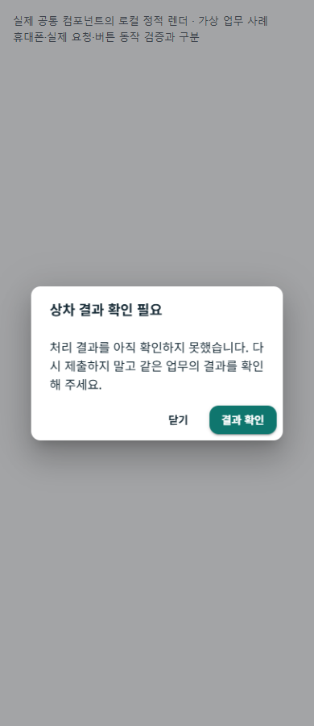
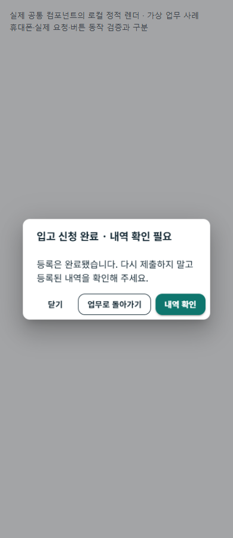

# OS 단계·도메인 예외·업무 복구 r2

- 날짜: 2026-10-21
- 상태: `CompletedLocalValidation / OtherOsAndDurableRecoveryPending`
- [승인·책임](../AI/Planning/공통/PLAN-OPERATIONS-DISPATCH-CORE/domain-workflow-recovery.r2.md) · [단계별 정상/예외 대응표](../AI/Planning/공통/PLAN-OPERATIONS-DISPATCH-CORE/domain-workflow-recovery.matrix.r2.md) · [작업 명세](../AI/Planning/공통/PLAN-OPERATIONS-DISPATCH-CORE/domain-workflow-recovery.r2.work-order.json)
- 선행: [짧은 조회 오류 안내·APK202 기기 검증](2026-10-21-role-error-recovery-r1.md)

## 구현 목적과 경계

오류 문자열을 HTTP 상태만으로 해석하던 첫 안내에 OS·업무 단계·처리 결과를 연결한다. 서버는 기존 원장·Policy·UseCase가 확정한 실패 사유와 가능 복구 행동을 전달하고 화면은 현재 역할의 짧은 안내/버튼을 선택한다. 기존 상태 전이 조건·사진 요구·권한·원장·금액·운영 기본값은 유지한다. 기존 dirty 변경은 별도로 보존했다.

공통 계약은 선택적 `workflowContext`의 OS/단계/결과와 기존 errorCode·책임·행동·revision을 사용한다. GET은 NotApplicable, 변경 전 명시적 거절은 NotApplied, 저장 응답 확인은 Applied, 응답 불명은 Unknown이다. Applied는 후속 조회 성공을 뜻하지 않고 Unknown은 미접수를 뜻하지 않는다. 내부 코드·raw body·trace를 제품 본문에 그대로 표시하지 않는다.

## 단계별 반영

화물 접수→배차→상차→운송→하차→인수/정산의 대응표를 만들고 기존 담당자·가능 행동과 연결했다. 이번 첫 범위는 화물/화주 조회와 상하차 guard·입고 결과 확인이며 음식·공동구매·수입·생활 신뢰 등 다른 OS의 개별 코드 적용은 후속이다. 새로운 공통 상태 원장이나 실행 엔진은 만들지 않는다.

| 경계 | 이번 변경 |
| --- | --- |
| 서버 계약 | [업무실패맥락Dto](../../Ssalddel.Contracts/Common/Workflow/업무실패맥락Dtos.cs)는 알려진 OS·해당 OS의 단계·결과4종만 허용한다. 기존 API 필드는 유지한다. |
| 서버 응답 | [Result 응답](../../Ssalddel/Controllers/Result응답확장.cs)은 같은 첫 오류에 결속된 허용 메타데이터만 전달한다. 임의 metadata를 공개하지 않는다. |
| 화물 guard | 사진·인수증·창고 인계·운송 보류·단계 변경의 사유를 [기존 guard Factory](../../Ssalddel/Application/Driver/Transport/Services/화물업무실패Factory.cs)에 결속했다. 명시적 변경 전 거절만 NotApplied다. |
| 조회·표현 | 공통 파서→Api작업오류→[업무 표현](../../Ssalddel.Ui.Common/Areas/App/ViewModels/업무맥락오류Presentation.cs)→Dialog로 전달한다. GET은 같은 OS의 페이지 목적에 맞춰 표시명을 구체화하고, 명령의 결과/단계는 서버 값을 유지한다. |
| 기사 상하차 | 사진 완료 서비스가 버리던 typed 완료 실패를 보존하고 상하차 VM·화면에 연결했다. 실제 완료 확인 시 기존 정리를 수행하며 다른 ID/계정/폐기 뒤 늦은 실패를 적용하지 않는다. 이번 완료 실패의 중복 상태 문구만 숨긴다. |
| 명시적 미확정 | 같은 OS·현재 완료 단계의 서버 Unknown은 GET이 성공해도 미완료이면 유지하고 재POST를 막는다. 실제 완료가 확인되면 해소한다. |
| 화주 조회 | 접수 요청 조회와 진행 조회의 단계를 구분한다. 조회404는 접수 거절·의뢰 취소 확정이 아니다. 기존 접수 복구와 결제/인수증 안내는 유지한다. |
| 입고 결과 | 저장/완료 응답 뒤 GET 실패는 Applied로 보존한다. 서버의 유효한 해당 입고 단계 결과를 우선하고 맥락 없는409/408/425/429는 Unknown이다. 대기 중 새 신청 진입을 비활성화하되 목록/뒤로 이동은 유지한다. |
| 입고 조회 수명 | 기존 업무선택Context와 요청 scope로 A→B 조회의 늦은 A 응답·실패·finally를 무시한다. 진행 중 POST는 조회 취소와 연결하지 않고 기존 중복 방지를 유지한다. |

## 화면 예시

[공통 다이얼로그 6사례](../assets/changes/2026-10-21-domain-workflow-recovery-r2/index.html) · [원본 결속/검증 색인](../assets/changes/2026-10-21-domain-workflow-recovery-r2/evidence.json).

현재 제품 공통 컴포넌트에 가상 입력을 넣어 실제 HtmlRenderer로 정적 렌더하고 Chrome의 로컬 파일390/1280px에서12장 확인했다. 모두 화면 안에 표시됐고 가로 넘침·콘솔/페이지 오류·외부 요청은0이었다. 대표390px6PNG는 원본 바이트/SHA 그대로 문서에 보존했다. 전체 역할 페이지·버튼 동작·실제 HTTP·휴대폰 실행을 이 이미지로 대신하지 않는다. 다이얼로그 수명/GET 콜백/명령 차단은 회귀시험 증거와 구분한다.

## 검증 상태

서버 첫 집중 시험72개와 첫 Fast의 관련247개는 실패/미실행0으로 통과했다(`artifacts/local/validation/20261021-222008/`). 아래 회귀 수정 후 **최종 Fast286개 통과·실패/미실행0**, **최종 Task 전체14,260개 통과·실패0·환경 의존16개 미실행**과 소비 솔루션 `Ssalddel.v3.5.slnx` 빌드를 확인했다. 최종 실행은 각각 `artifacts/local/validation/20261021-223026/`, `artifacts/local/validation/20261021-223121/`에 보존한다. 서로 겹치는 실행을 독립 시험량으로 합산하지 않는다. 원본 로그·초기 보완·최종 소스 SHA는 `artifacts/local/domain-workflow-recovery/20261021-r1/`에 보존한다.

SSR 첫 시도의 제목 검사가 HTML 인코딩을 고려하지 못해 중단된 도구 오류를 보존하고, 디코딩 검사 보완 후 r2/r3 렌더를 수행했다. 이를 제품 오류나 기기 실패로 집계하지 않았다. 제품 원문·불변 경계는 별도 시험으로 대조했다.

첫 Task 전체 실행(`artifacts/local/validation/20261021-222317/`)에서는14,255개 통과·16개 미실행과 분산 창고 회귀3건 실패가 있었다. 공통 오류 생성기가 넣은 ErrorCode/StatusCode를 기존 분산 사진 guard가 다시 추가해 발생한 예외였다. 중복 추가2곳만 제거하고 기존 분산 차단 사유·Code 별칭·HTTP409를 유지했다. 상하차 분산 guard 회귀2건을 추가했으며 분산 전체와 서버 집중111개 통과·실패/미실행0을 확인했다. 첫 실패·r1 소스와 수정 r2 소스를 각각 보존했고 위 최종 Fast/Task에서 실패가 해소됐다.

최종43개 제품/시험 소스와 허용 경로·해시, 렌더에 사용한 공통 UI/계약 assembly와 최종 빌드 바이트, 문서 링크·diff 검사는 `artifacts/local/domain-workflow-recovery/20261021-r1/verification.json`에 별도 결속한다. 그림의 입력은 가상이며 새 HTTP 요청/실제 서버 업무 완료나 APK 실행 증거가 아니다.

## 남은 우선순위와 한계

1. **미확정 복구 영속화와 명령 결과 조회 계약**: 입고는 기존 transient VM, 상하차 명시 Unknown도 현재 VM 수명에서 보호한다. 사진 recovery store는 기존 사진/업로드 참조를 보관하며 새로운 미확정 정책을 영속화하지 않는다. 앱 폐기·재실행·새 VM 이후까지 중복 명령을 막았다고 표시하지 않는다. 서버 멱등/결과 조회 계약을 먼저 정해야 한다.
2. **구판 응답과 추천 수락의 사유 전수 적용**: 구판에는 기존 GET 재확인 후 명시적 사용자 재요청 동작을 유지했다. 모든 통신 실패를 새 서버 Unknown과 같게 처리한 것은 아니다. 현재 추천 수락 전체 guard의 단계·결과 분류도 후속이다.
3. **음식·창고의 다음 단계와 다른 OS**: 메뉴 변경·접수 미확정·음식점 조리/픽업, 창고 검수/피킹/포장/인계, 정산·지급·사건 처리의 각 전문 책임에 순차 적용한다. 기술 오류와 지속 현장 사건을 합치지 않는다.

이전 APK202는 선행 코드이며 이번 변경을 설치한 판본으로 표시하지 않는다. 이번에는 새 USB 검증 APK 제작/설치·기기 조작·기존 로컬 서버 재기동·운영 DB 변경·외부 서버/FCM·실금융·운영 활성화·모델 학습·stage/commit/push를 하지 않았다.
