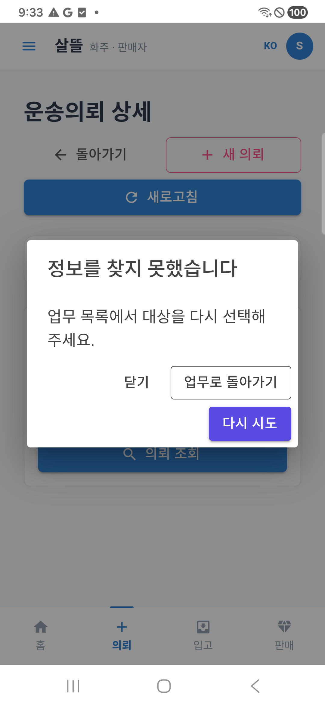

# 역할 앱 통신·오류 안내·업무 복귀 r1

- 날짜: 2026-10-21
- 상태: `CompletedLocalDeviceValidation / RemainingRoleFindings`
- [승인 계획](../AI/Planning/공통/PLAN-OPERATIONS-DISPATCH-CORE/role-error-recovery.r1.md) · [작업 명세](../AI/Planning/공통/PLAN-OPERATIONS-DISPATCH-CORE/role-error-recovery.r1.work-order.json)
- 선행: [화물 예외 화면 검증](2026-10-21-cargo-ui-exception-audit-r1.md)

전체 역할의 대표 오류 경로·서버 설정을 조사했다. 공통 오류 안내와 화주·화물 기사 조회 복구를 우선 구현했다. 조사한 모든 화면에 새 창을 적용하거나 모든 앱의 실제 통신을 확인했다는 뜻은 아니다. 실행 자료는 `artifacts/local/role-error-recovery/20261021-r1/`에 보존한다.

## 서버 통신

기존 격리 로컬 서버와 화주·기사·서버관리자 합성 계정을 사용했다. 정상 조회5건과 미인증/권한/없는 대상3건, **8건 모두 기대 응답과 일치**했다. `server-communication.json`은 PC HTTP 증거다. 신규 업무 명령은 보내지 않았으며 인증은 필요한 경우 정상 로그인으로 갱신했다.

| 요청 | 기대·실제 |
| --- | --- |
| 화주 본인 의뢰 | 200 |
| 기사 본인 운송 | 200 |
| 기사 현재 업무 | 200 |
| 기사 추천 목록 | 200 |
| 관리자 운송 목록 | 200 |
| 로그인 없는 의뢰 접근 | 401 |
| 화주 계정의 관리자 접근 | 403 |
| 없는 의뢰 | 404 |

서버는 기존 `5364`, 휴대폰 USB 시험 주소는 `5363→5364`다. 기존5595 검토 서버·Ollama·DB·운영 비활성 설정은 유지했다. 이전 migration health 경고를 통신 성공으로 해소된 것으로 표시하지 않는다. 외부 Azure·FCM·실제 수금/입금·지급을 검증한 결과가 아니다.

## 이번 구현

- [공통 오류 창](../../Ssalddel.Ui.Common/Areas/App/Components/Recovery/업무오류복구Dialog.razor)은 짧은 제목·설명과 닫기/업무 복귀/재조회만 제공한다. [표시 수명](../../Ssalddel.Ui.Common/Areas/App/Components/Recovery/업무오류복구Panel.razor)은 같은 배경 오류의 반복 표시를 막고 대상 변경·성공·페이지 폐기에 맞춰 과거 창을 닫는다. 닫은 뒤에는 중립 상태와 ‘안내 보기’를 남긴다.
- [분류](../../Ssalddel.Ui.Common/Areas/App/ViewModels/업무오류안내Presentation.cs)는 기술 원문을 화면에 복제하지 않는다. 명시된 HTTP 상태와 오류 종류로 짧은 안내를 선택하며 GUID/주소의 숫자만으로 상태를 추정하지 않는다.
- [화주 공통 Frame](../../Ssalddel.Ui.Common/Areas/App/Components/Transport/ShipperRequestDetailScreenFrame.razor)은 조회 실패만 새 창으로 안내한다. [모바일 VM](../../SsalddelApp/ViewModels/Shipper/ShipperRequestDetailPageViewModel.cs)은 자동 재조회 성공 때 이전 조회 오류만 정리한다. 중요한 인수증·결제·미확정 결과 안내는 유지한다.
- 기사 [현재 운송](../../DriverApp/Components/Pages/Driver/03_Progress/진행중운송Page.razor), [상차](../../DriverApp/Components/Pages/Driver/03_Progress/상차Page.razor), [하차](../../DriverApp/Components/Pages/Driver/03_Progress/하차Page.razor)의 조회 오류를 연결했다. 완료 결과 미확정이면 결과 확인 GET을 사용하며 재전송·강제 이동을 하지 않는다.
- [공통 업무 상태](../../Ssalddel.Ui.Common/Areas/App/Components/Crud/SsalddelOperationState.razor)는 typed 기술 실패에만 적용한다. 여러 CRUD 조각의 창이 겹치지 않게 **자동 열기 OFF·명령 재시도 OFF**이며 ‘안내 보기’로 연다. 필드 검증·동시 변경·업무 거절은 기존 의미를 유지한다.

닫기·복귀·재조회는 상태 변경/완료 명령이 아니다. API·원장·권한·금액·필수 사진·동의·멱등 요청 ID·운영 기본값은 바꾸지 않았다. ‘오류가 없어진 화면’과 ‘업무가 완료됨’을 같은 결과로 처리하지 않는다.

## 역할별 조사·남은 범위

`food-survey.json`과 `operations-survey.json`은 첫 적용 전 소스 관측이다. 실제 제품 파일·행·기존 시험 후보를 보존하며 모든 route의 실행 증거로 사용하지 않는다.

| 역할/앱 | 발견한 차이 | 이번 적용·후속 |
| --- | --- | --- |
| 통합 화주 | 조회 실패 원문·복구 후 오류 잔존 | 상세 Frame와 모바일 조회 복구 적용. 다른 작성/목록은 개별 검토 필요 |
| 화물 기사 | 현재 운송·상하차 조회 오류와 복귀 | 3화면 적용. 사진/도착/신고·추천·정산의 개별 오류는 후속 |
| 음식 기사 FDriverApp | native XAML의 상태/경고 반복, 기존 ModalErrorHandler는 영어·예외 원문 | 조사만. native adapter와 배경 오류 중복 방지 필요 |
| 주문자 OrdererApp | 음식 상세는 안전 문구가 있으나 주문 작성·보조 원장에 인라인/raw 오류 잔존 | 개별 UI 미적용. 주문 접수 미확정·같은 요청 복구 우선 |
| 음식점 RestaurantDeskApp | 실시간 연결 오류에 기술 문구, 상세 인증·미확정 보호는 별도 | 개별 UI 미적용. 주문함 연결 오류부터 적용 필요 |
| 관리자 Web/모바일 | 일부 client는 비JSON body를 예외 원문으로 표시 | 개별 관제 미적용. PC 관리자 GET 통신은 위8건에 포함 |
| 창고·마트 | 목록/상세의 인라인 오류, 입고 완료/피킹과 조회 책임 차이 | 공통 typed OperationState 소비 기술 오류만 수동 안내. 개별 화면은 후속 |
| 판매자 SellerApp | 시설 조회/저장 원문, 일부 재조회 때 이전 오류 유지 | 개별 UI·서버 주소 미적용. 모바일 endpoint 소비 확인 필요 |
| 인사 HumanResourcesManagerApp | 목록/상세/신청 인라인 오류, 서버 미설정 localhost fallback | 개별 UI·설정 미적용. 실제 Android endpoint 확인 우선 |
| 분산 공간·입고·피킹 | pending 요청/사진·동의·편집 잠금, 다중 상태 안내 | 개별 UI 미적용. 기존 결과 확인·복구 수명 보존 필요 |

특히 Seller·HR은 `ResolveConfiguredBaseAddress`를 쓰며 HR 미설정 기본값은 `https://localhost:7117/`다. 모바일 내장 endpoint를 소비하는지 확인하지 않고 모든 APK 통신 정상으로 보고할 수 없다. 또한 `InboundRequestPageViewModel`의 POST 성공 후 GET 실패가 저장 실패 안내로 흐르는 경로는 새 신청보다 같은 결과 확인을 먼저 보완해야 한다. 이번에는 해당 업무 정책을 바꾸지 않았다.

### 남은 보완 순서와 코드 근거

1. **입고 결과 미확정**: [입고 요청 ViewModel](../../Ssalddel.Ui.Common/Areas/App/ViewModels/InboundRequestPageViewModel.cs)의 `284~295`행과 `374~386`행은 저장 뒤 재조회 실패도 일반 저장 실패로 안내한다. 생성 ID·같은 요청 결과·서버 멱등성을 먼저 대조한 뒤 재신청을 허용해야 하며, 이번 창 구현으로 해결됐다고 보지 않는다.
2. **물리 휴대폰 서버 주소**: [판매자 초기화](../../SellerApp/MauiProgram.cs) `21~24`행과 [인사 초기화](../../HumanResourcesManagerApp/MauiProgram.cs) `19~23`행은 구성 주소 경로다. 모바일 내장 주소를 읽는 overload와 차이가 있고, 인사의 localhost 기본값은 실제 PC 서버 접근 주소가 아니다. 실제 설치판의 해소 결과를 별도로 확인한다.
3. **음식 기사 native 안내**: [ModalErrorHandler](../../FDriverApp/Services/ModalErrorHandler.cs) `19~25`행은 기존 영어 제목과 예외 원문을 사용한다. Blazor 창 적용과 별개로 native adapter가 필요하며 배경 polling에 단순 연결해 창 대기열을 만들지 않는다.
4. **나머지 개별 조회 화면**: [관리자 client](../../SsalddelAdminApp/Services/AdminAuthenticatedApiClient.cs) `145~163`행의 원문 fallback, [판매자 시설 화면](../../SellerApp/Components/Pages/ForeignFoodFacilities.razor) `312~375`행의 오류 잔존·원문 표시부터 다룬다. [분산 업무 화면](../../Ssalddel.Ui.Common/Areas/App/RoleWorkspace/DistributedFulfillment/분산이행Screen.razor) `15~35`행의 같은 요청/사진 결과 확인과 편집 잠금은 보존한다.

## 검증 진행

공통 정책·컴포넌트 수명·화주 자동 복구·기존 인수증 관련 집중69개 통과, 실패·생략0이다. 초기 시험 namespace 오류2건은 수정 후 재실행했고 로그를 보존한다. 창 종료/생성 경합을 발견해 첫 Fast/APK를 중단하고 소스를 보완했으며, 부분 결과를 최종 APK로 쓰지 않는다.

최종 Fast는 소비 솔루션 `Ssalddel.v3.5.slnx` 빌드와 집중366개 시험을 통과했다(`artifacts/local/validation/20261021-211019/`). 최종 Task도 같은 소비 빌드와 전체14,172개 통과·환경 의존16개 미실행·실패0을 확인했다(`artifacts/local/validation/20261021-211229/`). 서로 겹치는 실행 수를 독립 시험량으로 합산하지 않는다.

## APK·휴대폰 검증

화주 통합앱과 화물 기사 앱의 USB Debug APK `0.1.202 / 202`를 제작해 기존201판에 업데이트 설치했다. 서명·정렬 검사와 기존 인증서 일치, 설치 후 APK를 다시 가져온 SHA 일치를 확인했다. 제거·데이터 초기화는 하지 않았다. 제작 입력3,335개 해시와 최종 공통 소스 해시를 대조했다. 제작 manifest의 당시 `physicalDeviceVerified=false`는 수정하지 않고 이후 설치·실행 증거를 별도로 남겼다.

| 앱 | 설치 바이트 SHA-256 |
| --- | --- |
| 화주 통합앱 | `876522699c3a58ba204037a4ad7fddeab37e6adefb02ac813190b63fabe429de` |
| 화물 기사 | `432d2a5d705cad0abd9952c73d6ef5086765cb5e3d791782bd3e4512d0c977bd` |

실제 Samsung Android 단말에서 합성 계정과 기존 완료 운송9를 조회했다. 최초 없는 의뢰 시험은 로그인 전이라 로그인 안내가 나왔고, 정상 로그인 후 동일 조회 시험을 다시 수행했다. 이를 404 복구 성공이나 제품 결함으로 집계하지 않았다.

| 절차 | 실제 관측 |
| --- | --- |
| 화주: 없는 의뢰 조회 | ‘정보를 찾지 못했습니다’ 창, 기술 원문 없음 |
| 창 닫기·배경 재조회 | 중립 상태·안내 보기 유지. 32초 동안 같은 창 재등장 없음 |
| 안내 다시 열기·업무 복귀 | 화주 홈으로 이동 |
| 정상 의뢰 조회 | 같은 완료 건의 상태·6,200원 조회 |
| USB 시험 통신만 차단 | ‘연결 확인 필요’ 창 |
| 끊긴 상태에서 다시 시도 | GET 재조회 실패를 다시 안내. 업무 명령 재전송 없음 |
| 시험 통신 복원 | 자동 재조회로 정상 의뢰 표시, 과거 창·오류 상태 제거 |
| 기사: 없는 운송 조회·복귀 | 동일 짧은 창과 현재 운송 화면 복귀 |
| 기사: 기존 완료 하차 조회 | 하차 완료, 오류 창 없음 |

새 화면9장을 [전후 화면 갤러리](../assets/changes/2026-10-21-role-error-recovery-r1/index.html)와 [증거 색인](../assets/changes/2026-10-21-role-error-recovery-r1/evidence.json)에 연결했다. 이전 APK201 오류 화면1장은 참고로 보존하며 새 캡처로 세지 않는다. 실제 viewport384px에서 관측한 모든 단계의 수평 넘침은0이었다. 버튼은 좁은 화면에서 줄을 바꿔 표시됐다.

갤러리는 실제 Chrome의 로컬 파일 표시390/1280px에서10장 로드·가로 넘침0·콘솔/페이지 오류0·외부 요청0을 확인하고 시각 검토했다. 갤러리 반응형 검증과 위 휴대폰 화면 검증은 별도 증거다.

복귀한 화주 홈에는 기존 **입고·재고 요약 조회 경고**가 여전히 인라인으로 표시됐다. 복귀 성공은 해당 홈의 모든 경고를 고쳤다는 뜻이 아니며 이 화면은 다음 적용 대상이다. 음식·판매자·인사·운영자 등의 개별 화면 실제 기기 시험도 이번 결과에 포함하지 않는다.

`canonical-readback.json`에서 같은 운송의 인수완료·차수1·동결보수6,200원·AI Applied가 이전 결과와 같음을 확인했다. 신규 접수·수락·상하차 완료·신고·결제·사진 촬영 명령은 보내지 않았다. USB 연결을 복원하고 화주 정상 의뢰 화면으로 돌려놓았다. 현재 두 앱 프로세스의 AndroidRuntime 오류 버퍼에 FATAL EXCEPTION이 없었으며 모든 과거 크래시나 장시간 안정성 검증을 뜻하지 않는다.

최종 실행 색인은 `artifacts/local/role-error-recovery/20261021-r1/verification.json`이다. 외부 서버·Azure·FCM·실거래·실입금·운영 활성화·commit/push는 하지 않았다.
