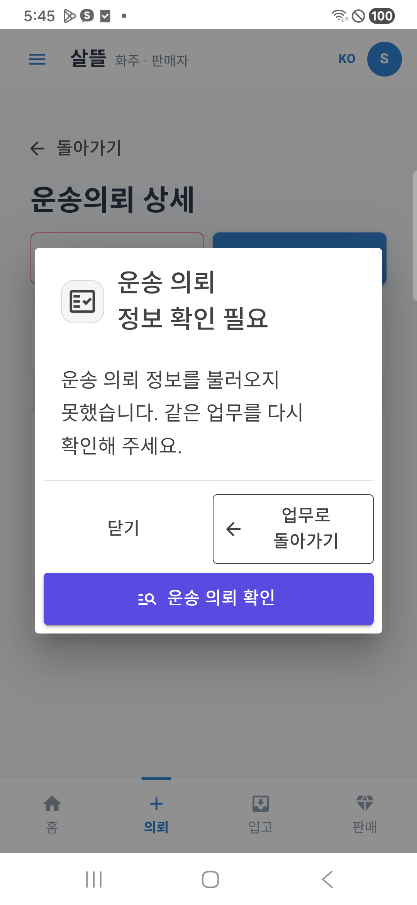
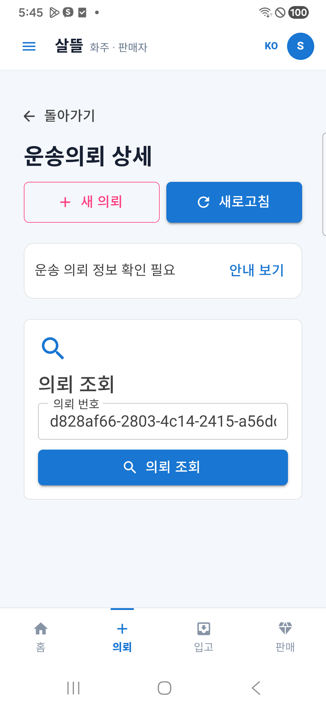

# 안내 창·화주 상세 버튼 정렬 r19

상태: `CompletedDeviceAlignmentValidation / ExistingServerReadFailuresRemain`. 사용자가 요청한 버튼·정보 정렬을 현재 휴대폰 안내 창과 화주 상세 화면부터 확인하고 보완했다. [r18 실제 화면](2026-10-22-recovery-dialog-device-r18.md)을 변경 전 근거로 보존한다. 앱 전체 화면을 실제로 전수 검증한 결과는 아니다.

## 확인한 문제와 조정

| 대상 | 이전 | 이번 배치 |
| --- | --- | --- |
| 공통 오류 안내 창 | 닫기·복귀 아래에 재조회만 오른쪽으로 내려감 | 닫기·복귀는 같은 폭의 보조 행, 재조회는 아래 전체 폭 |
| 안내 제목 | 긴 제목의 마지막 단어가 혼자 다음 줄에 남음 | 모바일 아이콘40px·제목 균형 줄바꿈, 문구 유지 |
| 화주 의뢰 상세 | 돌아가기·새 의뢰 두 칸 아래 새로고침 한 줄 | 돌아가기는 제목 위 탐색, 새 의뢰·새로고침은 같은 폭 |
| 닫은 뒤 짧은 안내 | 제목·안내 버튼이 임의로 줄을 넘길 수 있음 | 왼쪽 상태와 오른쪽 안내 버튼을 두 열로 정렬 |

주소·설명은 왼쪽 기준선을 유지한다. 모든 글자를 가운데로 맞추지 않는다. 닫기·복귀·재조회 조건과 결과, 탐색 주소·새로고침 처리, 서버·원장·권한·문구는 바꾸지 않았다. 재조회/복귀가 없는 표시 조합에서도 빈 버튼 자리를 만들지 않는다. 홈·입력 단계의 기존 균등 버튼 구조는 소스 검토에 그쳤고 이번 범위에서 추가 변경하지 않았다.

## 확인 범위

공통 Recovery Dialog/Panel과 ShipperRequestDetailScreenFrame, 통합앱 모바일 레이아웃의 여섯 파일을 동결해 검증했다. 실제 휴대폰의 동일 폭·높이, 가로 넘침, 닫기·재개방·명시적 재조회·기존 업무 복귀를 별도로 확인했다.

## 첫 휴대폰 확인에서 추가 발견

첫 판본207은 Fast55·Task14,893개 통과/환경16개 미실행 후 데이터 보존 갱신 설치와 설치본 SHA 일치를 확인했다. 실제384px에서 보조 버튼 두 개는148×64.111px, 재조회는304×48px로 정렬됐고 가로 넘침은 없었다. 닫기·수동 재개방·명시적 재조회·기존 `/shipper` 복귀도 유지됐다.

다만 기존 모바일 호스트의42px 버튼 규칙이 같은 특이도의 공유48px 규칙보다 우선해 상단 버튼은160×42px로 남았다. 이 결과를 `attempt-207.json`과207 캡처에 보존하고, 상세 버튼·돌아가기·안내 보기의 공유 선택자만 좁게 보완했다. 최종 소스는 `source-freeze.json`, 첫 판본은 `source-freeze-207.json`으로 구분하고 아래208 결과와 합치지 않는다.

## 최종208 실제 휴대폰 결과

Galaxy A34의 통합앱을 **0.1.208/code208**로 데이터 보존 갱신했다. 설치된 base APK를 다시 가져와 제작본 SHA-256 `459e11df4cf1eb5b530118797c17a5becdc6302e155266c0888d452aabab0bfe`와 일치함을 확인했다. 기존 외부 서명·Firebase·네이버 SDK 입력을 유지했고, 제작 입력3,137개와 이번 여섯 소스가 빌드 중 바뀌지 않았다. 다른 전문 APK를 모두208로 갱신한 결과는 아니다.

아래 수치는 실제 WebView의 CSS px다. Android dp/DIP와 같은 단위로 간주하지 않는다.

| 확인 | 실제 결과 |
| --- | --- |
| 화면 폭·가로 넘침 | viewport384 / scrollWidth384, 넘침0 |
| 안내 창 폭 | 320 |
| 닫기·업무 복귀 | 각각148×64.111, 같은 행·폭·높이 |
| 운송 의뢰 확인 | 304×48, 아래 전체 폭 |
| 새 의뢰·새로고침 | 각각160×48, 같은 행·폭·높이 |
| 돌아가기·안내 보기 | 각각 높이48, 작업 버튼과 탐색 분리 |
| 긴 제목·본문 | 문구 누락/잘림 없이 표시, 마지막 단어 단독 줄바꿈 해소 |

닫기는 같은 의뢰 화면을 유지하고, 안내 보기는 수동으로 다시 열린다. 명시적 재조회가 실패하면 짧은 상태와 안내 보기를 유지한다. 같은 오류의 창이 자동으로 반복 개방된다고 보고하지 않는다. 안내를 다시 연 뒤 업무로 돌아가기는 기존 `/shipper`로 이동하며 창을 제거한다. 재조회 직후 창이 없는 시점에 복귀 버튼을 너무 일찍 찾은 자동화 시도는 대상0개로 클릭 없이 중단됐고, 안정된 상태를 다시 확인해 수동 재개방·복귀를 검증했다. 해당 중간 기록도 보존했다.

## 최종 검증과 남은 범위

- 최종 Fast55/55, v3.5 솔루션 빌드와 Task14,893개 통과·실패0·환경 의존16개 미실행. 미실행 수는 TRX 개별 결과 `NotExecuted`와 전체/실행 수 차이로 대조했다.
- 최종 동결·제작 입력·현재 소스의 SHA가 일치한다. 서명·APK 정렬·단독 assembly와 설치본 SHA 대조를 통과했다. 실제 PNG 두 장은 편집하지 않은 휴대폰 캡처이며 원본/문서 사본 해시도 일치한다.
- 기존 로컬 서버 의뢰 조회 실패는 남아 있다. 이번 결과는 실패 안내·정렬·복귀의 증거이며 정상 상세 데이터·모든 역할 화면·접수/배차 완주·금융·지도 정상화·외부 운영 검증이 아니다.
- 시험 계정을 로그아웃하고 역할 선택 홈으로 복귀했다. 검증용 자체 WebView 연결만 제거했으며 기존 `휴대폰5363 → PC5365` 연결과 서버를 유지했다. 삼성 패스 저장 제안은 취소했고 설정은 바꾸지 않았다.
- 업무 원장·서버 동작·권한·결제·배차는 바꾸지 않았다. 커밋·푸시·외부 배포는 하지 않았다.

기록은 `artifacts/local/alignment-review/20261022-r1/verification.json`, `source-check-final.json`, `installed-apk-check.json`, `screens/manifest.jsonl`, 최종 APK의 `usb-test-manifest.json`에 보존한다. 암호·토큰·계정 원문과 기기 일련번호는 공개 문서에 기록하지 않는다.
