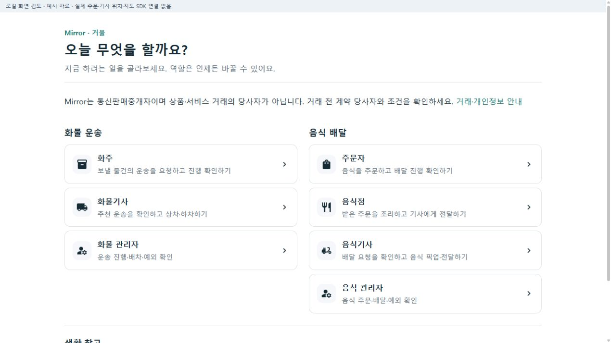
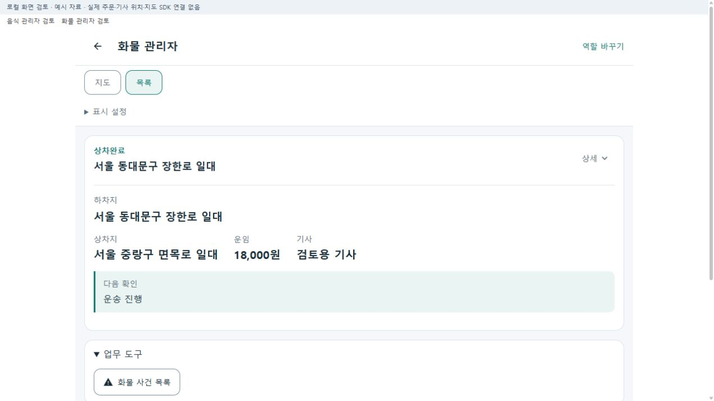
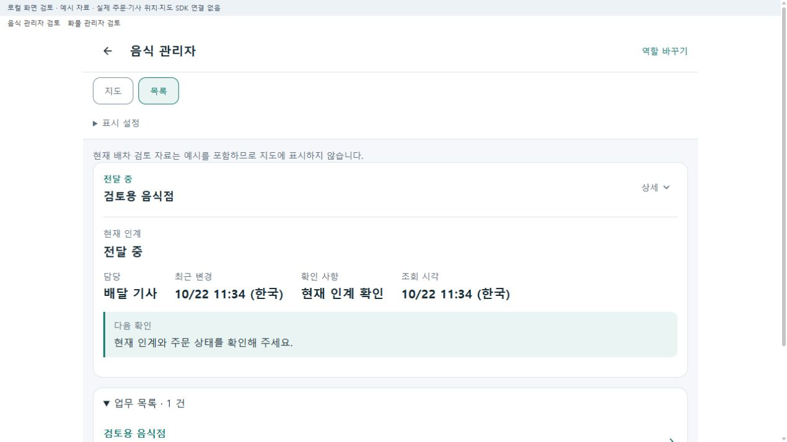
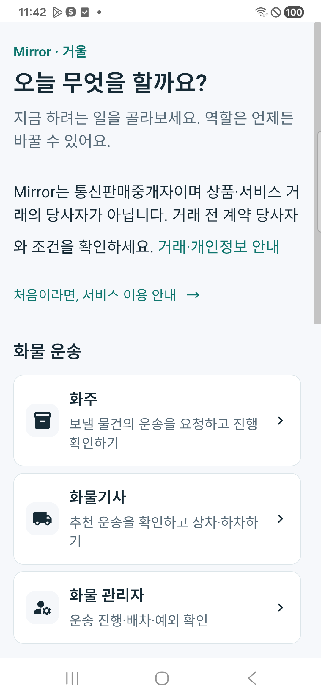
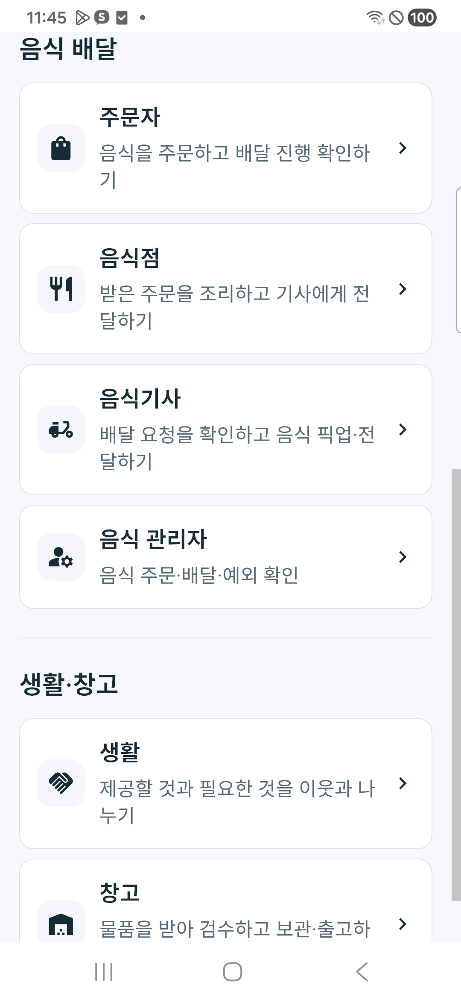
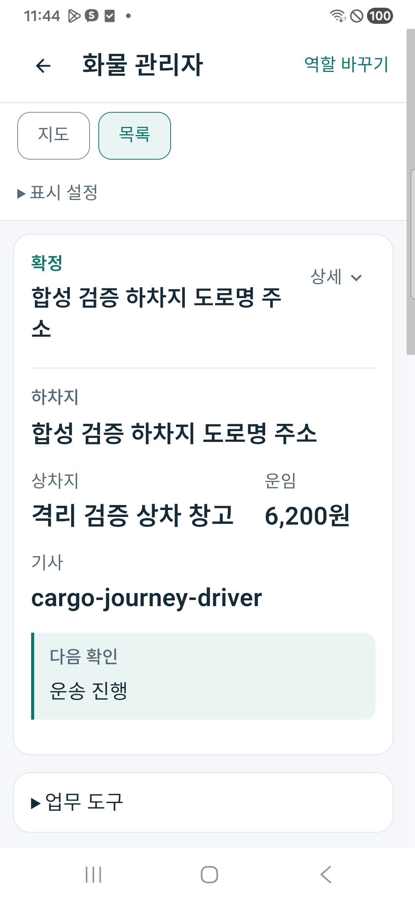
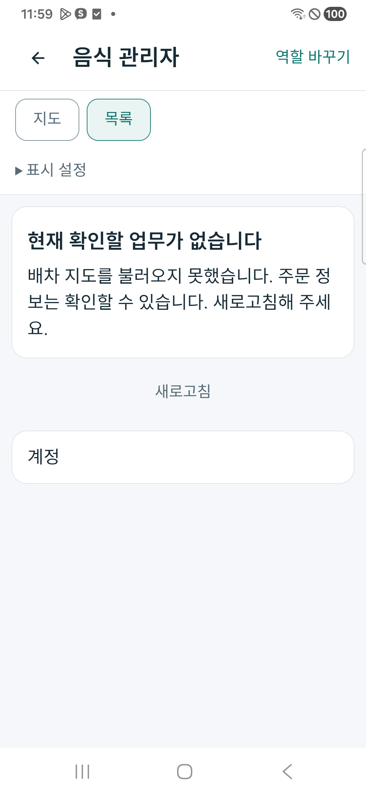

# 화물 3역할·음식 4역할 독립 관리 r9

- 상태: **CompletedLocalAndDeviceGroupingValidation — 지도 후속 확인 별도**
- 기준: [승인 기획](../AI/Planning/공통/PLAN-OPERATIONS-DISPATCH-CORE/business-role-bundles.r9.md) · [작업 명세](../AI/Planning/공통/PLAN-OPERATIONS-DISPATCH-CORE/business-role-bundles.r9.work-order.json) · [페이지 책임 카드](../ProjectOverview/page-docs/business-role-bundles-r9.md)
- 이번 변경은 같은 앱·서버·DB 안에서 두 업무의 진입과 관리자 조회 문맥을 분리한다. 별도 앱·원장·권한을 새로 만들거나 음식·화물 업무를 병합한 변경이 아니다.

## 업무 구조와 변경 책임

```text
통합앱·웹 홈
├─ 화물 운송
│  ├─ 화주 → 운송 접수·진행·인수 확인
│  ├─ 화물기사 → 추천·수락·상차·운송·하차
│  └─ 화물 관리자 → 화물 운송 조회·기존 사건 목록과 검토
├─ 음식 배달
│  ├─ 주문자 → 주문·배달 진행·수령 확인
│  ├─ 음식점 → 주문 수락·조리·픽업 준비
│  ├─ 음식기사 → 추천·수락·픽업·전달
│  └─ 음식 관리자 → 음식 주문의 현재 인계·중단 검토
└─ 생활·창고
   ├─ 생활 → 기존 생활 화면
   └─ 창고 → 기존 입고·보관·출고 화면
```

위 트리는 각 역할의 기존 책임을 묶은 것이다. 이번 구조 변경만으로 모든 업무를 새로 수행했거나 실물 운송·음식 전달을 완료했다고 판단하지 않는다. 기사 하차/전달, 화주·주문자 인수/수령, 정산, 실제 지급은 계속 별개 결과다. 음식점은 유효한 기사 배정 후 조리를 시작하는 기존 조건을 유지한다.

| 영역 | 최종 동작과 권위 |
| --- | --- |
| 홈 | 공통 `RoleWorkspaceHomeCatalog`가 화물3·음식4·생활/창고2 진입을 조립한다. 기존8개 역할 키를 유지하며 운영자 진입만 두 업무에 각각 표시한다. 무채색 Material 아이콘·공통 토큰·짧은 목적 문구·기존 법적/서비스 안내를 사용한다. |
| 업무 문맥 | `RoleWorkspaceBusinessContext`가 역할과 기존 `freight-delivery`·`food-delivery`·`order-warehouse` 코드를 결속한다. 관리자는 같은 기존 `operator` 자격으로 두 업무를 구분하고, 고유 역할을 임의 쿼리로 다른 업무에 붙이지 않는다. |
| 상태·복구 | 선택 대상·지도·접기·조회 문맥과 미확정 요청 ID를 역할과 업무별로 구분한다. 업무 전환·늦은 응답·계정 변경 시 이전 정보가 새 화면에 적용되지 않게 하며, 미확정 명령을 새 요청으로 자동 재전송하지 않는다. |
| 화물 관리자 | 기존 관리자 운송 API에 화물 필터를 명시하고 현재 반환된 운송의 상태·상하차지·운임·기사를 표시한다. 주소에서 좌표·경로를 만들어내지 않는다. 사건의 조치는 기존 독립 사건 검토 화면과 서버가 소유한다. |
| 음식 관리자 | 기존 음식 주문·인계·중단 검토를 계속 사용한다. 화물 사건과 창고 도구를 음식 관리 화면에 함께 노출하지 않는다. |
| 공통 기능 | 인증·지도 호스트·알림 기술·공통 화면을 재사용한다. 전문 원장·배차 알고리즘·운임·정산·실지급 기준은 변경하지 않는다. |

주요 소스는 [홈 카탈로그](../../Ssalddel.Ui.Common/Areas/App/RoleWorkspace/Core/RoleWorkspaceHomeCatalog.cs), [업무 문맥](../../Ssalddel.Ui.Common/Areas/App/RoleWorkspace/Core/RoleWorkspaceBusinessContext.cs), [공통 화면 조립](../../Ssalddel.Ui.Common/Areas/App/RoleWorkspace/Core/RoleWorkspaceViewModel.cs), [화물 관리자 Adapter](../../Ssalddel.Ui.Common/Areas/App/RoleWorkspace/Cargo/CargoOperatorWorkspaceAdapter.cs), [기존 운송 조회](../../Ssalddel/Controllers/Admin/03_진행/운송진행관리Controller.cs)다. 구현 파일 목록과 수정 전 자료는 `artifacts/local/business-role-bundles/20261022-r1/`에 보존한다.

## 이동·호환과 사용자 안내

- 새 관리자 진입은 `/workspace/operator?business=freight-delivery`와 `/workspace/operator?business=food-delivery`다. 구판 `/workspace/operator`는 음식 관리로 호환하고 다른 역할의 기존 URL은 유지한다. 로그인과 독립 업무 복귀에도 선택 업무·대상을 전달한다.
- 관리자 운송 조회에 선택적 `business` 쿼리를 추가했다. 생략한 기존 API는 호환하며 새 화물 화면은 서버 필터를 명시한다. 잘못된 업무 코드가 전체 조회로 바뀌지 않게 검사한다. 명시적 빈 쿼리가 모델 바인딩에서 null로 바뀌는 HTTP 경계도 구분하며 빈값·공백·중복값은400으로 차단했다.
- 잘못된 화면 업무 구분은 `업무 구분 확인`과 역할 선택 복귀를 표시한다. 업무 구분 오류를 로그인 실패로 취급하거나 불필요하게 재로그인을 유도하지 않는다.
- 화물 운송의 과거 신고 첨부는 `신고 기록`으로 표시한다. 그 기록만으로 현재 사건이 미처리·보류 상태라고 판정하지 않는다. 현재 검토 결과는 기존 사건 원장에서 확인한다.
- `화물 사건 목록`은 독립 조회 도구다. 선택 운송의 사건 상세로 바로 이동한다고 표현하지 않으며 현재 카드와 접힌 도구에 같은 링크를 반복하지 않는다. 빈 운송 목록에서는 사건 목록 진입만 남기고 가상 운송을 만들지 않는다.
- 권한 거절·조회 실패·빈 목록은 구분한다. 권한 실패나 네트워크 장애를 정상 빈 목록·예시 데이터로 숨기지 않는다.

## 화면 검증과 대표 자료

로컬 검토 호스트 `127.0.0.1:5615`에서 **실제 공통 화면과 실제 역할 Adapter에 가상 API 응답**을 연결했다. 데스크톱 실제 폭1270px에서 홈, 화물/음식 관리자 교대, 두 업무의 빈 목록·403·오프라인, 잘못된 업무 구분, 구판 관리자 URL을 확인했다. 검토 호스트의 업무 전환 링크와 예시 자료 안내는 제품 기능이나 실제 운영 자료가 아니다.

| 화면 | 확인 범위 | 원본 PNG |
| --- | --- | --- |
| 홈 | 화물3·음식4·생활/창고2 진입과 업무별 그룹 | `screens/01-home-desktop.png` |
| 화물 관리자 | 운송 핵심 값과 별도 `화물 사건 목록` 도구. 과거 신고 표시는 회귀시험으로 확인 | `screens/02b-cargo-manager-desktop.png` |
| 음식 관리자 | 음식 주문·현재 인계와 화물/창고 도구 비노출 | `screens/03-food-manager-desktop.png` |
| 잘못된 업무 구분 | 로그인 유도·지도·업무 카드 없이 역할 선택 복귀 | `screens/04-invalid-business-desktop.png` |
| 두 업무의 예외 | 403의 접근 거절, 오프라인 재조회, 정상 빈 상태 분리 | `screens/*-forbidden-desktop.png`, `screens/*-offline-desktop.png` |

PNG 원본과 `browser-cases.json`·`browser-route-compat.json`은 [로컬 검증 자료](../../artifacts/local/business-role-bundles/20261022-r1/)에 있다. 전체18장 중 대표10장을 문서 자산에 복사하고 원본과 SHA-256이 같은 것을 확인했다. 브라우저의 가상 응답은 실제 DB 자료와 구분한다.







### 실제 휴대폰

통합앱 **0.1.205/205**를 Galaxy A34의 기존 앱 위에 갱신 설치했다. 기존 앱 삭제·데이터 초기화 없이 설치된 APK를 다시 꺼내 제작본과 해시를 대조했다. 실제 CSS 폭384px에서 홈과 관리자 카드의 가로 넘침이 없었다. 홈의 실제3/4/2개 진입, 관리자 로그인 후 화물 문맥 복귀, 화물→음식→화물 전환, 개별 목록 보기 유지, 사건 화면의 업무·선택12 복귀, 로그아웃 뒤 두 관리자 화면의 업무 정보 숨김을 확인했다.

| 홈의 화물 그룹 | 스크롤한 음식 그룹 |
| --- | --- |
|  |  |

| 현재 서버의 합성 화물 | 같은 계정의 음식 목록 |
| --- | --- |
|  |  |

화물은 실제 로컬 API의 시험 운송12건과 선택 운송의6,200원·상하차지·기사를 표시했다. 음식 운영 목록은200·실제0건이며 화물 카드가 나타나지 않았다. 음식 배차 지도 보조 조회의404는 별도 안내로 남았고 목록을 차단하지 않았다. 음식 기능이 꺼진 최초 화물 전용 fixture에서는 조회 오류가 났으므로 원본 `08-food-feature-disabled-phone.png`를 보존한 뒤, **GET만 허용하는 로컬 Simulation 설정**에서 음식 목록 조회를 재확인했다. 제품 운영 설정이나 업무 원장을 변경한 조치가 아니다.

전환 직후 첫 캡처09의 제목 일부가 덜 그려진 장면은 보존하고, 실제 화면과 제목 영역을 다시 확인한 안정된13번 캡처를 대표 이미지로 사용했다. 제품 소스 변경 없이 제목 전체 표시·너비384px을 재확인했다.

이번에는 새 배차 수락·촬영·상하차·전달을 수행하지 않았다. 기존 역할별 정상/예외 회귀와 이번 화면·조회 확인은 서로 다른 검증이다. 네이버 SDK 인증401의 실제 지도 타일·핀·경로 확인은 선행 r8의 후속으로 유지한다.

## 코드·통신·APK 검증 상태

| 검증 종류 | 현재 확인 결과와 한계 |
| --- | --- |
| 정적·집중 Fast | 최종 **546통과·0실패**. `artifacts/local/validation/20261022-114456/`. 새 업무 구분43사례를 포함하며 초기538·중간541 통과와 구분한다. |
| 소비 빌드 | v3.5의 서버·웹·Windows/Android 소비 빌드와 음식 기사 코드지도 검사를 통과했다. 최종 소스를 고정하고 서버·시험 참조를 명시적으로 재빌드한 뒤 검증했다. |
| 전체 Task | **14,674통과·0실패·환경 의존16미실행**. `artifacts/local/validation/20261022-114641/`. 미실행을 실제 Mongo/MySQL 운영 검증으로 합치지 않는다. |
| 정상·예외 회귀 | 화주 접수 결과 유실·기사 중복 수락·상하차 사진 실패·완료 미확정 복구, 음식 주문·조리 조건·픽업·전달/수령 구분·중단 검토·알림, 공통 계정 수명·늦은 응답·요청 ID 분리를 포함한다. 기존 합성/격리 시험이며 신규 실제 업무 완주가 아니다. QA 선택 근거는 `qa/filters.json`·`qa/cases.json`을 따른다. |
| 실제 브라우저 렌더 | 실제 공통 컴포넌트·Adapter + 가상 API, 폭1270px. 홈·관리자 전환, 각각 빈 목록/403/통신 실패, 잘못된 문맥·구판 URL을 확인했다. |
| 실제 HTTP·DB 경계 | 현재 서버5365에서 전체/화물200·12건, 음식 운송200·0건, 잘못된 값/빈값/공백/중복400, 무인증401·기사403을 확인했다. 혼합 SQLite의 업무·상태 필터와 구판 API 호환도 통과했다. 업무11개 테이블의 전후 해시는 같으며 정상 로그인 감사·세션 기록은 별개다. |
| 음식 관리자 API | 운영 목록200·0건. 보조 배차 검토 GET는404 `FeatureBoundaryUnclassified`로 남았다. 기존 Controller의 기능 분류 누락을 이번에 발견했으며 인증 관문을 우회하거나 예시를 실제 주문으로 바꾸지 않았다. |
| APK205 | 제작·서명·정렬·기존 Firebase 설정 보존·입력3,121개 변경없음을 확인했다. 기존 서명 갱신 설치·설치본 SHA 일치. `0886244727bd8fa1abbe47b15d28f66deae899fc3bd21fb2e44b40cd780e047d`. `eng/role-workspace`의 연결 소스는 별도 현재 해시와 실제 새 관리자 실행으로 확인한다. |
| 실제 휴대폰 | 폭384px 홈·화물12건·음식0건·같은 관리자 로그인 복귀·업무 전환·개별 목록 설정·사건 복귀·두 문맥 로그아웃 정리 통과. 실제 지도·새 주문 완주·실제 푸시·수금/지급은 이번에 실행하지 않았다. |

처음 신규 시험은 필요한 `using` 누락으로 컴파일이 실패했다(`20261022-112509`). 수정 중 실행한 첫 Task는14,665통과/1실패/16미실행(`113149`), 두 번째는14,670통과/4실패/16미실행(`113909`)이었다. 소스 보완 중 만들어진 이전 시험·서버 산출물에서 옛 기대와 guard가 실행된 것을 구분하고, **제품·시험 소스 고정 → 참조 전체 명시 재빌드 → Fast546 → Task14,674**로 재검증했다. 이 두 실패와 최초 HTTP의 빈값 전체조회 실패를 지우거나 성공 실행에 합치지 않았다. 최종 소스에는 첫 HTTP 실패를 해소한 Controller guard가 포함되며 현재 서버의 실제 HTTP 차단도 확인했다.

재현·증거 정본은 [verification.json](../../artifacts/local/business-role-bundles/20261022-r1/verification.json), `final-source-hashes.json`, `package-check.json`, `server-readonly/http-verification.json`·`food-http-verification.json`, `screens/manifest.jsonl`이다. 이전 시도·원본 APK204·비공개 계정 자료는 보존하고 암호·토큰·키는 문서에 복제하지 않는다.

## 마무리 조건과 남은 경계

홈과 두 관리자 문맥의 구현·로컬 회귀·현재 서버 조회·APK205 설치/화면 분리는 완료했다. 실제 물품 운송/음식 전달을 새로 완주하거나 운영 준비가 끝났다는 뜻은 아니다.

남은 확인은 네이버 지도 인증401 해소와 실제 타일·핀·선, 기존 음식 배차 검토 API의 기능 분류 누락404, 신규 화물3역할·음식4역할의 실제 원장→기기 전체 흐름이다. 음식 지도 API를 후속 보완할 때 빈 원장의 예시 응답과 실제 주문 응답을 계속 구분해야 한다. 외부 서버 배포·새 관리자 권한·혼합 배차·원장 병합·정산 정책·실제 수금/송금은 변경하지 않았다.

현재5365는 기존 r114 시험 DB와 계정을 읽는 **로컬 Simulation 조회 전용** 호스트다. 인증 login/refresh 외 업무 변경 HTTP와 worker·외부발송·자동지급은 막혀 있으며, 모바일 시험 연결은5363→5365로 유지했다. 기존5363·5364 서버는 종료하지 않았다. 실제 운송을 이어 시험할 때는 해당 검증 목적에 맞는 수동 업무 호스트와 따로 연결해야 한다. 휴대폰 합성 계정은 로그아웃하고 홈으로 복귀했다. 기존 무관한 dirty 작업을 보존했으며 **commit·push는 하지 않았다**.
