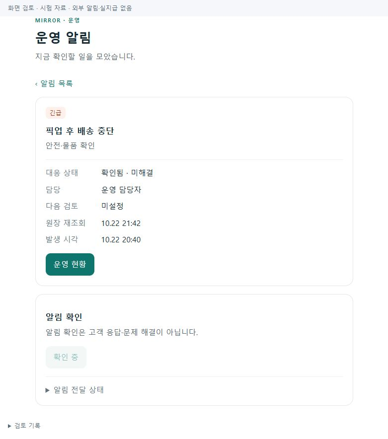
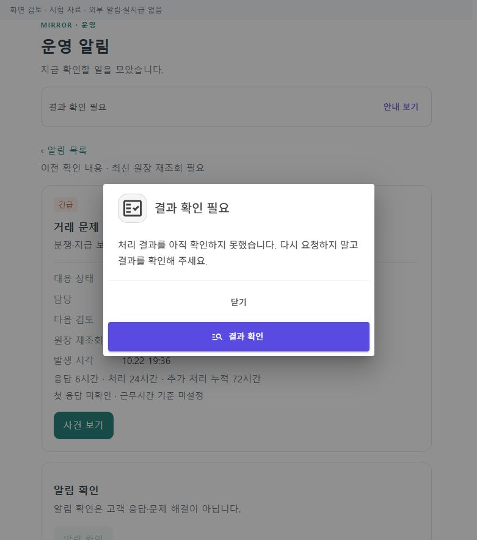

# 정상 자료·예외 검증과 단독 운영 대응 리팩토링 r21

- 범위: [승인 계획](../AI/Planning/공통/PLAN-OPERATIONS-DISPATCH-CORE/cargo-operating-verification-refactor.r21.md), 기존 업무 규칙·전문 원장·권한·운영 비활성 유지.
- 기준 commit: `d3a19163ba96a7dbed31028f639f3bf0c534ae79`, 기존 dirty 작업 1,016파일의 시작 해시를 별도로 보존했다.
- 진행 상태: `CompletedLocalValidationWithFindings / OperationalDisabled`. 코드·시험·실제 공통 화면과 새 격리 제품 HTTP를 검증했다. 휴대폰·실결제·실송금·외부 발송은 실행하지 않았다.

## 바뀐 책임

| 전 | 후 | 기존 업무 경계 |
|---|---|---|
| 시험 입력·HTTP·결과 저장 혼합 | r21의 순수 자료 / 실행 어댑터 / 정본 판정 / 불변 증거·대표 선별 | r114 제품 호스트·명령 재사용, 과거 도구 보존 |
| 관측·확인·발송·목록 읽기 혼합 | 조회와 대응 표시 정책 분리 | 기존 관측·확인 명령·outbox 유지 |
| 확인한 알림이 기본 대응에서 누락 | 확인 전·후의 미해결 기본 목록 | 확인은 해결·고객 응답이 아님 |
| 오류 문자열 중심 화면 | 기존 공통 복구 창 → GET 재조회 | 결과 불명 확인 POST 자동 재전송 금지 |
| 수납·지급 판단을 ViewModel이 함께 소유 | 수납·지급 표시와 관리자 지급 조회 분리 | 지급준비 관리자 미연결·UTC 승인월 한계 보존 |

고객 청구액과 기사 약정액이 같은 직접 제안 상자, 두 금액이 다른 일반 견적 상자, 팔레트 1개를 가상 정상 자료로 준비했다. 추천 기사액·수락 뒤 동결 금액과 화주 청구액을 각각 확인한다. 차량 규격·법정동 표시는 합성 시험자료이며 실제 차량·주소·상품 검증 결과가 아니다.

운영자 화면에는 미해결 상태·담당·다음 행동·원장 재조회·다음 검토를 구분한다. 거래 분쟁의 응답6/처리24/누적72시간은 근무시간 기준 미정인 목표로 표시하며 실제 처리기한을 임의로 만들지 않는다. 기존 사건·개인정보 기한은 변경하지 않았다. [페이지 책임·대응 트리](../ProjectOverview/page-docs/cargo-operating-verification-r21.md)를 따른다.

## 반복 검증 방법

새 고정 호스트 `eng/CargoOperationsVerificationR21`은 loopback5369, `mirror_operations_r21_20261022`, `artifacts/local/cargo-operations-r21`에 제한한다. 기존 서버·DB·증거와 사진·영상 원본은 보존한다. private 자격 설정은 기존 로컬 파일을 읽고 결과에는 비밀값을 기록하지 않는다.

`verify.py`의 `fixtures`는 자료만 저장한다. `setup` 이후 사례별 `create → pay → followup → recommend → complete → review`를 명시적으로 실행하며 마지막 `representatives`에서 검토할 사례를 고른다. 첫 요청의 ID·입력·영수증을 보존하고 불명 상태는 재조회한다. import만으로 폴더·HTTP·환경을 변경하지 않는다.

재사용 `guards`의 무키 proof 조회는 새 클라이언트의 엄격한 제어경로 검사와 호환되지 않아 해당 CLI 경로를 통과했다고 보고하지 않는다. 이번 실제 부정시험은 고정5369·명시 대상의 별도 artifact 절차에서 수행했다. 제품 권한·원장 보호를 완화하거나 미확정 명령을 새 명령으로 덮지 않았다. CLI 반복 검증은 이 어댑터 차이를 먼저 보완해야 한다.

`alert-cycle`은 합성 관측→확인→미해결 유지→합성 해소 재관측을 한 번 확인하는 전용 명령이다. dispatcher·worker를 켜거나 실제 업무 원인을 해결하는 기능이 아니다. 모의 수납 후 `followup`도 명시적 수동 호출이며 자동 운영 성공으로 집계하지 않는다.

## 검증 결과

| 검증 | 결과 | 근거·한계 |
|---|---|---|
| Python 검증기 | 최종33/33 통과 | 처음26개 이후 다른 의뢰의 결제·다른 실행·불완전 Mongo 투영을 오인 성공하지 않는 회귀7개 추가 |
| Scoped Fast | 115개 통과 | `artifacts/local/validation/20261022-212804` |
| Scoped Task | 15,069개 통과·실패0·환경 의존16개 생략 | `artifacts/local/validation/20261022-213321`; 마지막 CSS 간격16px 보완 전 판본 |
| 소비 앱 | v3.5의 웹·모바일 빌드 통과, 최종 관리자 Windows 소비 빌드 오류0 | 마지막 CSS 뒤 `admin-consumer-final.log`; 설치·기기 시험 아님 |
| 전용 호스트·화면 호스트 | 격리 build 출력으로 각각 빌드 성공 | 기존5363/5364/5365/5368 호스트는 보존 |
| 실제 브라우저 | 781×884에서 공통 화면11항목 확인·PNG8장 | 메모리 fixture, 제품 API·실제 단말과 별개 |
| 원장 결속 | 현재 run/source SHA/case/client request·결제 의뢰·Mongo와 RDB 대조 강화 | 독립 검토에서 발견한 검증기3항목 보완; 사진은 기존 서버의 원장·차수·저장 해시 검증 재사용 |

최초 Fast는 기존 미관련 `CargoDriverWorkSession.cs`의 파일 끝 빈 줄로 전체 diff 검사에서 중단됐다. 원문을 수정하지 않고 검증 프로세스에 한해서 EOF 빈 줄 검사만 제외했다. 그다음 공통 UI의 WebUtilities 참조 오류를 발견하여 새 패키지 없이 기존 navigation context와 엄격한 상태/페이지 파싱으로 수정했다. 두 실패 기록과 최종 통과를 따로 보존했다.

브라우저에서는 기본 미해결 목록의 긴급 우선·확인한 미해결 유지, 확인 후 버튼 차단, 조회 실패 안내→GET 성공 복귀, 확인 응답 유실→결과 조회(확인 요청1/조회2), 빈 목록, 오래된 원장, 확인 중2페이지 복귀를 확인했다. 최종 화면은 가로 넘침0, 정보와 업무 버튼 사이16px, 업무 버튼 높이45.4375px다. 모바일 실제 viewport·APK/단말은 이번에 검증하지 않았다.

### 대표 화면

01~07은 최종 간격 보완 전 상호작용 검토이고 08은 간격16px를 반영한 최종 빌드다. [화면·소스 해시와 검증 범위](../assets/changes/2026-10-22-cargo-operating-verification-refactor-r21/evidence.json)를 함께 보존한다. 모든 화면은 시험 자료이며 제품 DB와 연결한 화면이라고 표시하지 않는다.

### 새 제품 HTTP

새5369 서버에서 live200·공개 요약200을 확인했다. ready503은 fresh-model fixture의 운영 migration 미검증 결과이며 정상 readiness로 바꾸지 않았다. 직접 제안 상자와 일반 견적 상자는 접수→모의 선결제→수동 Outbox 인계→추천→수락→상하차 도착→두 사진 영수증→인수 완료→화주·기사·SQL/Mongo 대조를 통과했다.

일반 견적 사례의 고객 모의 수납40,000원·서버 견적35,455원·기사 약정/수락 동결35,000원을 구분했다. 이번 리팩토링은 이 금액들을 하나로 바꾸거나 기존 운임 정책을 고치지 않는다. 모델 선택은 적용되지 않았고 규칙 대체로 수행했다. 실제 모델 학습·실제 PG·실지급 결과가 아니다.

타기사 수락·구차수·무키 proof GET·AI 명령의 같은 키/다른 키·사진 없는 상하차 완료 보호7개를 실제 응답과 원장·Outbox·판단 감사의 불변으로 대조했다. 합성 알림의 수동 관측은 Open→Acknowledged(미해결 유지)→합성 해소 재관측→Resolved·미해결 목록 제외를 통과했고 알림 Outbox 증가0이었다.

첫 팔레트 사례는 경도127.092가 기존 합성 경로 지원 범위 밖이어서 `IdleSchedulePickupRouteUnverified`/`NoEligibleCandidate`로 추천되지 않았다. 이를 적재 한도 결함이나 정상 완주로 표시하지 않고 미완료 검토 사례로 보존했다. 원장 수정·새 키 재요청 없이 별도 허용 범위의 팔레트 fixture 판본 `r21-pallet-in-scope-r2`를 불변 artifact로 저장하고 새 의뢰로 검증했다. 이 팔레트는 고객 모의 수납50,000원·서버 견적35,455원·기사 약정/동결45,000원으로 완료·정본 대조를 통과했다. fixture SHA는 `abcba9d021acba8e5edf17bceffe8e8ec0ed60131eeb01ac886d6afedcc0cfd4`다. 총4사례 중 완료3·경로 미지원 대기1을 구분하며 기존 실패를 성공으로 덮지 않았다.

관리자 실제 GET은 미해결 목록200/0건·해결됨 목록200/1건·동일 알림 상세200/Resolved를 확인했다. 익명401·기사403도 확인했고 Enabled/ExternalSendEnabled는 false였다. 수동 coordinator 검증과 관리자 HTTP 조회, 브라우저 메모리 화면을 각각 별도 증거로 둔다.

최신 제품 실행은 `cargo-operations-r21:d61bbc2a591943d0a745b170dfc9e3a5`, 소스3,751개 결속 SHA `bd245452b623ec3e8252cbba811a9b09a9887f75ec924f3bf4e29dbf8b20f53d`다. `artifacts/local/cargo-operations-r21/runtime/`의 단계별 결과·검토와 `reviews/`·`representatives/`의 내용 해시를 사용한다. 로컬 임시 증거는 Git 게시 자료가 아니며 사람 승인·학습 승격을 뜻하지 않는다.

최종 대표4건은 사람 미검토·`trainingApproved=false`를 유지한다. 실행 요약 SHA는 `24f11d77a43589cd171d42b4c1a5744af8783794a32c77088069bd18a4eb8af3`이며 최종 소스 재대조3,751개 불일치0을 확인했다. 기존 서버 네 곳은 계속 listening 상태였고 기존 DB의 바이트 단위 digest 재대조는 수행하지 않았다.

## 보존·후속

시작 dirty1,016파일 중 이번 허용 경로 밖의 변경은 없었다. 기존 dirty `eng/RoleWorkspacePreview/Program.cs`에는 이번 fixture 등록 한 줄만 추가했으며 index는 비어 있다. 원본 시험자료·실패·기존 서버·DB를 정리하거나 commit/push하지 않았다.

운영 전에 우선할 일은 migration·복원 검증, 유효한 실제 결제/지급 연결, 모델 통신과 실제 단말/외부 알림이다. 검토 목록의 사람 승인 전 학습 자료로 확정하지 않는다. 기존 preview 의존 `SQLitePCLRaw.lib.e_sqlite3 2.1.10`의 NU1903 경고는 이번 책임 분리에서 변경하지 않았고 빌드 로그에 남겼다.

## 남은 운영 경계

- 운영 migration과 백업·복원, 실제 PG·지급 계좌·송금은 별도다. fresh-model `EnsureCreated`는 운영 migration 증거가 아니다.
- 외부 알림 발송·worker·Operational은 켜지 않는다. 실제 휴대폰 설치·카메라·푸시·지도 검증을 이번 브라우저/합성 API 결과에 합치지 않는다.
- 통합 관리자앱 화물 개별 상세와 관리자 지급준비 API는 미연결 상태다. 기존 운영 현황·관리자 지급요청 조회 범위만 사용한다.
- 6/24/누적72시간의 근무시간·휴일·기산점과 운영자 부재 시 대응은 추가 운영 결정이 필요하다.
- 새 commit·push·클라우드 배포는 하지 않는다.
