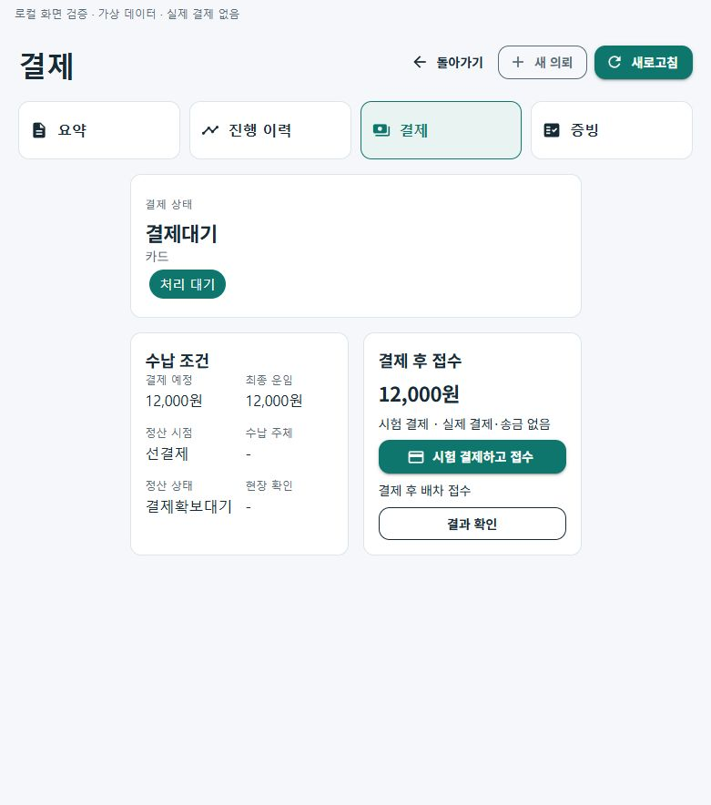
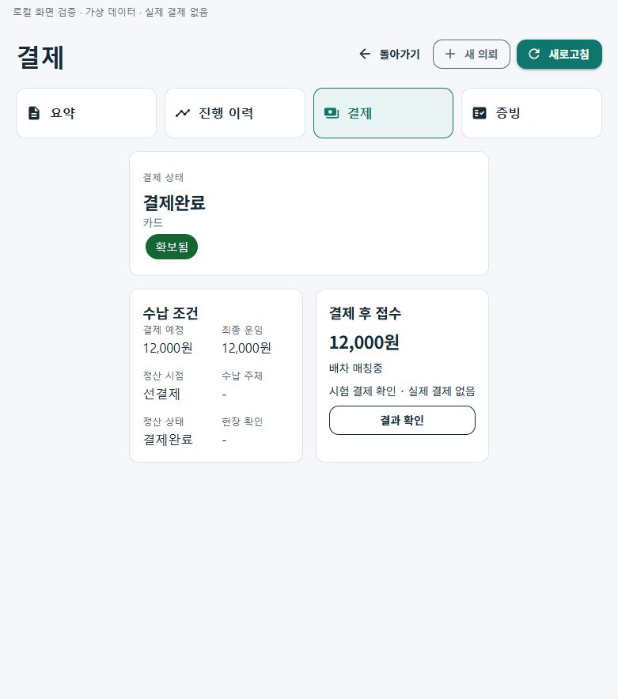
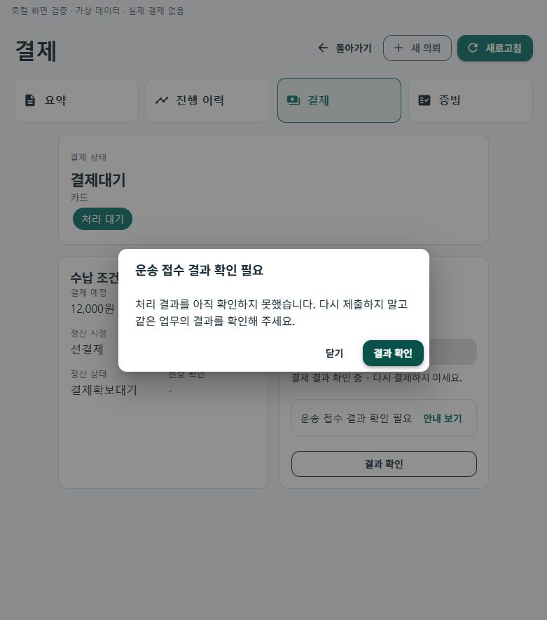
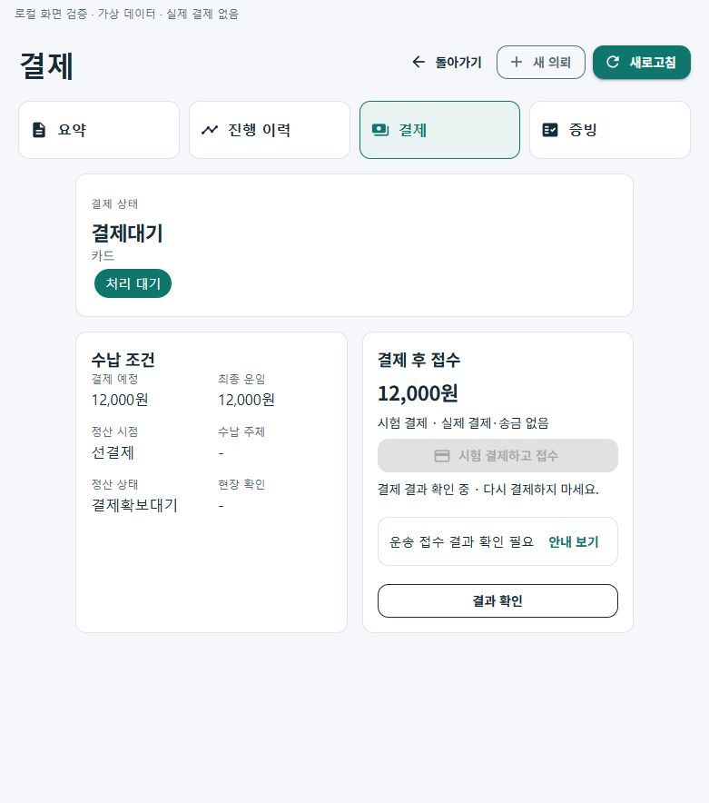

# 화물 선결제 접수·통신 복구 r16

상태: `CompletedLocalValidation / ActualPGCheckoutPending / NativeRecoveryPending / OperationalDisabled`.

기획·승인 범위: [r16](../AI/Planning/공통/PLAN-OPERATIONS-DISPATCH-CORE/cargo-prepayment-recovery.r16.md). 선행 결손: [r15](../AI/Planning/공통/PLAN-OPERATIONS-DISPATCH-CORE/cargo-three-role-readiness.review.r15.md).

## 바뀐 업무 흐름

```text
화주: 조건 입력·동의
└─ 접수 준비 저장 → 같은 의뢰의 결제 화면
   ├─ 결제 전: 배차 큐 생성·추천·수락 차단
   ├─ 결과 미확정: 재결제 차단 → 같은 의뢰의 수납 근거 확인
   └─ 서버 승인 근거 확인
      └─ 기존 Outbox → 같은 의뢰의 배차 대기열
         └─ 기사 수락 → 상차 → 하차·인수
            └─ 기존 지급 준비·정산 정책(실지급과 별도)
```

결제 전 기록을 접수 완료·배차 진행으로 표시하지 않으며, 화주 목록의 주 행동과 모바일/Web 등록 뒤 이동을 결제로 맞췄다. 신규 본인 전용 조회는 대상·화주·금액 근거·취소·Toss 수납 정본을 확인하고 PG 키나 계좌/원문을 반환하지 않는다. 승인 원장 투영이 늦거나 이미 시작된 결제가 있으면 새 결제를 유도하지 않는다. 현재 UI의 실행 검증은 시험 결제이며 실제 토스 결제창은 후속이다.

## 통신·재실행 복구

- 통합 기사 수락·상하차: 실제 화면 이탈 취소와 HTTP 시간초과를 구분한다. 전송 가능성이 있는 요청의 비공개 관측을 계정·서버·업무·대상별 기존 보호 저장소에 남긴다. 정본 완료를 확인하기 전에는 재POST하지 않는다.
- 사진/서명/주소/신고 원문은 복구 기록에 저장하지 않는다. 로컬 관측 GUID는 서버 멱등 영수증이나 미전송 증거가 아니다.
- 선결제: 별도 관측을 전송 전에 저장하고 승인 응답 뒤에도 같은 의뢰를 재조회한다. 미확정/보호 기록 누락은 미결제로 단정하지 않는다. 명시적으로 거절된 POST만 정리하며, 승인 뒤 GET 실패는 구분한다.
- Web 상세: A의 늦은 성공·실패·finally가 B 선택 또는 다른 인증 판본의 화면을 덮지 못하게 한다. 조회 취소·로그아웃·Dispose·자연 만료에서도 같은 경계를 적용한다.

## 보존한 경계

기존 원장·권한·명시적으로 승인된 후불/현장 조건·기능 기본 OFF를 유지했다. 신규 생성 입력에서 결제 완료를 직접 주장할 수 없고, 기존 미결제 선결제 큐도 추천 전에 막는다. FakePG의 신규 선결제는 선결제 옵션과 Simulation을 모두 요구한다. 수납과 지급 완료, 하차와 화주 인수, 사건과 실제 송금은 합치지 않았다. 원격 운영 DB·상용 PG·송금·휴대폰 설치·기존 데이터 변경·commit/push는 하지 않았다.

## 검증·화면

최종 결과는 `artifacts/local/cargo-prepayment-recovery/20261022-r1/verification.json`과 `final-source-freeze.json`을 따른다. 제품·시험 소스38개를 동결했다.

- 최종 Fast: **362통과 / 실패0**. `artifacts/local/validation/20261022-151507/`.
- 최종 Task: **14,893통과 / 실패0 / 환경16미실행**, 전체14,909. `artifacts/local/validation/20261022-151700/`. v3.5 소비 솔루션 빌드 오류0이며 기존 패키지·정적 분석 경고는 별도로 남아 있다.
- 신규 선결제 서버 handler/EF InMemory 투영·조회, 보호 저장소를 주입한 결제/기사 VM, Web 상세 세대 경계와 API 기능 분류를 검증했다. 별도 집중206·결합118은 전체 시험과 겹치므로 합산하지 않는다. 새 운영 SQL/Mongo 통합·제품 HTTP 종단간 시험을 실행한 결과는 아니다.
- 첫 전체 시험의6실패는 새 안내 문구5사례와 미결제 선결제의 큐 생성 기대1사례였다. 문구 기대와 해당 미결제 fixture의 큐0건 기대만 정리하고 업무·적재 왕복 assertions는 보존했다. 이전 Fast의 기능 분류 기대와 SDK `ComputeWasmBuildAssets` 도구 실패도 로그에 보존한다. 최종 재시험은 통과했다.
- 통합 모바일의 기존 보호 저장소 DI·계정/서버 분리는 코드와 회귀로 확인했다. 실제 단말 보호 저장·프로세스 재실행, 신규 실운송·실제 PG/송금·클라우드는 미검증이다.

[화면 모음](../assets/changes/2026-10-22-cargo-prepayment-recovery-r16/index.html): 공통 Razor 화면을 가상 API·휘발 저장소로 실행해 결제 버튼, 정본 재조회 후 부모 화면 갱신, 시간초과 대화상자와 닫기 뒤 재결제 차단을 확인했다. 브라우저 화면이며 실제 휴대폰 화면과 구분한다.

| 결제 전 | 확인 후 |
| --- | --- |
|  |  |

| 시간초과 안내 | 닫은 뒤 결과 확인 |
| --- | --- |
|  |  |

## 다음 연결

실제 토스 결제창·앱 복귀·상용 수납 결과 재조회와 기존 재무 명령의 명시적인 기능 분류를 별도로 연결해야 한다. 현재 운영 화면은 결제를 실행하는 대신 연결 준비 상태를 표시하며 기본 기능 OFF를 유지한다. 하차/인수·지급 재원·신고 보류와 기존 주간 정산·실제 지급을 같은 결과로 합치지 않는다. 이 한계가 해결되기 전 실제 유료 주문 접수를 완료했다고 표시하지 않는다.
