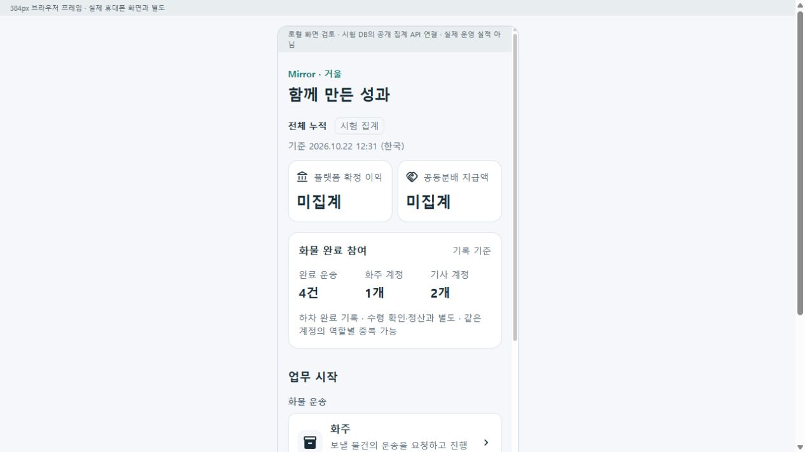
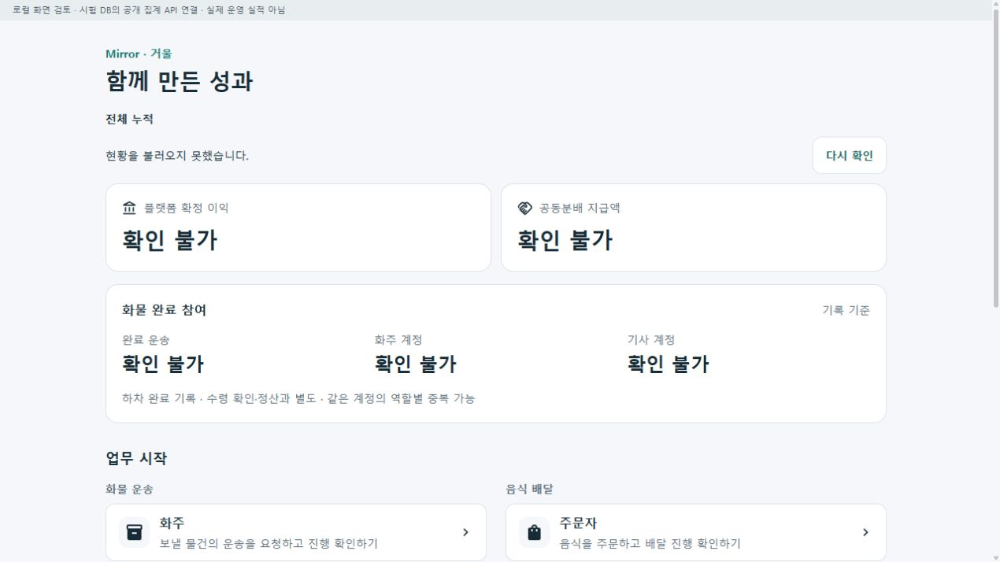
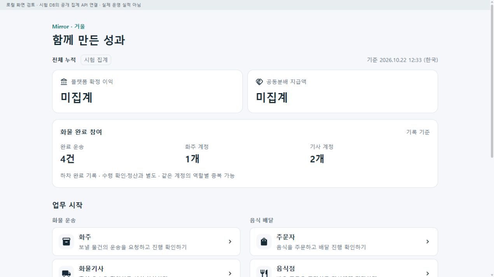

# 전체 누적 참여·이익 공유 홈 r10

기준: [사용자 승인 계획](../AI/Planning/공통/PLAN-OPERATIONS-DISPATCH-CORE/home-participation.r10.md) · [작업 명세](../AI/Planning/공통/PLAN-OPERATIONS-DISPATCH-CORE/home-participation.r10.work-order.json) · [페이지 책임](../ProjectOverview/page-docs/home-participation-r10.md).

상태: CompletedLocalValidation / FinancialAggregateAndOtherBusinessCountsPending.

## 화면과 정보의 책임

```text
통합 홈 · 함께 만든 성과
├─ 전체 누적 · 집계 시각 · 시험 여부
├─ 플랫폼 확정 이익 / 공동분배 지급액
│  └─ 확정 공개 집계 근거 미연결: 미집계
├─ 화물 완료 참여 · 기록 기준
│  ├─ 완료 운송 건수
│  ├─ 확인된 화주 계정 수
│  └─ 확인된 기사 계정 수
├─ 업무 시작
│  ├─ 화물: 화주 / 기사 / 관리자
│  ├─ 음식: 주문자 / 음식점 / 기사 / 관리자
│  └─ 생활 / 창고
└─ 서비스 안내 / 거래·개인정보 안내
```

확정 이익·공동분배 지급액은 기존 경제성 시뮬레이션, 예정 보수, 거래 총액, 월 사용료로 대체하지 않는다. 현재 실제 재무 공개 집계가 연결되지 않아 금액은 null이다. 확인하지 못한 값을 0원으로 만들지 않는다.

참여는 가입 수·현재 운행 수가 아닌 **화물 기사 하차 완료 기록에 연결된 계정 수**다. 기존 운송 유형과 완료 코드, 완료 시각, 연결 의뢰의 모의 수행 여부를 검사한다. 의뢰 번호는 unique가 아니므로 정확히 한 의뢰에 연결된 기록만 집계해 중복 증폭을 막는다. 화주는 두 원장의 화주 ID 일치와 Identity 계정 실재를, 기사는 확정 기사와 현재 수행 기사 결속 및 Identity 계정 실재를 확인한다. 관리자 대리 접수의 인증 요청자를 화주로 치환하지 않는다. 확인되지 않은 계정은 추정하지 않고 누락 가능 안내를 표시한다. 역할별 계정 수는 중복될 수 있어 전체 인원으로 합산하지 않는다.

이는 SQL 실행 투영의 **기록 집계**이며 화주 수령 확인·정산·실제 지급·개별 기록의 실제 운영 감사와 별개다. 현재 서버가 Simulation이면 시험 집계를 명시한다. 음식·공간 참여 실적은 이번 화물 집계에 포함되지 않는다.

## 코드 경계

공개 홈 GET → 읽기 전용 집계 UseCase → 숫자만 있는 계약 → 별도 공개 client → 조회 컨테이너 → 표시 컴포넌트 순서다. 관리자 원본 응답·개인 식별자·주소·좌표를 공개하지 않는다. 조회 실패는 현황 부분에서 재시도하며 기존 역할 진입은 그대로 제공한다. 미집계·조회한 실제 0·통신 실패를 구분한다. 이탈 취소·요청 제한 시간·중복 재시도 차단을 적용했다.

홈 공통 컴포넌트는 통합 MAUI와 Web `/`, `/apps`에서 소비한다. 기존 3+4+생활·창고 진입과 안내 링크를 유지한다. 업무·배차·운임·원장 스키마·정산·실지급·관리 권한은 변경하지 않는다.

## 검증

- 최종 Task: **14,703통과 / 실패0 / 환경16미실행**. 현재 홈 관련29케이스(UI10·집계7·client12)가 모두 통과했다. `Ssalddel.v3.5.slnx`의 서버·웹·Android·Windows 소비 빌드와 기존 음식기사 코드맵 검사를 통과했다.
- 초기 Fast는 소비 빌드 통과 후 UI helper6개가 실패했다. CSS scope 속성이 붙은 `<dd>`와 정적 Markup 버튼 글자를 검사 도구가 인식하지 못한 원인을 고쳤다. 검증 기준은 유지했고 UI10개 재시험 및 최종 전체 Task가 통과했다. 실패 로그도 보존했다.
- 실제 loopback HTTP·기존 격리 MySQL: 익명 GET200, 최소10개 필드, NoStore, 금액null, POST405, 업무11테이블의 조회 전후 해시 불변을 확인했다. 시험 DB에서 완료 운송4건·화주 계정1개·기사 계정2개를 읽었으며 실제 운영 실적이 아니다. SQLite와 실제 MySQL에서 집계 SQL 실행을 확인했지만 독립 SQL 수치 재산출은 수행하지 않았다.
- 실제 공통 Razor 화면이 위 API를 읽는 브라우저에서 상단 현황→업무 시작 순서, 기존9링크와 안내2링크, 넓은 화면 표시를 확인했다. 384px 외곽 iframe은 실제 렌더를 시각 점검했다. 도구의 iframe DOM 계측은 지원되지 않아 수치 검증으로 보고하지 않는다.
- 이번에 만든 읽기 전용 시험 서버5366만 중단해 `확인 불가`·9개 역할 링크 유지·기존 수치 비표시를 확인했다. 같은 서버를 DB 준비/seed 없이 재시작한 뒤 실제 `다시 확인` 버튼으로4/1/2가 복구됐다. 기존 서버5363~5365는 중단하지 않았다.
- 최종 시험 이후 제품·시험17개 소스 해시가 동일하며 HEAD와 staging은 그대로다. 새 DB·스키마·권한·재무 금액을 만들지 않았다. APK 패키징·설치·물리 기기 확인·외부 배포·commit/push는 하지 않았다.

[최종 검증](../../artifacts/local/home-participation/20261022-r1/verification.json) · [Task 로그](../../artifacts/local/validation/20261022-123102/) · [실제 HTTP 검사](../../artifacts/local/home-participation/20261022-r1/server-readonly/http-home-verification.json) · [화면·해시 색인](../../artifacts/local/home-participation/20261022-r1/screenshots.json).

## 실제 화면

이전 [r9 역할 선택 홈](../assets/changes/2026-10-22-business-role-bundles-r9/01-home-desktop.png)은 유지한다. 아래는 앱 공통 컴포넌트와 실제 로컬 공개 집계 API를 연결한 브라우저 화면이다.








## 남은 연결

확정 이익·실제 공동분배 지급액의 공개 집계 정본과 음식·생활·창고의 참여 집계는 아직 연결하지 않았다. 현재 금액은 미집계이며 화물 완료 참여 범위를 넘어선 전체 참여 인원으로 표시하지 않는다. 신규 APK와 물리 단말 검증은 별도 단계다.
