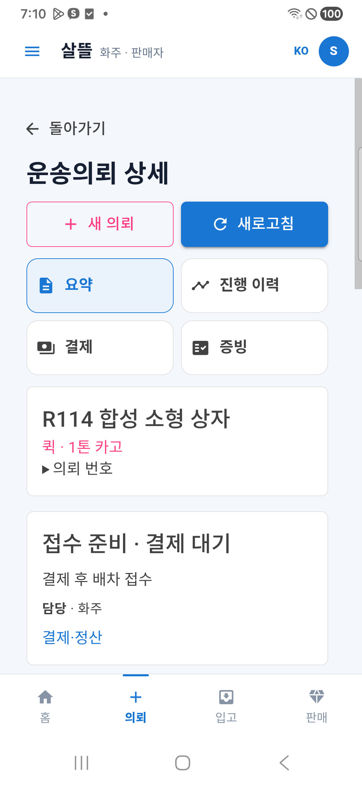
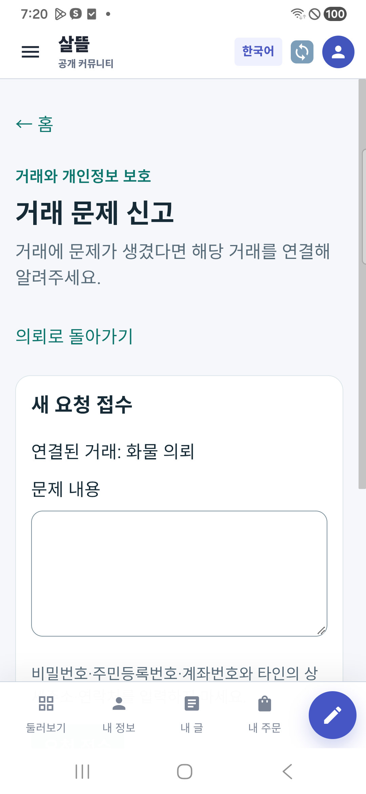
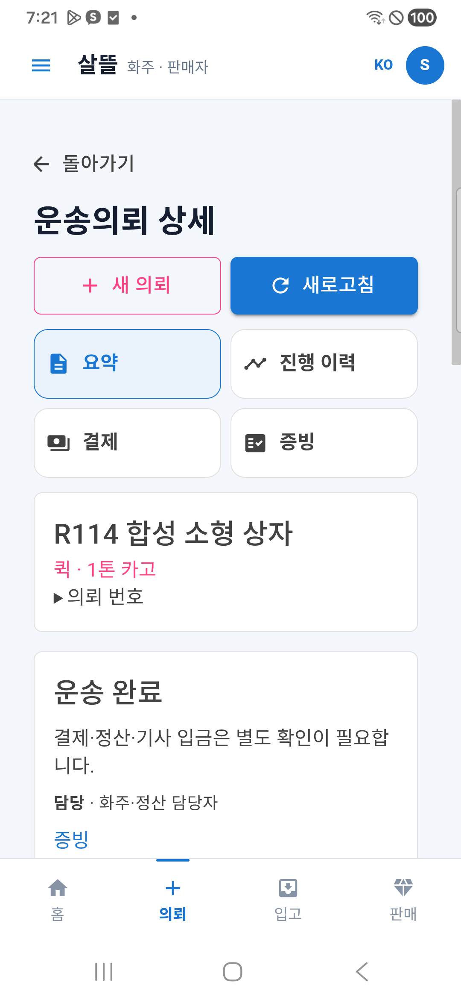

# 화물 운영 흐름·금액·분쟁 보호 r20

상태: `CompletedLocalAndDeviceValidationWithFindings / SimulationOnly / OperationalDisabled`.

사용자가 요청한 운영 준비 보완을 계속하되 네이버 클라우드 배포를 제외했다. 실제 토스 키가 준비되지 않아 사용자가 모의 결제·로컬 검증 범위를 선택했다. [승인 범위](../AI/Planning/공통/PLAN-OPERATIONS-DISPATCH-CORE/local-operations-closeout.r20.md)와 [r19 실제 기기 결과](2026-10-22-alignment-review-r19.md)를 보존한다.

## 달라진 업무 화면과 보호

| 입장 | 보완 |
| --- | --- |
| 화주 | 고객 청구액·수락 전 약정 기사액·수락 후 동결액을 구분한다. 응답에 동결액이 없으면 추정하지 않는다. 현재 운송에서 문제 신고로 이동하고 같은 업무로 돌아올 수 있다. |
| 기사 | 전용 기사 앱의 진행·하차·내역은 고객 총운임을 보수로 대신하지 않고 확인된 동결 지급 예정액을 표시한다. |
| 운영자 | 선택 운송의 사건만 조회하고 늦은 응답·계정 전환으로 다른 사건의 조치가 섞이지 않게 한다. 수납·지급 준비·지급 요청·실지급을 분리한다. 월 이용료를 운송료 지급 내역으로 표시하지 않는다. |
| 지급 보호 | 정식 미해결 거래 분쟁을 지급 준비·승인·배치·Gateway 직전에 확인한다. 조회 실패·미구성·원천 색인 불명은 보류한다. 문의·개인정보 요청·보존 정지는 정식 분쟁과 구분한다. |

사건 종결과 실제 송금 완료는 별개다. 관리자 지급 준비 조회 API는 새로 만들지 않았으므로 해당 화면은 `관리자 조회 미연결`로 남긴다. 기존 지급 요청 API의 현재 UTC 승인월만 조회하며 빈 결과를 전체 기간 지급 없음으로 해석하지 않는다. Mongo 최종 조회 이후 외부 Gateway 사이의 경합까지 저장소 간 원자적으로 없앤 결과는 아니다.

## 로컬 검증 환경

기존 5363/5364/5365 서버·DB·과거 증거는 유지하고 새 5368 제품 호스트와 격리 DB만 사용한다. `eng/CargoOperationsCloseoutR20`은 기존 합성 계정·AI fixture·제품 API를 재사용하는 로컬 시험 도구다. 운영 배포 산출물이 아니며 기존 비공개 합성 adapter·환경 파일이 필요하다.

새 DB의 `EnsureCreated`는 현재 모델의 시험 구조일 뿐 운영 migration 완료가 아니다. 기존 호스트의 ready503과 보류 migration을 지우거나 health 검사를 완화하지 않는다. 시험 접수·결제·배차·완주가 성공해도 운영 readiness는 별도로 남긴다.

## 실행 증거

최종 제품 소스55개를 동결했고 현재 해시 불일치는0이다. 최초 Fast339/339 이후 발견한 FakePG 수리의 관계형 집중51/51, 최종 v3.5 솔루션 빌드·Task **15,018통과 / 실패0 / 환경16미실행**을 확인했다. 미실행은 TRX 개별 NotExecuted16과 total−executed16을 대조했다. 신규 r20 시험은 표시/탐색/분쟁114개와 결제 재시도11개다. 전용 기사 Android 소비 빌드와 관리자·Web 소비 빌드는 v3.5 빌드에 포함되며 전문 APK 전부를 갱신한 결과는 아니다.

새 시험 helper는 별도 빌드 오류0으로 확인했다. 최초 assets 미복원과 후속 필터 namespace 누락은 로그에 보존하고 복원/수정 후 재빌드했다. 최종 source binding은3744개 항목·SHA `a07f667d9bc8374dff34f66fae87d4095c237f84149fbcb8e558468d2b4b7a03`이다. 같은 실행의 소스가 달라지면 재시작/검증 요청을 보류한다. 이전 실패 실행의 소스 결속 거절도 별도 대조했다.

### 같은 실행에서 구분한 두 사례

| 사례 | 실제 관측 |
| --- | --- |
| 첫 사례 | 휴대폰에서 시험 결제 버튼을 눌러 서버의 모의 결제 확인을 받았다. 배차 후 수락은 팔레트 수 누락으로409 차단됐으며 기존 의뢰를 변경하거나 수락을 자동 재전송하지 않았다. |
| 둘째 사례 | 별도 합성 상자에 팔레트 없음(0)을 명시해 새로 접수했다. 결제 확인→명시적 Outbox 1회→배차 대기→규칙 대체 추천→수락→상차 도착/사진/완료→하차 도착/사진/인수 완료를 **제품 HTTP**로 완주했다. |

둘째 사례는 고객 운임6,200원, 동결 기사액6,200원을 확인했다. 첨부2개는 합성 PNG이며 실제 카메라나 실물 배송 증거가 아니다. 재완료 요청은 정본 조회만 수행하고 mutationRepeated=false로 수렴했다. 다른 기사 상세 접근403/404, 완료 뒤 활성 운송0건도 확인했다. 소형 상자의 명시0을 실제 미확인 입력의 기본값으로 전파하지 않았다.

```text
접수 준비
└─ 모의 결제 확인
   └─ 승인 Outbox 명시 1회 → 배차 대기
      └─ 추천 → 수락
         └─ 상차 도착 → 시험 사진 → 상차 완료
            └─ 하차 도착 → 시험 사진 → 인수 완료
               ├─ 화주: 운송 완료 / 결제·기사 입금은 별도 확인
               └─ 지급 준비: 정산계좌 미등록으로 보류
                  └─ 정식 문제 신고 → 미해결 분쟁 지급 보류 판독
```

두 추천 모두 로컬 모델 연결 `NetworkFailure`로 규칙 대체가 적용됐다. 후보·규칙 결과·실제 배차 정본의 일치를 확인한 것이며 LLM 선택 적용0건, 가중치 학습0건이다. 알림 Outbox 생성과 실제 FCM/알림음 수신은 다르며 이번에는 Hosted worker/외부 푸시를 켜지 않았다.

### 실제 Mongo 분쟁과 지급 경계

완료한 둘째 사례에서 실제 Mongo 저장소/분쟁 query의 **분쟁 없음(Clear) → 정식 접수200/received → CargoTransactionDisputeOpen**을 확인했다. 첫 초기화 때의 Unknown 안전 보류와 정확 예외를 소급 확정하지 못한 한계도 보존했다. 현재 보호지원 인덱스는7개, 미색인 과거 분쟁 혼입은0이다.

해당 기사의 지급 준비는 신고 전후 모두 `SettlementAccountMissing`·준비액0이며 예정액6,200원은 유지됐다. 실제 계좌 확인을 만들지 않았으므로 지급 준비 API가 분쟁 사유로 바뀌었다고 주장하지 않는다. 준비 가능 상태의 분쟁 보류 전환과 승인/배치/Gateway 보호는 관계형·단위 회귀 결과이고, 이 실제 Mongo 판독과 별도다. 실제 지급 요청·송금은 실행하지 않았다.

### 실제 휴대폰

통합앱 **0.1.209/code209**를 데이터 보존 갱신 설치했다. 제작본과 설치본 SHA-256 `15e2a75a2e26dd82c79ceec26e4274d64a397225293e91c31441b7be413279fd`가 같다. APK 입력3,137개 변경0, 서명/정렬/standalone 검사를 통과했다. 후속 서버 Handler는 APK 소스 참조 밖이며 APK 입력의 현재 해시 불일치0도 확인했다.

- 새 제품 서버에 연결한 정상 상세, 첫 사례의 실제 시험 결제 버튼과 결과, 둘째 사례의 운송 완료·금융 별도 안내를 확인했다.
- 선택한 첫 사례의 문제 신고 링크를 실제 Android WebView에서 클릭해 sourceId와 복귀 맥락을 확인했고, ‘의뢰로 돌아가기’로 같은 selected 의뢰에 복귀했다. 화면 밖 버튼을 누르려 한 자동화는 클릭 없이 중단했고 기존 화면 요소를 찾아 이동했다.
- 실제384 CSS px에서 scrollWidth384로 가로 넘침0이다. 세 PNG는 편집하지 않은 단말 캡처이며 문서 사본과 원본 해시가 같다.
- 네이버 지도는 사용 불가 안내와 목록 대안이 나타났다. 지도 타일·핀 정상화를 확인한 결과는 아니다.
- 시험 계정을 로그아웃하고 역할 선택 홈으로 복귀했다. 검증용 자체 WebView 연결만 제거했다. `휴대폰5363 → 새 PC5368` 연결과 로컬 시험 서버는 유지하며 기존5363/5364/5365 서버도 보존했다. Samsung Pass 저장 제안은 취소했다.







최종 구조화 기록은 `artifacts/local/local-operations-closeout/20261022-r1/verification.json`, 실행/명령/원장 대조는 `artifacts/local/cargo-operations-r20-r2/`에 있다. 키·암호·토큰과 기기 일련번호는 공개 문서에 넣지 않았다.

## 다음 운영 단계

실제 PG 계약·테스트 키와 결제창/취소·환불, 운영 migration 기준선과 서버 밖 복원, 외부 알림 실제 수신, 실제 주간 지급과 공급자 결과 대사는 이번 모의 검증과 별도다. 클라우드 생성·배포·운영 활성화·실수납·실송금·커밋·푸시는 하지 않는다.

## 첫 실제 HTTP 시도의 추가 발견

첫 실행은 공개 요약과 live200, ready503을 확인했고, 선결제 전 의뢰는 금액6,000원·미결제·배차 미시작이었다. 승인 요청에서 MySQL 재시도 정책과 수동 transaction 충돌로 HTTP400이 발생했다. 실패 응답/명령 기록·최초 source binding·시험 DB는 보존했다. 결제 결과를 지어내거나 실패 명령을 자동 재전송하지 않았으며, 수정 후 새 `cargo-operations-r20-r2` 영역과 격리 DB를 사용한다.
