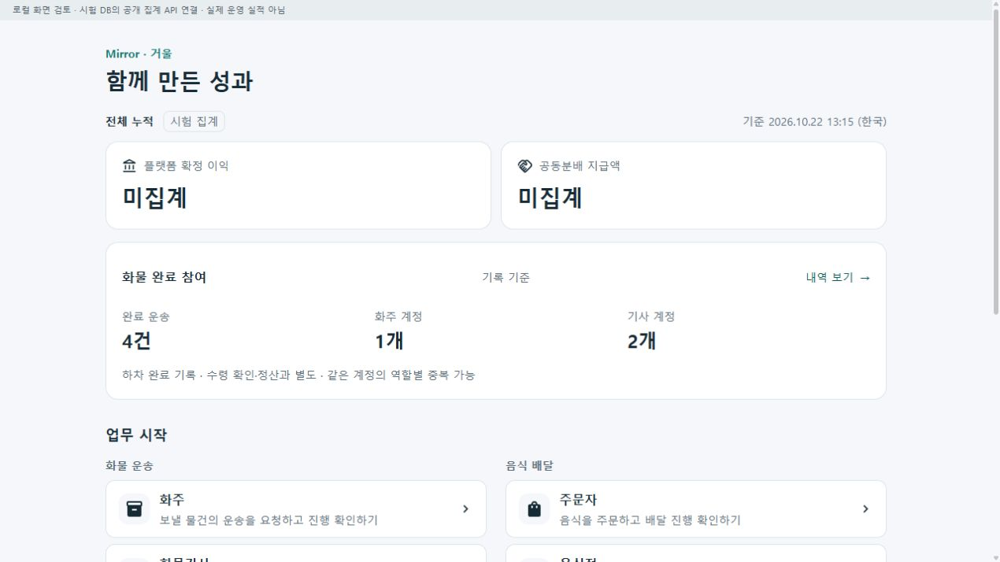
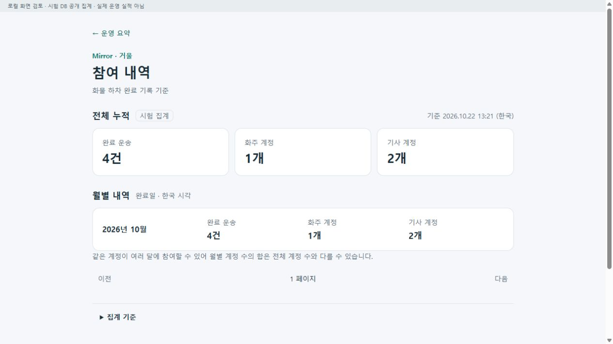
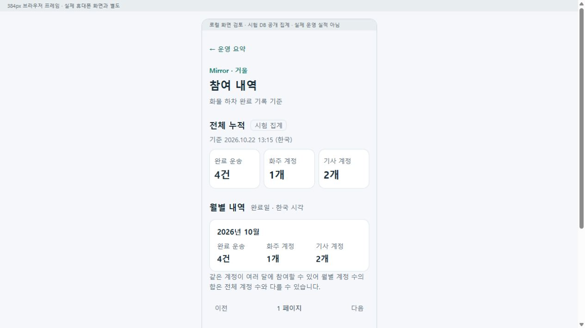
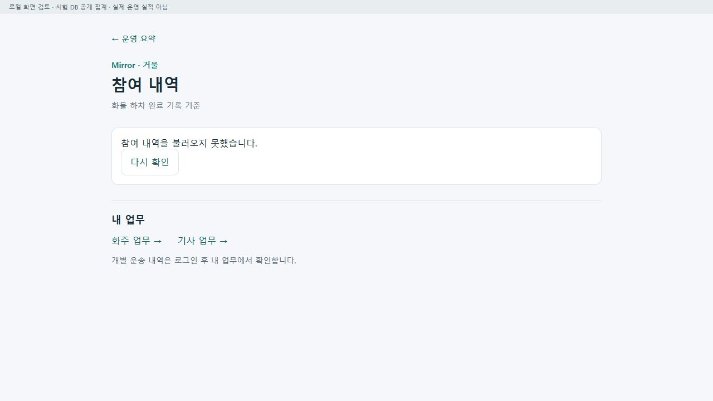

# 운영 요약에서 내역·업무로 이어지는 흐름 r12

기준: [승인 조정안](../AI/Planning/공통/PLAN-OPERATIONS-DISPATCH-CORE/platform-overview-drilldown.r12.md) · [첫 구현 명세](../AI/Planning/공통/PLAN-OPERATIONS-DISPATCH-CORE/platform-overview-drilldown.r12.work-order.json) · [페이지 책임](../ProjectOverview/page-docs/overview-drilldown-r12.md).

상태: CompletedWave1LocalValidation / RemainingR12WorkPending.

## 적용한 정보 흐름

```text
홈 · 운영 요약
├─ 화물 완료 참여 → 내역 보기
│  ├─ 전체 누적 · 기준 시각 · 시험 여부
│  ├─ 완료일 기준 월별 내역 · 이전/다음 페이지
│  ├─ 포함/제외 기준
│  └─ 내 업무 → 기존 로그인·역할별 업무
└─ 기존 역할 진입
   ├─ 관리자 운송 목록 · 업무/상태/이벤트/확인필요 조건
   │  └─ 한 건 상세 → 이벤트/증빙/정산 → 원래 목록 조건
   ├─ 관리자 지원 목록 · 종류/페이지
   │  └─ 사건 상세 → 원래 목록/상위 업무
   └─ 모바일 게시판 → 게시글 상세·내부 행동 → 원래 게시판
```

공개 내역은 개인 원장 목록이 아닌 비식별 집계다. 공개 API는 월·건수·계정 수·집계 기준과 시각만 반환하며 주소·연락처·운송/계정 식별자·증빙을 제공하지 않는다. 개인별 운송·지원 기록은 기존 인증과 권한을 거친다. 화면을 열기만 해서 승인·지급·사건 종결이나 증거 감사 조회가 실행되지 않는다.

## 수치·조회·복귀의 경계

누적과 월별은 기존 화물 하차 완료 선정 및 계정 결속 기준을 공유한다. 월은 실제 완료 UTC를 한국 시각으로 변환해 정하고, 기록이 있는 월만 최신순 12개씩 읽는다. 월별로 같은 계정이 반복되므로 계정 수를 더해 전체 인원으로 표시하지 않는다. 한 응답의 두 SQL 조회는 읽기 트랜잭션으로 묶지만, 다른 페이지까지 과거 시점을 고정하는 영속 스냅샷은 아니다.

잘못된 응답·통신 실패를 정상 0건으로 바꾸지 않는다. 화면 이탈·연속 조회의 취소와 늦은 응답을 구분한다. 목록 복귀는 기존 안전한 내부 경로 계약을 재사용하고 허용된 분야·조회 조건을 보존한다. 화물 관리 별칭에만 기존 서버 업무 필터를 전달하며, 주문·창고 경로만으로 운송 유형을 추정하지 않는다. 구판 서비스 시그니처는 유지하고 분류를 지원하지 않는 서비스는 업무 필터 요청을 거절한다.

## 검증

- 초기 Fast: 소비 솔루션 빌드와 집중145사례 통과. 첫 Task는14,803통과·실패1·환경16미실행이며, 새 Web 내역 route의 capability 등록 누락만 실패했다. Web·통합 MAUI의 기존 카탈로그에 이 주소만 익명 읽기 전용으로 등록하고3개 경계 시험을 보강했다. 최초 실패 로그를 보존하고 최종37소스를 재동결해 재시험했다.
- 실제 loopback HTTP와 기존 격리 MySQL: 공개 요약·상세·2페이지200, 잘못된 페이지0/10001/문자400, NoStore, POST405, 누적·월별 일치, 정확한 최소 응답, 업무11종의 조회 전후 해시 불변을 확인했다. 수치는 시험 DB의 완료4건·화주 계정1개·기사 계정2개이며 실제 운영 실적이 아니다. 새 DB 준비·스키마·seed는 실행하지 않았다. 독립 SQL 수치 재산출 및 대용량 성능 측정은 하지 않았다.
- 실제 공통 Razor+읽기 전용 API 브라우저에서 요약 링크·월별 내역·빈 후속 페이지의 누적 보존·이전/홈 복귀·기준 펼침을 확인했다. 384px iframe은 시각 검토이며 실제 휴대폰·iframe DOM 수치 계측과 별도다. 이번에 만든 API5367만 잠시 끊어 수치 비표시·업무/홈 링크 유지·오류 안내를 확인하고 같은 서버를 seed 없이 재시작해 실제 `다시 확인`으로 복구했다. 기존 서버5363~5366은 중단하지 않았다.
- 관리자 운송 왕복은 허용 경로·조건 helper와 실제 HTTP 소비 회귀로, 지원 화면은 실제 공통 Razor 렌더와 종류/페이지 이벤트 시험으로 확인한다. 실제 관리자 브라우저/휴대폰 전체 왕복 검증으로 합치지 않는다. 화면 준비용 호스트는 실제 공유 컴포넌트를 실행한 별도 로컬 preview이며, 통합 앱 셸 전체 실행과 구분한다.

- 최종 Task: **14,807통과 / 실패0 / 환경16미실행**. 신규 r12 회귀104사례가 모두 통과했다. 집계14·상세 client/VM/화면33·관리자 운송43·지원11·화면 분류3이다. `Ssalddel.v3.5.slnx`의 서버·웹·모바일/데스크톱 소비 빌드와 기존 음식기사 코드맵 검사를 통과했다. 기존 지도 키·Firebase 미구성 등의 빌드 경고를 실제 연결 완료로 해석하지 않는다.
- 최종 시험 후 제품·시험37개 해시가 그대로이며 HEAD와 staging도 동일하다. 실제 API/미리보기 의존 파일4개가 소비 빌드 산출물과 일치하고 최종 화면도 새로 캡처했다. APK 패키징·설치·기기·외부 운영·commit/push는 실행하지 않았다.

[최종 검증](../../artifacts/local/overview-drilldown/20261022-r1/verification.json) · [최종 Task 로그](../../artifacts/local/validation/20261022-131903/) · [첫 Task 실패 로그](../../artifacts/local/validation/20261022-131438/) · [실제 HTTP](../../artifacts/local/overview-drilldown/20261022-r1/server-readonly/http-details-verification.json) · [화면·해시7장](../../artifacts/local/overview-drilldown/20261022-r1/screenshots.json).

## 실제 화면 기록

기존 [누적 홈 r10 화면](../assets/changes/2026-10-22-home-participation-r10/01-home-desktop.png)은 보존했다. 아래 화면은 실제 공유 컴포넌트와 기존 격리 시험 DB를 연결한 로컬 브라우저이며, 물리 휴대폰 화면이 아니다. 화면의4/1/2는 시험 기록 집계다.









[첫 내역 화면](../assets/changes/2026-10-22-overview-drilldown-r12/02-participation-details.png) · [빈 후속 페이지의 누적 보존](../assets/changes/2026-10-22-overview-drilldown-r12/03-empty-page-keeps-total.png) · [실제 다시 확인 후 복구](../assets/changes/2026-10-22-overview-drilldown-r12/06-details-recovered.png).

## 후속

이번 적용은 r12 첫 범위다. 음식·창고 전체 내역 페이지, 본인 정산·관리 재무의 최소 목록 투영, 후원 입금/운영비 공개와 활동자·교육 연결은 기존 계획에 남긴다. 재무 금액 정본이 연결되기 전 홈 금액은 미집계를 유지한다. 순위식·후원 수납·새 관리자 권한을 임의로 활성화하지 않는다.

APK 패키징·설치, 물리 휴대폰 화면 확인, 외부 서버 배포·실운영, commit/push는 이번 범위에 포함하지 않는다.
