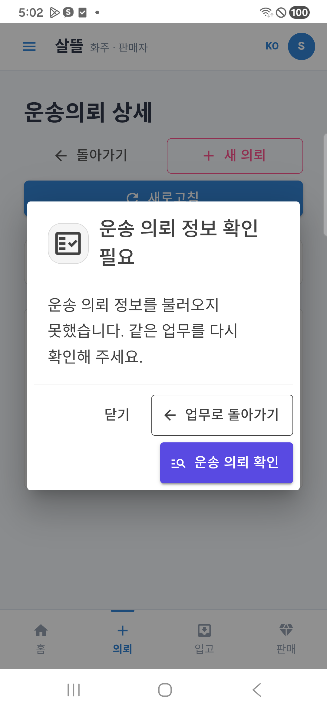
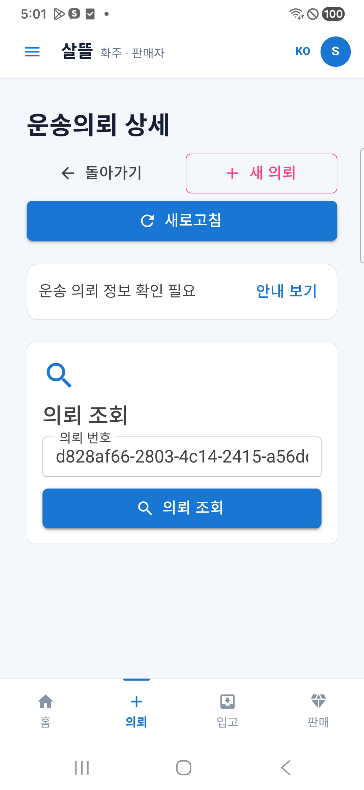

# 공통 오류 안내 창 실제 휴대폰 반영 r18

상태: `InstalledAndDeviceDialogVerified / ExistingServerReadFailuresRemain`. 사용자의 요청에 따라 [r17 시각 변경](2026-10-22-recovery-dialog-visual-r17.md)을 실제 연결 휴대폰에 반영하고 확인했다. 이번에는 제품 소스를 추가 수정하지 않았다.

## 설치

Galaxy A34(SM-A346N)의 통합앱 `com.companyname.ssalddelapp`을205에서 **0.1.206/code206**으로 갱신했다. 앱 삭제·데이터 초기화 없이 `install -r`가 성공했다. 설치된 base APK를 다시 가져온 SHA-256도 제작본과 일치했다.

- APK SHA-256: `d1bf93d9a24b07d17269a59b3813f2b60c829080758e883ec5b1d317ec70a09a`.
- 기존 외부 서명 키·Firebase/네이버 SDK 입력을 보존했다. 서명·정렬·단독 실행 assembly 검증을 통과했다.
- 제작 입력3,137개가 빌드 중 바뀌지 않았고 r17의 Razor/CSS 두 소스가 제작 입력과 현재 파일에 일치한다. 선택 제작은 통합앱 한 개이며 다른 전문 앱을 모두206으로 갱신한 것은 아니다.

## 실제 화면과 동작

기존 합성 화주 계정으로 본인용 상세 화면을 열었다. 현재 조회가 실패하는 상황에서 새 공통 안내 창을 확인했다. 다음 결과는 브라우저 시안이나 가상 API 렌더가 아닌 실제 APK·휴대폰 결과다.

| 확인 | 결과 |
| --- | --- |
| 단색 문서 아이콘·복귀/확인 버튼 아이콘 | 실제 표시3개 확인 |
| 제목·본문·구분선·버튼 | 전체 문구 표시, 좁은 화면에서는 버튼 두 줄 배치 |
| 가로 넘침 | CSS viewport384 / scrollWidth384, 다이얼로그 폭320 |
| 닫기 | 안내 창 제거, 같은 의뢰 화면·번호 유지 |
| 안내 보기 | 수동 재개방 확인 |
| 운송 의뢰 확인 | 명시적 재조회 뒤 실패 안내 유지. 성공으로 바꾸지 않음 |
| 업무로 돌아가기 | 기존 `/shipper`로 이동, 다이얼로그 제거 |

닫은 뒤에는 같은 화면에서 짧은 상태와 안내 다시 열기가 남는다.

## 통신 한계·종료 상태

기존 USB 연결 `휴대폰5363 → PC5365`와 서버 프로세스를 유지했다. 현재 PC5365의 공개 홈 요약 GET은404이며 기존 합성 의뢰 상세 조회도 휴대폰에서 실패했다. **새 UI의 설치·오류 안내/복귀는 확인했지만, 정상 상세 수신·접수/배차 완주·신규 선결제·정산/송금·지도 정상화까지 확인한 결과는 아니다.** 해당 서버의 호환성/조회 장애는 후속 점검으로 남긴다. 이번 검증을 위해 서버 설정·배차/지급·worker·업무 원장이나 실운송을 변경하지 않았다.

삼성 패스의 시험 계정 저장 제안은 취소했으며 관련 설정을 바꾸지 않았다. 합성 계정은 로그아웃하고 역할 선택 홈으로 복귀했다. 검증용 자체 WebView 연결만 제거했고 기존 USB 서버 연결은 유지했다. 커밋·푸시·외부 배포는 하지 않았다.

제작·설치·화면 해시와 제한은 `artifacts/local/recovery-dialog-device/20261022-r1/verification.json`, `installed-apk-check.json`, `apk/0.1.206-206/usb-test-manifest.json`, `screens/manifest.jsonl`에 보존한다. 암호·토큰·비공개 계정 자료는 문서에 기록하지 않는다.
