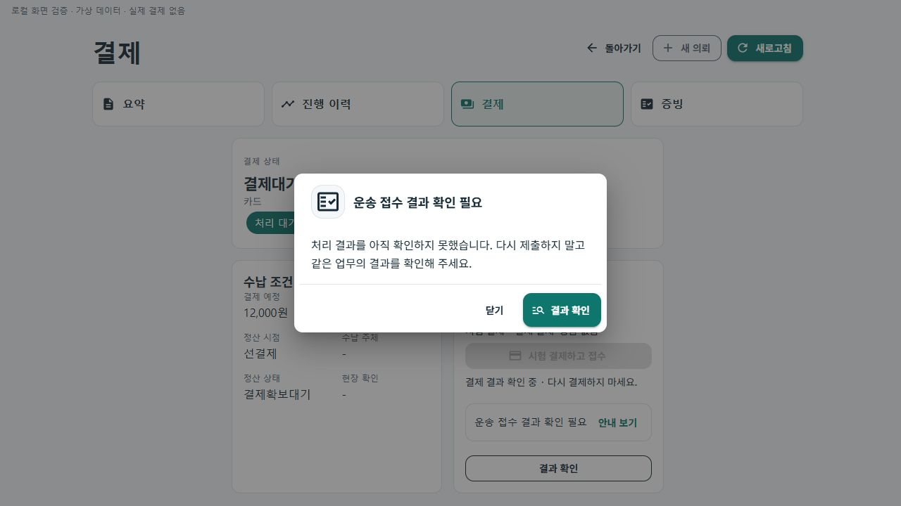
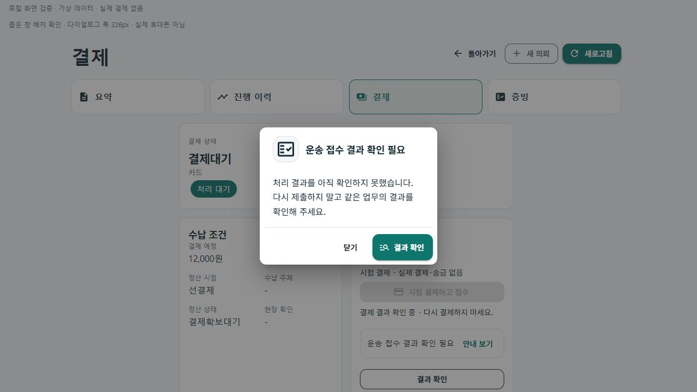

# 업무 오류 안내 다이얼로그 시각 보완 r17

상태: `CompletedLocalVisualValidation / DeviceUpdatedInR18`. 사용자의 2026-10-22 후속 요청에 따라 기존 공통 안내 창에 단색 아이콘과 읽는 순서를 보완한다. 이 기록의 초기 검증은 로컬이며, 이후 [r18 실제 휴대폰206 반영](2026-10-22-recovery-dialog-device-r18.md)에서 설치·표시·닫기/복귀를 별도로 확인했다.

## 화면 책임과 변경

현재 업무에서 문제가 생긴 사용자가 안내를 읽고 닫기·허용된 결과 확인·기존 업무 복귀를 선택하는 기존 책임을 유지한다. 새 페이지·상태·API·원장·복구 정책을 추가하지 않는다.

- 제목 옆에 기존 Material의 문서 확인 아이콘을 무채색 바탕으로 배치했다. 색이 많은 이모지·외부 이미지·애니메이션은 추가하지 않았다.
- 제목은 아이콘 옆에서 줄바꿈하고, 본문 줄 간격을 넓혔다. 긴 문구는 잘라내지 않는다.
- 본문과 버튼 영역을 얇은 경계로 나누고, 결과 확인·복귀 버튼에도 기존 아이콘을 붙였다. 조작 높이는 최소48 CSS px이며 버튼 줄바꿈을 유지한다.
- 제목·설명·버튼 문구, 조건부 표시·허용 여부·닫기·Escape·재조회 동작은 보존했다. 장식 아이콘은 `aria-hidden=true`로 중복 낭독을 피한다.

대상은 `Ssalddel.Ui.Common/Areas/App/Components/Recovery/업무오류복구Dialog.razor`와 같은 이름의 `.razor.css`다. 이 컴포넌트를 쓰는 화면에 적용되며, 별도 구현된 모든 앱의 모든 다이얼로그를 바꾼 것은 아니다.

## 검증

원시 결과·소스 판본·화면 해시는 `artifacts/local/recovery-dialog-visual/20261022-r1/verification.json`을 따른다.

- 최초 Fast: 기존 안내 수명 회귀8/8, Task: 소비 v3.5 솔루션 빌드와14,893통과/실패0/외부DB 환경16미실행. `artifacts/local/validation/20261022-155435/`, `20261022-155551/`.
- 그 뒤 좁은 창에서 한국어 단어가 갈라지는 현상을 보고 CSS 두 곳에 `word-break: keep-all`만 추가했다. 마지막 CSS는 공통 UI 재빌드·Fast8/8(`20261022-160057/`)·참조 프로젝트를 재빌드하지 않는 별도 소비 호스트 빌드와 실제 화면으로 검증했다. 전체 Task는 이 마지막 CSS 두 줄 전 판본의 결과이며 합산하거나 최종 CSS 전수시험으로 표시하지 않는다. Razor 동작 소스는 Task 이후 변경하지 않았다.
- 실제 공통 결제 화면의 시간초과 안내를 가상 API·휘발 저장소로 열어 기본 창과326px 창 폭에서 아이콘, 전체 문구, 줄바꿈·버튼·구분선을 확인했다. 326px은 검증 호스트에서 창 최대 폭만 제한한 것으로 실제 모바일 viewport/휴대폰 시험이 아니다.
- 버튼 닫기·Escape 후 창이 닫히고 같은 업무 화면·미확정 결제의 비활성 버튼이 남는 것을 확인했다. 기존 안내 수명 시험8개는 반복 개방 억제, 명시 재조회, 대상 변경/폐기, 복귀·재조회 권한을 검증한다. 새 기능이나 구현을 그대로 따라 하는 시각 시험은 추가하지 않았다.
- 장식 아이콘은 접근성 트리에 제목으로 중복 나타나지 않았고 버튼 이름은 그대로였다. 전체 스크린리더·접근성 인증은 수행하지 않았다. 실제 단말 업데이트·APK 설치·운영/결제·커밋·푸시는 하지 않았다.

## 변경 후

좁은 창에서의 전체 문구·줄바꿈 확인:

## 변경 전

같은 공통 화면의 앞선 검증본이다. [r16 기록](2026-10-22-cargo-prepayment-recovery-r16.md)의 입력·시험과 이번 변경의 실행 결과를 합산하지 않는다.

