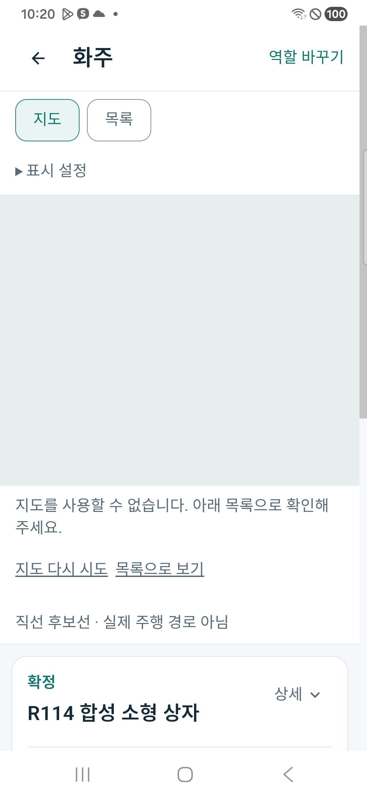
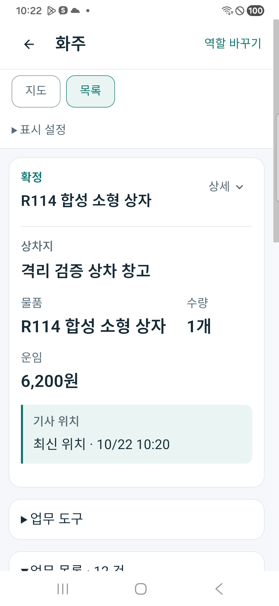

# 관계 기사 네이버 지도 연결과 위치 보호 r8

2026-10-22, 통합 Android앱의 기존 지도 표시 영역을 네이버 지도 SDK에 연결하고, **현재 주문에 배정된 기사의 유효한 최근 위치만 제공하도록** 음식 주문자·화주 조회를 보완했다. 통합앱 **0.1.204/204**를 실제 휴대폰에 갱신 설치하고 로컬 서버의 합성 운송으로 목록 전환·위치 시각 자동 갱신을 확인했다. SDK는 실제 기기에서 **인증 오류401**을 반환하여 지도 타일·핀·경로의 정상 표시는 아직 확인하지 못했다.

기준: [승인 기획](../AI/Planning/공통/PLAN-OPERATIONS-DISPATCH-CORE/related-driver-naver-map.r8.md) · [작업 명세](../AI/Planning/공통/PLAN-OPERATIONS-DISPATCH-CORE/related-driver-naver-map.r8.work-order.json) · [주문 전 탐색·활동 인정 설계](../AI/Planning/공통/PLAN-OPERATIONS-DISPATCH-CORE/preorder-discovery-recognition.r8.md).

## 이번에 구현한 것

| 책임 | 변경 내용 | 주요 소스 |
| --- | --- | --- |
| 통합앱 실제 지도 연결 | 기존 네이티브 지도 표시 영역·브리지에 네이버 SDK MapView를 연결. 타일 로드 성공과 인증 실패를 구분하고 화면 이탈 시 이벤트·마커·타이머를 정리 | [지도 Handler](../../SsalddelApp/Handlers/NeighborhoodNativeMapViewHandler.Android.cs), [렌더링](../../SsalddelApp/Handlers/NeighborhoodNativeMapViewHandler.Android.Rendering.cs), [페이지 배치](../../SsalddelApp/MainPage.xaml.cs) |
| 지도 표현 | 기존 상태의 픽업 주황·전달 파랑·기사 보라·비활성 회색, 선택·지도 이동 문맥을 재사용. 교통/대중교통 레이어 OFF, SDK 로고·출처 유지. 화물 직선 후보는 점선으로 구분 | 같은 Handler·렌더링 소스. 구현·빌드 확인이며 실제 지도 표시 성공 증거는 아님 |
| SDK 설정 전달 | 기존 SDK 바인딩을 통합앱에 참조하고 외부 설정 파일/환경의 ID를 빌드 중 리소스에 전달. 값은 추적 소스·문서에 기록하지 않음 | [프로젝트](../../SsalddelApp/SsalddelApp.csproj), [Android 설정](../../SsalddelApp/Platforms/Android/AndroidManifest.xml), [기존 APK 제작 도구](../../eng/MobileWorkflowR108/build-local-apk.ps1) |
| 음식 주문자 위치 | 현재 수락 시도·확정 기사·진행 상태를 확인한 뒤 수락 이후의 최근30초 기록·수신 위치만 제공. 종료·재배정·다른 주문자·시각/좌표 오류는 위치를 내보내지 않음 | [음식 주문 조회](../../Ssalddel/Application/Food/주문자음식주문조회UseCase.cs) |
| 화주 위치 | 현재 운송·기사·추천 차수와 수락 복구 사건 근거를 대조한 뒤 수락 이후의 최근10분 기록·수신 위치만 제공. 조회 중 정본 변경도 재확인 | [화주 운송 조회](../../Ssalddel/Application/Shipper/Request/화주운송실행정보조회.cs) |
| 카드·마커의 정보 수명 | UTC를 일관되게 해석해 위치 확인 시각을 표시. 완료·취소·미확정·만료·미래 시각의 위치 표시를 막고 좌표와 선의 만료 시각을 지도에 전달 | [화주 표시](../../Ssalddel.Ui.Common/Areas/App/ViewModels/ShipperRequestDetailPresentation.cs), [화물 역할 Adapter](../../Ssalddel.Ui.Common/Areas/App/RoleWorkspace/Cargo/CargoWorkspaceAdapters.cs) |

새 주문·배차·정산 엔진을 만든 변경이 아니다. 기존 전문 원장·수락 API·권한·상태 전이와 목록 대안을 재사용한다. 위치가 없거나 오래됐더라도 원래 업무 카드와 정상적인 업무 진행은 유지한다. 지도에 그릴 점·선을 준비한 것과 실제 SDK가 인증되어 그 점·선을 표시한 결과는 구분한다.

## 업무와 검증 흐름

```text
기존 합성 화물 접수
├─ 화주 정상 접수 → 별도정산 후불 승인
├─ 제품 추천 정책 → 모델 통신 실패 → 현재 규칙으로 추천
├─ 기사 본인의 정상 수락 API → 현재 배정·수락 사건 근거 저장
└─ 수락 후 합성 위치 API 입력
   ├─ 서버: 본인 주문·현재 배정·최근 시각 검사 → 허용 좌표만 반환
   ├─ 앱: 기존 화주 카드 조회 → 위치 확인 시각 표시
   │  └─ 두 번째 합성 위치 입력 → 화면 시각10:15→10:20 자동 갱신 확인
   └─ 네이버 지도
      ├─ SDK 연결·실제 인증 요청 → AuthFailed401 확인
      ├─ 지도 타일·핀·경로 검증 → 보류
      └─ 기존 ‘목록으로 보기’ → 카드가 상단에 표시됨
```

이 흐름은 가상 의뢰·가상 기사·합성 좌표의 로컬 시험이다. 실제 사람의 이동·실물 운송·GPS 정확도·주행 경로·최적 배차·운영 요금·학습 완료를 검증한 것은 아니다. 사진 촬영·픽업 완료·전달 완료·FCM 발송·실제 수금/지급은 이번 시험에서 실행하지 않았다.

## 실제 휴대폰 화면



SDK 인증 실패 뒤 기존 목록 대안으로 이동할 수 있었다. 첫 화면에 큰 빈 지도 영역이 남는 기존 배치는 그대로여서, 이 화면의 가독성까지 완성됐다고 판단하지 않는다. 지도 불가 시 사용할 대안이 동작한다는 범위의 확인이다.



정상 수락된 합성 의뢰의 운임6,200원과 상차지·물품·기사 위치 확인 시각을 표시했다. API의 합성 위치를 한 번 갱신한 뒤 같은 휴대폰 카드에서 확인 시각이 자동으로 갱신됐다. 이는 서버→앱 조회 갱신의 증거이며 지도 마커가 실제로 이동했다는 증거는 아니다. 두 PNG는 실제 기기 캡처이며 원본과 문서 자산 사본의 해시를 대조했고 합성 본문·개인정보 미포함 여부를 확인했다.

## 제작·로컬 검증 결과

| 항목 | 결과·근거 |
| --- | --- |
| APK 제작·설치 | 0.1.204/204 제작·갱신 설치, 설치본 SHA-256 일치. `df1ee47d82702614594e1b8ef898d1c3af0d9211f475604d2fff3df32c07faf8` |
| 제작 입력 고정 | 입력3,118개, 제작 중 변경0개. [APK manifest](../../artifacts/local/related-driver-naver-map/20261022-r1/apk/0.1.204-204/usb-test-manifest.json) |
| 집중 시험 | **90개 통과·실패0개**. `artifacts/local/validation/20261022-101701/` |
| 일반 화물 호환 재시험 | 위치 보호·생활 배송 경계 **81개 통과·실패0개**. `artifacts/local/validation/20261022-102643/` |
| 전체 소비 빌드·Task | v3.5 소비 빌드·전체 **14,631개 통과·실패0개·환경 의존16개 미실행**. `artifacts/local/validation/20261022-102758/` |
| 현재 서버 API | 현재 소스의 별도 출력 빌드·5364 수동 호스트에서 정상 접수·추천·수락·수락 후 합성 위치·화주 조회 확인 |
| 화면 대안·갱신 | 지도 인증 실패 표시, 목록 전환, 합성 위치 확인 시각의 자동 갱신 확인 |
| 자연 경과 후 서버 만료 | 마지막 합성 GPS 뒤 실제610.852초 경과 후 읽기 전용 HTTP200. 현재 기사 배정·운송 상태는 유지하고 위치3필드는 모두null. 시계·DB 시각 조작 없음. `natural-expiry.json` |
| 실제 지도 | SDK 인증401 확인. 타일·핀·색·선·마커 선택·지도 이동·만료 제거의 실제 기기 검증은 보류 |

초기 두 번의 집중 시험은 새 EF 메모리 시험 구성의 서비스 제공자/DB root 문제로 실패했다. 첫 실패 로그와 수정 뒤 로그를 각각 `20261022-100943/`, `20261022-101502/`에 보존한 뒤 시험의 공유 DB root·Interceptor 구성을 보완했고 최종90개가 통과했다. 해당 수정은 시험 구성에 한정하며 이를 제품 로직의 추가 변경으로 합치지 않는다.

첫 전체 시험은 14,629개 통과·1개 실패·환경 의존16개 미실행이었다. 기존 일반 화물 시험이 1시간 전 GPS도 반환하도록 기대하여 새10분 보호 기준과 충돌했다. 시험을 현재 수락 근거가 있는 **2분 전 위치는 제공 / 1시간 전 위치는 차단**하는 두 사례로 고쳤고, 일반 화물을 생활 배송 전용 지도에 노출하지 않는 경계도 유지했다. 제품 보호 조건을 완화하지 않았으며 해당 원본·실패 로그는 `20261022-101815/`와 별도 baseline에 보존했다.

현재 소스의 위치 보호 시험은 다른 주문자 조회, 현재 배정과 차수 불일치, 수락 이전 위치, 오래된/미래 기록, 잘못된 좌표·정확도, 완료·취소, 조회 중 배정/상태 변경을 다룬다. 시험과 빌드는 실제 네이버 타일·핀을 눈으로 확인한 증거를 대신하지 않는다.

## 재현 절차와 자료 보존

1. 기존 비공개 설정을 읽어 만든 현재 소스 APK204를 같은 서명으로 설치한다. 키·계정·토큰을 소스·공개 기록에 넣지 않는다.
2. 기존5363 r106 서버를 보존하고, 별도5364 현재 소스 수동 호스트를 사용한다. 전용 Simulation DB `mirror_ai_device_r114_20261019`와 기존5개 합성 계정·이력·스키마를 유지한다. 이번 호스트 시작에서 새 nullable 열 추가0개, 자동 worker·외부 FCM·지급 비활성이다. 기존 migration health 경고는 그대로이며 운영 준비 완료로 판단하지 않는다.
3. 새 [fixture 도구](../../artifacts/local/related-driver-naver-map/20261022-r1/fixture/fixture.py)의 `prepare`는 기존 제품 API를 통해 접수·추천·수락까지만 수행하고, 수락 후 합성 위치A를 입력한다. 기존 helper와 이전 API state·token cache·HTTP journal을 덮지 않으며 새 상태와 인증 자료는 해당 fixture의 `.private/`에만 보관한다.
4. 휴대폰 USB 시험 연결로 해당 API를 조회하고 기존 화주 업무 화면에서 수락된 합성 의뢰를 선택한다. 키가 들어 있는 SDK를 실제 기기에서 연결해 인증 결과를 관찰한다. 이번에는401이었고 네이버 클라우드 콘솔 로그인까지 진행할 수 없어 패키지 인가·선택 API·계정 설정의 원인 확인은 보류했다.
5. `fixture.py locate --position b`를 한 번 실행하면 새 시각의 합성 위치B를 기존 위치 API에 보낸다.10분이 지나면 기존 위치가 만료되므로 필요 시 캡처 직전에 명시적으로 한 번 갱신한다. 연속 위치 생성·무인 감시·배차 작업은 등록하지 않았다. 실행 경로·명령과 원장 ID·계정 참조는 비공개 인계에 있다.
6. 실제 화면은 기존 링크·버튼으로 확인한다.401 상태에서는 기존 목록 전환·업무 카드와 위치 시각 갱신을 검증하며, 지도 정상 표시로 기록하지 않는다.

처음 만든 fixture는 기존 합성 주소 어댑터의 허용 이름 밖이어서 좌표가 미확보된 채 추천이 거절됐다. 다음 fixture는 구형 API 도구에 팔레트 개수 입력이 없어 현재 구간 적재 검사에서 수락이 거절됐다. 두 주문·실패 응답·시도 기록을 그대로 보존하고, **기존 허용 합성 주소와 팔레트0·회전/적층 가능 여부를 명시한 새 요청**으로 세 번째 사례를 통과했다. 기존 원장을 직접 고치거나 적재·수락 검사를 우회하지 않았다.

주요 비공개 근거는 `artifacts/local/related-driver-naver-map/20261022-r1/`의 `native-handoff-r8.json`, `server-location-handoff*.json`, `fixture/fixture-status.json`, `fixture/host-build.log`, `screens/manifest.jsonl`, `device-list-readback.json`, `device-logout-readback.json`, `package-check.json`, `natural-expiry.json`이다. 키·원문 토큰·계정 암호를 포함한 `.private/`는 문서에 복제하지 않는다. 원래 화면·실패 기록·기존 완료 주문·5363 프로세스는 유지했다. 휴대폰의 시험 계정은 로그아웃했고 이후 업무 정보가 남지 않은 것을 확인했다.5364 현재 시험 서버와 마지막 수락된 합성 의뢰는 다음 지도 인증 검증을 위해 유지했다.

## 설계만 정리한 후속과 남은 확인

**주문 전 기사 탐색·활동 인정·칭호는 이번 제품 구현이 아니다.** [별도 설계](../AI/Planning/공통/PLAN-OPERATIONS-DISPATCH-CORE/preorder-discovery-recognition.r8.md)에 다음 경계를 정리했다.

- 주문 전 공개 참여는 배차 제안 수신·현재 배정 위치 제공과 다른 동의다. 동의한 넓은 법정동/설정 격자와 업무 가능 여부를 표시하고 실제 GPS를 공개하지 않는다.
- 직접 선택은 요청이며 기사 수락·차량·시간·업무·자격 검사를 생략하지 않는다. 공개 참여 입력·원천·권한·철회·신선도 검증은 아직 구현 전이다.
- 기존 양측 완료·유상 거래 수령 확인을 재사용하고, 같은 두 사람의 주간 총3회 인정 방향을 유지한다. 주간 경계와 칭호별 명칭·필요 건수·유효 기간은 미정이다.
- 표시용 칭호는 돈·포인트나 실제 관리자 권한이 아니다. 기존 `집하 조정자` Role을 재사용하지 않으며 자동 칭호 발급·배차 우선권을 추가하지 않았다.

다음 실제 검증은 네이버 콘솔 인증/패키지 인가 확인 뒤 같은 APK·합성 원장으로 타일·픽업/전달/기사 핀·선·선택·지도 이동·만료 제거를 확인하는 것이다. 음식 주문자의 실제 기기 위치 흐름, 로그아웃·재배정·완료/취소 중 지도 정리도 별도 단말 확인으로 남는다. 외부 서버 배포·실제 운행·실거래·FCM·금융·모델 가중치 학습·새 권한 부여·commit/push는 실행하지 않았다.

SDK 구성 참고: [네이버 Android 시작 안내](https://navermaps.github.io/android-map-sdk/guide-en/1-1.html), [지도 레이어 안내](https://navermaps.github.io/android-map-sdk/guide-ko/2-3.html). 실제 인증 결과와 화면 검증은 위 로컬·단말 증거를 따른다.
